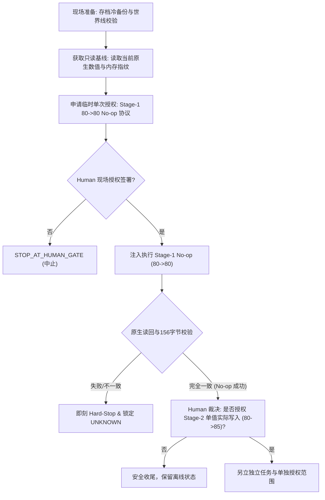

# NBA2K22 REA · 批量执行器实机准入授权接口规范与安全门设计

**文档 ID：** `NBA2K22-REA-LIVE-AUTHORIZATION-GATE-DESIGN-20261101`  
**任务 ID：** `NBA2K22-REA-BULK-SAFETY-ADMISSION-20261101-001`  
**OS 岗位：** `execution`（模型登记：`Gemini 2.5 Pro (execution)`）  
**当前状态：** `OFFLINE_SAFETY_ADMISSION_CANDIDATE`（严禁在未经 Human 独立签署前激活）  
**发布基线：** `04c378151c576140b5e347c94a1b0952b15903cd`  

---

## 1. 目标与绝对权限边界

本设计文档旨在为未来可能进行的 NBA2K22 REA 原生实机执行建立严密的独立授权接口规范与两阶段准入安全门。

### 1.1 绝对边界声明
1. **当前阶段严格离线**：本任务仅实现离线安全状态机、严格回执协议、故障注入测试及授权接口模型。本地环境严格禁止连接 `NBA2K22.exe` 真实进程、调用原生 Setter、修改真实存档或触发 WorldData 采集。
2. **硬拒绝（Hard-Denial）不变式**：`ReaChunkTransportAdapter` 在非 Mock/Fake 环境下无条件抛出 `PermissionError("LIVE_MUTATION_NOT_AUTHORIZED: LIVE_AUTHORIZATION_VERIFIER_NOT_AVAILABLE")`。
3. **禁止 CLI 文本绕过**：任何命令行参数（如 `--authorized`）、自填的字符串 `authorization_ref`、PID 注入或伪造的 JSON 令牌均**不构成**有效授权，系统在代码层面对此类绕过保持 Fail-Closed。

---

## 2. 授权接口协议与密码学绑定设计

未来实机授权验证器（`LiveAuthorizationVerifier`）必须遵循双人交互（Two-Man Rule）与密码学强绑定的原则。单次授权令牌（Authorization Grant Token）必须对以下全要素进行不可变哈希绑定：

```
AuthorizationGrantDigest = SHA256(
    plan_digest ||
    chunk_digests ||
    target_save_instance_id ||
    target_game_build_sha256 ||
    process_start_epoch ||
    process_pid ||
    target_menu_state_context ||
    ordered_intent_targets_and_values ||
    budget_limits_limits_digest ||
    grant_nonce ||
    grant_expiration_timestamp
)
```

### 2.1 强制绑定的要素明细
1. **精确计划与分块摘要（`plan_digest` & `chunk_digests`）**：
   - 授权仅对经过严格校验（无依赖环、无冲突目标、规范化动作切块）的批次计划有效。
   - 运行时过滤 completed/locked intent 时，必须重新计算 `sub_chunk_digest`；若实际执行摘要与授权摘要不符，立即终止。
2. **目标存档与实例标识（`target_save_instance_id`）**：
   - 授权严格锁定具体存档实例（例如 `save_mycareer_20261101_lillard`）。跨存档重放相同 `intent_id` 直接被拦截（`INTENT_ID_REUSED_WITH_DIFFERENT_PAYLOAD`）。
3. **可执行文件哈希（`target_game_build_sha256`）**：
   - 严格绑定固定构建 `1727ad72085fba39e789ee574fc15aab623ad1651cf6879e95e8cd53b6ffbbf5`。游戏补丁或内存布局变化立即导致授权失效。
4. **进程生命周期纪元（`process_start_epoch` & `process_pid`）**：
   - 记录 `NBA2K22.exe` 启动时间戳与操作系统 PID。游戏进程重启后，旧授权令牌自动作废，防止悬挂指针与重放攻击。
5. **UI/对象上下文状态（`target_menu_state_context`）**：
   - 原生 Setter/Getter 依赖游戏主线程 PeekMessageA 消息循环与编辑界面上下文。必须校验对象指针位于安全读写周期内（非赛季模拟中、非比赛运行中）。
6. **资源与数值明细（`ordered_intent_targets_and_values`）**：
   - 精确列举每一个被授权修改的实体（`team_id`、`player_id`、`field_id`）、预期原值（`expected_before`）及目标值（`value`）。未列出的字段或字节严禁触碰。
7. **调用预算与时限（`budget_limits` & `grant_expiration_timestamp`）**：
   - 每次授权设定硬时限（如 180 秒）与最大原生调用次数（如 `max_game_calls = 300`）。超时或超限即刻触发看门狗中止。
8. **单次使用约束（Single-Event Limited Scope）**：
   - 每个授权令牌具备单次使用 Nonce，且仅在当前独立执行会话中有效。执行完成或异常中止后立即注销。

---

## 3. 真实游戏 Stage-1 单字段准入验证方案（待 Human 审批）

在任何大规模或批量原生修改被允许之前，必须完成 Stage-1 最小受控验证。此方案仅供未来 Human 独立决策，本任务不激活。



### 3.1 Stage-1 验证协议步骤
1. **步骤 0：现场存档冷备份与世界线锁定**
   - 现场核验 Steam 存档物理路径，创建只读冷备份哈希镜像。
   - 记录 WorldData 当前最新快照与日历时间，确认游戏处于暂停/主菜单状态。
2. **步骤 1：只读 Native Getter 基线复核**
   - 通过只读 Native Action（`PLAYER_GET_STAT_UI`）读取目标球员当前字段值（例如 Damian Lillard `SHOT_TENDENCY`）。
   - 校验 156 字节属性/倾向区指纹及缓存标志位。
3. **步骤 2：Stage-1 80→80 No-op 协议执行**
   - **严格约定**：优先执行目标值等于当前值的 No-op 意图（`expected_before == current == requested`）。
   - 校验执行器能够准确识别 No-op，不调用原生 Setter，生成 `UNCHANGED_ALREADY_TARGET` 回执。
4. **步骤 3：单字段微量写入验证（须二次 Human 明确裁决）**
   - 若 Human 批准进入单字段写入，仅允许修改 1 个已认证倾向字段（如 80→82）。
   - 严格执行 CAS 预检（`getter_before == expected_before`）。
   - 严格执行未请求字段 156 字节不变式检查（`unaltered_fields_check == True`）。
   - 严格执行写入后原生读回（`getter_after == requested`）。
   - 若出现任何不符合预期的字节变动，立即触发 Hard-Stop，生成 `UNKNOWN_EXECUTION_OUTCOME`，永久锁定该资源，严禁重试。

---

## 4. 故障阻断与回滚回执（Rollback Receipts）机制

### 4.1 异常阻断不变式
- **任一失败即刻全批停止**：分块执行中若有任何一个 intent 返回非成功状态（如 `CAS_EXPECTED_BEFORE_MISMATCH` 或 `UNKNOWN_EXECUTION_OUTCOME`），后续所有未执行分块均标为 `NOT_EXECUTED`，终止执行。
- **守恒律强校验**：`planned == success + noop + reused + blocked + unknown + not_executed`。任何一笔不平账均触发系统性 Panic。

### 4.2 UNKNOWN 锁定与对账（Reconciliation）要求
- 任何处于 `UNKNOWN_EXECUTION_OUTCOME` 的资源，其写入锁永久保留。
- 严禁通过 `applied: true` 简单布尔值解锁。
- 解锁必须提交完整的独立只读回读证据（包含 `readback_getter_value`、`target_value`、`observation_timestamp`、`independent_source` 及 `unaltered_fields_verified == True`），经由外部审计角色核对后方可释放。

---

## 5. 准入结论与交接建议

1. **当前系统已具备完整的离线安全边界、At-Most-Once 状态机与协议校验**。
2. **未经两阶段授权接口验证与 Human 现场签字，系统处于绝对只读/模拟隔离状态**。
3. **本设计已作为候选准入标准归档，待总架构与 Human 进一步审核**。
