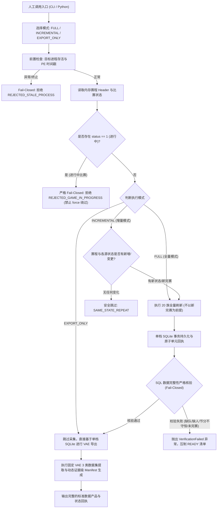

# Calendar Sim 一键全量采集编排器与固定提取设计文档 (One-Click Auto Capture & VAE Dataset Pipeline)

## 一、设计目标与定位

根据 Human 最新裁决（`worlddata_architecture_one_click_addendum.md`），针对 VAE 第一阶段（Calendar Sim）数据闭环的 **G1 就绪门**，本编排器提供：
1. **纯非驻留设计（Nonresident）**：零系统服务、零常驻轮询后台守护进程、零未授权线程，完全遵循 Human 裁决与安全纪律。
2. **人工一次显式触发、程序完全自动化（One-Shot Automated）**：由 Human 主动触发一次本地命令，自动识别当前游戏进程与既定存档，完成全部已注册 20 族 Reader 的采集与入库，无需每次采集调用 Gemini 或消耗模型额度。
3. **精准状态甄别**：区分“新完赛比赛（NEW_FINAL_GAME_DETECTED）”、“同一状态重复调用（SAME_STATE_REPEAT）”、“仅日期推移未完赛（DATE_ADVANCED_NO_NEW_GAME）”与“模拟进行中（INCOMPLETE_GAME_IN_PROGRESS）”。
4. **确定性熔断安全（Fail-Closed）**：若检测到比赛未打完、进程异常退出/重启、PID 复用或校验和不匹配，坚决拒绝发起写入事务。
5. **SQL 完整性闭环核验**：完成采集后，自动在同一事务上下文中对新入库比赛执行比分守恒、节得分与球员 Box 完整性核对，返回原子事实回执。
6. **固定 VAE 标准化数据包提取层**：在单存档 SQLite 主账本基础上，通过固定版本化 SQL 提取三个规范化 VAE 数据集及清单文件，使后续模型直接读取结构化产物，不再重复开发统计提取代码。

---

## 二、架构与状态机流水线 (Modes: FULL / INCREMENTAL / EXPORT_ONLY)



---

## 三、固定 VAE 标准数据集规范

编排器在每次采集入库后，或通过专用命令直接生成如下三个规范数据集与 Manifest：

| 数据集文件名 | 包含内容与数据结构 | 规范依据 | 状态要求 |
| :--- | :--- | :--- | :--- |
| **`calendar_sim_completed_game_player_team_metrics.json`** | 逐场已完赛（`status == 2` 且 `was_simulated == 1`）比赛观察、主客队单场 Box、球员单场 Box（含 PTS, FGA, FGM, MIN, ORtg, DRtg, GameScore 等）。 | Stage02 M3 38 项 Canonical 指标；严格排除 3D 比赛混淆。 | `READY` (已通过 SQL 入库回读) |
| **`vae_setting_context_snapshot.json`** | 当前倾向快照、球员属性快照、教练偏好（Coach Preferences）、球队战术设置（Team Tactics: POE, Run Plays, Help Defense, Tempo 等）。 | 只读捕获观察；尚未可采的项显式保留为 UNKNOWN，严禁伪造补零。 | `READY` (只读观测就绪) |
| **`vae_experiment_evidence_input.json`** | Pilot 1 (出手/触球)、Pilot 2 (节奏/快攻)、Pilot 3 (协防/防守评级) 的 S0 基线块 vs S1 干预候选对照合同、同种子对照组规则与可证伪准则。 | 只读实验合同；参数修改状态明确为 `NOT_AUTHORIZED; READ_ONLY`。 | `READY` (实验协议就绪) |
| **`manifest.json`** | 数据集 SHA256、行数/字节数、时间戳区间、数据库 Schema 版本、指标字典版本与 6 维就绪门评级状态。 | 包含完整的溯源哈希与状态等级。 | `PUBLISHED` |

---

## 四、接口规范与 CLI 调用

### 1. Python 编程入口
位于 `08_Domain_Applications/Antigravity_GM_Engine/world_data_prototype/calendar_sim_orchestrator.py`：

```python
from calendar_sim_orchestrator import CalendarSimOrchestrator, trigger_world_capture, trigger_calendar_sim_capture, export_vae_datasets

# 实例化编排器
orchestrator = CalendarSimOrchestrator(save_directory, loaded_filename)

# 1. 状态侦测（只读检查进程与内存赛程）
inspection = orchestrator.inspect_calendar_progress(reader_or_pid='auto')

# 2. 一键采集（支持 FULL / INCREMENTAL / EXPORT_ONLY）
# FULL: 执行 20 族全量刷新，不受无新比赛限制，完整更新名单、战术、倾向、伤病等
# INCREMENTAL: 增量刷新，若同一状态无变化则跳过；有新完赛则执行完整核验
receipt = orchestrator.trigger_world_capture(
    mode='FULL',            # 'FULL' | 'INCREMENTAL' | 'EXPORT_ONLY'
    reader_or_pid='auto',
    output_directory=None,  # 自动生成临时输出目录
    families=None,          # 默认为 None，按 20 族注册顺序执行
    resume_report=None      # 断点恢复报告
)

# 3. 独立执行 VAE 数据集提取（从现有单档 SQLite 导出）
export_summary = orchestrator.export_vae_standard_datasets(output_directory)
```

### 2. CLI 命令行入口
位于 `cli.py`：

```bash
# 1. 一键全量采集（FULL 模式，不依赖新完赛比赛即可刷新全族数据）
python cli.py calendar-sim-trigger <save_directory> <loaded_filename> --mode FULL [--pid auto] [--output-directory DIR]

# 2. 一键增量采集（INCREMENTAL 模式，遇相同状态跳过，有新赛果则入库并核验）
python cli.py calendar-sim-trigger <save_directory> <loaded_filename> --mode INCREMENTAL [--pid auto] [--output-directory DIR]

# 3. 从已有数据库独立导出三类 VAE 标准化数据集与 Manifest
python cli.py vae-export-datasets <save_directory> <loaded_filename> <output_directory>

# 4. 快速核验内存比赛与 DB 同步状态（只读检查，不写库）
python cli.py calendar-sim-inspect <save_directory> <loaded_filename> [--pid auto]
```

---

## 五、安全与非驻留纪律

1. **零常驻**：绝不在系统内启动后台轮询进程或注册守护服务；
2. **零模型开销**：采集与提取完全由本地确定性代码和 SQL 执行，无需消耗 LLM Token；
3. **零未授权修改**：不调用 REA Setter，不修改游戏内存或 Save 文件，不自动推进日历；
4. **单档隔离**：所有事实持久化严格绑定到目标存档专属的 SQLite 数据库，严禁多存档混淆。
