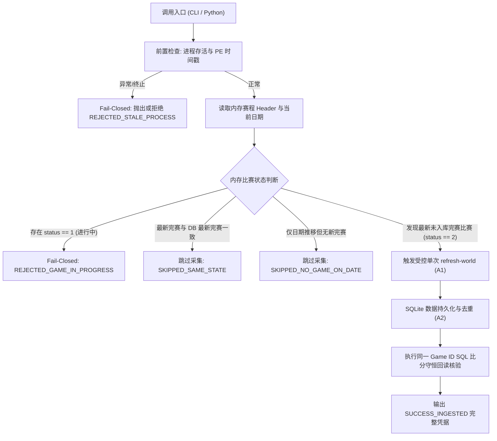

# Calendar Sim 自动采集编排器设计与入口文档 (Auto Capture Orchestrator Design & Entrypoint)

## 一、设计目标与定位

针对 VAE 第一阶段（Calendar Sim）自动化数据闭环的 **G1 就绪门**，本编排器提供：
1. **纯非驻留设计（Nonresident）**：零系统服务、零常驻轮询后台守护进程、零未授权线程，完全遵循 Human 裁决与安全纪律。
2. **明确选择机制（Explicit Opt-in）**：必须由 Human 或自动化执行流主动发起调用（`calendar-sim-trigger` 或 Python 函数）。
3. **精准状态甄别**：区分“新完赛比赛（NEW_FINAL_GAME_DETECTED）”、“同一状态重复调用（SAME_STATE_REPEAT）”、“仅日期推移未完赛（DATE_ADVANCED_NO_NEW_GAME）”与“模拟进行中（INCOMPLETE_GAME_IN_PROGRESS）”。
4. **确定性熔断安全（Fail-Closed）**：若检测到比赛未打完、进程异常退出/重启、PID 复用或校验和不匹配，坚决拒绝发起写入事务。
5. **SQL 完整性闭环核验**：完成采集后，自动在同一事务上下文中对新入库比赛执行比分守恒、节得分与球员 Box 完整性核对，返回原子事实回执。

---

## 二、架构与状态机



---

## 三、接口规范与 CLI 调用

### 1. Python 编程入口
位于 `08_Domain_Applications/Antigravity_GM_Engine/world_data_prototype/calendar_sim_orchestrator.py`：

```python
from calendar_sim_orchestrator import CalendarSimOrchestrator, trigger_calendar_sim_capture

# 实例化编排器
orchestrator = CalendarSimOrchestrator(save_directory, loaded_filename)

# 1. 状态侦测（不触发采集写入）
inspection = orchestrator.inspect_calendar_progress(reader_or_pid='auto')

# 2. 受控条件触发（仅在有新完赛比赛时触发）
receipt = orchestrator.trigger_capture_if_new_game(
    reader_or_pid='auto',
    output_directory=None,  # 自动生成临时输出目录
    families=['schedule', 'game-mode', 'period-stats', 'coach-stats'],
    force=False  # 若 True 则强制重刷
)
```

### 2. CLI 命令行入口
位于 `cli.py`：

```bash
# 1. 侦测当前状态
python cli.py calendar-sim-inspect SAVE_DIRECTORY LOADED_FILENAME [--pid PID]

# 2. 触发条件采集与 SQL 验证
python cli.py calendar-sim-trigger SAVE_DIRECTORY LOADED_FILENAME [--pid PID] [--output-directory DIR] [--force]
```

---

## 四、返回凭据结构示例 (SUCCESS_INGESTED)

```json
{
  "status": "SUCCESS_INGESTED",
  "triggered": true,
  "game_id": "game:native:1240",
  "native_game_id": 1240,
  "was_simulated": true,
  "simulation_mode": "CALENDAR_SIM",
  "refresh_batch_id": "a1b2c3d4e5f6",
  "sql_verification": {
    "verified_in_db": true,
    "score_conservation": true,
    "home_points": 108,
    "away_points": 102,
    "team_boxes_count": 2,
    "player_boxes_count": 26
  }
}
```

---

## 五、安全与纪律约束

1. **绝对只读游戏内存**：本编排器仅使用 `ReadOnlyGameProcess` (VM_READ | QUERY_LIMITED_INFORMATION) 读取公开赛程头部与进度，零内存注入、零按键模拟。
2. **绝不私自推进日历**：日历推进必须由 Human 明确在游戏内完成；本编排器仅负责被动检测日历推进后的赛后状态。
3. **绝不常驻**：执行完成后主进程立即退出，操作系统不残留任何后台监听。
