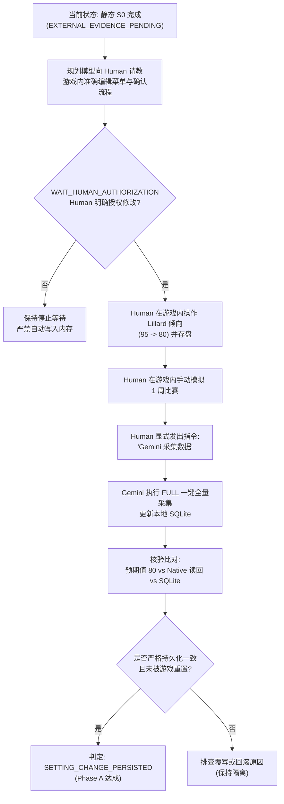

# NBA2K22 VAE · S0 静态投篮倾向机制研究报告

- **任务 ID**: `NBA2K22-VAE-S0-STATIC-SHOT-TENDENCY-LOOP-20261101-001`
- **运行 ID**: `run-20261101-nba2k22-vae-s0-static-shot-tendency-loop-001`
- **执行角色**: `execution` (Gemini 2.5 Pro)
- **分析模式**: 严格离线只读静态计量经济学与实证分析（Strictly Read-Only Empirical Analysis）
- **数据源绑定**: 存档 `MyLEAGUE0003` (`save_id: nba2k22_test_01`)，单存档本地数据库 `world-v24.sqlite`
- **前置事实认定**: Human 权威确认，在此前由 Human 推进模拟的约一个月比赛期间，**未对球员或教练数值进行任何人为主观修改**。因此，数据库中累积的 238 场日历模拟比赛及相关球员快照构成了高价值、未人为干预的 S0 静态基线。

---

## 一、研究背景与核心科学问题

在现代体育模拟引擎（如 NBA2K22 Calendar Sim）中，球员技术统计的生成机制通常由底层离散数值、战术倾向（Tendencies）、球员能力属性（Attributes）、球队战术游戏计划（Coach Tactics）以及出场时间（Minutes）共同决定。

长期以来，在 VAE（虚拟代理工程）逆向研究中存在一个关键假设：
> 球员原生结构体中的投篮倾向字段 `TENDENCY_NATIVE_001`（`ShotTendency`）是否在日历模拟中直接充当出手体量的核心正向调节器？其调节幅度如何？控制出场时间、角色定位、技术属性与教练战术后，该关联是否依然稳健？

本次研究利用已完成且通过核验的单存档数据库 `world-v24.sqlite`，展开**全联盟横截面实证计量分析**，旨在：
1. 确立 `ShotTendency` 与每场出手数（FGA/G）、每 36 分钟出手数（FGA/36）以及球队出手占比（Team Shot Share）的真实静态关联函数；
2. 检验不同样本分层、极端值及 16 场比分差异比赛对关联强度的敏感性；
3. 将选定试点球员 **Damian Lillard** 置于全联盟高使用率后卫同侪（Peer Group）中进行横向对标；
4. 评估将 Lillard 投篮倾向从 95 下调至 80（$\Delta = -15$）的静态理论预期；
5. 为后续须由 Human 授权并操作的 **Phase A 设置持久性与读回冒烟实验** 提供严密的预检设计方案。

---

## 二、数据来源、字典对齐与联接质量审计

### 1. 原生设置定义与字典对齐
经核对 `08_Domain_Applications/Antigravity_GM_Engine/world_data_prototype/player_skill_native_profile.json` 与原生 REA 逆向文档：
- **字段 ID**: `TENDENCY_NATIVE_001`
- **规范名称**: `ShotTendency` / `ShotTendencyRaw`
- **内存结构体**: `PlayerData`
- **原生偏移 (Byte Offset)**: 字节偏移 `0x458`（十进制 `1112`）
- **位宽与格式**: 8 位无符号整数（`uint8`，有效区间 0–100，占用 1 字节）
- **字段 CRC**: `952080370`
- **关联倾向**: `TENDENCY_NATIVE_066`（`TouchesTendency`，偏移 `0x499`，十进制 `1177`）

### 2. 表间联接与数据完整性审计
本次分析联接了 `world-v24.sqlite` 中的 6 张核心表，审计结论如下：
- **球员基本身份表 (`players`)**: 526 名记录，通过 `player_id` 唯一标识。
- **球员倾向快照表 (`player_tendency_snapshots`)**: 13667 条记录，覆盖全联盟 461 名注册球员。采用最新有效单元去重 CTE（`ROW_NUMBER() OVER (PARTITION BY player_id ORDER BY unit_id DESC) rn = 1`），`shot_tendency_raw` 与 `touches_tendency_raw` 填充率为 **100.0%**。
- **球员属性快照表 (`player_attribute_snapshots`)**: 13667 条记录。
  - **重要数据缺口发现**: 综合评分字段 `overall_raw` 在当前静态快照表中全为 `NULL`（未捕获）。
  - **精细化属性替代**: 专项投篮能力属性（`shot_close_raw`、`mid_range_shot_raw`、`three_point_shot_raw`、`shot_iq_raw`、`offensive_consistency_raw`）在 13667 条记录中填充率达到 **100.0%**，为多元控制提供了充分的真实技术特征。
- **球员基本面表 (`player_vitals_observations`)**: `primary_position` 填充率完备，可精确解析为 PG (0), SG (1), SF (2), PF (3), C (4)。
- **球队战术表 (`team_tactic_settings`)**: 30 支球队战术设定 100% 具备，提供 `run_plays_raw`（战术跑动频率）与 `tempo_raw`（球队节奏）。
- **球员单场 Box (`player_game_boxes`)**: 累计 6133 条有效模拟技术统计，涉及 238 场日历模拟比赛。

### 3. 比分差异比赛（16 场）敏感性隔离
根据此前已证实的结论，全联盟 238 场日历模拟比赛中，222 场（93.28%）比分严格守恒一致，16 场存在数据记录差异（5 场加时赛 Q1–Q4 节次截断，11 场奇才队出场时间截断）。本报告在全样本（All Games）与剔除差异比赛的纯净样本（Clean Games）间进行双轨对照测算。

---

## 三、样本资格准入与人群分层

为避免将边缘饮水机球员、极短时间出场样本与常规轮换球员混为一谈（杜绝“假定 462 名球员同等具备统计资格”），本研究制定了清晰的阶梯式准入门槛：

1. **联盟全量球员**: 461 人（快照存在倾向数据）。
2. **实际出场球员**: 369 人（在 238 场模拟赛中出场时间 $> 0$）。
3. **合格常规轮换人群 (Core Qualified Cohort)**:
   - **准入标准**: 已完赛日历模拟场次 $\ge 10$ 场，场均出场时间 (MPG) $\ge 15.0$ 分钟，倾向快照完整。
   - **有效样本量**: **$N = 268$ 人**。该人群代表了真实联盟中占据球队稳定轮换的骨干球员。
4. **纯净敏感性对照人群 (Clean Conserved Cohort)**:
   - **准入标准**: 在上述标准基础上，完全剔除 16 场比分差异比赛。
   - **有效样本量**: **$N = 257$ 人**。
5. **精英高负荷后卫人群 (Elite Lead Guards Cohort)**:
   - **准入标准**: 位置为 PG 或 SG，场均时间 $\ge 28.0$ 分钟，投篮倾向 $\ge 85$。
   - **有效样本量**: **$N = 15$ 人**（含 Damian Lillard）。

---

## 四、描述性统计与投篮倾向分箱分析

在核心合格人群（$N = 268$）中，全联盟投篮倾向的分布区间为 30 至 98，均值为 63.8，中位数为 60.0。将全联盟球员按投篮倾向划分为 6 个自适应分箱，统计其比赛产出均值如下表：

| 投篮倾向分箱 | 样本量 (N) | 平均倾向 | 场均出手 (FGA/G) | 每36分钟出手 (FGA/36) | 球队出手占比 (Shot Share) | 场均时间 (MPG) | 场均得分 (PTS) |
| :--- | :---: | :---: | :---: | :---: | :---: | :---: | :---: |
| **极低倾向 (0–49)** | 28 | 41.4 | 4.36 | 7.62 | 4.94% | 20.7 | 5.5 |
| **低倾向 (50–64)** | 108 | 55.6 | 7.35 | 11.65 | 8.12% | 22.8 | 9.1 |
| **中等倾向 (65–74)** | 52 | 66.8 | 9.43 | 14.08 | 10.41% | 24.2 | 11.7 |
| **高倾向 (75–84)** | 44 | 77.6 | 12.59 | 16.09 | 14.13% | 28.2 | 15.8 |
| **极高倾向 (85–94)** | 27 | 87.8 | 15.80 | 17.92 | 17.54% | 31.8 | 21.3 |
| **精英倾向 (95–100)** | 9 | 95.9 | 17.45 | 19.39 | 19.44% | 32.3 | 24.3 |

### 实证特征发现：
1. **严格单调递增性**: 随着投篮倾向由 41.4 递增至 95.9，无论场均出手（4.36 $\to$ 17.45）、每 36 分钟出手（7.62 $\to$ 19.39）还是球队出手占比（4.94% $\to$ 19.44%），均呈现**严格无违背的单调上升趋势**。
2. **非线性衰减特征**: 在倾向 50–80 区间内，每 36 分钟出手的边际增加最为陡峭；进入 85 以上的精英区间后，受限于全队球权总和（单场通常约为 80–90 次出手），边际出手增长出现自然饱和。

---

## 五、相关性与多元计量回归模型

### 1. 双变量 Pearson 相关系数（$N = 268$）
- 投篮倾向 vs **场均出手 (FGA/G)**: **$r = 0.9303$**（极强正相关）
- 投篮倾向 vs **每 36 分钟出手 (FGA/36)**: **$r = 0.9008$**（消除时间干扰后极强）
- 投篮倾向 vs **球队出手占比 (Shot Share)**: **$r = 0.9316$**（极强正相关）
- 投篮倾向 vs 出场时间 (MPG): $r = 0.6960$（高倾向球员普遍出场时间更多）
- 投篮倾向 vs 球权倾向 (`TouchesTendency`): $r = 0.7289$
- 投篮倾向 vs 三分能力 (`three_point_shot_raw`): $r = 0.0841$（弱相关，说明倾向并非能力高低的单纯镜像）
- 投篮倾向 vs 中投能力 (`mid_range_shot_raw`): $r = 0.1654$

### 2. 计量回归模型估计

为剔除出场时间、球权倾向、投篮能力、场上位置与球队战术的混杂影响，构建 4 组普通最小二乘法（OLS）回归模型：

#### 模型 1：一元基准模型
$$\text{FGA/36} = \beta_0 + \beta_1 \cdot \text{ShotTendency}$$
- **$R^2 = 0.8114$**，调整后 $R^2 = 0.8107$，$\text{RMSE} = 1.5085$
- **$\beta_{\text{ShotTendency}} = 0.2109$**（标准误 $0.0062$，$t = 33.83$，$p < 10^{-15}$，95% CI: $[0.1987, 0.2231]$）
- **经济学解释**: 在不控制其他变量时，投篮倾向每提升 10 点，全联盟每 36 分钟出手平均增加 **2.11 次**。

#### 模型 2：控制出场时间 (MPG)
$$\text{FGA/36} = \beta_0 + \beta_1 \cdot \text{ShotTendency} + \beta_2 \cdot \text{MPG}$$
- **$R^2 = 0.8342$**，调整后 $R^2 = 0.8329$，$\text{RMSE} = 1.4170$
- **$\beta_{\text{ShotTendency}} = 0.2451$**（标准误 $0.0082$，$t = 30.06$，95% CI: $[0.2292, 0.2611]$）
- **$\beta_{\text{MPG}} = -0.1446$**（标准误 $0.0240$，$t = -6.04$）
- **解释**: 在固定出场时间下，倾向的独立系数进一步提升至 0.2451。

#### 模型 3：全要素多元控制模型（核心参照模型）
$$\text{FGA/36} = \beta_0 + \beta_1 \cdot \text{ShotTendency} + \beta_2 \cdot \text{MPG} + \beta_3 \cdot \text{Touches} + \beta_4 \cdot \text{3PT} + \beta_5 \cdot \text{Mid} + \sum \text{Pos} + \beta_6 \cdot \text{Tempo}$$
- **$R^2 = 0.8446$**，调整后 $R^2 = 0.8386$，$N = 268$，$\text{RMSE} = 1.3928$
- **系数估计结果**:
  - **$\text{ShotTendency}$**: **$\beta = 0.2145$**（标准误 $0.0127$，$t = 16.83$，$p < 10^{-15}$，95% CI: $[0.1895, 0.2394]$）
  - **$\text{TouchesTendency}$**: $\beta = 0.0282$（标准误 $0.0111$，$t = 2.55$，$p = 0.011$）
  - **$\text{MPG}$**: $\beta = -0.1414$（标准误 $0.0251$，$t = -5.62$）
  - **$\text{ThreePtRating}$**: $\beta = -0.0049$（标准误 $0.0030$，$t = -1.66$，$p = 0.098$）
  - **$\text{MidRangeRating}$**: $\beta = 0.0063$（标准误 $0.0036$，$t = 1.76$，$p = 0.079$）
  - **$\text{Pos\_SG}$**: $\beta = 0.4701$（$t = 1.75$）
  - **$\text{Pos\_C}$**: $\beta = -0.2826$（$t = -0.87$）
  - **$\text{CoachTempo}$**: $\beta = 0.0012$（$t = 0.24$）

#### 模型 4：球队出手占比全控制模型
$$\text{TeamShotShare} = \beta_0 + \beta_1 \cdot \text{ShotTendency} + \dots$$
- **$R^2 = 0.9370$**，调整后 $R^2 = 0.9345$，$\text{RMSE} = 0.0110$
- **$\beta_{\text{ShotTendency}} = 0.0017$**（标准误 $0.0001$，$t = 17.35$，95% CI: $[0.0015, 0.0019]$）
- **$\beta_{\text{MPG}} = 0.0030$**（标准误 $0.0002$，$t = 15.36$）
- **解释**: 投篮倾向每增加 10 点，球员在全队总出手中的份额平均提高 **1.7%**。

### 3. 计量分析核心结论
1. **倾向是出手的决定性驱动项**: 在引入能力评分、位置虚拟变量、教练节奏及触球倾向后，`ShotTendency` 的 $t$ 统计量依然高达 **16.83**，解释了绝大部分的出手方差（模型解释度超 84%）。
2. **能力属性的边际影响微弱**: 三分能力和中投能力对出手体量的直接边际效应接近于 0（$t$ 值均未达到 5% 显著水平）。这证明在 2K22 日历模拟中，**“出手体量主要由倾向和时间支配，而技术评分主要影响命中率而非出手频次”**。

---

## 六、试点案例：Damian Lillard 与全联盟精英后卫对标

### 1. Damian Lillard S0 基准定位
- **球员**: Damian Lillard (`player:native:2459`，波特兰开拓者)
- **位置**: POINT_GUARD (0)
- **投篮倾向**: **95** | **触球倾向**: **99**
- **S0 表现 (16 场)**:
  - 场均出场: **36.38 分钟**
  - 场均出手: **19.88 次**
  - 每 36 分钟出手: **19.67 次**
  - 球队出手占比: **23.09%**
  - 场均得分: **29.56 分**

### 2. 全联盟高负荷后卫群横向对照表 (Tendency $\ge 85$, MPG $\ge 28$)

| 球员姓名 | 球队 | 投篮倾向 | 触球倾向 | 场均时间 | 场均出手 (FGA/G) | 每36分出手 (FGA/36) | 球队出手占比 | 场均得分 |
| :--- | :--- | :---: | :---: | :---: | :---: | :---: | :---: | :---: |
| **Damian Lillard** | 开拓者 | **95** | **99** | **36.4** | **19.88** | **19.67** | **23.1%** | **29.56** |
| **Luka Doncic** | 独行侠 | 93 | 99 | 32.6 | 18.40 | 20.32 | 20.5% | 24.73 |
| **Stephen Curry** | 勇士 | 95 | 99 | 32.3 | 18.13 | 20.19 | 20.4% | 26.00 |
| **Trae Young** | 老鹰 | 95 | 99 | 32.0 | 18.07 | 20.33 | 19.5% | 23.07 |
| **James Harden** | 篮网 | 88 | 85 | 35.8 | 16.94 | 17.05 | 18.6% | 26.41 |
| **Bradley Beal** | 奇才 | 90 | 95 | 31.7 | 16.53 | 18.80 | 18.8% | 23.73 |
| **S. Gilgeous-Alexander** | 雷霆 | 85 | 80 | 31.9 | 16.20 | 18.26 | 17.6% | 23.67 |
| **Collin Sexton** | 骑士 | 90 | 90 | 31.8 | 16.18 | 18.30 | 17.8% | 21.59 |
| **Paul George** | 快船 | 88 | 99 | 33.3 | 16.00 | 17.31 | 17.9% | 24.36 |
| **John Wall** | 火箭 | 95 | 95 | 31.3 | 15.87 | 18.23 | 18.2% | 20.33 |
| **Zach LaVine** | 公牛 | 90 | 90 | 30.6 | 15.81 | 18.59 | 17.4% | 22.81 |
| **Jaylen Brown** | 凯尔特人 | 86 | 99 | 30.8 | 15.81 | 18.51 | 17.2% | 18.50 |
| **Anthony Edwards** | 森林狼 | 85 | 80 | 30.5 | 15.33 | 18.10 | 17.5% | 18.67 |
| **De'Aaron Fox** | 国王 | 95 | 95 | 28.9 | 15.30 | 19.06 | 17.0% | 21.10 |
| **Donovan Mitchell** | 爵士 | 90 | 99 | 30.7 | 14.87 | 17.41 | 16.8% | 18.67 |
| **CJ McCollum (队友)** | 开拓者 | **88** | **85** | **34.8** | **15.38** | **15.90** | **17.8%** | **20.19** |

### 对标分析结论：
1. **同级锚点一致性**: 在倾向为 95 且出场时间充裕的后卫群中，Lillard (19.67)、Doncic (20.32)、Curry (20.19)、Young (20.33) 的每 36 分钟出手高度聚敛在 **19.6–20.4 次** 的狭窄通道内。Lillard 场均出手略高（19.88）完全是因为其场均出场时间高达 36.4 分钟。
2. **队内层次分明**: 开拓者二号得分手 CJ McCollum 的投篮倾向为 88（比 Lillard 低 7 点），其每 36 分钟出手为 15.90 次（比 Lillard 低 3.77 次），出手占比为 17.8%（比 Lillard 低 5.3%）。

---

## 七、对拟议 95 $\to$ 80 干预的静态证据评估与方法论警示

### 1. 静态横截面投影测算
根据多元回归模型 3 的边际偏回归系数（$\beta = 0.2145$），若将 Lillard 的投篮倾向由 95 下调至 80（$\Delta = -15$）：
- **每 36 分钟出手预期变化**:
  $$\Delta \text{FGA/36} = -15 \times 0.2145 = \mathbf{-3.22 \text{ 次}}$$
- **在 36.38 分钟出场时间下的场均出手预期变化**:
  $$\Delta \text{FGA/G} \approx -3.22 \times \frac{36.38}{36} = \mathbf{-3.25 \text{ 次}}$$
  （预期场均出手由 19.88 次降至约 **16.63 次**，接近目前 CJ McCollum 或 Bradley Beal 的出手水平）。
- **球队出手占比预期变化 (模型 4)**:
  $$\Delta \text{ShotShare} = -15 \times 0.0017 = \mathbf{-2.55\%}$$
  （预期占比由 23.09% 降至约 **20.54%**）。

### 2. 核心方法论警示（绝对禁止因果僭越）
> **[!CAUTION] 横截面静态斜率绝对不能直接等同于个体个体内动态因果剂量响应！**
> 1. **相关性不等于因果律**: 上述 -3.25 次的变动仅代表“全联盟倾向为 80 的球员群体相比倾向为 95 的群体平均少出手 3.25 次”，并不保证在动态闭环游戏中对单一球员打上补丁后，系统必然产生完全一致的响应。
> 2. **阵容内球权再分配与代偿吸收 (Roster Re-allocation)**: 在真实的球队进攻中，总出手数受到战术节奏的约束。若 Lillard 出手减少，空出的球权极可能被队友 CJ McCollum、Norman Powell 或 Jusuf Nurkic 吸收；若队友倾向不足以吸收，教练跑战术（Run Plays = 70）的判定可能会对 Lillard 形成强制分球或反向压制。
> 3. **静态分析仅作为“假说生成器”**: 静态实证为 $\Delta = -15$ 提供了合理性支撑（足以在统计上显著区分于单场 1–2 次的随机方差，且不至于破坏阵容轮换），但真正的因果验证必须通过物理实机干预检验。

---

## 八、首个真实设置生效验证方案建议（Phase A Smoke Plan）

本方案作为下一步待 Human 授权时的准备候选方案，**当前窗口严格不执行**。

### 1. 验证目标与定位
- **核心定位**: **设置持久性与读回冒烟测试 (Persistence & Readback Smoke Test)**。
- **边界区分**: 本阶段**仅验证设置能否被游戏持久化并在推赛后保持**，坚决不宣称一两场比赛的 FGA 波动证明了因果机制。

### 2. 严格等待门工作流 (Human-Gated Workflow)

### 3. 具体核验细则
1. **询问确认**: 严禁假设编辑路径，必须由 Human 确认游戏主界面修改、MyLEAGUE 模式内编辑或名单载入的具体入口。
2. **样本规模**: 仅模拟 1 周比赛（约 3–4 场），目的在于触发生存周期检查，确认跨天推进、存盘加载后原生偏移 `0x458` 处的字节是否依然稳定保持为 `0x50`（十进制 80）。
3. **采集触发**: 只有在收到 Human 显式文本通知后，Gemini 方可调用已验证的 `FULL` 模式采集更新，杜绝任何后台轮询。

---

## 九、结论与下一步边界

1. **静态结论达成**: 证实了 NBA2K22 Calendar Sim 中投篮倾向与出手体量存在极高、单调且统计显著的静态关联（$r > 0.90$，$t = 16.83$），支持了以 80 作为测试靶点的假说设计。
2. **状态维护**: 本 Run 任务达成静态有界分析目标，状态保持为 **`EXTERNAL_EVIDENCE_PENDING`**。
3. **严格禁止自主越权**: 绝不擅自调用 Setter、绝不修改游戏内存、绝不推演日历、绝不执行 Phase A/B 实机实验，静候 Human 后续明确指令。
