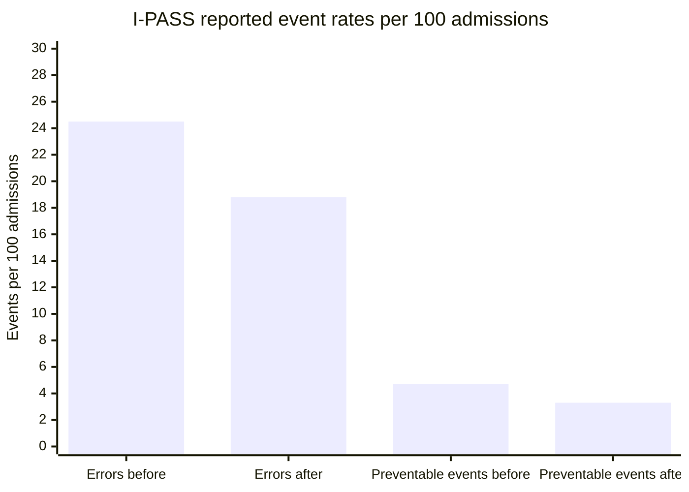
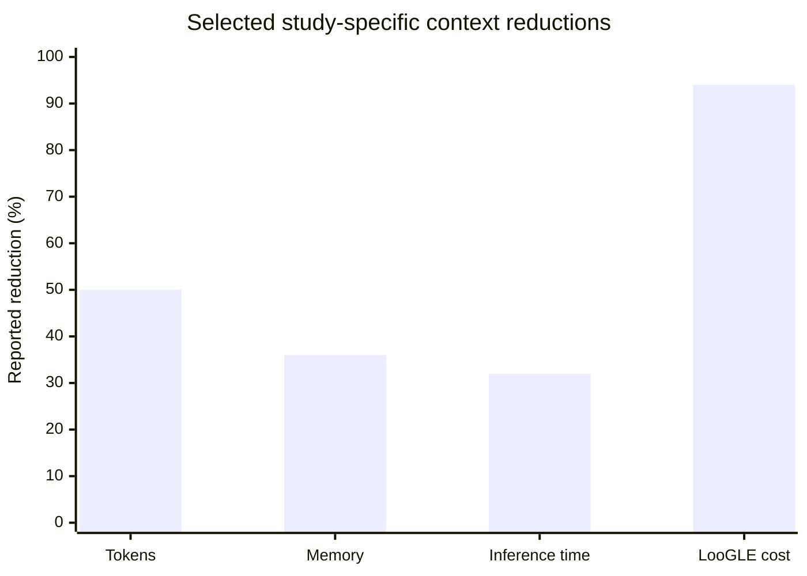
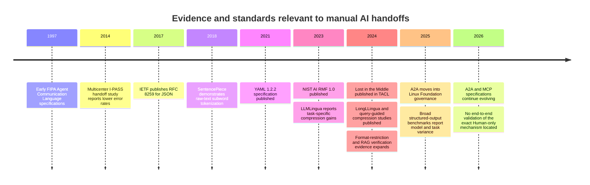

# Independent Evidence Review of a Human-Mediated AI Communication Mechanism

## Executive Summary

The commissioning document is an internal Chinese-language research brief titled **“Independent Deep Research Assignment A: ChatGPT.”** It specifies an independent evidence-gathering lane, six research questions, a Human-mediated communication hypothesis, source-priority rules, and a required Markdown deliverable. It names no author, institution, funder, or conflict of interest, and contains no original dataset, implementation, experiment, or statistical result. It should therefore be treated as a research protocol and hypothesis statement rather than as evidence for the mechanism it describes. fileciteturn0file0

The proposed arrangement is **engineering-feasible as a manual, task-scoped, document-centered handoff system**, but the evidence supports its constituent patterns more strongly than the complete end-to-end mechanism. No direct study was located that evaluates the exact combination of Human-only forwarding, no polling or automatic delivery, one task per communication space, compact index messages, separately stored long artifacts, direct-reference-only context loading, independent authorization, mirrored local and remote task directories, and Human-triggered cleanup.

The strongest support comes from adjacent systems and research:

| Proposition | Evidence assessment | Main qualification |
|---|---|---|
| Short message envelopes can carry identity, routing, type, task, and reference metadata | Strong conceptual support | Metadata does not authenticate identity, grant permission, guarantee delivery, or prove that referenced context is complete |
| Long artifacts can be externalized and addressed from short messages | Strong engineering support | Retrieval, access control, lifecycle, consistency, and version-drift failures are introduced |
| Selective context can reduce burden and sometimes improve performance | Moderate empirical support | Compression or retrieval can omit decisive evidence and may worsen performance |
| One task per workspace can reduce accidental cross-task contamination | Moderate-to-strong engineering inference | Shared dependencies, copied artifacts, similar paths, and cross-task decisions remain |
| Human routing can provide a disclosure and authorization checkpoint | Moderate governance support | Manual routing is a cognitive bottleneck and does not guarantee delivery, ordering, acknowledgment, or correct interpretation |
| Separating runtime from durable records improves lifecycle clarity | Strong adjacent-practice support | Ordinary deletion does not remove repository history, backups, caches, mirrors, logs, or provider-side copies |
| One text format can be optimal across models and vendors | Unsupported | Parsing, readability, partial access, repair cost, reasoning performance, and tokenization produce irreducible trade-offs |

Current agent interoperability systems explicitly distinguish tasks, contexts, messages, artifacts, metadata, idempotency, versioning, authentication, and authorization. A2A, for example, separately models Messages and Artifacts and defines task and context identifiers rather than treating an entire interaction as undifferentiated text. MCP similarly separates resources from tools and prompts and permits application-controlled resource inclusion. These are strong structural analogues for message/artifact separation and on-demand loading, although both protocols support automated capabilities outside the proposed Human-only delivery boundary. citeturn13view0turn13view1turn1search7turn1search8

Distributed messaging provides especially direct support for keeping large content outside short envelopes. Microsoft’s Claim-Check pattern stores a large payload externally and transmits a token, while also warning that the pattern adds storage operations, latency, lifecycle requirements, and complexity and therefore should be applied selectively. AWS likewise documents external storage for oversized messages and warns that standard queues may deliver duplicates or reorder messages, motivating idempotency and deduplication. These delivery failures have close manual analogues: a Human can forward the same message twice, omit it, or forward messages out of causal order. citeturn13view3turn4search10turn4search0turn4search4turn4search2

The critical correction to the proposed reference model is that **an exact path is not an exact content identity**. Paths may be moved, replaced, resolved on different branches, or point to different bytes in local and remote mirrors. Git’s content-addressed objects, OCI descriptors containing digest and size, and HTTP validators such as ETags all embody the stronger requirement: when correctness depends on exact content, a consumer needs a way to verify the retrieved representation or detect that it has changed. citeturn5search0turn5search3turn12search3

Selective context has a genuine rationale. “Lost in the Middle” found that models’ use of long contexts was position-sensitive and often worst when relevant information appeared in the middle; in its tested multi-document setting, adding substantially more retrieved documents produced little improvement. Prompt-compression studies have reported large task-specific savings and, in some conditions, performance improvements. However, query-guided compression and retrieval-verification studies also document the opposite failure: compression can remove key facts, retrieval can omit required information, and excessive or conflicting retrieval can cause an otherwise correct answer to become wrong. citeturn13view2turn2search5turn2search9turn3search4turn3search1turn3search15

Consequently, a sender-provided **“reference closure”** is feasible as an asserted manifest of inputs and dependencies, but current evidence does not justify treating it as proven complete. Its reliability must be measured through tasks containing hidden transitive dependencies, contradictory historical decisions, superseded files, cycles, mutable references, and irrelevant distractors.

Manual Human routing should likewise be viewed as a **governance gate rather than a reliability mechanism**. NIST guidance emphasizes that Human oversight requires defined roles, documentation, training, testing, and accountability. Structured clinical handoff evidence provides a useful but limited analogue: the multicenter I-PASS intervention reported a 23% reduction in medical errors and a 30% reduction in preventable adverse events without a statistically significant increase in handoff duration. That intervention was a bundle involving training, observation, feedback, and workflow changes, not merely a short template, and it cannot supply an expected effect size for AI handoffs. citeturn7search5turn7search9turn6search1turn6search2

The workspace-lifecycle hypothesis is supported in principle. The XDG specification defines restricted, short-lived runtime storage separately from persistent data, while Kubernetes distinguishes ephemeral volumes tied to workload lifecycle from persistent volumes. These analogues support explicit runtime/durable classes and task-scoped cleanup. They also expose the limitation: mature systems rely on lifecycle controllers and precise semantics, whereas a Human-triggered cleanup step can be forgotten, applied prematurely, or pointed at the wrong directory. citeturn13view5turn8search14turn8search7

Deletion must not be overstated. NIST distinguishes ordinary logical deletion from sanitization, and GitHub documents that removing a file from the current tree does not remove it from repository history. Sensitive material can persist in commits, pull requests, forks, caches, clones, logs, backups, or synchronized repositories, and rewritten history can be recontaminated by collaborators who retain old commits. citeturn8search8turn11search1turn11search6

Finally, the evidence does not establish a cross-model optimal choice among YAML, JSON, JSONL, and Markdown with a machine-readable header. JSON has a small standardized grammar and strong parser interoperability; YAML explicitly prioritizes Human readability but has richer syntax and version/schema concerns; JSONL is effective for line-wise append and partial processing; Markdown is well suited to long Human-readable narratives but requires a defined and validated metadata boundary. Empirical LLM work finds that strict output-format constraints can reduce reasoning performance and that structured-output success varies markedly by model, task, schema, and prompting method. Token counts cannot be universalized because tokenization is model- and vocabulary-dependent. citeturn13view6turn10search0turn10search12turn13view7turn9academia45turn9academia46turn9academia48turn10search1

## Principal Findings

The mechanism’s most defensible operating boundary is **low-to-moderate message volume, high-value tasks, explicit and stable artifacts, relatively shallow dependencies, and a Human expected to inspect and route rather than perform unreviewed copy-and-paste**. Risk rises sharply with high concurrency, rapid artifact mutation, hidden historical dependencies, large fan-out, strict latency requirements, regulated erasure, or ambiguous responsibility.

The evidence-implied load-bearing conditions are:

| Condition | Why it matters |
|---|---|
| References identify versions or verified content, not only paths | Prevents silent use of replaced, stale, divergent, or concurrently edited artifacts |
| Sender intent and Human routing are separately recorded | Prevents a suggested recipient from being mistaken for the actual disclosure decision |
| Requested action and authorization are separately represented | Prevents message text from acting as an accidental permission grant |
| Receivers acknowledge what they actually read | Distinguishes delivery from retrieval and retrieval from comprehension |
| Replays and duplicate forwards are idempotent | Prevents repeated work or repeated side effects |
| Direct-reference closure can be challenged and expanded | Prevents selective context from becoming silent context loss |
| Cleanup has explicit scope and verification | Prevents wrong-target deletion, premature deletion, and false erasure claims |
| Format validation and semantic validation are both tested | A syntactically valid message can still be incomplete, misleading, or wrongly interpreted |
| Protocol, schema, tokenizer, and model versions are recorded | Prevents apparent reproducibility when behavior has changed |
| Failure states remain visible | Missing files, denied access, malformed messages, and unanswered handoffs must not disappear silently |

A complete catalogue in the downloadable report identifies reusable patterns including typed message envelopes, task and context correlation, Human brokerage, closed-loop acknowledgment, message/artifact separation, claim-check pointers, URI-addressed resources, progressive disclosure, handoff history filters, query-guided compression, receiver-initiated retrieval, dependency manifests, content-addressed artifacts, version-validated mutable references, immutable task snapshots, idempotency, deduplication, causal sequence links, explicit resume gates, error manifests, runtime/durable separation, task-scoped workspaces, append-only audit records, semantic read-back, and escalation paths.

The corresponding failure catalogue covers identity ambiguity and spoofing; hidden intended-versus-actual recipient mismatches; wrong or excessive disclosure; absent or false acknowledgment; permission confusion; confused-deputy and overprivilege behavior; secrets committed to remote repositories; stale, moved, mutable, broken, or divergent references; branch and task confusion; incomplete or excessive context closure; cyclic and dynamic dependencies; duplicate, lost, reordered, or looping messages; concurrent edits; stale responses; premature, wrong-target, incomplete, or forgotten cleanup; Human overload and automation bias; parser disagreement; malformed envelopes; prompt injection in artifacts; context truncation; tokenizer divergence; silent partial retrieval; and unclear responsibility.

## Quantitative Evidence and Uncertainty

The clearest quantitative evidence for structured Human handoff comes from I-PASS, where reported medical-error rates fell from 24.5 to 18.8 per 100 admissions and preventable-adverse-event rates fell from 4.7 to 3.3 per 100 admissions. The reported relative reductions were 23% and 30%, with `p < 0.001`; handoff duration changed from 2.4 to 2.5 minutes, with `p = 0.55`. The study included 10,740 admissions across nine pediatric residency programs but was not randomized and evaluated a multifaceted intervention, so its figures must not be transferred to AI communication. citeturn6search1turn6search2

Context-reduction studies report substantial but non-comparable results. Selective Context reported a 50% context reduction accompanied by approximately 36% lower memory use and 32% lower inference time, with small losses on some quality measures. LLMLingua reported up to 20-fold compression with limited loss on selected datasets. LongLLingua reported up to a 21.4% improvement in one NaturalQuestions setting, a 94% cost reduction on a LooGLE setting, and 1.4–2.6-fold latency improvement at tested compression ratios. These are maxima or study-specific measurements, not an uncertainty interval for the proposed system. citeturn2academia44turn2search5turn2search9

The principal quantitative uncertainty is therefore not whether fewer tokens can reduce computational burden; that is well supported. The unresolved quantity is **how often selective references omit information that changes the downstream action**. No defensible end-to-end probability was found for incomplete sender-generated closure, Human misrouting, local/remote mirror divergence, or cleanup failure in this architecture.

## Evidence Timeline

The timeline also illustrates a versioning risk. Foundational messaging, storage, and format concepts are relatively stable, while A2A, MCP, LLM context behavior, constrained decoding, and model-specific tokenization are moving targets. Wire-level fields, defaults, and benchmark percentages should therefore be pinned to versions rather than treated as timeless properties. A2A’s current specification explicitly includes versioning and migration semantics, reinforcing that interoperability itself requires lifecycle management. citeturn13view0turn1search0turn1search12

## Research Deliverable

The complete report contains the detailed methodology and search paths; source-quality and access limitations; findings grouped by all six research questions; the full reusable-pattern catalogue; the full Human-routing and artifact-lifecycle failure catalogue; primary-source comparison table; methodological and statistical assessment; provenance, affiliations, funding, and conflict notes where available; supporting and conflicting evidence; protocol-version differences; policy and market implications; unresolved questions; fourteen proposed experiments; inaccessible and uncovered areas; and a complete linked source register.

[Download the complete Markdown report](sandbox:/mnt/data/01_ChatGPT_外部检索_v1.md)