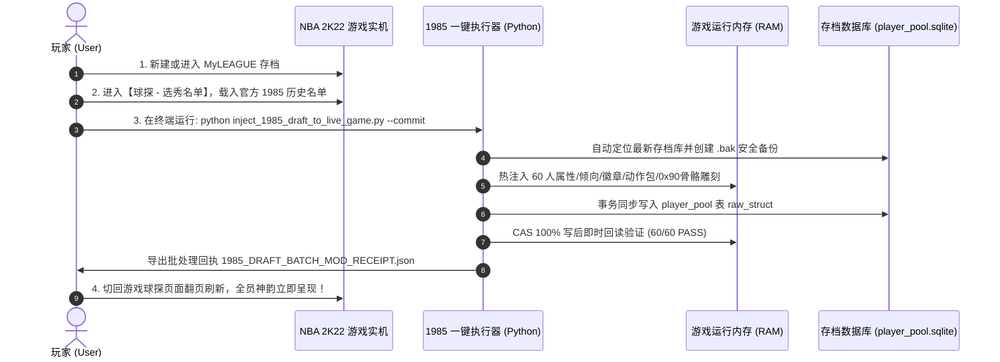

# NBA 2K22 1985 届历史选秀名单可复用模板任务使用指南
**Document ID**: `GUIDE-NBA2K22-1985-DRAFT-REUSABLE-V1.0`  
**Task Contract**: `TASK-NBA2K22-1985-DRAFT-REUSABLE-TEMPLATE`  
**Protocol Standard**: `SPEC-DRAFT-CLASS-MEM-INJECT-V1.0` (无占位符差分协议)  
**SOP Standard**: `SOP-DRAFT-CLASS-MEMORY-INJECTION-V1.0`  

---

## 一、 模板任务设计宗旨与核心价值

在 NBA 2K22 MyLEAGUE 模式中，每当用户**新建存档**并载入官方“1985 届历史选秀名单”时，游戏引擎默认仅提供 9 名官方自带名宿（尤因、马龙、穆林等），其余 51 个选秀槽位全是由系统随机生成的呆板“泥人”（面补 ID=1、随机怪异动作、默认平庸身材、垃圾徽章、选秀年份错误标注为 2023）。

本模板任务将我们在 1985 选秀实战中积累的**全部 60 人全维真实化成果（身份、攻防属性、战术倾向、徽章纯净化、现代球星动作原型克隆、0x90 专属骨骼雕刻）**完全封装为一个**即开即用、跨存档无缝复用的一键流水线**。

无论是新建 `MyLEAGUE0006`、`MyLEAGUE0007` 还是任何其他历史赛季存档，只要载入官方 1985 名单，运行一条指令即可秒级完成 60 人的殿堂级真实化注入！

---

## 二、 新存档一键复用极速操作流程（4 步闭环）



### 第一步：在游戏中载入 1985 名单
1. 启动 `NBA2K22.exe`，进入您的任意 MyLEAGUE 存档；
2. 导航至：**【行政办公室】->【球探】->【选秀名单 (Prospect Scouting)】**；
3. 选择 **【加载选秀名单 (Load Draft Class)】->【历史选秀名单 (Historic Draft Class)】-> 选择【1985】**。
*(此时游戏球探页面中将展示出 1985 届的原始名单)*

### 第二步：执行一键注入命令
打开系统终端（PowerShell 或 CMD），直接运行以下命令：

```powershell
python C:\nba2k22\exports\inject_1985_draft_to_live_game.py --commit
```

> **提示**：执行器内置了**智能存档探测引擎**，会自动在 `C:\nba2k22\saves\` 目录下搜寻修改时间最新的 `player_pool.sqlite` 并完成数据库备份与双端原子写入！  
> 若您需要指定特定存档数据库，可添加 `--db-path` 参数：  
> `python C:\nba2k22\exports\inject_1985_draft_to_live_game.py --db-path "C:\nba2k22\saves\MyLEAGUE0006\player_pool.sqlite" --commit`

### 第三步：切回游戏享受成果
在游戏中按一次手柄的翻页键（LT/RT 或 L1/R1）刷新球探列表，所有 60 名新秀（马努特·波尔的 8'6" 极限臂展与站立抓帽、斯普德·韦伯的莫兰特级暴扣、萨博尼斯的约基奇慢节奏传球魔术等）全部即时生效！

---

## 三、 模板核心资产与流水线架构

| 资产文件 | 物理绝对路径 | 功能与规范定位 |
| :--- | :--- | :--- |
| **全量增强主规格书** | [1985_draft_enhancement_spec.json](file:///C:/nba2k22/exports/1985_draft_enhancement_spec.json) | 统一数据源：封存 60 名新秀攻防属性、倾向、徽章、动作原型、签名 ID 及雕刻参数。 |
| **一键执行器引擎** | [inject_1985_draft_to_live_game.py](file:///C:/nba2k22/exports/inject_1985_draft_to_live_game.py) | 核心注入工具：集成内存挂接、动作克隆、PlayerSculptor 骨骼注入、数据库双端事务落盘。 |
| **GM 引擎源码副本** | [inject_1985_draft_to_live_game.py](file:///e:/workspace/Cybernetic_City_State_OS_v2%20-%20nba2k22/08_Domain_Applications/Antigravity_GM_Engine/src/inject_1985_draft_to_live_game.py) | OS 领域持久化维护代码，受版本控制与工程化标准保护。 |
| **骨骼雕刻核心模块** | [player_sculptor.py](file:///e:/workspace/Cybernetic_City_State_OS_v2%20-%20nba2k22/08_Domain_Applications/Antigravity_GM_Engine/src/player_sculptor.py) | 解引用 `0x90 APPEARANCEDATA` 堆块的浮点缩放与外貌修改接口。 |
| **标准任务配置文件** | [TASK-NBA2K22-1985-DRAFT-REUSABLE-TEMPLATE.yml](file:///C:/nba2k22/tasks/TASK-NBA2K22-1985-DRAFT-REUSABLE-TEMPLATE.yml) | City-State OS 标准任务卡契约，记录前置条件、验收标准与回执规范。 |
| **最新执行验收回执** | [1985_DRAFT_BATCH_MOD_RECEIPT.json](file:///C:/nba2k22/exports/1985_DRAFT_BATCH_MOD_RECEIPT.json) | 60 槽位 100% CAS 写后回读全通过认证报告。 |

---

## 四、 核心五大安全红线（严格遵守）

1. **官方原生球星“零修改”防线**：
   - 尤因、马龙、穆林、杜马斯、奥克利、施拉姆夫、麦克丹尼尔、孔卡克、威廉姆斯 9 人为 2K 官方名宿，**绝对不改动其原生姓名、面补 ID、`0x90` 堆指针与专属动作**，仅注入真实战术倾向与攻防评分。
2. **底层三不动基石不可篡改守则 (`0x88`, `0x90`, `0xF4`) 与日历模拟零崩溃防线**：
   - **`0x88` (HEAD_MORPH_PTR, 64 位指针)**：头部微变形与面部特征指针。清零会导致面部坍缩或模型不可见；
   - **`0x90` (APPEARANCE_PTR, 64 位指针)**：独立外观堆指针。单人步长精确为 `0x40` (64 字节)，严禁覆盖指针本身，所有骨骼身材定制必须解引用进入动态堆块后修改；
   - **`0xF4` (UNIQUE_ID / NATIVE_PLAYER_ID, 32 位整数)**：★ **日历模拟绝对生命线**。游戏读档时在 `[rdi + 0x220]` 静态基址建立全局球员哈希表。推进日历推演赛程时，轮换与比赛推演通过该 ID 检索哈希表。一旦为 0，解引用空指针直接触发内核级非法访问异常 (`Access Violation 0xC0000005`，瞬间无弹窗 CTD 闪退)；
   - **装配器与验证铁律**：`patch_raw_struct` 强制从原槽位解包并保留 `0xF4`、`0x88`、`0x90`，CAS 回读必须严格断言 `rb_f4 != 0 and rb_f4 == orig_f4 and rb_88 == orig_88 and rb_90 == orig_90`。
3. **泥人垃圾技能徽章“按位纯净化”**：
   - 写入前自动将 `0x4BB ~ 0x4E2` 范围内的 80 个技能等级徽章（`kind: LEVEL`，每徽章 3 位）**全部按位清零**，杜绝泥人残留垃圾技能。
4. **犯规安全锁 (Foul Lock $\le 45$)**：
   - 强行约束所有 60 名新秀在 `0x4B9` 处的犯规倾向 $\le 45$，彻底根除新秀上场数分钟即犯满离场的 2K 底层恶性 Bug。
5. **巅峰年龄真实化校准与位域安全掩码 (Doc 95)**：
   - 依据《Doc 95 巅峰年龄真实化校准标准与 SOP》通用决策树，对全量 60 人标定现实 NBA 相对年龄曲线：
     - **PEAKSTART（停止快速涨点年龄）**：出道即巅峰天才 `23~24`、常规成长型 `25~26`、晚熟爆发型 `27~29`；
     - **PEAKEND（开始大幅衰退年龄）**：历史级常青传奇 `35~39`（如卡尔·马龙 `38`、萨博尼斯 `36`、A.C.格林 `36`）、长巅峰全明星 `32~34`、标准健康轮换 `30~31`（彻底根除 2K 原生 `<=27` 的畸形截断）、运动依赖早衰型 `27~29`（如波尔 `29`）；
     - **底层写入红线**：写入 `0x072 (uint16)` 时强制通过 `old_u16 & 0x000F` 保留低 4 位系统标志，并严格断言 `21 <= PEAKSTART < PEAKEND <= 42` 且 `PEAKEND - PEAKSTART >= 4`。

---

## 五、 代表性球星动作原型、骨骼雕刻与巅峰年龄配方表

| 球员姓名 | 顺位与槽位 | 真实面补 ID | 2K 原生动作原型 | 动作神韵亮点 | 专属骨骼雕刻参数 | 真实巅峰年龄 (`0x72`) |
| :--- | :--- | :---: | :--- | :--- | :--- | :---: |
| **卡尔·马龙** | Rank 2 (Slot 746) | `159` (官方) | 原生名宿动作 | 历史第一铁血大前锋，34/36岁夺MVP | 原生官方体型保护 | **`25 .. 38`** *(常青超巨)* |
| **帕特里克·尤因** | Rank 1 (Slot 646) | `940` (官方) | 原生名宿动作 | 纽约禁区大核，统治防守至35岁 | 原生官方体型保护 | **`24 .. 35`** *(长青中锋)* |
| **克里斯·穆林** | Rank 3 (Slot 729) | `1146` (官方) | 原生名宿动作 | Run TMC核心神射，连续一阵/二阵 | 原生官方体型保护 | **`25 .. 33`** *(全明星射手)* |
| **马努特·波尔** | Rank 46 (Slot 860) | `7863` | **波尔津吉斯** *(Porzingis)* | 双手高举头顶推石机三分 + 站立抓帽封盖 | 臂展 `259.0cm` (8'6"), 窄肩 `0.92`, 竹竿模板 `SLENDER` | **`23 .. 29`** *(伤病早衰型)* |
| **斯普德·韦伯** | Rank 18 (Slot 821) | `1737` | **莫·兰特** *(Ja Morant)* | 爆炸双脚起跳折叠暴扣 + 超快变向突破 | 臂展 `175.0cm`, 紧凑肩宽 `0.96`, 爆发粗小腿 `1.05` | **`24 .. 30`** *(速度依赖型)* |
| **阿维达斯·萨博尼斯** | Rank 49 (Slot 876) | `4514` | **尼古拉·约基奇** *(Jokic)* | 背后击地长传魔术 + 慢节奏柔和低位勾手 | 臂展 `229.0cm`, 巨兽开阔肩 `1.10`, 柱石底盘 `1.10` | **`24 .. 36`** *(历史级传奇)* |
| **A.C. 格林** | Rank 35 (Slot 913) | `1974` | **P.J. 塔克** *(P.J. Tucker)* | 1192场全勤第一铁人，硬汉防守与快攻 | 臂展 `213.0cm`, 铁人坚毅肩宽 `1.06`, 模板 `STANDARD` | **`25 .. 36`** *(历史级铁人)* |
| **查尔斯·奥克利** | Rank 21 (Slot 743) | `185` (官方) | **P.J. 塔克** *(P.J. Tucker)* | 贴身死缠锁喉防守姿态 + 铜墙铁壁掩护 | 臂展 `218.0cm`, 霸气宽肩 `1.08`, 麒麟粗臂 `1.08` | **`25 .. 34`** *(铁血防守核)* |
| **韦曼·蒂斯代尔** | Rank 5 (Slot 896) | `1971` | **朱利叶斯·兰德尔** *(Randle)* | 标志性左手背身单打脚步 + 左手跳投/勾手 | 臂展 `213.0cm`, 协调宽肩 `1.04`, 均衡身形 `STANDARD` | **`24 .. 31`** *(健康得分手)* |
| **特里·波特** | Rank 13 (Slot 844) | `1748` | **克里斯·保罗** *(Chris Paul)* | 控卫大脑节奏掌控 + 急停中投拔枪 + 节奏变向 | 臂展 `196.0cm`, 标准后卫体型 `STANDARD` | **`25 .. 33`** *(全明星主控)* |
| **马里奥·埃利** | Rank 6 (Slot 855) | `2021` | **吉米·巴特勒** *(Butler)* | “疯狗”铁血外线贴防 + 底角定点拔击冷血三分 | 臂展 `203.0cm`, 倒三角强壮肩宽 `1.05`, 模板 `STANDARD` | **`28 .. 35`** *(大器晚成3冠)* |
| **乔·杜马斯** | Rank 8 (Slot 748) | `1213` (官方) | 原生名宿动作 | 坏孩子军团FMVP，防阵+全明星攻防一体 | 原生官方体型保护 | **`25 .. 34`** *(长巅峰分卫)* |
| **德特雷夫·施拉姆夫** | Rank 29 (Slot 742) | `1217` (官方) | 原生名宿动作 | 德国高炮台，超音速全盛，高水准进总决赛 | 原生官方体型保护 | **`26 .. 34`** *(晚熟高炮台)* |
| **查尔斯·巴克利** *(1984)* | Rank 5 (Slot 623) | `2001` | **锡安·威廉姆森** *(Zion)* | 暴力双手挂筐重扣 + 抓板推土机快攻一条龙 | 臂展 `221.0cm`, 宽阔重肩 `1.08`, 飞猪大底盘 `1.085` | **`24 .. 33`** *(MVP级飞猪)* |

---

## 六、 常见问题与排查 (Troubleshooting)

- **Q1: 为什么运行后游戏里的球员没有立刻变化？**  
  👉 **原因**：2K UI 界面有视图缓存。只需要在手柄上按一下 `LT/RT`（或键盘翻页键）切换一下名单分类，或重新进入球探页面，UI 就会立刻重新加载内存中最新的球员数据。
- **Q2: 换了新的电脑或不同的游戏存档目录怎么办？**  
  👉 **解决**：使用 `--db-path` 参数直接传入新存档的 `player_pool.sqlite` 绝对路径即可，内存注入逻辑会自动挂接 `NBA2K22.exe`，无需重新配置任何代码。
