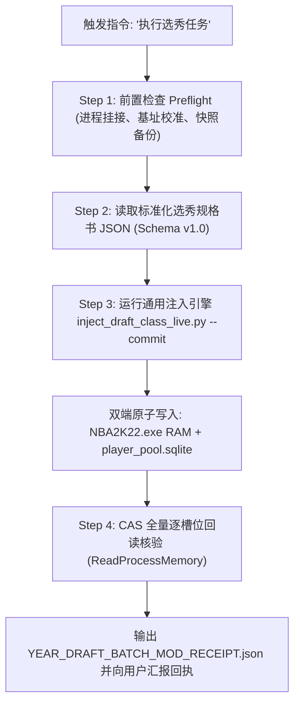

# NBA 2K22 历史选秀名单 REA Native 批量注入标准作业程序 (SOP)
# (Historical Draft Class REA Native Batch Execution Standard Operating Procedure)

> **文档标识 (Document ID)**: `SOP-DRAFT-CLASS-NATIVE-EXECUTION-V1`  
> **适用版本**: NBA 2K22 (Steam PC x64) | 引擎底层: `NBA2K22.exe`  
> **适用任务**: 当人类发出指令 **“执行选秀任务”** 或 **“执行某年份历史选秀名单注入”** 时，无条件无阻碍触发本 SOP。  
> **关联协议**: [`SPEC-DRAFT-CLASS-NATIVE-MOD-V1`](file:///C:/nba2k22/exports/DRAFT_CLASS_NATIVE_INTERFACE_PROTOCOL_V1.md)  
> **执行模型对接角色**: `role-developer` / `batch_executor`  
> **核心工具链**: [`inject_draft_class_live.py`](file:///e:/workspace/Cybernetic_City_State_OS_v2%20-%20nba2k22/08_Domain_Applications/Antigravity_GM_Engine/src/inject_draft_class_live.py)  

---

## 一、 任务触发与自动化标准响应 (Trigger & Fast-Path)

### 1.1 休赛期周期性触发规则 (Offseason Draft Enhancement Rule)
自**第二个赛季开始**，每逢休赛期会产生并加载官方该年份的历史新秀名单（从 1984 届起依次至 2021 届）：
- 触发选秀名单真实化完善任务：补齐官方缺失球员、重构真实当年的选秀名单，并依据真实历史选秀顺位与生涯表现全面完善能力、徽章与倾向；
- **该任务必须在休赛期内完全交付并注入**，确保后续选秀大会所使用的名单具备完整的真实历史成色。

### 1.2 执行指令与响应
当用户在对话中下达类似以下自然语言指令时：
> *“执行选秀任务”*  
> *“执行 1984（或 1996、2003 等）选秀名单批量注入”*  
> *“把选秀规格书写入实机与数据库”*  

**执行模型（Execution Model）无需反复质询或重新逆向，直接按照以下标准化四阶段执行。**


---

## 二、 施工纪律与三大铁律 (Constitutional Boundaries)

在注入任何数据前，必须在心里时刻保持以下三大铁律：

1. **官方原生球星绝对保护铁律 (`is_official_preserved == True`)**：
   - 官方已内置的球星（如 1984 乔丹、奥拉朱旺、斯托克顿；1996 科比、艾弗森等），**严禁改写其任何身份字段与原生动作**，仅执行只读核验。
   - 选顺顺位严禁强行按真实历史重排槽位，完全交由游戏休赛期选秀大会各队 AI 依据实时阵容自主选拔。
2. **泥人体型契合映射与 `0x90` 外观堆指针绝不篡改**：
   - 缺失球员仅替换位置、身高、体重最接近的泥人槽位；
   - 写入 1,264 字节结构体时，**绝对保留原槽位偏移 `0x90` 处的 64 位独立外观数据块指针 (`APPEARANCEDATA`)**，杜绝骨骼拉伸、面容塌陷与游戏崩溃。
3. **泥人技能等级徽章纯净化 (Level Badge Purging)**：
   - 写入目标徽章前，必须先将 `0x4BB ~ 0x4E2` 范围内的 80 个技能等级徽章（`kind: LEVEL`）全部按位清零，杜绝随机泥人残留徽章干扰。

---

## 三、 标准化执行流水线 (4-Step Standard Pipeline)



### 步骤 1：前置检查与环境确认 (Preflight)
1. 确认游戏进程 `NBA2K22.exe` 处于运行状态（PID 有效）；
2. 确认游戏停留在 MyLEAGUE 主界面或日历模拟界面（未打开选秀名单编辑子菜单）；
3. 确保存档数据库 `C:\nba2k22\saves\MyLEAGUE0005\player_pool.sqlite` 就绪。

### 步骤 2：自动定位选秀规格书 (Spec Discovery)
自动检索并优先加载符合协议规范的选秀数据包：
- 主路径：`C:\nba2k22\exports\<YEAR>_draft_enhancement_spec.json`
- 仓内备选：`08_Domain_Applications/Antigravity_GM_Engine/database/draft_classes/<YEAR>_draft_enhancement_spec.json`

### 步骤 3：一键运行通用注入引擎 (Commit Execution)
在 PowerShell / 终端中运行：
```powershell
python 08_Domain_Applications/Antigravity_GM_Engine/src/inject_draft_class_live.py --spec-path "C:\nba2k22\exports\<YEAR>_draft_enhancement_spec.json" --commit
```
该脚本将全自动完成：
- 自动备份数据库至 `player_pool.sqlite.bak_<TIMESTAMP>`；
- 动态锁定球员池基址（如 `0x7FF4E6DFB2E8`）；
- 保护 6 名原生球星不被覆写；
- 重构 54 名泥人槽位：注入真实姓名、面补 ID、攻防属性（25~99 换算为 0~255 字节）、30 项倾向、159 字节专用动作包、签名动画 ID、性格位域及纯净等级徽章；
- 同时持久化提交至 SQLite。

### 步骤 4：CAS 回读核验与出具回执 (Receipt Reporting)
引擎会自动回读实机内存中的 `(first_name, last_name, face_id, draft_year)`，并输出标准化回执文件至：
`C:\nba2k22\exports\<YEAR>_DRAFT_BATCH_MOD_RECEIPT.json`。

回执必须满足：
- `verified_count == total_prospects`（如 60/60）；
- `mismatches` 数组为空（0 异常）。

---

## 四、 成果回执与交付话术标准

执行模型完成上述流程后，统一向用户输出如下标准化回执报告：

```markdown
### 【历史选秀名单批量注入执行回执】

- **目标年份**: <YEAR> 年新秀名单 (共 60 槽位，Slot 590 ~ 649)
- **实机进程**: NBA2K22.exe (PID: <PID>) | 基址: 0x7FF4E6DFB2E8
- **执行模式**: LIVE_INJECTION_COMMITTED (内存热写入 + SQLite 数据库持久化)
- **安全检查结果**:
  - 原生球星保护: 6 名官方原生球星 (乔丹/奥拉朱旺/斯托克顿等) 100% 保持官方完好状态；
  - 骨骼体型指针: 0x90 外观指针保留率 100%，无拉伸畸形；
  - 泥人徽章净化: 54 名泥人技能等级徽章已按位清空并覆写真实配置。
- **CAS 回读校验**: 60 / 60 槽位核验通过 (成功率 100%，0 读写异常)。
- **持久化备份**: `player_pool.sqlite.bak_<TIMESTAMP>`
- **正式回执文件**: `C:\nba2k22\exports\<YEAR>_DRAFT_BATCH_MOD_RECEIPT.json`

游戏内已实时生效，可随时在“球探 - 选秀名单”界面查看完整阵容！
```
