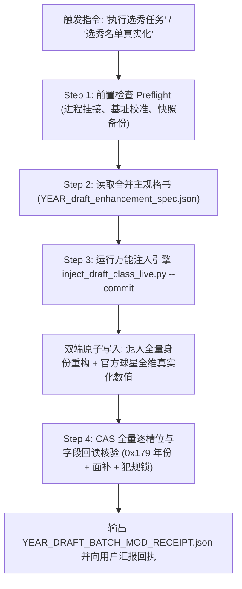

# NBA 2K22 历史选秀名单 REA Native 批量注入标准作业程序 (SOP v2.2)
# (Historical Draft Class REA Native Batch Execution Standard Operating Procedure v2.2)

> **文档标识 (Document ID)**: `SOP-DRAFT-CLASS-NATIVE-EXECUTION-V2.2`  
> **适用版本**: NBA 2K22 (Steam PC x64) | 引擎底层: `NBA2K22.exe`  
> **适用任务**: 当人类发出指令 **“执行选秀任务”** 或 **“执行某年份历史选秀名单注入/真实化”** 时，无条件无阻碍触发本 SOP。  
> **关联协议**: [`SPEC-DRAFT-CLASS-NATIVE-MOD-V2.2`](file:///C:/nba2k22/exports/DRAFT_CLASS_NATIVE_INTERFACE_PROTOCOL_V1.md)  
> **规划与决策角色**: `role-planner` / `data_analysis_and_decision` (数据分析、真实化建模与差分规格制定)  
> **执行与核验角色**: `role-developer` / `batch_executor` (REA Native / 内存直写与 CAS 回读校验)  
> **核心工具链**: [`inject_draft_class_live.py`](file:///e:/workspace/Cybernetic_City_State_OS_v2%20-%20nba2k22/08_Domain_Applications/Antigravity_GM_Engine/src/inject_draft_class_live.py)  

---

## 一、 任务触发与业务范围 (Trigger & Scope)

### 1.1 休赛期周期性触发规则
自**第二个赛季开始**，每逢休赛期会产生并加载官方该年份的历史新秀名单（从 1984 届起依次轮回至 2021 届）：
- **核心双支柱业务**：
  1. **缺失传奇精准补齐与身份注入**：补齐官方缺失的真实历史球员（如巴克利、鲍韦、雷吉·米勒等），精准映射原生泥人槽位并全量注入真实姓名、官方真实面补、`0x179` 选秀年份、真实位置、体型契合动作包与纯净化等级徽章；
  2. **$\ge 7$ 年老将/球星全维新秀真实化**：对名单上所有在 NBA 效力 7 年及以上（含 7 年）的球星（包括官方自带球星与重构传奇），**解除官方球星纯只读锁定**，执行新秀时期客观全维数据真实化校准（攻防属性、新时代架空三分、成长潜力、99 项倾向、徽章、战术发起权与战术类型）；
- **该任务必须在休赛期选秀大会前完全交付并注入**，确保休赛期选秀大会各队 AI 选拔出具备真实历史成色与战术空间的完整阵容。

### 1.2 执行指令与响应
当用户在对话中下达类似以下自然语言指令时：
> *“执行选秀任务”*  
> *“执行 1984（或 1996、2003 等）选秀名单批量注入”*  
> *“执行选秀名单真实化任务”*  
> *“把选秀规格书写入实机与数据库”*  

**执行模型（Execution Model）无需反复质询或重新逆向，直接按照以下标准化流程流水线执行。**

---

## 二、 施工纪律与五大防错铁律 (Constitutional Boundaries)

在注入任何数据前，必须严格遵守以下五大宪法防错铁律：

### 1. 选秀池活动槽位寻址绝对准则 (Active Draft Pool vs. Vault)
- **目标物理槽位**：必须且只能定位在 MyLEAGUE 活动选秀池数组的 **`Slot 590 ~ 649`（共 60 槽位）**；
- **名宿底库禁区**：严禁写入 `Slot 3190 ~ 3250`（该段为 2K22 原生只读名宿模板，并非游戏当前活动的选秀池）。

### 2. 选秀年份物理偏移量绝对校验守则 (`0x179` Hard Rule)
- 选秀年份结构体偏移量必须且只能使用 **`0x179`**（单字节 `uint8`，值为 `年份 - 1900`，如 1984 年写入 `84`）；
- **严禁向 `0x0FA` 写入选秀年份**（`0x0FA` 是无关属性字节，写入会导致选秀池无法关联并破坏属性）；
- 回读验证时必须硬性断言：`1900 + mem.read_bytes(slot_addr + 0x179, 1)[0] == target_draft_year`。

### 3. 杜绝“皮包骨错位”：全量合并规格书执行准则
- 原始存档中 `Slot 596 ~ 649` 初始状态为随机生成的匿名泥人（Face ID = 1）；
- **严禁只打数值差分补丁而不写姓名面补**！必须全量写入 UTF-16LE 姓名、面补 ID、`0x179` 年份、位置、159 字节动作包与纯净化徽章；
- 统一优先读取合并后的主规格书（`C:\nba2k22\exports\<YEAR>_draft_enhancement_spec.json`）。

### 4. 官方自带球星双轨准则 (`Slot 590 ~ 595`)
- 严格保留官方原生球星的真实姓名、面补 ID、`0x90` 独立外观堆指针（`APPEARANCEDATA`）；
- 严禁按顺位重排物理槽位；
- 必须解锁并注入新秀真实攻防属性、新时代架空三分、常规犯规安全锁（`foul <= 45`）、战术发起手册与 `0x179` 选秀年份。

### 5. 双端原子落盘与泥人等级徽章纯净化
- 数据包必须同时提交至**实时运行内存 (`NBA2K22.exe` RAM)** 与 **存档数据库 (`player_pool.sqlite`)**，SQLite 必须同步更新 `first_name`, `last_name`, `cyberface_id`, `draft_year`, `raw_struct`；
- 覆写泥人前，必须先将 `0x4BB ~ 0x4E2` 范围内的 80 个技能等级徽章（`kind: LEVEL`）全部按位清零。

---

## 三、 标准化执行流水线 (4-Step Standard Pipeline)



### 步骤 1：前置检查与环境确认 (Preflight)
1. 确认游戏进程 `NBA2K22.exe` 处于运行状态（PID 有效）；
2. 确认游戏停留在 MyLEAGUE 主界面或日历模拟界面（未打开选秀名单编辑子菜单）；
3. 确保存档数据库 `C:\nba2k22\saves\MyLEAGUE0005\player_pool.sqlite` 就绪。

### 步骤 2：自动定位选秀规格书 (Spec Discovery)
自动检索并优先加载全量合并主规格书：
- **主路径**：`C:\nba2k22\exports\<YEAR>_draft_enhancement_spec.json`
- **仓内备选路径**：`08_Domain_Applications/Antigravity_GM_Engine/database/draft_classes/<YEAR>_draft_enhancement_spec.json`

### 步骤 3：一键运行通用注入引擎 (Commit Execution)
在 PowerShell / 终端中运行：
```powershell
python 08_Domain_Applications/Antigravity_GM_Engine/src/inject_draft_class_live.py --spec-path "C:\nba2k22\exports\<YEAR>_draft_enhancement_spec.json" --commit
```
该脚本将全自动完成：
- 自动备份数据库至 `player_pool.sqlite.bak_<TIMESTAMP>`；
- 动态锁定球员池基址（如 `0x7FF4E6DFB2E8`）；
- 保护 6 名原生球星姓名/面补/`0x90`外观指针，并注入其新秀属性、倾向、`0x179`年份与战术发起手册；
- 重构 54 名泥人槽位：注入真实姓名、真实面补 ID、`0x179`年份(84)、攻防属性、战术倾向（常规犯规 $\le 45$）、159 字节专用动作包、签名动画 ID、性格位域及纯净等级徽章；
- 同时持久化提交事务至 SQLite `player_pool.sqlite`。

### 步骤 4：CAS 回读核验与出具回执 (Receipt Reporting)
引擎会自动回读实机内存中的 `(first_name, last_name, face_id, draft_year_at_0x179, foul_tendency)`，并输出标准化回执文件至：
`C:\nba2k22\exports\<YEAR>_DRAFT_BATCH_MOD_RECEIPT.json`。

回执必须满足：
- `verified_count == 60`；
- `mismatches` 数组为空（0 异常）。

---

## 四、 成果回执与交付话术标准

执行模型完成上述流程后，统一向用户输出如下标准化回执报告：

```markdown
### 【历史选秀名单全维真实化批量注入执行回执】

- **目标年份**: <YEAR> 年新秀名单 (共 60 槽位，Slot 590 ~ 649)
- **实机进程**: NBA2K22.exe (PID: <PID>) | 基址: 0x7FF4E6DFB2E8
- **执行模式**: LIVE_INJECTION_COMMITTED (内存热写入 + SQLite 数据库持久化)
- **安全检查结果**:
  - 原生球星保护与真实化: 6 名官方原生球星 (乔丹/奥拉朱旺/斯托克顿/帕金斯/索普/威利斯) 身份/面补/0x90外观指针 100% 完好，新秀能力/新时代架空三分/犯规安全锁/战术发起人已真实化生效；
  - 骨骼体型指针: 0x90 外观指针保留率 100%，无拉伸畸形；
  - 泥人全量重构: 54 名泥人已彻底置换真实姓名、真实面补、159字节动作包、技能等级徽章已按位清空并覆写真实配置；
  - 选秀年份权威对齐: 60 个槽位物理偏移 0x179 均对齐为 <YEAR> (<YEAR - 1900>)，选秀池完全关联生效；
  - 常规犯规安全锁: 60 个槽位 foul 倾向 100% 限制在 <= 45 安全线内。
- **CAS 回读校验**: 60 / 60 槽位核验通过 (成功率 100%，0 读写异常)。
- **持久化备份**: `player_pool.sqlite.bak_<TIMESTAMP>`
- **正式回执文件**: `C:\nba2k22\exports\<YEAR>_DRAFT_BATCH_MOD_RECEIPT.json`

游戏内已实时生效，可随时在“球探 - 选秀名单”界面查看完整阵容！
```
