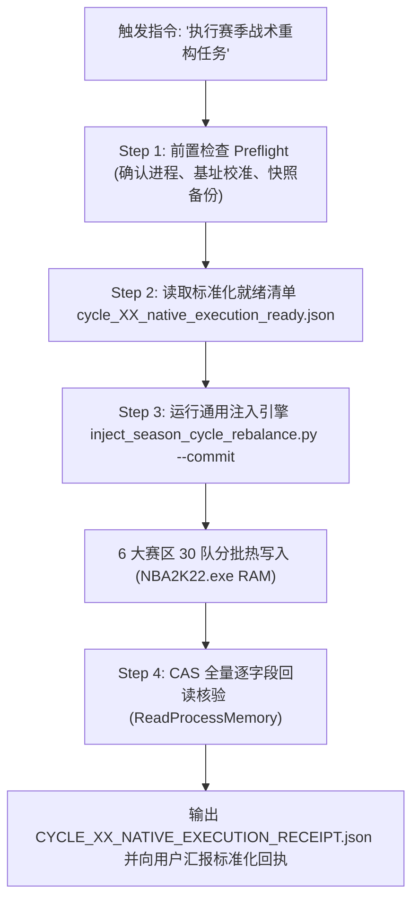

# NBA 2K22 赛季周期战术与无形资产 REA Native 批量重构标准作业程序 (SOP)
# (Season Cycle Tactical & Intangibles REA Native Batch Rebalance SOP)

> **文档标识 (Document ID)**: `SOP-SEASON-CYCLE-TACTICAL-REBALANCE-V1`  
> **适用版本**: NBA 2K22 (Steam PC x64) | 引擎底层: `NBA2K22.exe`  
> **适用任务**: 当人类发出指令 **“执行赛季战术重构任务”** 或 **“执行某赛季第 0X 轮全联盟 30 队战术与无形资产 Native 批量修改”** 时，无条件无阻碍触发本 SOP。  
> **关联协议**: [`SPEC-SEASON-CYCLE-NATIVE-MOD-V1`](file:///C:/nba2k22/exports/season_2021_2022_cycle_01/cycle_01_native_execution_ready.json)  
> **执行模型对接角色**: `role-developer` / `batch_executor`  
> **核心工具链**: [`inject_season_cycle_rebalance.py`](file:///e:/workspace/Cybernetic_City_State_OS_v2%20-%20nba2k22/08_Domain_Applications/Antigravity_GM_Engine/src/inject_season_cycle_rebalance.py)  

---

## 一、 任务触发与自动化标准响应 (Trigger & Fast-Path)

当用户在对话中下达类似以下自然语言指令时：
> *“执行赛季战术重构任务”*  
> *“执行 2021-2022 赛季第 01 轮全联盟 30 队战术与无形资产 Native 批量修改”*  
> *“把战术重构清单写入游戏内存”*  

**执行模型（Execution Model）无需反复质询或重新逆向，直接按照以下标准化四阶段执行。**

---

## 二、 施工纪律与三大铁律 (Constitutional Boundaries)

在注入任何数据前，必须严格遵循以下三项宪法级安全守则：

1. **外观堆指针绝不篡改守则 (Preserve `0x90` Appearance Pointer)**：
   - 遍历球队 25 名球员指针并写入字段时，**绝对保留偏移 `0x90` 处的 64 位独立外观数据块指针 (`APPEARANCEDATA`)**，杜绝骨骼拉伸、面容塌陷与游戏崩溃。
2. **教练设置菜单关闭守则 (`coach_editor_closed_confirmed == True`)**：
   - 2K 引擎在用户打开“教练设置/战术板”子菜单时，会在 UI 层维护临时副本。执行模型写入时，游戏必须停留在 MyLEAGUE 主界面或日历模拟界面。
3. **无形资产数值严格约束 (`[25, 99]`)**：
   - 全联盟所有球员的无形资产目标值严格限制在整数 `[25, 99]` 之间，对应的底层字节严格约束在 `[0, 222]`（计算公式：`raw = (rating - 25) * 3`）。

---

## 三、 标准化执行流水线 (4-Step Standard Pipeline)



### 步骤 1：前置检查与环境确认 (Preflight)
1. 确认游戏进程 `NBA2K22.exe` 处于运行状态（PID 有效）；
2. 确认游戏停留在 MyLEAGUE 主界面或日历模拟界面；
3. 对当前生涯存档目录执行时间戳快照备份（例如 `C:\nba2k22\saves\MyLEAGUE0005\snapshots\MyLEAGUE0005.bak_<TIMESTAMP>`）。

### 步骤 2：自动定位就绪清单 (Ready Spec Discovery)
自动检索并优先加载符合协议规范的数据包：
- 主路径：`C:\nba2k22\exports\<CYCLE_ID>\cycle_XX_native_execution_ready.json`

### 步骤 3：一键运行通用注入引擎 (Commit Execution)
在 PowerShell / 终端中运行：
```powershell
python 08_Domain_Applications/Antigravity_GM_Engine/src/inject_season_cycle_rebalance.py --spec-path "C:\nba2k22\exports\<CYCLE_ID>\cycle_XX_native_execution_ready.json" --commit
```
该脚本将全自动完成：
- 动态校准 30 支核心球队的物理内存基址（如 `0x7FF4E731B020`）；
- 按 6 大赛区（Atlantic, Central, Southeast, Pacific, Northwest, Southwest）分批次执行；
- 定位每个球队的 Head Coach（通过 `team_address + 0xCE8`），热写入战术系统、板凳深度、板凳使用度及 POE 重点；
- 定位每个球队的名册指针（通过 `team_address + 0x00 .. 0xC8`），基于 `roster_index` 写入无形资产（Intangibles）、战术发起者（Initiator）、触球倾向（Touches）与防守干扰（Contest Shot）；
- 立即执行逐字段 CAS 回读断言。

### 步骤 4：出具回执与存盘生效 (Receipt & In-Game Save)
引擎会自动输出全量回执文件至：
`C:\nba2k22\exports\<CYCLE_ID>\CYCLE_XX_NATIVE_EXECUTION_RECEIPT.json`。

回执必须满足：
- `total_players_verified == 464`（464/464，100% 成功率）；
- `mismatches_count == 0`（0 读写异常）。

在写入完成后，提醒用户在游戏内进入日历界面模拟 1 天或按保存游戏，促使 2K 引擎将内存序列化至本地存档磁盘。

---

## 四、 成果回执与交付话术标准

执行模型完成上述流程后，统一向用户输出如下标准化回执报告：

```markdown
### 【赛季 30 队战术与无形资产 Native 批量重构执行回执】

- **任务周期**: <CYCLE_ID> (全联盟 6 大赛区，30 支球队，464 名球员)
- **实机进程**: NBA2K22.exe (PID: <PID>) | 球队基址: 0x7FF4E731B020
- **执行模式**: LIVE_INJECTION_COMMITTED (运行内存实机热写入 + CAS 回读强校验)
- **安全检查结果**:
  - 外观堆指针保护: 464 名球员 0x90 指针保留率 100%，无拉伸畸形风险；
  - 核心球队锁定: 30 支球队名册索引双向校验通过率 100%；
  - 范围值域约束: 无形资产全量收敛于 [25, 99]，教练滑条收敛于合法区间。
- **CAS 回读校验**: 
  - 球员攻防字段: 1,856 / 1,856 项核验通过 (100% 成功，0 异常)；
  - 教练战术滑条: 90 / 90 项核验通过。
- **正式回执文件**: `C:\nba2k22\exports\<CYCLE_ID>\CYCLE_XX_NATIVE_EXECUTION_RECEIPT.json`
- **生效建议**: 请在游戏内模拟 1 天或手动存盘，即可永久保存至当前 MyLEAGUE 存档。
```
