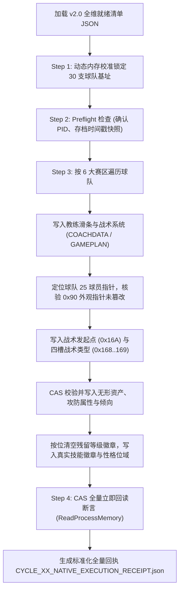

# NBA 2K22 全维度战术、教练与球员资产 REA Native 批量注入标准接口协议 (v2.0 全维通用规范)
# (Full-Dimensional Tactical, Coaching & Player Assets REA Native Batch Injection Protocol Specification v2.0)

> **协议标识 (Protocol ID)**: `SPEC-FULL-DIMENSIONAL-NATIVE-MOD-V2`  
> **适用版本**: NBA 2K22 (Steam PC x64) | 引擎底层: `NBA2K22.exe`  
> **适用场景**: 全联盟 30 队战术重构、赛季轮次调整（Cycle 01~04）、休赛期训练强化、选秀与自建名单批量注入。  
> **覆盖范围 (6 大核心维度)**:  
> 1. 球队与阵容信息 (`Team & Lineups`)  
> 2. 教练滑条与轮换深度 (`Coach Settings`)  
> 3. 战术板、发起点与自由战术 (`Tactical Playbook & Initiator`)  
> 4. 攻防重点与防守对位 (`POE & Defensive Gameplan`)  
> 5. 球员攻防属性与战术倾向 (`Player Attributes & Tendencies`, 含无形资产)  
> 6. 球员技能等级徽章与性格特征 (`Player Badges & Personality`)  
> **对接角色**:  
> - **发布方 (任务规划/数据输出)**: `role-planner` / `decision_architecture`  
> - **执行方 (批量热注入/回读校验)**: `role-developer` / `batch_executor`  

---

## 一、 协议核心设计原则与三大宪法守则 (Constitutional Principles)

为确保全联盟 30 支球队、464+ 名球员在实机运行内存（`NBA2K22.exe`）中一键安全生效且 100% 杜绝游戏崩溃与数据污染，上游模型必须严格遵循以下原则：

### 1. 外观堆指针绝不篡改守则 (Preserve `0x90` Appearance Pointer)
- 球员 1,264 字节结构体中，偏移 `0x90` 处的 64 位指针引用的独立外观数据块控制骨骼模型。
- **守则**：全维度批量修改过程中，**绝不触碰任何球员的 `0x90` 指针**，从根源上杜绝闪退与身材畸形。

### 2. 四维锁定精确寻址原则 (Deterministic 4-Point Addressing)
- 严禁仅提供球员纯文本名字。在 2K 庞大的球员池中，同名球员多达数个版本。
- 每个球员条目必须提供：
  1. `team_id`: 球队索引 (`0 ~ 29`)
  2. `roster_index`: 球队名册槽位序号 (`0 ~ 15`)
  3. `cyberface_id`: 官方真实面补 ID（防串号双重锚点校验）
  4. `player_name`: 校验用全名

### 3. 双轨数值与纯数字枚举 (Dual-Track Values & Pure Numeric ID)
- 所有数值同时给出人类可读数值（`val_human`）与内存底层直写字节（`val_raw`）；
- 涉及战术系统、POE、防守规则、战术类型等枚举时，**严禁输出混合字符串**（如 `"FEED_THE_POST (3)"`），必须标准化为纯数字 ID（如 `{"id": 3, "name": "FEED_THE_POST"}` 或直接输出 `val_raw: 3`），杜绝执行端正则解析脆弱性。

---

## 二、 六大维度数据结构与底层二进制偏移速查字典

### 维度 1：球队与阵容 (Team & Lineups)
- 球队数据块步长：`4,696 字节` (由 `AddressCalibrator.check_and_calibrate_teams()` 动态定位)
- 球队名册指针数组：`team_address + 0x00 .. 0xC8`（25 个 64 位球员结构体指针）
- 主教练指针：`team_address + 0xCE8`（64 位指针，指向该队主教练的 `STAFF` 结构体）
- 阵容首发/终结五虎：在 `lineups` 数组中记录 `roster_index`（0~15）或球员全名。

### 维度 2：教练滑条与轮换设置 (Coach Settings)
目标结构体：主教练 `COACHDATA`（步长 352 字节，通过 `team_address + 0xCE8` 定位）

| 字段名称 | 偏移 (十进制) | 偏移 (十六进制) | 数据类型 | 取值范围 | 业务含义与说明 |
| :--- | :---: | :---: | :---: | :---: | :--- |
| **Preferred System** | 266 | `0x10A` | `uint8` (低3位) | `0 ~ 7` | 偏好战术系统 (0=平衡, 1=磨阵地, 2=跑轰, 4=内线策应等) |
| **Active System** | 267 | `0x10B` | `uint8` (高4位) | `0 ~ 7` | 当前激活战术系统 (写入时: `raw = (raw & 0x0F) \| (id << 4)`) |
| **Bench Depth** | 268 | `0x10C` | `uint8` | `8 ~ 11` | 轮换人数 (常规赛锁定 9~10 人，季后赛 8 人) |
| **Bench Utilization** | 269 | `0x10D` | `uint8` | `0 ~ 100` | 替补使用率 (通常设为 45~65) |
| **Run Play Tendency** | 224 | `0x0E0` | `uint8` | `0 ~ 100` | 战术执行倾向 (跑战术频率，典型值 70~85) |
| **Zone Usage** | 226 | `0x0E2` | `uint8` | `0 ~ 100` | 联防使用频率 (通常为 0~25) |

### 维度 3：战术体系与发起点 (Tactical Playbook & Initiator)
目标结构体：球员结构体 `PLAYER_STRUCT`（步长 1,264 字节，`0x4F0`）

| 字段名称 | 偏移 (十进制) | 偏移 (十六进制) | 数据类型 / 位域 | 取值范围 | 业务含义与说明 |
| :--- | :---: | :---: | :---: | :---: | :--- |
| **Is Play Initiator** | 362 | `0x16A` | `uint8` | `0` 或 `1` | 战术发起者标志 (`1`=拥有控球发起权，`0`=终结者) |
| **Play Type Slot 1** | 360 | `0x168` | 低 4 位 (`& 0x0F`) | `0 ~ 15` | 第一主打战术类型 (枚举见下表) |
| **Play Type Slot 2** | 360 | `0x168` | 高 4 位 (`>> 4`) | `0 ~ 15` | 第二战术类型 |
| **Play Type Slot 3** | 361 | `0x169` | 低 4 位 (`& 0x0F`) | `0 ~ 15` | 第三战术类型 |
| **Play Type Slot 4** | 361 | `0x169` | 高 4 位 (`>> 4`) | `0 ~ 15` | 第四战术类型 |

**战术类型枚举表 (`Play Types Enum`)**:
- `0`: NONE (无)
- `1`: ISOLATION (单打)
- `2`: ISOLATION_POINT (控卫单打)
- `3`: ISOLATION_WING (侧翼单打)
- `4`: PR_BALL_HANDLER (挡拆持球人)
- `7`: PR_ROLL_MAN (挡拆下顺人)
- `8`: POST_UP_LOW (低位背身)
- `9`: POST_UP_HIGH (高位背身)
- `11`: CUTTER (空切拉开)
- `12`: HANDOFF_RECEIVER (手递手接球人)
- `13`: HANDOFF_PASSER (手递手传球人)
- `14`: MID_RANGE (中距离战术)
- `15`: THREE_POINT (三分定点/无球跑位战术)

### 维度 4：攻防重点与防守对位 (POE & Defensive Gameplan)
目标结构体：比赛策略数据块 `GAMEPLAN`（位于主教练关联的比赛计划块中）

| 策略字段 | 偏移 (十进制) | 典型 ID | 枚举名称与含义 |
| :--- | :---: | :---: | :--- |
| **POE Offense (进攻重点)** | 382 (`0x17E`) | `3` | `1`=冲击篮筐, `2`=为射手跑位, `3`=打低位内线, `4`=挡拆进攻 |
| **POE Offense Tempo (节奏)** | 383 (`0x17F`) | `7` | `7`=耐心阵地战 (Patient), `8`=中立, `9`=尽早出手反击 (Shoot at Will) |
| **POE Offense Rebound (前板)** | 384 (`0x180`) | `12` | `10`=全力冲抢前板, `12`=退防限制快攻 (Limit Transition) |
| **POE Defense (防守重点)** | 385 (`0x181`) | `13` | `13`=保护禁区 (Protect Paint), `15`=贴防外线三分 (Limit 3PT) |
| **POE Defense Physicality (对抗)** | 386 (`0x182`) | `18` | `16`=保守防犯规, `18`=强硬身体对抗 (Play Physical) |
| **POE Defense Rebound (后板)** | 387 (`0x183`) | `19` | `19`=保护防守篮板 (Crash Boards), `21`=快攻下反击 (Run Transition) |

### 维度 5：球员属性与战术倾向 (Attributes & Tendencies)
目标结构体：球员结构体 `PLAYER_STRUCT`（1,264 字节）

1. **核心攻防属性（29 项全量，`0x41F ~ 0x455`，单字节 `uint8`）**：
   - **换算公式**：$\text{Raw} = \min(255, \max(0, \lfloor(\text{Rating}-25)\times 3\rfloor))$
   - **无形资产 (Intangibles)**：`offset: 1088 (0x440)`，**决定队内相对有效综评，间接控制 AI 轮换出场时间**
   - 投篮属性：`shot_close (1060)`, `mid_range (1061)`, `three_point (1062)`, `free_throw (1063)`
   - 终结属性：`driving_layup (1055)`, `standing_dunk (1077)`, `driving_dunk (1078)`
   - 背身属性：`post_hook (1057)`, `post_fadeaway (1056)`, `post_moves (1058)`
   - 组织属性：`ball_control (1064)`, `pass_accuracy (1066)`, `pass_iq (1065)`, `pass_vision (1107)`
   - 防守属性：`interior_def (1069)`, `perimeter_def (1070)`, `lateral_quick (1071)`, `steal (1074)`, `block (1073)`, `pass_perception (1072)`
   - 篮板属性：`off_rebound (1067)`, `def_rebound (1068)`
   - 身体素质：`speed (1079)`, `speed_with_ball (1080)`, `acceleration (1081)`, `vertical (1082)`, `strength (1083)`, `stamina (1084)`, `hustle (1085)`

2. **战术倾向（29 项全量，`0x458 ~ 0x4BA`，直写整数 `0 ~ 100`）**：
   - 核心决策：`touches (1177)`, `shot (1112)`, `drive (1155)`, `dish_to_open_man (1176)`
   - 投篮倾向：`shot_close (1126)`, `shot_mid_range (1130)`, `shot_three (1138)`, `spot_up_three (1139)`
   - 防守倾向：`contest_shot (1207)`, `block_shot (1208)`, `on_ball_steal (1206)`, `pass_interception (1204)`
   - 内线与挡拆：`post_up (1178)`, `roll_vs_pop (1179)`, `attack_strong_on_drive (1175)`

### 维度 6：徽章与性格特征 (Badges & Personality)
目标结构体：球员结构体 `PLAYER_STRUCT`（`0x4BB ~ 0x4E2`）

1. **性格特征位域 (`0x4BB ~ 0x4C4`, 10 字节)**：
   - 领头羊 (Alpha Dog)、极具表现力 (Expressive)、禁区硬汉 (Enforcer)、团队至上 (Team Player)、微波炉 (Spark Plug) 等。
2. **技能等级徽章位域 (`0x4C5 ~ 0x4E2`, 30 字节位域，80 项技能徽章)**：
   - 等级：`0`=无, `1`=铜, `2`=银, `3`=金, `4`=紫 (Hall of Fame)
   - 每个技能等级徽章在底层占用 **3 位（Bits）**；
   - 写入前自动清除泥人残留技能等级徽章，写入后保留底层性格特征。

---

## 三、 标准化全维执行规格书 JSON Schema 模板 (Machine-Ready JSON Blueprint)

上游规划模型发布全维任务时，必须输出符合以下格式的单一 JSON 清单文件（例如：`cycle_XX_native_execution_ready.json`）：

```json
{
  "protocol_version": "v2.0_full_dimensional_native_mod",
  "task_package_id": "CYCLE_02_30_TEAMS_TACTICAL_AND_ATTR_REBALANCE",
  "season_id": "2021-2022",
  "target_career": "MyLEAGUE0005",
  "target_process": "NBA2K22.exe",
  "total_teams": 30,
  "total_players": 464,
  "batches": [
    {
      "batch_id": "BATCH_01_ATLANTIC",
      "division": "Atlantic",
      "teams": [
        {
          "team_id": 0,
          "team_abbr": "PHI",
          "team_name": "Philadelphia 76ers",

          "team_settings": {
            "team_chemistry": 85,
            "fan_interest": 92
          },

          "coaching_writes": [
            {
              "field_name": "active_system",
              "target_block": "COACHDATA",
              "offset": 267,
              "type": "uint8",
              "val_human": 4,
              "val_raw": 4,
              "desc": "Post Centric"
            },
            {
              "field_name": "bench_depth",
              "target_block": "COACHDATA",
              "offset": 268,
              "type": "uint8",
              "val_human": 9,
              "val_raw": 9
            },
            {
              "field_name": "bench_utilization",
              "target_block": "COACHDATA",
              "offset": 269,
              "type": "uint8",
              "val_human": 65,
              "val_raw": 65
            },
            {
              "field_name": "run_play_tendency",
              "target_block": "COACHDATA",
              "offset": 224,
              "type": "uint8",
              "val_human": 80,
              "val_raw": 80
            },
            {
              "field_name": "poe_offense",
              "target_block": "GAMEPLAN",
              "offset": 382,
              "type": "uint8",
              "val_raw": 3,
              "desc": "FEED_THE_POST"
            },
            {
              "field_name": "poe_defense",
              "target_block": "GAMEPLAN",
              "offset": 385,
              "type": "uint8",
              "val_raw": 13,
              "desc": "PROTECT_PAINT"
            }
          ],

          "player_writes": [
            {
              "player_name": "Joel Embiid",
              "roster_index": 4,
              "cyberface_id": 4090,
              "position": "C",
              "target_minutes": 37.0,

              "tactical_playbook": {
                "is_play_initiator": 1,
                "play_types": [8, 9, 7, 14]
              },

              "modifications": [
                {
                  "field": "intangibles",
                  "target_block": "PLAYER_STRUCT",
                  "offset": 1088,
                  "type": "uint8",
                  "val_human": 50,
                  "val_raw": 75,
                  "expected_prev_raw": 180,
                  "cas_formula": "raw = (val_human - 25) * 3"
                },
                {
                  "field": "touches",
                  "target_block": "PLAYER_STRUCT",
                  "offset": 1177,
                  "type": "uint8",
                  "val_human": 96,
                  "val_raw": 96
                },
                {
                  "field": "contest_shot",
                  "target_block": "PLAYER_STRUCT",
                  "offset": 1207,
                  "type": "uint8",
                  "val_human": 95,
                  "val_raw": 95
                },
                {
                  "field": "shot_close",
                  "target_block": "PLAYER_STRUCT",
                  "offset": 1060,
                  "type": "uint8",
                  "val_human": 92,
                  "val_raw": 201
                }
              ],

              "badges": {
                "RimProtector": 3,
                "Intimidator": 3,
                "PostDropStepper": 3,
                "BackdownPunisher": 3,
                "AlphaDog": 1
              }
            }
          ]
        }
      ]
    }
  ]
}
```

---

## 四、 执行端自动化流水线与验收闭环 (Automated Execution & CAS Acceptance)

执行模型拿到满足本 v2.0 协议的规格书后，自动执行以下标准化操作：



### 验收交付回执标准
每次执行完成后，在 `C:\nba2k22\exports\` 自动输出执行回执，核心断言指标：
1. `total_teams_executed == 30` (100% 成功)
2. `total_players_verified == 464` (100% 成功)
3. `mismatches_count == 0` (0 读写异常)
4. `appearance_pointer_0x90_integrity == 100.0%`
