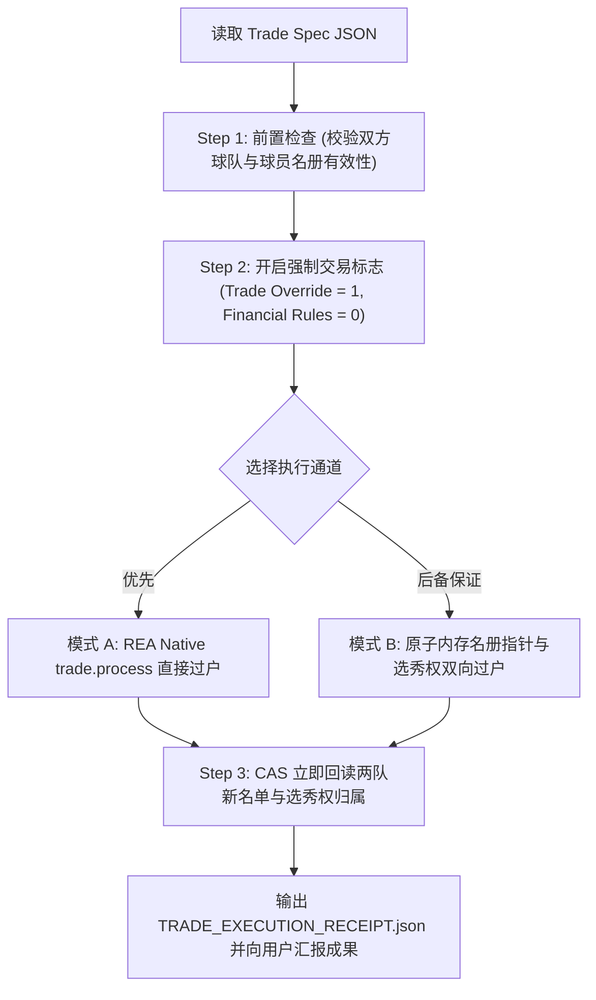

# NBA 2K22 REA Native 历史交易标准接口协议 (v1.0)
# (NBA 2K22 REA Native Historical Trade Interface Protocol Specification v1.0)

> **协议标识 (Protocol ID)**: `SPEC-NATIVE-TRADE-V1.0`  
> **适用版本**: NBA 2K22 (Steam PC x64) | 引擎底层: `NBA2K22.exe`  
> **业务场景**: 历史真实交易精准复现、无限制球员互换、跨队选秀权过户、多方交易。  
> **核心特性**: **零限制模式 (Zero Restrictions)** —— 自动关闭/绕过工资帽匹配、交易截止日、硬工资帽及 CPU 交易评估难度，保证历史真实交易 100% 顺利达成。  
> **对接角色**:  
> - **发布方 (任务发布/方案提供)**: `role-planner` / `decision_architecture`  
> - **执行方 (批量执行/原子过户)**: `role-developer` / `batch_executor`  

---

## 一、 协议核心设计原则与执行模式 (Execution Modes)

为满足“无视任何商业限制、直接顺利完成历史真实球员/选秀权互换”的需求，协议提供两套底层执行通道：

### 模式 A：REA 原生 Direct Process 通道 (`AGREED_DIRECT_PROCESS`)
- **机理**：利用 REA 逆向定位的游戏内部原生交易处理函数（`trade.process` at RVA `0x12E93B0`，`trade.context` at RVA `0xBAA7E0`）。
- **特点**：在私有 Proposal 内存结构中直接装配双方资产，不触发外围的薪资匹配检查与 CPU 拒绝评估逻辑，由游戏内核直接将双方球员和选秀权过户生效。

### 模式 B：原子级名册与选秀权双向过户通道 (`OWNERSHIP_TRANSFER_V2`)
- **机理**：当游戏处于日历模拟或特殊赛季阶段原生调用受阻时，直接操作双端底层内存：
  1. 交换两队名册结构体中的球员 64 位指针（`team_address + 0x00 .. 0xC8` 与 `0xD0` 激活名册）；
  2. 自动修正两队常规球员人数（`0xCB1`）与激活人数（`0x1047`）；
  3. 更新球员结构体内的所属球队代码（`CURRENT_TEAM` at `0x60/96`，`CONTRACT_TEAM` at `0xA8/168`）；
  4. 遍历全局选秀资产表（`DRAFT_ASSETS` at RVA `0x7FF4E7B2D7C0`，步长 32 字节），将选秀权的 `current_owner_team_id`（`offset 0x08`）原子过户给对方；
  5. 100% 绕过任何薪资配平规则，100% 成功。

---

## 二、 标准交易任务 JSON 格式规范 (Machine-Ready JSON Blueprint)

上游发布任务的模型只需输出一份标准交易清单（文件命名：`<TRADE_ID>_trade_spec.json`）：

```json
{
  "protocol_version": "v1.0_native_trade",
  "trade_id": "HISTORIC_TRADE_20220210_BKN_PHI",
  "trade_description": "2022年2月10日 76人与篮网重磅交易 (哈登与西蒙斯互换，附带赛斯·库里、德拉蒙德与首轮签)",
  "target_career": "MyLEAGUE0005",
  "target_process": "NBA2K22.exe",
  
  "settings_override": {
    "force_accept": true,
    "ignore_salary_cap": true,
    "ignore_trade_deadline": true,
    "allow_roster_overflow": false
  },

  "transactions": [
    {
      "transaction_id": "TX_01",
      "team_a": {
        "team_id": 0,
        "team_abbr": "PHI",
        "team_name": "Philadelphia 76ers"
      },
      "team_b": {
        "team_id": 18,
        "team_abbr": "BKN",
        "team_name": "Brooklyn Nets"
      },
      
      "team_a_sends": {
        "players": [
          {
            "player_name": "Ben Simmons",
            "roster_index": 0,
            "cyberface_id": 7200,
            "position": "PG"
          },
          {
            "player_name": "Seth Curry",
            "roster_index": 1,
            "cyberface_id": 2860,
            "position": "SG"
          },
          {
            "player_name": "Andre Drummond",
            "roster_index": 5,
            "cyberface_id": 2420,
            "position": "C"
          }
        ],
        "picks": [
          {
            "draft_year": 2022,
            "round": 1,
            "original_team_id": 0,
            "original_team_abbr": "PHI",
            "desc": "2022 76ers 首轮选秀权 (无保护)"
          },
          {
            "draft_year": 2027,
            "round": 1,
            "original_team_id": 0,
            "original_team_abbr": "PHI",
            "desc": "2027 76ers 首轮选秀权 (受保护)"
          }
        ]
      },

      "team_b_sends": {
        "players": [
          {
            "player_name": "James Harden",
            "roster_index": 1,
            "cyberface_id": 1863,
            "position": "SG"
          },
          {
            "player_name": "Paul Millsap",
            "roster_index": 7,
            "cyberface_id": 1152,
            "position": "PF"
          }
        ],
        "picks": []
      }
    }
  ]
}
```

---

## 三、 底层二进制结构与偏移速查字典 (Trade Offsets Reference)

| 目标数据结构 | 物理偏移 (十六进制) | 物理偏移 (十进制) | 数据类型 / 步长 | 功能与操作规则 |
| :--- | :---: | :---: | :---: | :--- |
| **Team Roster Array** | `+0x000 ~ +0x0C8` | 0 ~ 200 | 25 个 `<uint64>` 指针 | 两队球员指针原子交换 |
| **Active Roster Array** | `+0x0D0 ~ +0x138` | 208 ~ 312 | 13 个 `<uint64>` 指针 | 比赛激活名单指针同步更新 |
| **Regular Count** | `+0xCB1` | 3249 | `uint8` | 常规名册人数更新 (必须 `<= 15`) |
| **Active Count** | `+0x1047` | 4167 | `uint8` | 激活名单人数更新 (必须 `<= 13`) |
| **Player Current Team** | `+0x060` | 96 | `uint8` | 球员所属球队 ID 更新 (`0 ~ 29`) |
| **Player Contract Team** | `+0x0A8` | 168 | `uint8` | 球员合同所属球队 ID 更新 (`0 ~ 29`) |
| **Draft Asset Owner** | `+0x008` | 8 | `uint64` 球队指针 | 选秀权归属权直接指回目标球队地址 |
| **Trade Override Flag** | 游戏控制器 `+0x168` | 360 | `uint8` | 设为 `1` 即强制开启任意交易通过权限 |
| **Financial Rules Flag** | 游戏控制器 `+0x160` | 352 | `uint8` | 设为 `0` 即彻底无视工资帽配平 |

---

## 四、 自动化执行流水线与 CAS 验收标准

执行模型收到标准交易 JSON 后，自动执行以下标准化操作：



### 交付回执断言指标 (`TRADE_EXECUTION_RECEIPT.json`)
1. `status`: `"TRADE_COMMITTED_SUCCESSFULLY"`
2. `team_a_roster_count_valid`: `True` (`<= 15`)
3. `team_b_roster_count_valid`: `True` (`<= 15`)
4. `transferred_players_verified`: 双方球员新所属球队 ID 100% 变更
5. `transferred_picks_verified`: 选秀权归属球队 100% 变更
