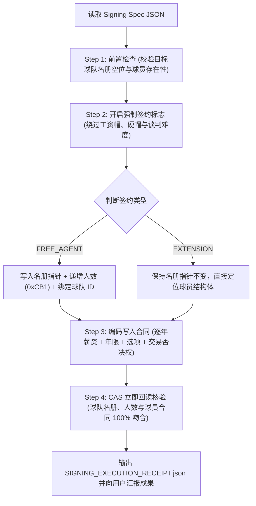

# NBA 2K22 REA Native 历史球员签约与续约标准接口协议 (v1.0)
# (NBA 2K22 REA Native Historical Signing & Extension Interface Protocol Specification v1.0)

> **协议标识 (Protocol ID)**: `SPEC-NATIVE-SIGNING-V1.0`  
> **适用版本**: NBA 2K22 (Steam PC x64) | 引擎底层: `NBA2K22.exe`  
> **业务场景**: 历史真实签约复现、自由球员认领/签约、核心球星提前续约、新秀标准合同签约、双向合同管理。  
> **核心特性**: **零限制模式 (Zero Restrictions)** —— 自动关闭/绕过工资帽（Salary Cap）、硬工资帽（Hard Cap）、奢侈税触发线、中产特例限制及 CPU 自由球员谈判签约意愿系统，保证历史上已发生的真实签约 100% 顺利生效。  
> **对接角色**:  
> - **发布方 (任务发布/方案提供)**: `role-planner` / `decision_architecture`  
> - **执行方 (批量执行/原子写入)**: `role-developer` / `batch_executor`  

---

## 一、 协议核心设计原则与业务类型 (Signing Types)

为满足“无视任何商业/工资帽限制、直接顺利完成历史真实球员签约与续约”的需求，协议支持四种签约业务模式：

### 1. 自由球员直接签约 (`FREE_AGENT`)
- **场景**：球员当前处于自由球员池（无所属球队），签约加盟指定目标球队。
- **底层执行动作**：
  1. 在目标球队的常规 15 人名册数组（`team_address + 0x00 .. 0x70`）中查找可用空位（`roster_slot`）；
  2. 将球员 64 位物理指针写入该槽位；
  3. 将球队常规球员计数（`0xCB1`）递增 1；
  4. 将球员结构体内的所属球队代码（`CURRENT_TEAM` at `0x60` 与 `CONTRACT_TEAM` at `0xA8`）更新为目标球队 ID；
  5. 按照给定的逐年薪资序列（`contract_year_1 ~ 6`）、合同年限（`years_left`）与选项类型，原子编码写入球员合同区。

### 2. 现有球员提前续约 / 重签 (`EXTENSION`)
- **场景**：球员已在目标球队名册中，签订新合同或提前延长现有合同。
- **底层执行动作**：
  1. 校验球员当前已在目标球队名册中；
  2. 保持名册指针与人数不变；
  3. 直接更新球员结构体中的逐年薪水、剩余年限与合同选项，达成无缝续约。

### 3. 新秀标准合同签约 (`ROOKIE_SCALE`)
- **场景**：历史选秀大会结束后，选中新秀正式签下标准 2+2 或 2+1 新秀合同。
- **底层执行动作**：与自由球员签约类似，将新秀从选秀池/新秀储备移入正式阵容，并写入标准新秀薪资。

### 4. 双向合同签约 (`TWO_WAY`)
- **场景**：发展联盟/双向合同球员加盟。
- **底层执行动作**：占用目标球队双向名额（`team_address + 0x78 .. 0x80`），更新双向计数与特殊合同标志。

---

## 二、 标准签约任务 JSON 格式规范 (Machine-Ready JSON Blueprint)

上游发布任务的模型只需输出一份标准签约清单（文件命名：`<SIGNING_ID>_signing_spec.json`）：

```json
{
  "protocol_version": "v1.0_native_signing",
  "signing_id": "HISTORIC_SIGNING_2021_OFFSEASON_LAL_MELO",
  "signing_description": "2021年休赛期 洛杉矶湖人队签约自由球员卡梅隆·安东尼 (1年老将底薪签约)",
  "target_career": "MyLEAGUE0005",
  "target_process": "NBA2K22.exe",

  "settings_override": {
    "ignore_salary_cap": true,
    "ignore_hard_cap": true,
    "force_sign": true,
    "allow_roster_overflow": false
  },

  "signings": [
    {
      "signing_item_id": "SIGN_01",
      "signing_type": "FREE_AGENT",
      "target_team": {
        "team_id": 13,
        "team_abbr": "LAL",
        "team_name": "Los Angeles Lakers"
      },
      "player": {
        "player_name": "Carmelo Anthony",
        "cyberface_id": 1022,
        "birth_date": "1984-05-29",
        "position": "PF",
        "current_status": "FREE_AGENT"
      },
      "contract": {
        "years": 1,
        "salaries": [
          2641691
        ],
        "option": "NONE",
        "no_trade": 0,
        "contract_type": "CORE"
      }
    },
    {
      "signing_item_id": "SIGN_02",
      "signing_type": "EXTENSION",
      "target_team": {
        "team_id": 14,
        "team_abbr": "GSW",
        "team_name": "Golden State Warriors"
      },
      "player": {
        "player_name": "Stephen Curry",
        "cyberface_id": 1603,
        "birth_date": "1988-03-14",
        "position": "PG",
        "current_status": "ON_ROSTER"
      },
      "contract": {
        "years": 4,
        "salaries": [
          48070014,
          51915615,
          55761216,
          59606817
        ],
        "option": "NONE",
        "no_trade": 1,
        "contract_type": "CORE"
      }
    }
  ]
}
```

---

## 三、 底层二进制结构与偏移速查字典 (Signing Offsets Reference)

| 目标数据结构 | 物理偏移 (十进制/十六进制) | 位域 (StartBit:Bits) | 数据类型 / 步长 | 功能与操作规则 |
| :--- | :---: | :---: | :---: | :--- |
| **Team Roster Slot N** | `slot * 8` (`+0x000 ~ +0x070`) | - | `<uint64>` 指针 | 将球员 64 位指针写入可用名册槽位 |
| **Team Regular Count** | 3249 (`+0xCB1`) | - | `uint8` | 常规球员人数更新 (`0 ~ 15`) |
| **Team Active Count** | 4167 (`+0x1047`) | - | `uint8` | 激活名单人数更新 (`0 ~ 13`) |
| **Player Current Team** | 96 (`+0x060`) | - | `uint64` / `uint8` | 球员当前所属球队 ID (`0 ~ 29`，自由球员为 `0xFF`) |
| **Player Contract Team** | 168 (`+0x0A8`) | - | `uint64` / `uint8` | 球员合同所属球队 ID (`0 ~ 29`) |
| **Contract Year 1** | 420 (`+0x1A4`) | `0:31` | `uint32` (31 bits) | 第一年薪资金额 (整数美元，高位保留) |
| **Contract Year 2** | 424 (`+0x1A8`) | `0:31` | `uint32` (31 bits) | 第二年薪资金额 |
| **Contract Year 3** | 428 (`+0x1AC`) | `0:31` | `uint32` (31 bits) | 第三年薪资金额 |
| **Contract Year 4** | 432 (`+0x1B0`) | `0:31` | `uint32` (31 bits) | 第四年薪资金额 |
| **Contract Year 5** | 436 (`+0x1B4`) | `0:31` | `uint32` (31 bits) | 第五年薪资金额 |
| **Contract Year 6** | 440 (`+0x1B8`) | `0:31` | `uint32` (31 bits) | 第六年薪资金额 |
| **Contract Option** | 791 (`+0x317`) | `4:2` | 2 bits 位域 | `0`: 无; `1`: 球队选项; `2`: 球员选项; `3`: 双年球队选项 |
| **Years Left On Contract**| 814 (`+0x32E`) | `2:4` | 4 bits 位域 | 合同剩余年限 (`1 ~ 6`) |
| **Original Contract Years**| 833 (`+0x341`) | `4:3` | 3 bits 位域 | 签约时初始总年限 (`1 ~ 6`) |
| **Contract Type** | 836 (`+0x344`) | `3:3` | 3 bits 位域 | `0`: CORE; `1`: HARDSHIP; `2`: TWO_WAY |
| **No-Trade Clause** | 838 (`+0x346`) | `4:1` | 1 bit 位域 | 交易否决权 (`0`: 无; `1`: 拥有) |

---

## 四、 自动化执行流水线与 CAS 验收标准

执行模型收到标准签约 JSON 后，自动执行以下标准化操作：



### 交付回执断言指标 (`SIGNING_EXECUTION_RECEIPT.json`)
1. `status`: `"SIGNINGS_COMMITTED_SUCCESSFULLY"`
2. `all_signings_verified`: `True`
3. `team_roster_count_valid`: 每支目标球队人数不超过 15
4. `contracts_verified`: 逐年薪资金额、年限与选项回读 100% 精确一致
5. `team_ownership_verified`: 球员所属球队 ID 与合同所属球队 ID 100% 匹配目标球队
