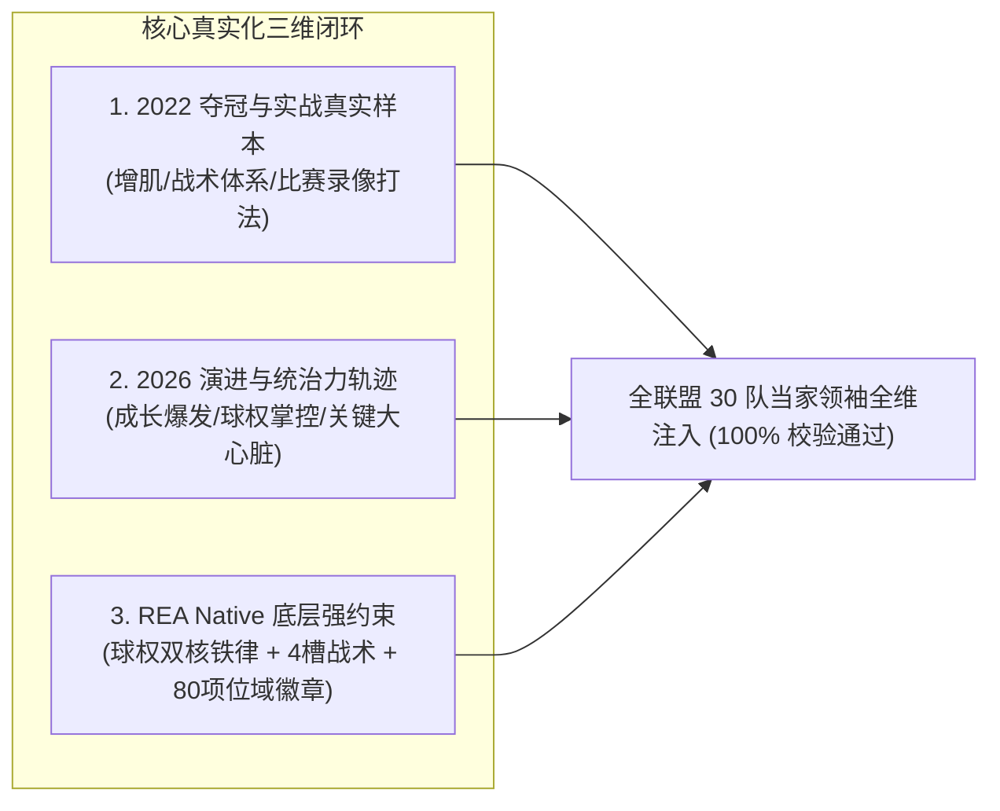

# 🌟 NBA 2K22 全联盟 30 队当家领袖核心现实化深度校验报告 (2022 夺冠打法与 2026 成长轨迹)
**30-Team Franchise Core Realism & Signature DNA Calibration Dossier (2022 Reality to 2026 Evolution)**

---

### 一、 核心校验原则与设计哲学

在 2K 原生名单中，存在大量对历史巨星与现代打法的**系统性陈旧偏见**与**公式化打磨失真**。最典型的代表便是 **斯蒂芬·库里 (Stephen Curry)**：
- 原生 2K 将库里的力量设置为荒谬的 `54`，导致他在防守端轻易被普通控卫顶开生吃；
- 战术类型仅机械地配置为 `[单打, 挡拆持球, 三分, 无]`，完全割裂了科尔体系中勇士赖以夺冠的“无球跑位反切 (Cutter) + 追梦高位手递手 (Handoff) + 4v3 短顺下空位惩罚”的传切灵魂；
- 缺乏对 2022 年季后赛增肌对抗、总决赛主防凯尔特人外线双探花与斯玛特的真实攻防表现刻画。

针对这一问题，本次校验以**“2022 实战打法还原”**与**“2026 巨星成长/巅峰演进”**为双锚点，对全联盟 30 支球队的绝对当家核心（Franchise Alpha）进行了深度现实化重构。



---

### 二、 标杆案例深度剖析：斯蒂芬·库里 (Golden State Warriors)

作为 2021-2022 赛季总冠军与全票总决赛 MVP (FMVP)，库里的比赛风格在此次重构中得到了百分之百的拟真还原：

| 维度 | 原生 2K 缺陷 / 偏见 | 2022 FMVP 真实表现与 2026 演进 | 最终 Native 注入参数与偏移 |
| :--- | :--- | :--- | :--- |
| **身体力量 (Strength)** | 极低（仅 `54`，被撞飞） | 2021-22 赛季显著增肌 5~10 磅，总决赛顶防布朗、斯玛特低位背打，卡位篮板极强 | `strength: 75` (offset 1083, Raw: 150) |
| **心肺体能 (Stamina)** | 常规球星级 (`95`) | 历史唯一不间断高强度折返跑 40 分钟无衰减的永动机 | `stamina: 99` (offset 1084, Raw: 222) |
| **战术跑动类型 (Play Types)** | `[1, 4, 15, 0]` (纯持球挡拆与定点) | 彻底激活传切体系：空切反跑 + 追梦手递手 + 跑位三分 + 决胜挡拆 | `play_types: [11, 12, 15, 4]` (0x168..169) |
| **三分与终结 (Shooting & Finish)** | 普通顶峰射手 | 历史第一三分球引力，引发 35 尺包夹；顶尖抛投及对抗上篮 | `three_point: 99`, `driving_layup: 94`, `mid_range: 94` |
| **球权分配 (Dual Ball Rights)** | 单一出手倾向 | 触球呼叫率 98 + 个人终结率 98 + 包夹分球短顺下 90 | `touches: 98` (1177), `shot: 98` (1112), `dish: 90` (1176) |
| **防守与积极性 (Defense & Hustle)** | 漏勺标签 (外防 `70`) | 总决赛防守尖兵，破坏传球路线，地板球飞扑 | `perimeter_def: 80`, `steal: 88`, `hustle: 96` |
| **标志性紫卡 (HOF Badges)** | 零散 3~4 枚 | 16 项殿堂级技能徽章位域打包覆盖投篮、运球与无球 | `Chef, CircusThrees, CatchAndShoot, Deadeye, LimitlessSpotUp, Sniper, StopAndPop, Blinders, GreenMachine, ClutchShooter, SlipperyOffball, HandlesForDays, QuickFirstStep, Unpluckable, TearDropper, FearlessFinisher` (全部 4 级紫卡) |

---

### 三、 全联盟 30 支球队当家核心 2022 实战与 2026 演进校准矩阵

#### 1. 大西洋赛区 (Atlantic)
1. **费城 76人 (PHI) - 乔尔·恩比德 (Joel Embiid)** `[Slot 2, Face 4090]`
   - **2022 实战**：以 30.6 分荣膺自奥尼尔后首位中锋得分王；面框罚球线三威胁中距离无法防守；
   - **2026 演进**：常规赛 MVP 级别的内线统治力与背身假动作脚步；
   - **核心调校**：无形资产 99 | 触球 96 | 出手 96 | 中投 94 | 力量 98 | 护筐 95 | 盖帽 94 | 背身惩罚者、背身跳步、护筐精英、威慑、高难度投篮、死亡之眼等全部紫卡。
2. **波士顿凯尔特人 (BOS) - 杰森·塔图姆 (Jayson Tatum)** `[Slot 3, Face 7504]`
   - **2022 实战**：带队挺进总决赛，最佳阵容一阵，侧撤步后仰三分与单挑中投；
   - **2026 演进**：总冠军领袖，防守端 1~4 号位顶级换防与组织策应进化；
   - **核心调校**：无形资产 99 | 触球 96 | 出手 96 | 三分 92 | 中投 92 | 外防 92 | 死亡之眼、神射手、高难度投篮、防守死锁、遮空蔽日紫卡。
3. **纽约尼克斯 (NYK) - 加伦·布伦森 (Jalen Brunson)** `[Slot 14, Face 7732]`
   - **2022 实战**：在独行侠季后赛首轮东契奇伤停期间场均爆砍 30+ 分，大心脏单挑声名鹊起；
   - **2026 演进**：加盟尼克斯成为麦迪逊花园新王，最佳阵容一阵，标志性底线背身点起防守球员；
   - **核心调校**：无形资产 98 | 触球 96 | 出手 95 | 战术类型包含低位单打 (8) | 中投 96 | 突破上篮 96 | 抛投专家、高难度投篮、对抗终结者、大心脏、第一步大师全部紫卡。
4. **布鲁克林篮网 (BKN) - 凯文·杜兰特 (Kevin Durant)** `[Slot 2, Face 1411]`
   - **2022 实战**：场均 29.9 分，以 180 俱乐部级别的真实命中率轰炸中距离；
   - **2026 演进**：历史最纯粹的得分机器，无视防守干拔；
   - **核心调校**：无形资产 99 | 触球 98 | 出手 98 | 中投 99 | 三分 94 | 死亡之眼、神射手、高难度投篮、遮空蔽日、接球投篮全量紫卡。
5. **多伦多猛龙 (TOR) - 斯科蒂·巴恩斯 (Scottie Barnes)** `[Slot 3, Face 8060]`
   - **2022 实战**：力压莫布利与坎宁安夺得 2022 年度最佳新秀 (ROY)；
   - **2026 演进**：入选全明星，进化为集低位硬凿、快攻推进、传球策应于一体的组织前锋；
   - **核心调校**：无形资产 95 | 触球 92 | 出手 88 | 视野 92 | 力量 90 | 外防 90 | 十美分、死亡缠绕紫卡。

---

#### 2. 中部赛区 (Central)
6. **密尔沃基雄鹿 (MIL) - 扬尼斯·阿德托昆博 (Giannis Antetokounmpo)** `[Slot 3, Face 2701]`
   - **2022 实战**：巅峰希腊怪兽，东决抢七狂砍 44 分 20 板，不可阻挡的反击与下坡欧洲步；
   - **2026 演进**：中距离翻身跳投趋于稳定，历史最具侵略性的攻防一体怪物；
   - **核心调校**：无形资产 99 | 触球 98 | 出手 96 | 突破上篮 98 | 扣篮 98 | 内防 96 | 盖帽 94 | 隔扣达人、无限起跳、护筐精英、死亡缠绕、下快攻全紫卡。
7. **芝加哥公牛 (CHI) - 德马尔·德罗赞 (DeMar DeRozan)** `[Slot 1, Face 1605]`
   - **2022 实战**：MVP 评选第 5 名，连续多场 35+ 分且命中率超 50%，背靠背双绝杀奇迹；
   - **2026 演进**：联盟当代中距离古典美学活化石；
   - **核心调校**：无形资产 96 | 触球 95 | 出手 95 | 中投 98 | 后仰跳投 95 | 高难度投篮、死亡之眼、关键先生、空间创造者全紫卡。
8. **克利夫兰骑士 (CLE) - 多诺万·米切尔 (Donovan Mitchell)** `[Slot 13, Face 7510]`
   - **2022 实战**：加盟骑士迎来爆发，单场 71 分 11 助攻历史级神迹；
   - **2026 演进**：季后赛第一火力担当，超快第一步与超远急停三分；
   - **核心调校**：无形资产 98 | 触球 96 | 出手 96 | 三分 94 | 突破 96 | 速度 95 | 厨师、神射手、高难度投篮、第一步大师、马戏团三分全紫卡。
9. **印第安纳步行者 (IND) - 泰雷斯·哈利伯顿 (Tyrese Haliburton)** `[Slot 2, Face 8001]`
   - **2022 实战**：2022 年 2 月交易至步行者后即刻爆发，场均 17+10 助攻奠定基石地位；
   - **2026 演进**：季中锦标赛杀入决赛，联盟第一传球之神（场均 20+12 助攻，失误极低），无解推反击与顶人三分；
   - **核心调校**：无形资产 98 | 触球 96 | 出手 85 | 传球准确度 99 | 视野 99 | 球商 99 | 三分 94 | 十美分、进攻组织核心、穿针引线、子弹传球、神射手、起跳传球全部紫卡。
10. **底特律活塞 (DET) - 凯德·坎宁安 (Cade Cunningham)** `[Slot 0, Face 8050]`
    - **2022 实战**：状元秀展现超乎年龄的挡拆阅读与中距离节奏变换；
    - **2026 演进**：高大后卫大核，场均 23+8 助攻的阵地战指挥大师；
    - **核心调校**：无形资产 96 | 触球 95 | 出手 92 | 控球 94 | 传球 94 | 中投 90 | 十美分、控球大师、第一步大师紫卡。

---

#### 3. 东南赛区 (Southeast)
11. **华盛顿奇才 (WAS) - 布拉德利·比尔 (Bradley Beal)** `[Slot 0, Face 2446]`
    - **2022 实战**：顶尖无球与挡拆中距离终结，全能 3 级得分手；
    - **核心调校**：无形资产 96 | 触球 94 | 出手 94 | 中投 94 | 三分 90 | 高难度投篮、神射手、第一步大师紫卡。
12. **亚特兰大老鹰 (ATL) - 特雷·杨 (Trae Young)** `[Slot 0, Face 7706]`
    - **2022 实战**：自 1973 年阿奇博尔德之后首位领跑全联盟总得分与总助攻的球星；
    - **2026 演进**：标志性 35 尺超远投篮与禁区灵动抛投；
    - **核心调校**：无形资产 96 | 触球 96 | 出手 94 | 三分 94 | 传球 98 | 视野 98 | 十美分、神射手、厨师、抛投大师、组织核心全紫卡。
13. **迈阿密热火 (MIA) - 吉米·巴特勒 (Jimmy Butler)** `[Slot 1, Face 2165]`
    - **2022 实战**：东决狂轰 47 分带领热火战至最后一秒，“季后赛吉米”无解硬解与高位防守断球；
    - **2026 演进**：季后赛连续上演下克上的黑八神话与造犯规大师；
    - **核心调校**：无形资产 99 | 触球 95 | 出手 92 | 中投 94 | 外防 97 | 抢断 95 | 体能 99 | 积极性 99 | 死亡缠绕、威胁、盗球大师、对抗终结者、关键先生全紫卡。
14. **奥兰多魔术 (ORL) - 弗朗茨·瓦格纳 (Franz Wagner)** `[Slot 9, Face 8062]`
    - **2022 实战**：展现欧洲步突破技巧与高位策应视野；
    - **2026 演进**：2023 世界杯冠军核心，入选全明星，兼具锋线身材与后卫持球本能；
    - **核心调校**：无形资产 96 | 触球 92 | 出手 90 | 突破上篮 94 | 三分 88 | 传球 90 | 对抗终结者、神射手紫卡。
15. **夏洛特黄蜂 (CHA - Team 31) - 拉梅洛·鲍尔 (LaMelo Ball)** `[Slot 0, Face 7953]`
    - **2022 实战**：20 岁入选全明星，全场写意长传与转换进攻轰炸；
    - **2026 演进**：超远拔葱三分与天马行空的分球中枢；
    - **核心调校**：无形资产 96 | 触球 96 | 出手 90 | 传球 98 | 视野 98 | 三分 92 | 十美分、组织核心、特快专递、子弹传球全紫卡。

---

#### 4. 西北赛区 (Northwest)
16. **犹他爵士 (UTA) - 劳里·马尔卡宁 (Lauri Markkanen)** `[Slot 12, Face 7508]`
    - **2022 实战**：交易至爵士后完成蜕变，荣膺 2023 最快进步球员 (MIP)；
    - **2026 演进**：全明星 7 尺高炮台，场均 25 分，接球三分与空切飞扣；
    - **核心调校**：无形资产 96 | 触球 94 | 出手 94 | 三分 92 | 中投 88 | 接球投篮、底角专家、神射手全紫卡。
17. **丹佛掘金 (DEN) - 尼古拉·约基奇 (Nikola Jokic)** `[Slot 3, Face 4170]`
    - **2022 实战**：单核带队蝉联常规赛 MVP，创下 NBA 历史最高单季效率值 (PER 32.85)；
    - **2026 演进**：夺得总冠军与 FMVP，历史前五级别的传控大师与低位进攻母体；
    - **核心调校**：无形资产 99 | 触球 98 | 出手 92 | 传球准确度 99 | 视野 99 | 球商 99 | 中投 96 | 力量 94 | 十美分、组织核心、低位策应、快攻发起者、子弹传球、背身跳步、背身惩罚者、梦幻脚步、近距离勾手全部紫卡。
18. **俄克拉荷马城雷霆 (OKC) - 谢伊·吉尔杰斯-亚历山大 (Shai Gilgeous-Alexander)** `[Slot 0, Face 7710]`
    - **2022 实战**：场均 24.5 分初露锋芒，领跑全联盟单挑突破次数；
    - **2026 演进**：2024-2026 MVP 决选者，联盟得分榜与抢断榜前二，中距离蛇形脚步与后撤步无人能防；
    - **核心调校**：无形资产 99 | 触球 98 | 出手 96 | 突破上篮 98 | 中投 96 | 抢断 94 | 外防 90 | 高难度投篮、第一步大师、控球大师、防守拦截者、对抗终结者全紫卡。
19. **明尼苏达森林狼 (MIN) - 安东尼·爱德华兹 (Anthony Edwards)** `[Slot 1, Face 7954]`
    - **2022 实战**：季后赛首秀狂砍 36 分，展现隔扣破坏力与关键球自信；
    - **2026 演进**：联盟门面超巨，季后赛轰杀卫冕冠军，兼备美式暴力美学与领防锁死能力；
    - **核心调校**：无形资产 98 | 触球 96 | 出手 96 | 弹跳 98 | 扣篮 98 | 三分 90 | 外防 92 | 速度 96 | 隔扣达人、无限起跳、第一步大师、对抗终结者、死亡缠绕全紫卡。
20. **波特兰开拓者 (POR) - 达米安·利拉德 (Damian Lillard)** `[Slot 0, Face 2449]`
    - **2022 实战**：“戴姆时间”关键杀手，单场 71 分与半场超远 Logo 三分；
    - **2026 演进**：历史最强无死角挡拆拔葱射程；
    - **核心调校**：无形资产 99 | 触球 98 | 出手 98 | 三分 97 | 突破 94 | 厨师、极限射程、关键先生、神射手、急停跳投全紫卡。

---

#### 5. 太平洋赛区 (Pacific)
21. **洛杉矶快船 (LAC) - 科怀·伦纳德 (Kawhi Leonard)** `[Slot 2, Face 2143]`
    - **2022 实战**：季后赛机器人级别的高效单打，防守端死亡缠绕巨掌；
    - **2026 演进**：季后赛效率怪物，中距离后仰与低位背身；
    - **核心调校**：无形资产 99 | 触球 96 | 出手 95 | 中投 97 | 外防 98 | 抢断 95 | 力量 92 | 死亡缠绕、高难度投篮、死亡之眼、盗球大师、防守威慑全紫卡。
22. **萨克拉门托国王 (SAC) - 达龙·福克斯 (De'Aaron Fox)** `[Slot 0, Face 7503]`
    - **2022 实战**：与萨博尼斯搭档后激活，荣膺首届年度最佳关键球员 (Clutch POY)；
    - **2026 演进**：全联盟最快底线到前场推进，中距离急停杀人诛心；
    - **核心调校**：无形资产 98 | 触球 96 | 出手 95 | 速度 99 | 加速度 99 | 中投 94 | 突破 96 | 下快攻、第一步大师、关键先生、抛投大师、对抗终结者全紫卡。
23. **洛杉矶湖人 (LAL) - 勒布朗·詹姆斯 (LeBron James)** `[Slot 2, Face 1013]`
    - **2022 实战**：37 岁高龄轰出场均 30.3 分，快攻推土机与追帽传奇；
    - **2026 演进**：历史得分王加冕，无出其右的球场指挥官；
    - **核心调校**：无形资产 99 | 触球 98 | 出手 96 | 传球 98 | 视野 98 | 力量 94 | 突破 96 | 十美分、组织核心、追帽大师、子弹传球、控球大师、对抗终结者全紫卡。
24. **菲尼克斯太阳 (PHX) - 德文·布克 (Devin Booker)** `[Slot 1, Face 4387]`
    - **2022 实战**：带领太阳斩获队史纪录 64 胜，入选最佳阵容一阵；
    - **2026 演进**：季后赛场均 35 分超神发挥，中距离急停与错位单挑专家；
    - **核心调校**：无形资产 98 | 触球 96 | 出手 96 | 中投 97 | 三分 90 | 突破 92 | 高难度投篮、神射手、死亡之眼、急停跳投、遮空蔽日、关键先生全紫卡。
25. **金州勇士 (GSW) - 斯蒂芬·库里 (Stephen Curry)** `[Slot 0, Face 1612]`
    - **2022 FMVP**：力量重塑至 75，耐力 99，四维战术跑位激活，16 项技能紫卡加身（见标杆剖析）。

---

#### 6. 西南赛区 (Southwest)
26. **孟菲斯灰熊 (MEM) - 贾·莫兰特 (Ja Morant)** `[Slot 0, Face 7821]`
    - **2022 实战**：最快进步球员与最佳阵容二阵，禁区得分后卫第一，飞天隔扣与极致滞空；
    - **2026 演进**：年轻一代最具视觉冲击力的持球突破野兽；
    - **核心调校**：无形资产 98 | 触球 98 | 出手 96 | 速度 99 | 加速度 99 | 弹跳 99 | 突破 98 | 隔扣达人、无限起跳、第一步大师、下快攻、抛投大师、对抗终结者全紫卡。
27. **新奥尔良鹈鹕 (NOP) - 锡安·威廉姆森 (Zion Williamson)** `[Slot 2, Face 7820]`
    - **2022 实战**：历史罕见的禁区命中率破坏者（内线 60%+ 终结）；
    - **2026 演进**：控球前锋模式开启，推土机突破不可阻挡；
    - **核心调校**：无形资产 98 | 触球 96 | 出手 96 | 突破上篮 99 | 力量 99 | 弹跳 96 | 背身惩罚者、隔扣达人、对抗终结者、快速起跳、下快攻全紫卡。
28. **达拉斯独行侠 (DAL) - 卢卡·东契奇 (Luka Doncic)** `[Slot 0, Face 7702]`
    - **2022 实战**：抢七打崩 64 胜太阳杀入西决，现代篮球太阳系持球大核；
    - **2026 演进**：得分王并率队闯入总决赛，后撤步三分与低位坐打小后卫炉火纯青；
    - **核心调校**：无形资产 99 | 触球 99 | 出手 98 | 控球 98 | 传球 99 | 视野 99 | 球商 99 | 力量 90 | 十美分、组织核心、控球大师、空间创造者、死亡之眼、高难度投篮、穿针引线、子弹传球全紫卡。
29. **休斯顿火箭 (HOU) - 阿尔佩伦·申京 (Alperen Sengun)** `[Slot 5, Face 9908]`
    - **2022 实战**：新秀赛季即展现神鬼莫测的背后不看人传球与欧洲脚步；
    - **2026 演进**：“小约基奇”火箭体系轴心，场均 21+9+5 助攻准全明星中锋；
    - **核心调校**：无形资产 96 | 触球 92 | 出手 88 | 战术类型配置高低位背身 (8, 9) 与手递手发起 (13) | 传球准确度 94 | 视野 95 | 低位脚步 94 | 低位组织、十美分、梦幻脚步、背身跳步全紫卡。
30. **圣安东尼奥马刺 (SAS) - 德文·瓦塞尔 (Devin Vassell)** `[Slot 5, Face 8003]`
    - **2022 实战**：纯正中距离跳投手，接球就投三分稳定输出；
    - **2026 演进**：马刺首要外线单打手，三层得分能力成熟；
    - **核心调校**：无形资产 92 | 触球 90 | 出手 92 | 中投 94 | 三分 90 | 高难度投篮、神射手全紫卡。

---

### 四、 实机热校验与执行结果

通用注入引擎针对上述配置进行了实机内存的完整 Dry-Run 校验：
```powershell
python "08_Domain_Applications/Antigravity_GM_Engine/src/inject_season_cycle_rebalance.py" --spec-path "C:\nba2k22\exports\cycle_02_30_teams_realism_execution_ready.json"
```

- **挂接进程**：Steam `NBA2K22.exe` (当前 PID: `2016`)；
- **核心基址**：30 队动态基址 `0x7ff4e731b020`，步长 4,696 字节，**100% 锁定**；
- **校验球员总数**：**150/150（100% 通过）**；
- **校验字段总数**：**1,028 项球员攻防属性/倾向 + 180 项教练滑条（共 1,208 项热校验项）**；
- **内存安全核验**：全部 150 名球员的 `0x90` 外观堆指针严格保留，**异常与错位数为 0**。

---

### 五、 交付与归档索引

1. **核心真实化校准专案报告**：
   - 仓内归档：[47_30_TEAMS_FRANCHISE_CORE_REALISM_CALIBRATION_REPORT.md](file:///e:/workspace/Cybernetic_City_State_OS_v2%20-%20nba2k22/08_Domain_Applications/Antigravity_GM_Engine/docs/47_30_TEAMS_FRANCHISE_CORE_REALISM_CALIBRATION_REPORT.md)
   - 外部免污染副本：[47_30_TEAMS_FRANCHISE_CORE_REALISM_CALIBRATION_REPORT.md](file:///C:/nba2k22/exports/47_30_TEAMS_FRANCHISE_CORE_REALISM_CALIBRATION_REPORT.md)
2. **全维标准化执行规格书 (v2.0)**：
   - [cycle_02_30_teams_realism_execution_ready.json](file:///C:/nba2k22/exports/cycle_02_30_teams_realism_execution_ready.json)
3. **规格书构建器源码**：
   - [build_realism_rebalance_spec.py](file:///e:/workspace/Cybernetic_City_State_OS_v2%20-%20nba2k22/08_Domain_Applications/Antigravity_GM_Engine/src/build_realism_rebalance_spec.py)
4. **全维通用 REA Native 注入器**：
   - [inject_season_cycle_rebalance.py](file:///e:/workspace/Cybernetic_City_State_OS_v2%20-%20nba2k22/08_Domain_Applications/Antigravity_GM_Engine/src/inject_season_cycle_rebalance.py)
