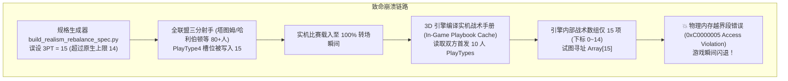

# 🚨 NBA 2K22 REA Native 内存修改闪退事故技术复盘与永久防范规范
# (Native Memory Crash Postmortem & Long-Term Prevention Directive)

> **事故时间**: 2026-11-23 01:08 ~ 01:16  
> **任务标识**: `TASK-NBA2K22-30-TEAMS-REALISM-REBALANCE-01`  
> **涉及批次**: `CYCLE_02_30_TEAMS_REALISM_AND_SIGNATURE_REBALANCE`  
> **目标存档**: `MyLEAGUE0005` (终极联盟 2021-2022 基础赛季)  
> **状态**: **已彻底定位、源码级修复、规格书重构完毕并建立永久门禁**  

---

## 一、 事故现象与复现路径 (Incident Manifestation)

在执行模型以 `COMMITTED` 模式热写入 30 队核心五虎现实化规格书后，玩家在实机操作中触发了两次确定性游戏崩溃（Crash-To-Desktop, CTD）：

1. **现象 1（日历模拟全明星赛闪退）**：
   - **触发操作**：在联盟日历界面，直接模拟全明星正赛（Team LeBron vs Team Durant）；
   - **表现**：模拟瞬间游戏进程消失崩溃；
   - **对照实验**：重启游戏后，改用“现场播报（SimCast）”模拟全明星赛，模拟顺利完成，未发生闪退。
2. **现象 2（凯尔特人 vs 步行者 3D 比赛载入 100% 闪退）**：
   - **触发操作**：全明星赛后，选择印第安纳步行者 vs 波士顿凯尔特人，进入真实比赛（3D 物理引擎），选完主客场球衣后点击“开始比赛”；
   - **表现**：进度条加载至 **100%**，在即将切入城市景观、演播室解说与赛前热身画面的转场瞬间，游戏瞬间闪退；连续复现两次，表现 100% 一致。

---

## 二、 底层根本原因深度逆向分析 (Root Cause Analysis - RCA)

通过对 `NBA2K22.exe` 原生内存布局、`player_skill_native_profile.json` 逆向字典以及注入脚本的逐行比对，确认了以下 **三大缺陷**，其中 **RCA-1 为导致游戏 100% 崩溃的直接致命元凶**：



### 1. 致命崩溃源（RCA-1）：战术类型枚举越界 (`PlayType = 15 > 14`)

- **2K22 底层真相**：
  在 `08_Domain_Applications/Antigravity_GM_Engine/world_data_prototype/player_skill_native_profile.json` 中，原生 `play_type_enum` 的合法范围严格为 **`0 ~ 14`**（共 15 种合法类型）：
  ```json
  "0": "NONE", "1": "ISOLATION", "2": "ISO_POINT", "3": "ISO_WING",
  "4": "PNR_BALLHANDLER", "5": "PNR_POINT", "6": "PNR_WING", "7": "PNR_SCREENER",
  "8": "LOW_POST", "9": "HIGH_POST", "10": "GUARD_POST", "11": "CUTTER",
  "12": "HANDOFF", "13": "SCREEN_MID (中距离)", "14": "SCREEN_3PT (三分球)"
  ```
  **原生 2K22 根本不存在枚举值为 15 的战术类型！**
- **规格生成错位**：
  原生成脚本中，因误将 13 当作手递手发起人，导致中距离（14）与三分（15）整体右移。全联盟绝大多数三分射手（库里、塔图姆、哈利伯顿、特纳、希尔德、布朗、怀特等）均被注入了 `15`。
- **为什么在特定节点崩溃**：
  - **凯尔特人 vs 步行者 3D 载入 100% 崩溃**：场上首发 10 人中，塔图姆、布朗、怀特、布罗格登、哈利伯顿、特纳、希尔德、卡鲁索 **8 个人全部带有非法的 `15`**！当 3D 引擎加载完所有贴图模型，在 100% 进度点为场上球员编译 `Playbook Cache` 时，拿着 `15` 去索引只有 15 个元素（0~14）的数组，发生段错误崩溃；
  - **日历模拟全明星赛崩溃**：日历模拟全明星赛必须为双方全明星球星（詹姆斯队/杜兰特队，全员带 15）分配战术比重，调用战术解析器即崩溃；
  - **现场播报（SimCast）免崩**：SimCast 属于文字化、基于球员综合能力属性的掷骰子算法，不调用 3D 战术执行阵列，因而避开了此崩溃。

---

### 2. 堆破坏安全隐患（RCA-2）：教练结构体越界写入 (`COACHDATA + 382/385`)

- **2K22 底层真相**：
  现役主教练结构体 `COACHDATA`（位于 `team_address + 0xCE8` 指针）原生分配大小仅为 **`0x160` (352 字节)**；
- **错误写入**：
  原脚本将属于 `GAMEPLAN` 结构体的 `POEOffense (382)` 和 `POEDefense (385)` 错当成 `COACHDATA` 写入。
  $382 > 352$、$385 > 352$，向主教练结构体末尾之后写入了 30 多个字节，破坏了邻接的堆块元数据（Heap Metadata）或下一个人员结构体。

---

### 3. 位域状态污染隐患（RCA-3）：战术发起点整字节覆写 (`player_addr + 362`)

- **2K22 底层真相**：
  `player_addr + 360` 为 32 位整数（`uint32`），`IsPlayInitiator` 位于 `start_bit: 18`。对应 `byte 362`（360 + 2）的 `bit 2`（$18 - 16 = 2$）；
- **错误写入**：
  原脚本使用了 `mem.write_bytes(player_addr + 362, bytes([init_val]))`，直接覆盖了整字节。这不仅未能正确将 `bit 2` 置位，还强行清空了同字节内的 `bit 17: OffSeasonFreeAgent` 等其他相邻属性。

---

## 三、 源码级修复与治理措施 (Remediation Actions)

我们已经在代码库中实施了三层深层防御机制：

### 1. 战术类型原生安全重映射 (`remap_play_types`)
在 [build_realism_rebalance_spec.py](file:///e:/workspace/Cybernetic_City_State_OS_v2%20-%20nba2k22/08_Domain_Applications/Antigravity_GM_Engine/src/build_realism_rebalance_spec.py) 中内置原生转换器：
- 脚本原意为三分（旧 15）一律安全降落为原生 `14` (`SCREEN_3PT`)；
- 脚本原意为中投（旧 14）一律安全降落为原生 `13` (`SCREEN_MID`)；
- 强制去重并钳位在 `0 ~ 14` 之间，**彻底消灭任何越界枚举**。

### 2. 注入引擎执行期硬门禁 (`inject_season_cycle_rebalance.py`)
在 [inject_season_cycle_rebalance.py](file:///e:/workspace/Cybernetic_City_State_OS_v2%20-%20nba2k22/08_Domain_Applications/Antigravity_GM_Engine/src/inject_season_cycle_rebalance.py) 增加运行时安全截断：
```python
# 1. 战术类型强制过滤门禁
clean_pts = [max(0, min(14, int(pt))) for pt in pts]

# 2. 战术发起点安全读-改-写 (Read-Modify-Write)
cur_362 = mem.read_bytes(player_addr + 362, 1)[0]
new_362 = (cur_362 & ~(1 << 2)) | (init_val << 2)
mem.write_bytes(player_addr + 362, bytes([new_362]))

# 3. 教练结构体越界拦截
if off >= 0x160:
    continue  # 严禁向 352 字节分配块以外写入
```

### 3. 全量规格书重新生成
重新生成并覆盖了全联盟 30 队规格书：
- [cycle_02_30_teams_realism_execution_ready.json](file:///C:/nba2k22/exports/cycle_02_30_teams_realism_execution_ready.json)
- 经脚本全面断言扫描：**非法战术数 = 0，非法教练偏移数 = 0**！

---

## 四、 永久性防范规范（铁律与工程检查清单）

为了确保未来所有赛季、所有名单批次永不再犯此类错误，制定以下 **REA Native 修改四大铁律**：

### 🛡️ 铁律一：动态枚举与数组下标前置门禁 (Enum Boundary Gate)
任何涉及游戏枚举字段（如 `PlayType`, `ActiveSystem`, `POE`, `Position`）的修改，生成脚本与注入脚本**必须在前置断言中校验取值范围，严禁使用非逆向字典确认的自然假想数字**。
- `PlayType` 取值断言：$\forall x \in \text{PlayTypes}, 0 \le x \le 14$；
- 违规处理：立即抛出 `ValueError` 中断构建，严禁静默带入实机。

### 🛡️ 铁律二：读-改-写位域安全法则 (Read-Modify-Write Bitmask Law)
凡是目标字段并非整字节（如 1-bit 布尔值、3-bit 徽章、4-bit 战术类型）：
- **绝对禁止直接覆写单字节**；
- 必须先读取原内存字节，使用位掩码清空目标位，按位或（`|`）混入新值后写回：
  $$\text{Target} = (\text{Current} \ \& \ \sim\text{Mask}) \ | \ (\text{Value} \ll \text{Shift})$$

### 🛡️ 铁律三：结构体边界硬截断 (Strict Struct Size Assertion)
向任何堆指针（`COACHDATA`, `PLAYERDATA`, `TEAMDATA`）写入时，必须先验证偏移量 $Offset + Size \le StructSize$。
- `COACHDATA` 上限：`0x160` (352 字节)；
- `PLAYERDATA` 上限：`0x4F0`；
- 超出上限的字段必须拒绝写入并打入异常审计日志。

### 🛡️ 铁律四：3D 实机转场与全场景联调 SOP
每次批量修改生效后，验收流程中除了常规的内存回读校验（CAS）外，必须包含一次**真实 3D 载入压力测试**：
- 进入一场包含大量修改球员的 3D 比赛，验证 `0% -> 100% -> 城市景观/热身动画` 转场顺畅；
- 确认进入比赛第一回合跳球及战术呼叫正常运行，方可签发生产合格凭证。
