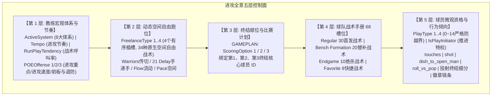
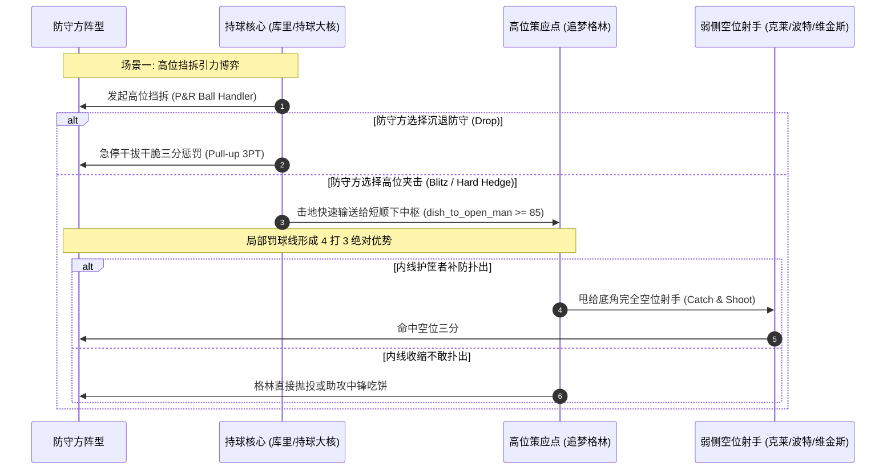
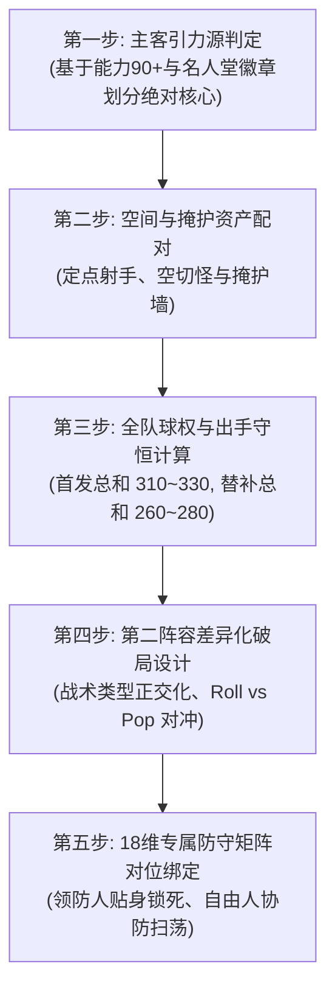
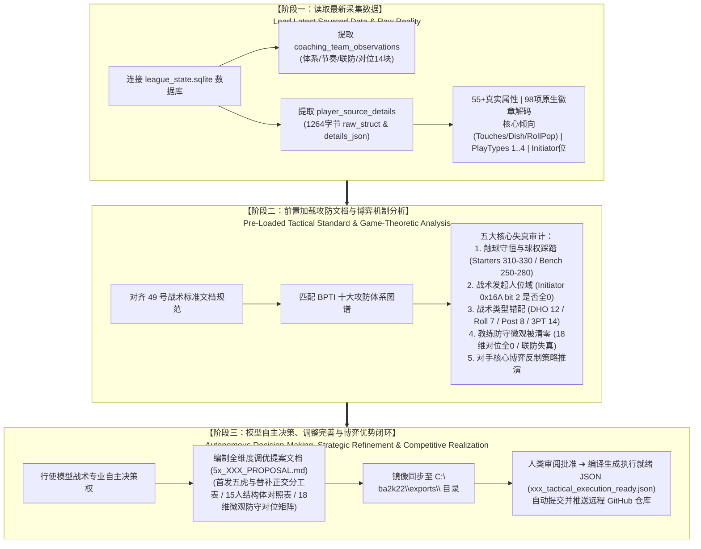

# 📋 NBA 2K22 全维度战术体系与攻防博弈标定标准规范 (V1.0)
# (Full-Dimensional Tactical System & Game-Theoretic Tuning Standard Directive)

> **文档标识**: `STANDARD-NBA2K22-TACTICAL-AND-GAME-THEORY-V1`  
> **生效时间**: 2026-11-23  
> **目标工程**: `Cybernetic_City_State_OS_v2 - nba2k22` / `Antigravity_GM_Engine`  
> **约束等级**: **强制性核心技术标准 (Mandatory Pre-Load Baseline)**  
> **适用对象**: **所有参与 NBA 2K22 球队与球员战术研究、能力重构、倾向平衡、教练预案及对位设置的智能体角色（任务规划、任务开发、独立审核等）**  

---

> [!IMPORTANT]
> **智能体前置必读与加载守则 (Agent Pre-Load Directive)**  
> 任何智能体在针对 30 支 NBA 球队及其阵容（1~5 首发五虎、6~10 第二阵容替补、教练组）展开战术、能力、徽章、倾向及防守对位方案的研究、讨论或生成可执行规格书之前，**必须预先加载并严格遵循本文档所定义的全部可设置项全景、博弈论攻防模型以及四大原生安全铁律**。未经本文档规范推导的任意数值设置均视为无效提议。

---

## 目录 (Table of Contents)
1. [引言与战术博弈核心理念](#一-引言与战术博弈核心理念)
2. [进攻面原生底层可设置项全景](#二-进攻面原生底层可设置项全景)
   - 2.1 [主教练宏观战术体系与风格 (COACHDATA)](#21-主教练宏观战术体系与风格-coachdata-352字节)
   - 2.2 [动态空间自由跑位体系 (Freelance Sets 1..4)](#22-动态空间自由跑位体系-freelance-sets-14)
   - 2.3 [终结顺位与比赛计划 (GAMEPLAN Scoring Options)](#23-终结顺位与比赛计划-gameplan-scoring-options)
   - 2.4 [战术手册 68 槽位分布 (PLAYBOOKDATA)](#24-战术手册-68-槽位分布-playbookdata)
   - 2.5 [球员战术资格与微观决策倾向 (PLAYERDATA)](#25-球员战术资格与微观决策倾向-playerdata)
3. [防守面原生底层可设置项全景](#三-防守面原生底层可设置项全景)
   - 3.1 [球队教练级防守哲学 (COACHDATA & GAMEPLAN)](#31-球队教练级防守哲学-coachdata--gameplan)
   - 3.2 [球员专属与个人对位防守矩阵 (18 维微观策略)](#32-球员专属与个人对位防守矩阵-18-维微观策略)
   - 3.3 [球员个人防守行为倾向与徽章联动](#33-球员个人防守行为倾向与徽章联动)
4. [基于博弈论的攻防体系与阵容搭配方法论](#四-基于博弈论的攻防体系与阵容搭配方法论)
   - 4.1 [引力模型与破局博弈 (Gravity & Counterplay)](#41-引力模型与破局博弈-gravity--counterplay)
   - 4.2 [首发五虎 vs 第 6-10 人第二阵容协同机制](#42-首发五虎-vs-第-6-10-人第二阵容协同机制-化解混编冲突)
   - 4.3 [针对性防守反制策略库](#43-针对性防守反制策略库)
   - 4.4 [攻防对抗的五大经典博弈矩阵与数学平衡](#44-攻防对抗的五大经典博弈矩阵与数学平衡-five-tactical-game-theoretic-dualities--equations)
   - 4.5 [球队 1-10 人阵容搭配博弈推演标准范式](#45-球队-1-10-人阵容搭配博弈推演标准范式-universal-10-man-lineup-derivation-methodology)
5. [NBA 经典建队逻辑与十大赢球哲学体系库 (BPTI 体系图谱)](#五-nba-经典建队逻辑与十大赢球哲学体系库-bpti-体系图谱与策略选择)
   - 5.1 [三大宏观建队逻辑与争冠周期哲学](#51-三大宏观建队逻辑与争冠周期哲学)
   - 5.2 [BPTI 十大经典攻防战术体系卡与博弈选择库](#52-bpti-十大经典攻防战术体系卡与博弈选择库)
   - 5.3 [三十支球队历史底色与候选体系索引表](#53-三十支球队历史底色与候选体系索引表)
6. [智能体三阶标准化调优流程与自检清单 (Agent SOP & Checklist)](#六-智能体三阶标准化调优流程与自检清单-agent-sop--checklist)
   - 6.1 [智能体三阶核心工作流规程 (Three-Stage Standardized Optimization Workflow)](#61-智能体三阶核心工作流规程-three-stage-standardized-optimization-workflow)
   - 6.2 [八阶段具体实施细则与作业流转 (8-Step Execution Blueprint)](#62-八阶段具体实施细则与作业流转-8-step-execution-blueprint)
   - 6.3 [智能体开工前自检表 (Mandatory Preflight Gate)](#63-智能体开工前自检表-mandatory-preflight-gate)
7. [附录：原生参数字典与速查表](#七-附录原生参数字典与速查表)

---

## 一、 引言与战术博弈核心理念

在传统的篮球游戏数值调整中，往往存在“只调能力值（Attribute）”或“孤立设置单项倾向（Tendency）”的片面做法，这会导致两个严重缺陷：
1. **球场表现脱节**：即使球星能力高达 95+，若缺少对应的战术类型（PlayType）、触球倾向（Touches）或空间自由跑位（Freelance），在 3D 物理引擎和战术模拟中依然会沦为底角看客；
2. **阵容搭配混乱**：替补第六人若与首发核心同样被赋予高触球和高出手倾向，在轮换混编上场时会爆发严重的“球权互抢与停滞”，破坏整体战术流动性。

### 核心博弈理念 (Game-Theoretic Co-Evolution)
现代篮球比赛本质上是**攻防策略的纳什均衡博弈**。

> [!IMPORTANT]
> **攻守并重、因策而设、博弈制胜最高准则 (Offensive & Defensive Dual-System Architecture Directive)**  
> 进攻体系与防守体系的搭建在球队重构中具有**完全同等的重要性（同等权重）**。
> 1. **不强制搭建 (Non-Contrivance Principle)**：严禁脱离球员真实属性与能力生搬硬套、凭空捏造攻防体系（例如为缺少护筐大闸的球队强行设计深沉退护筐体系，或为缺少传切传球智商的球队强行设计复杂传切体系）；
> 2. **因策而设、博弈制胜 (Strategy-Driven Construction)**：**只要球队具备合适的博弈策略与人员支撑，就必须深度搭建进攻体系与防守体系**！
>    - **进攻端**：基于核心引力（Gravity）、战术类型（PlayTypes）、空间分配（Spacing）和球权守恒（Touches）搭建自洽闭环；
>    - **防守端**：基于真实防守资源（DPOY级护筐、外线死亡缠绕、机动协防、换防能力），针对高位挡拆、单挑点名、五外空间拉开等主流进攻形态，制定具体的博弈反制策略（如 Drop + Tag-on-roll、田忌赛马对位倒置、Free Safety 禁区巡航、1-4 无差别换防等）；
> 3. **作为每次分析与提议的强制性依据**：每一支球队的提案文档（Proposal）与执行规格书，必须同时、同等深度地论证进攻体系与防守博弈体系，绝不可重攻轻防或重防轻攻！

* **进攻端——引力与空位转移**：正如经典的湖人 OK 组合，奥尼尔在低位的绝对统治力（Post Up）会迫使对手采取包夹（Double Team Post），一旦包夹触发，防守阵型必然出现轮转空档；此时如果出球意愿（`dish_to_open_man`）与外线射手的定点投射徽章形成闭环，弱侧将获得空位大优势。同理，勇士库里在高位挡拆（Pick & Roll）所产生的超远射程引力，会逼迫对手采用高位夹击（Blitz）或换防，从而为短顺下的追梦格林创造局部 4 打 3 空间。
* **防守端——针对性锁死与阵型保护**：防守绝非单一的“整体防守”，而是由主教练宏观护筐/外线偏好、全队防守滑块以及 **23 组精准到个人的专属对位策略（Matchup Settings）** 共同构成的立体防御网。
* **动态轮换——先发与替补功能正交**：首发追求极致战术执行与主客引力互补，第二阵容（第 6~10 人）则需承担主控突分、空间拉开、防守大锁与暴力冲击的特定角色。通过**战术资格分离（PlayTypes 分流）**与**进攻倾向梯次化**，彻底根除混编时的球权踩踏。

---

## 二、 进攻面原生底层可设置项全景

REA 逆向工程已完全证实，NBA 2K22 原生进程具备结构清晰的自上而下五级进攻控制面：



### 2.1 主教练宏观战术体系与风格 (`COACHDATA` 352字节)
`COACHDATA` 结构体位于教练专属内存块，大小为 `0x160` 字节（352 字节），控制全队底层运行逻辑：
* **8 大战术体系 (`ActiveSystem` / `PreferredSystem`)**：
  * 偏移：`offset 264` (`0x108`), `start_bit: 28` (Active) / `start_bit: 16` (Preferred), `width: 4`。
  * 合法枚举：
    * `0`: **BALANCED** (攻守均衡体系)
    * `1`: **GRIT_AND_GRIND** (铁血慢节奏阵地战，如灰熊传统)
    * `2`: **PACE_AND_SPACE** (节奏与空间，现代魔球/快攻三分体系)
    * `3`: **PERIMETER** (外线挡拆投射主导)
    * `4`: **POST** (内线低位攻坚主导，如传统双塔/约基奇)
    * `5`: **TRIANGLE** (三角进攻站位与轴心策应)
    * `6`: **SEVEN_SECONDS** (跑轰七秒进攻，极致快速反击)
    * `7`: **DEFENSE** (防守反击主导)
* **执行战术频率 (`RunPlayTendency`)**：
  * 偏移：`offset 224` (`0xE0`), 1 字节, 范围 `0..100`。
  * 含义：决定球队在半场进攻时，强制呼叫 Playbook 具体战术的概率。数值越高，越倾向跑死战术；数值适中（如勇士 60~70），能在跑固定战术与进入 Freelance 自由流动之间取得完美平衡。
* **进攻节奏推进滑块 (`Tempo`)**：
  * 偏移：`offset 328` (`0x148`), `start_bit: 9`, `width: 8`, 范围 `0..100`。
  * 含义：实机观测值如汤姆·锡伯杜 55、尼克·纳斯 40（极度磨阵地），而史蒂夫·科尔高达 95（极致推早攻与转换节奏）。
* **进攻重点三维位域 (`POEOffense 1/2/3`)**：
  * 偏移：共用 `offset 316` (`0x13C`) 4 字节块。
  * **POEOffense (进攻重心)**: `start_bit: 15`, `width: 5`
    * `0`: NO_PREFERENCE, `1`: GET_TO_BASKET (冲击篮筐), `2`: GET_SHOOTERS_OPEN (为射手创造空位), `3`: FEED_THE_POST (喂球低位), `4`: PICK_AND_ROLL_OFFENSE (挡拆起手), `5`: NEUTRAL_OFFENSE_FOCUS (常规), `6`: RUN_OFFENSE_THROUGH_SCORER (围绕头号得分手)。
  * **POEOffense2 (进攻出手机会选择)**: `start_bit: 20`, `width: 5`
    * `0`: NO_PREFERENCE, `7`: PATIENT_OFFENSE (耐心传导), `8`: NEUTRAL_OFFENSE_TEMPO (常规), `9`: SHOOT_AT_WILL (快速拔枪/出手机会即投)。
  * **POEOffense3 (进攻篮板与退防)**: `start_bit: 25`, `width: 5`
    * `0`: NO_PREFERENCE, `10`: CRASH_OFFENSIVE_BOARDS (凶狠冲抢前板), `11`: NEUTRAL_OFFENSE_REBOUND (均衡), `12`: LIMIT_TRANSITION (快速退防/严防反击)。
* **轮换深度与替补使用率**：
  * `BenchDepth` (`offset 222`, 1 字节): 轮换人数限制（8~13 人）。
  * `BenchUtilization` (`offset 312`, 1 字节, 0~100): 替补使用激进程度。

### 2.2 动态空间自由跑位体系 (`Freelance Sets 1..4`)
当半场未呼叫战术、战术受阻断或战术第一段终结时，全队自动切入自由跑位状态。2K22 原生提供 **4 个有序插槽**，支持 34 种经过验证的原生战术：
* **插槽分布**：
  * `FreelanceType` (Slot 1 - 主选): `offset 252`, `start_bit: 25`, `width: 6`
  * `FreelanceType2` (Slot 2 - 次选): `offset 328`, `start_bit: 26`, `width: 6`
  * `FreelanceType3` (Slot 3 - 备选): `offset 348`, `start_bit: 3`, `width: 6`
  * `FreelanceType4` (Slot 4 - 备选): `offset 348`, `start_bit: 9`, `width: 6`
* **常用核心自由战术枚举速查 (部分核心)**：
  * `16`: **WARRIORS** (金州勇士专属无球双掩护、电梯门与空切)
  * `28`: **TWENTY_ONE_DELAY** (21 Delay / Pistol 边线手递手延迟落位)
  * `18`: **FLOW** (流动进攻，强弱侧动态转移球)
  * `21`: **PACE** (现代空间站位，底角拉开)
  * `22`: **POINT_FREELANCE** (组织前锋/高位策应中心)
  * `23`: **PRINCETON_CHIN** (普林斯顿下巴传切体系)
  * `27`: **TRIANGLE** (三角进攻落位)
  * `5`: **FOUR_OUT** (一内四外空间)

### 2.3 比赛计划之“模拟侧重”全局控制面 (`GAMEPLAN Simulated Focus & Scoring Options`)
位于 `GAMEPLAN` 结构体（stride 880 字节 / `0x370`，自 `offset 0x178` 至 `0x183` 构成连续 12 字节专属写块）：
* **三大终结选择 (ScoringOption 1 / 2 / 3)** (`offset 0x178`、`0x17A`、`0x17C`，各 2 字节 `uint16`，共 6 字节)：
  * 分别绑定球队第一、第二、第三得分核心球员的唯一真实 Player ID (`face_id`)。
  * **作用机制**：当多名球员同时跑出机会或战术出现多分支时，引擎按照 `Option 1 -> Option 2 -> Option 3` 的严格权重分配传球终结优先级。
* **六项攻防重点 (Points of Emphasis / POE)** (`offset 0x17E` 至 `0x183`，各 1 字节 `uint8`，共 6 字节)：
  * `0x17E` (382): `poe_offense` (进攻重点/进攻侧重，1冲击篮筐、2为射手跑位、3低位、4挡拆、5中立、6围绕得分手)
  * `0x17F` (383): `poe_offense_tempo` (进攻节奏，7耐心阵地、8中立、9快速反击/尽早出手)
  * `0x180` (384): `poe_offense_rebound` (进攻篮板策略，10冲抢前板、11中立、12极速退防)
  * `0x181` (385): `poe_defense` (防守重点/防守侧重，13保护禁区油漆区、14中立、15贴防限制外线三分)
  * `0x182` (386): `poe_defense_physicality` (防守对抗策略，16保守防犯规、17中立、18强硬身体对抗)
  * `0x183` (387): `poe_defense_rebound` (防守篮板策略，19全员保护后板、20中立、21抓篮板极速反击)
* **球队研究强制纳入铁律**：在每一支球队的进攻、防守、赢球哲学研究任务中，**“模拟侧重”是必须明确审查并按需标定的标准板块**，严禁遗漏。若球队战术调整涉及得分点转移或攻防节奏重构，必须同步生成模拟侧重更新方案。


### 2.4 战术手册 68 槽位分布 (`PLAYBOOKDATA`)
位于 `PLAYBOOKDATA`（stride 360 字节 / `0x168`），从 `offset 0x58` 开始连续存储 68 个战术 CRC：
* **首发主力战术 (Slots 0~29, 30个)**: 适配首发 5 人的主打战术。
* **替补阵容战术 (Slots 30~49, 20个)**: **为第 6-10 人量身定制的独立战术池**！当替补上场时，AI 会优先从该槽位调配战术，避免强打不适合替补技能包的首发战术。
* **终局绝杀战术 (Slots 50~59, 10个)**: 比赛最后关键时刻的快速三分/单打战术。
* **快捷战术 (Slots 60~67, 8个)**: 手柄十字键一键秒呼战术。

### 2.5 球员战术资格与微观决策倾向 (`PLAYERDATA`)
位于球员对象（stride `0x4F0` 字节）：
* **战术呼叫资格 (`PlayType 1..4`)——【🚨 必须严格执行 0..14 原生范围】**：
  * 偏移：`offset 360` (`0x168`: PT1 bits 0-3, PT2 bits 4-7) 及 `offset 361` (`0x169`: PT3 bits 0-3, PT4 bits 4-7)。
  * **合法枚举定义 (严格禁止写入 >= 15)**：
    * `0`: None (无)
    * `1`: Isolation (单打)
    * `2`: Isolation Point (控卫专属单打)
    * `3`: Isolation Wing (侧翼锋线单打)
    * `4`: P&R Ball Handler (挡拆持球人)
    * `5`: P&R Point (控卫挡拆)
    * `6`: P&R Wing (侧翼挡拆)
    * `7`: P&R Roll Man (挡拆顺下/掩护人)
    * `8`: Post Up Low (低位背打)
    * `9`: Post Up High (高位策应背打)
    * `10`: Guard Post Up (后卫背身单打)
    * `11`: Cutter (无球空切者)
    * `12`: Handoff Receiver (手递手接球人)
    * `13`: Handoff Passer / Mid Range (手递手发牌人 / 中距离挂掩护)
    * `14`: Screen 3PT / 3PT (无球挂掩护三分)
* **组织推进指挥官特权 (`IsPlayInitiator`)**：
  * 偏移：`offset 362` (`0x16A`), `bit 2`。
  * 含义：决定该球员是否有权在后场接球推进过半场并发起战术（如控卫、持球锋线设为 1；无球射手、吃饼中锋严格设为 0）。
* **球权与微观决策核心倾向 (Tendencies, 0~100)**：
  * `TOUCHES_TENDENCY` (`0x499`): 战术呼叫率与持球权重。
  * `SHOT_TENDENCY` (`0x458`): 接球后坚决出手还是继续转移。
  * `DISH_TO_OPEN_MAN_TENDENCY` (`0x498`): **破包夹/破停滞核心**！吸引防守后分球给空位队友的意愿（顶级组织者需 85+）。
  * `ROLL_VS_POP_TENDENCY` (`0x49B`): 挡拆后选择顺下攻筐 (0) 还是外弹跳投 (100)。
  * `DRIVE_TENDENCY` (`0x483`): 突破攻筐侵略性。
  * `PLAY_DISCIPLINE_TENDENCY` (`0x4A1`): 严格按战术路线跑位 (100) vs 自行乱战单打 (0)。
  * 投篮细分倾向：`SPOT_UP_SHOT_THREE` (`0x473`), `OFF_SCREEN_SHOT_THREE` (`0x474`), `TRANSITION_PULL_UP_THREE` (`0x47F`), `STEPBACK_JUMPER_THREE` (`0x47C`) 等。

---

## 三、 防守面原生底层可设置项全景

防守端由教练宏观哲学与球员 18 维专属对位矩阵构成密不可分的防御网。

### 3.1 球队教练级防守哲学 (`COACHDATA` & `GAMEPLAN`)
* **防守重点三维位域 (`POEDefense 1/2/3`)**：
  * 偏移：共用 `offset 316` (`0x13C`) 4 字节块。
  * **POEDefense (防守重心)**: `start_bit: 0`, `width: 5`
    * `0`: NO_PREFERENCE, `13`: PROTECT_PAINT (收缩保护禁区), `14`: NEUTRAL_DEFENSE_FOCUS (常规), `15`: LIMIT_PERIMETER_SHOTS (外扑限制三分)。
  * **POEDefense2 (防守侵略性)**: `start_bit: 5`, `width: 5`
    * `0`: NO_PREFERENCE, `16`: PLAY_CONSERVATIVE (稳妥防守/避免犯规), `17`: NEUTRAL_DEFENSE_TEMPO (常规), `18`: PLAY_PHYSICAL (高强度身体对抗/破坏节奏)。
  * **POEDefense3 (防守篮板与转换)**: `start_bit: 10`, `width: 5`
    * `0`: NO_PREFERENCE, `19`: CRASH_DEFENSIVE_BOARDS (全员卡位保后板), `20`: NEUTRAL_DEFENSE_REBOUND (常规), `21`: RUN_IN_TRANSITION (抓后板快速打反击)。
* **全队防守滑块**：
  * `HelpDefense` (`offset 328`, `start_bit: 17`, `width: 8`, 0~100): 弱侧协防刷卡积极性。
  * `ZoneUsage` (`offset 226`, 1 字节, 0~100): 区域联防使用频率。

### 3.2 球员专属与个人对位防守矩阵 (18 维微观策略)
在 `GAMEPLAN` 的 `offset 0x64..0x178` 连续存储 23 项对位结构，每项 12 字节：
* `+0x00` (2 字节): `matchup_id` (防守目标球员 ID)
* `+0x02` (2 字节): `defender_id` (指派防守人 ID，`65535` 为自动)
* `+0x04` (8 字节): 打包了 **18 项微观防守策略位域**：

| 字段名称 | 位域参数 (start_bit, width) | 合法取值与实战战术含义 |
| :--- | :--- | :--- |
| **PressureOnball** | bit 0, width 3 | `0`: AUTO, `1`: SAG_OFF (放一步), `2`: GAP (大幅放空防投), `3`: MODERATE (适度), `4`: TIGHT (紧逼贴防), `5`: SMOTHER (窒息贴身防接球) |
| **PressureOffball** | bit 3, width 3 | `0`: AUTO, `1`: GAP (收缩放空), `2`: MODERATE (适度), `3`: TIGHT (贴身), `4`: DENY_BALL (阻绝传球线路) |
| **ForceDirection** | bit 6, width 2 | `0`: AUTO, `1`: MIDDLE (逼向中路), `2`: BASELINE (逼向底线/边线), `3`: NO_FORCE |
| **ScreenDefenseOnBall** | bit 8, width 3 | `0`: AUTO, `1`: GO_OVER (从掩护上方挤过绕前), `2`: GO_UNDER (从掩护后方绕后), `3`: SWITCH (遇挡拆直接换防), `4`: ICE (冰封/逼向边线) |
| **ScreenDefenseHedge** | bit 11, width 3 | `0`: AUTO, `1`: DROP (大中锋深沉退守禁区), `2`: SOFT_HEDGE (轻微延误后回位), `3`: HARD_HEDGE (强硬延误阻截), `4`: BLITZ (双人强行夹击持球人), `5`: CATCH_HEDGE (延误并阻断突破走廊), `6`: SWITCH (内线直接换防持球人) |
| **OffballScreenDefense**| bit 14, width 2 | `0`: AUTO, `1`: GO_OVER (挤过无球掩护追防射手), `2`: GO_UNDER (绕后防切入), `3`: SWITCH (无球换防) |
| **PostDefense** | bit 16, width 2 | `0`: AUTO, `1`: BEHIND (背后顶防), `2`: FRONT (正面完全绕前阻绝接球), `3`: THREE_QUARTERS (3/4 绕前对抗) |
| **DoubleTeamPerimeter**| bit 18, width 2 | `0`: AUTO, `1`: NEVER (从不外线包夹), `2`: ON_CATCH (外线接球即包夹), `3`: ON_DRIVE (突破运球时包夹) |
| **DoubleTeamPost** | bit 20, width 2 | `0`: AUTO, `1`: NEVER (从不低位包夹), `2`: ON_CATCH (低位接球即包夹), `3`: ON_DRIBBLE (低位下球背打时包夹) |
| **ScreenDefenseOnBall5**| bit 22, width 3 | 5 号位中锋专属挡拆对位策略（取值同 ScreenDefenseOnBall） |
| **ScreenDefenseHedge5** | bit 25, width 3 | 5 号位中锋专属掩护延误策略（取值同 ScreenDefenseHedge，关键区分沉退 Drop 与硬延误 Hard Hedge） |
| **SwitchRule** | bit 28, width 2 | `0`: AUTO, `1`: NO_SWITCH (不换防), `2`: SWITCH_ALL (1-5号位无差别无限换防), `3`: GUARDS_ONLY (仅1-4号位或后场换防) |
| **OnballHelp** | bit 30, width 2 | `0`: AUTO, `1`: HELP_AND_RECOVER (积极刷卡协防并迅速回位), `2`: NO_HELP (死防自身对位人不协防) |
| **ScreenHelp** | bit 32, width 2 | `0`: AUTO, `1`: HELP_AND_RECOVER (掩护协防并回位), `2`: NO_HELP (不协防) |
| **ExtendPressure** | bit 34, width 2 | `0`: AUTO, `1`: NONE (退回半场), `2`: HALF_COURT (半场紧逼), `3`: THREE_QUARTER (3/4场紧逼), `4`: FULL_COURT (全场死缠领防) |
| **TagOnRoll** | bit 36, width 1 | `0`: NO (不管顺下人), `1`: YES (弱侧防守人刷卡贴防顺下内线，阻断空接/吃饼) |
| **StayAttached** | bit 37, width 1 | `0`: NO (正常协防), `1`: YES (死贴无球神射手，绝不协防放空，封杀弱侧空位三分) |
| **PreRotate** | bit 38, width 1 | `0`: NO (常规轮转), `1`: YES (防守阵型提前预判轮转，先于传球到达落位点) |

### 3.3 球员个人防守行为倾向与徽章联动
* **防守核心倾向 (Tendencies)**:
  * `CONTEST_SHOT_TENDENCY` (`0x4B7`): 扑防与起跳干扰投篮意愿。
  * `BLOCK_SHOT_TENDENCY` (`0x4B8`): 盖帽侵略性。
  * `ON_BALL_STEAL_TENDENCY` (`0x4B6`): 下手抢断持球人。
  * `PASS_INTERCEPTION_TENDENCY` (`0x4B4`): 预判截断传球路线（大闸需 80+）。
  * `TAKE_CHARGE_TENDENCY` (`0x4B5`): 制造进攻犯规造带球撞人。
  * `FOUL_TENDENCY` (`0x4B9`) / `HARD_FOUL_TENDENCY` (`0x4BA`): 控制防守动作洁净度。
* **防守神级徽章联动**:
  * 死亡缠绕 (Clamps): 阻断持球突破与贴身对抗必配。
  * 追帽大师 (Chase Down Artist): 转换追击大帽必备。
  * 拦截者 (Interceptor): 传球路线抢断必备。
  * 禁区威慑 (Intimidator): 干扰禁区终结命中率的核心。

---

## 四、 基于博弈论的攻防体系与阵容搭配方法论

### 4.1 引力模型与破局博弈 (Gravity & Counterplay)



### 4.2 首发五虎 vs 第 6-10 人第二阵容协同机制 (化解混编冲突)

要解决“第六人上场时球权混乱、持球核心互斥”的问题，必须遵循以下 **五大正交设计法则**：

```
┌────────────────────────────────────────────────────────────────────────┐
│               五大首发与替补正交防冲突协同法则                          │
├────────────────────────────────────────────────────────────────────────┤
│ 1. 战术类型正交化 (PlayTypes Orthogonality)                            │
│    - 即使普尔与库里同时在场:                                           │
│      * 普尔绑定: P&R Ball Handler (4), Isolation (1)                   │
│      * 库里绑定: Screen 3PT (14), Handoff Receiver (12)                │
│    - 战术呼叫时两人各司其职，库里无球挂掩护引走防守，普尔打持球挡拆。    │
├────────────────────────────────────────────────────────────────────────┤
│ 2. 球权与出手梯度化 (Usage & Shot Pyramid)                             │
│    - 主控核心 (库里/普尔带二阵): touches 85~90, shot 80~86             │
│    - 二当家/副攻手 (汤普森/维金斯): touches 65~70, shot 75~85          │
│    - 组织策应中枢 (追梦格林): touches 70~75, 但 shot 严格限制 <= 30    │
│    - 终结拼图 (波特/别利察): touches 45~55, shot 55~65                 │
│    - 纯蓝领大闸 (卢尼/小佩顿): touches 30~40, shot 25~35               │
├────────────────────────────────────────────────────────────────────────┤
│ 3. 出球意识底线保证 (Dish to Open Man Floor)                           │
│    - 任何具备高 touches (>=75) 的持球人，dish_to_open_man 必须 >= 75。│
│    - 追梦格林此类发牌轴心，dish_to_open_man 必须达到 90~95。           │
│    - 杜绝一切“持球过半场强顶单打不传空位”的毒瘤代码行为。             │
├────────────────────────────────────────────────────────────────────────┤
│ 4. 战术手册替补槽位专用化 (Bench Playbook Slots 30~49)                 │
│    - 在 Playbook 的 30~49 槽位，专门放入适合第二阵容打法的战术套路。   │
│    - 使得第二阵容单独在场时，AI 不会错误呼叫针对首发体系的旧套路。     │
├────────────────────────────────────────────────────────────────────────┤
│ 5. 内线空间与功能对冲 (Roll vs Pop Duality)                            │
│    - 首发中锋 (卢尼): roll_vs_pop = 10 (纯顺下吃饼，制造攻筐杀伤)      │
│    - 替补中锋 (别利察): roll_vs_pop = 85 (纯外弹三分，为突破拉开空间)   │
│    - 使得第二阵容登场后，整个球场在空间站位上呈现完全不同的博弈维度。  │
└────────────────────────────────────────────────────────────────────────┘
```

### 4.3 针对性防守反制策略库
在 `GAMEPLAN_MATCHUP_DEFENSIVE_SETTINGS` 中，针对不同联盟顶级球星模板建立四类标准预案：

1. **针对外线超远持球大核（如库里、利拉德、特雷杨）**：
   * `PressureOnball`: `SMOTHER` (窒息贴身)
   * `ScreenDefenseOnBall`: `GO_OVER` (必须绕前挤过掩护，严禁绕后)
   * `ScreenDefenseHedge`: `HARD_HEDGE` 或 `BLITZ` (高位延误甚至夹击)
   * `TagOnRoll`: `YES` (弱侧内线刷卡顺下人，弥补外线包夹漏洞)
   * `StayAttached`: `YES` (弱侧无球射手死贴不放)
2. **针对低位攻坚怪兽（如恩比德、约基奇）**：
   * `PostDefense`: `THREE_QUARTERS` (3/4 绕前对抗)
   * `DoubleTeamPost`: `ON_DRIBBLE` (一旦运球立刻包夹，限制自主起步)
   * `PressureOffball`: `DENY_BALL` (阻绝进入深位的吊球)
3. **针对突破重型坦克（如字母哥、莫兰特、西蒙斯）**：
   * `PressureOnball`: `GAP` 或 `SAG_OFF` (后撤一步放空远投，构筑禁区人墙)
   * `ScreenDefenseOnBall`: `GO_UNDER` (掩护绕后收缩禁区)
   * `ScreenDefenseHedge`: `DROP` (深沉退护筐)
4. **针对无球顶级神射（如克莱·汤普森、邓肯·罗宾逊）**：
   * `PressureOffball`: `DENY_BALL` (阻绝接球)
   * `OffballScreenDefense`: `GO_OVER` (无球掩护死命挤过)
   * `StayAttached`: `YES` (严禁协防，寸步不离)

### 4.4 攻防对抗的五大经典博弈矩阵与数学平衡 (Five Tactical Game-Theoretic Dualities & Equations)

篮球战术博弈不是抽象的情怀，而是可以通过原生引擎参数进行**期望收益（Expected Points Per Possession）推演的纳什均衡对抗**。智能体在标定球队时必须熟练运用以下五大博弈矩阵：

#### 1. 空间拉扯博弈 (Spacing vs Packing Game)
* **进攻方空间构筑**: 通过 4-Out-1-In 或 5-Out 站位（设定 `FreelanceType` 为 `PACE`、`WARRIORS` 或 `FLOW`），将 4 名防守人牵制在三分线外 24 英尺区域，清空中路走廊。
* **防守方对抗困境**:
  * 若选择收缩护筐 (`POEDefense=PROTECT_PAINT`, `HelpDefense>=75`)：禁区护筐率提升 15%~20%，但弧顶与底角的三分空位率暴增。若对手配备 80+ 三分能力的定点射手（拥有接球投篮徽章），防守方每回合失分期望急剧恶化；
  * 若选择外扑外线 (`POEDefense=LIMIT_PERIMETER_SHOTS`, `StayAttached=YES`)：外线三分被完全封死，但单防中锋被迫在没有协防保护下孤立单防突破手与挡拆顺下人，犯规率与被隔扣率飙升。
* **博弈优势构建法则**: **制造内外不对称**。首发中锋卢尼主打内线顺下吃饼，迫使对手收缩防线；轮换阶段迅速换上空间型 5 号位别利察（`roll_vs_pop=85`），对手习惯性收缩瞬间遭到致命外弹三分惩罚。

#### 2. 高位挡拆六大延误分支的反制博弈树 (P&R 6-Branch Counterplay Tree)
高位挡拆是现代篮球 70% 的半场起手式。在 `GAMEPLAN_MATCHUP_DEFENSIVE_SETTINGS` 中，防守掩护人中锋的延误策略 (`ScreenDefenseHedge`) 决定了整套防守阵型的生死：

| 防守延误策略 | 克制的进攻类型 | 被克制的进攻类型 (漏洞所在) | 进攻方最优破局决策 (Counterplay) | 防守方协同补救参数 |
| :--- | :--- | :--- | :--- | :--- |
| **DROP (沉退)** | 突破型/无跳投后卫 (西蒙斯、莫兰特) | 挡拆干拔跳投大师 (库里、利拉德、保罗) | 掩护后直接急停干拔中投/三分 (`TRANSITION_PULL_UP_THREE>=80`) | 追防人必须 `ScreenDefenseOnBall=GO_OVER` 极速挤过 |
| **SOFT_HEDGE (软延误)** | 常规阵地战、缺乏爆发力的控卫 | 具备极高变向能力的蛇形运球大师 | 蛇形运球过掉大个子，中距离抛投或喂饼内线 | 翼侧防守人微缩协防 |
| **HARD_HEDGE (硬延误)** | 传球视野狭窄、出球慢的年轻后卫 | 出球极快的组织大师 (特雷杨、哈登) | 大延误瞬间大个子失位，快速击地给顺下中锋 (`DISH_TO_OPEN_MAN>=85`) | 弱侧底角防守人必须触发 `TagOnRoll=YES` 刷卡阻断顺下 |
| **BLITZ (高位双人强行夹击)** | 依赖个人持球单打、缺乏传球倾向的大核 | 拥有高球商短顺下策应轴心的球队 (勇士、热火) | 库里被夹瞬间秒传罚球线追梦格林，形成 **4 打 3 局部顺下风暴** | 弱侧底角防守人执行 `PreRotate=YES` 提前预判轮转 |
| **SWITCH (遇挡拆直接换防)** | 纯传切射手机器 (克莱、邓罗) | 错位单挑惩罚大师 (杜兰特、东契奇、欧文) | 立即呼叫单打战术，展开“小打大”突突大中锋或“大打小”低位坐打矮控卫 | 强侧就近防守人伺机 `DoubleTeamPerimeter=ON_DRIVE` |
| **ICE (冰封/逼向边线)** | 极度依赖中路挡拆分球的控卫 | 善于在边线手递手 (Pistol) 和底角做文章的球队 | 边线手递手顺势反切，或直接大对角转移弱侧空位底角三分 | 底角防守人保持专注防反角空接 |

#### 3. 低位引力与包夹转移博弈 (Post Gravity & Double-Team Dilemma)
* **传统低位巨兽（奥尼尔、恩比德、约基奇）的统治力推演**：
  * **防守方单防 (`DoubleTeamPost=NEVER`)**: 低位攻坚手凭借高达 90+ 的背身属性与沉底步/背身旋转徽章，单打真实命中率突破 65%（每回合收益期望 ~1.30 分）。
  * **防守方选择包夹 (`DoubleTeamPost=ON_DRIBBLE / ON_CATCH`)**: 强行将巨兽的直接出手命中率压低至 40% 以下。然而，一旦包夹发动，防守方弱侧必然形成局部 3 防 4。如果该低位核心具备高出球倾向（`DISH_TO_OPEN_MAN>=80`）并配备“十美分（Dimer）”徽章，球权迅速向外转移，弱侧定点射手空位三分期望收益攀升至 1.25~1.45 分/回合！
* **博弈结论**: 迫使对手陷入“不夹被生吞活剥，夹了被三分雨射穿”的绝对两难境地。

#### 4. 错位点名与防守隐藏博弈 (Mismatch Hunting & Hiding)
* **进攻方意图**: 寻找对手场上防守能力最弱、横移最慢或身材最矮的球员（防守黑洞，如防守能力 <65 的控卫或重型中锋），通过战术指定掩护（Playbook 中指定 Screener），强迫防守方发生换防，创造单打错位机会。
* **防守方隐藏弱环反制**:
  * 设置该弱环球员的防守策略为 `SwitchRule=NO_SWITCH`（坚决不换防）；
  * 遇到掩护时该球员执行 `ScreenDefenseOnBall=GO_UNDER`（宁可放一步远投也不被过掉）；
  * 同时在全队将顶级防守自由人（如格林、字母哥）设置为 `OnballHelp=HELP_AND_RECOVER`，只要弱环被点名强突，自由人立刻从盲区杀出协防封盖。

#### 5. 攻防转换与篮板控制博弈 (Pace & Transition vs Glass Cleaning)
* `POEOffense3=CRASH_OFFENSIVE_BOARDS` (拼抢前板): 前场篮板率显著上升，但由于 3~4 名球员冲入篮下，退防人数仅剩 1~2 人。如果对手设置了 `POEDefense3=RUN_IN_TRANSITION` 并调高 `Tempo>=85`，只要拿到后板，防守方将立刻被对手打出 3 打 1 或 2 打 1 的狂暴快攻反击！
* `POEOffense3=LIMIT_TRANSITION` (优先快速退防): 主动放弃非绝对机会的前场篮板，投篮出手瞬间 3 名外线球员立刻极速回奔半场构筑防线。彻底斩断对手任何快攻转换期望，逼迫对手打效率最低的半场阵地战（这也是 2022 年勇士夺冠的真正防守基石）。

---

### 4.5 球队 1-10 人阵容搭配博弈推演标准范式 (Universal 10-Man Lineup Derivation Methodology)

任何智能体在针对具体球队进行 1-10 人攻防调优时，必须按照以下规范公式进行系统推导：



#### 1. 全队球权守恒定律 (Usage & Touches Conservation Law)
* **首发五虎总触球权重守恒**:
  $$\sum_{i=1}^{5} \text{touches}_i \in [310, 330]$$
  * 主控大核 (Alpha): `85 ~ 90` (掌控球权，发起进攻)
  * 第二副攻 (Beta): `65 ~ 72` (战术第二点，中距离/弱侧接应)
  * 战术发牌中枢 (Pivot): `70 ~ 75` (高触球但限制 `shot <= 30`，纯策应)
  * 空间锋线 (Spacer): `50 ~ 60` (定点等待，接球即投)
  * 纯蓝领护筐 (Anchor): `30 ~ 40` (纯掩护顺下，极低触球)
* **第二阵容总触球权重守恒**:
  $$\sum_{j=6}^{10} \text{touches}_j \in [250, 280]$$
  * 替补第六人突击手: `80 ~ 85` (享有二阵绝对控球与终结开火权)
  * 替补核心侧翼: `55 ~ 65`
  * 替补空间内线: `50 ~ 60` (高外弹投篮倾向)
  * 替补防守大闸: `30 ~ 40` (纯防守领防，不占球权)

#### 2. 出球兜底安全铁律 (Dish-to-Open-Man Safety Floor)
为了防止高触球球员在场上“粘球、强顶强投、无视大空位队友”，智能体必须强制执行：
$$\text{If } \text{touches} \ge 75 \implies \text{DISH\_TO\_OPEN\_MAN} \ge 75$$
对于像德雷蒙德·格林、尼古拉·约基奇、克里斯·保罗等组织发牌核心，`DISH_TO_OPEN_MAN` 必须强制拉升至 `90 ~ 95`，形成球权的高速自然流转。

#### 3. 替补阵容的“破局差异化”设计原则 (Bench Duality Principle)
第二阵容绝不能只是首发阵容的“弱化版复制品”，而必须通过功能对冲打破场上僵局：
* 若首发内线为**重型顺下护筐者**（如卢尼、卡佩拉），替补内线必须打造成**高位外弹空间射手**（如别利察、霍福德，`roll_vs_pop>=80`）；
* 若首发后场以**无球传切、手递手掩护**为主（如库里、克莱），替补后卫必须打造成**强力挡拆突破、面框单打撕裂者**（如普尔、克拉克森，`PlayType=P&R Ball Handler / Isolation`, `drive>=85`）。
* 当首发与替补混编时，由于战术类型完全正交，首发打无球掩护，替补打持球挡拆，两套体系无缝嵌合，进攻永远保持立体与多变！

---

## 五、 NBA 经典建队逻辑与十大赢球哲学体系库 (BPTI 体系图谱与策略选择)

高阶 GM 与教练组调优绝非盲目堆砌数值，而是为球队注入**明确的赢球哲学（Winning Philosophy）与战术灵魂**。本章深度提炼了仓库 BPTI（Basketball Principles & Tactical Intelligence）知识底座的核心体系卡，提供三大宏观建队逻辑与十大经典战术体系库，供智能体在调优不同球队时作为理论依据与选择矩阵。

### 5.1 三大宏观建队逻辑与争冠周期哲学

| 建队阶段 | 核心赢球哲学 | 阵容配置优先级 | 进攻与防守取舍 | 2K22 原生调优导向 |
| :--- | :--- | :--- | :--- | :--- |
| **1. 争冠窗口期 (Win-Now / Contender)**<br>如勇士、雄鹿、凯尔特人 | **极致效率与针对性克制**：围绕 1~2 名顶级超巨引力打造战术闭环，战术高度针对季后赛硬仗与针对性点名。 | 核心超巨 + 高球商连接者 (Connector) + 3D 侧翼 + 蓝领护筐大闸 | 进攻追求每次回合得分期望 (PPP) 极大化；防守强调专属个人对位撕咬与弱侧极速轮转。 | 锁定高效 Playbook 战术；`RunPlayTendency` 60~75；`HelpDefense` 70~80；`dish_to_open_man` 严防停滞。 |
| **2. 崛起与适应期 (Two-Way Adaptive)**<br>如灰熊、骑士、猛龙 | **运动能力、团队防守与多面手**：以防守带动转换，追求全员换防弹性（Switchable）与年轻活力。 | 运动型双向锋线 + 挡拆终结内线 + 冲击型后卫 | 防守端侵略性拉满，抢断反击；进攻端强调快攻转换早攻与二次进攻冲抢。 | `Tempo` 80~95；`POEDefense2=PLAY_PHYSICAL`；`POEOffense3=CRASH_OFFENSIVE_BOARDS`；`ExtendPressure=HALF_COURT`。 |
| **3. 重建蛰伏期 (Rebuilding / Asset Growth)**<br>如雷霆初期、魔术、活塞 | **战术试错、核心喂球与文化塑造**：优先为年轻基石球员创造大量持球与挡拆决策场景，培养比赛阅读能力。 | 年轻核心发起人 + 空间射手拉开环境 + 深度轮换考察新人 | 战术结构相对简洁（Spread P&R 或 4-Out），允许试错失误，注重个人单挑与挡拆能力锻炼。 | `BenchDepth` 11~12；`BenchUtilization` 70~80；高集中度 `touches` 喂给年轻大核。 |

---

### 5.2 BPTI 十大经典攻防战术体系卡与博弈选择库

每个体系均拥有清晰的**优势链条、角色门槛、自主权配置、对手反制与原生参数映射**：

#### 1. 动态传切与空间流动体系 (Motion / Read-and-React)
* **代表球队/教练**: 金州勇士 (Steve Kerr)、圣安东尼奥马刺 (Gregg Popovich 2014)
* **赢球哲学**: **“球动人动，优势传递”**。通过高频无球双掩护、手递手（DHO）与空切，迫使防守在追防、挤过与协防中产生微小时间差，再由高球商中枢将优势传递到弱侧致命空位。
* **优势链条**: 无球掩护/手递手起手 ➔ 防守追防产生半步迟疑 ➔ 射手吸引双人扑防 ➔ 分球短顺下或弧顶中枢 ➔ 弱侧 4 打 3 绝对空位出手机会。
* **必备角色画像**: 顶级无球神射手 (`Screen 3PT`) + 高位组织发牌轴心 (`P&R Roll Man`, `dish_to_open_man>=90`, `Dimer` 徽章) + 灵动空切手 (`Cutter`)。
* **对手反制与第二答案**:
  * *对手反制*: 遇掩护无限换防 (`Switch All`)，封锁外线空位切出；
  * *第二答案*: 立即利用身体优势展开低位点名坐打矮控卫，或弱侧反切禁区。
* **2K22 原生参数绑定**:
  * `ActiveSystem`: `2` (PACE_AND_SPACE) 或 `3` (PERIMETER)
  * `Tempo`: `90 ~ 95` | `RunPlayTendency`: `60 ~ 70%`
  * `FreelanceType`: `16` (WARRIORS) / `28` (TWENTY_ONE_DELAY)
  * `POEOffense`: `2` (GET_SHOOTERS_OPEN) | `POEOffense3`: `12` (LIMIT_TRANSITION)

#### 2. 高位扩散挡拆体系 (Spread Pick-and-Roll)
* **代表球队/教练**: 达拉斯独行侠 (Luka Doncic)、休斯顿火箭 (Mike D'Antoni)
* **赢球哲学**: **“绝对持球大核牵引，一内四外空间惩罚”**。由持球大核一人在高位撕裂防线，若大个沉退则抛投/干拔三分，若协防收缩则大对角传底角射手。
* **优势链条**: 高位挡拆起手 ➔ 突破吸引中锋护筐与弱侧底角收缩 ➔ 持球人自主攻筐或手术刀出球 ➔ 底角空位三分或内线吃饼。
* **必备角色画像**: 挡拆持球大核 (`P&R Ball Handler`, `touches>=85`, `Dimer`) + 强力挡拆吃饼中锋 (`P&R Roll Man`, `roll_vs_pop<=15`, `Lob City Finisher`) + 3 名定点底角射手 (`Spot Up 3PT`, `Corner Specialist`)。
* **对手反制与第二答案**:
  * *对手反制*: 高位双人强行夹击 (`Blitz`)，逼迫大核出球；
  * *第二答案*: 顺下内线需具备一定短接应中转能力，或让副控在弧顶接过渡球重新发起二次挡拆。
* **2K22 原生参数绑定**:
  * `ActiveSystem`: `2` (PACE_AND_SPACE) | `Tempo`: `75 ~ 85`
  * `FreelanceType`: `5` (FOUR_OUT) 或 `21` (PACE)
  * `POEOffense`: `4` (PICK_AND_ROLL_OFFENSE)

#### 3. 组织中锋与肘区轴心体系 (Point-Center / Elbow Hub)
* **代表球队/教练**: 丹佛掘金 (Nikola Jokic / Michael Malone)、萨克拉门托国王 (Domantas Sabonis)
* **赢球哲学**: **“将对方护筐中锋调离油漆区”**。中锋在罚球线肘区持球发牌，利用无死角传球视野与手递手掩护，让全队无球跑动成为致命杀器。
* **优势链条**: 肘区中锋高位接球 ➔ 对方防守中锋被迫提到罚球线 ➔ 禁区空虚 ➔ 后卫无球后门空切（Backdoor Cut）或手递手跳投 ➔ 轻松上篮或空位跳投。
* **必备角色画像**: 拥有传球视野的大中锋 (`Post Up High`, `Handoff Passer`, `dish_to_open_man>=90`, `Bullet Passer`, `Dimer`) + 敏锐空切后卫 (`Cutter`)。
* **对手反制与第二答案**:
  * *对手反制*: 防守中锋坚决不扑出，全员收缩禁区赌外线不进；
  * *第二答案*: 中锋直接开启自主中投与低位背身单打，惩罚对手放投。
* **2K22 原生参数绑定**:
  * `ActiveSystem`: `0` (BALANCED) 或 `4` (POST)
  * `FreelanceType`: `22` (POINT_FREELANCE) 或 `23` (PRINCETON_CHIN)
  * `POEOffense`: `3` (FEED_THE_POST) 或 `2` (GET_SHOOTERS_OPEN)

#### 4. 面框单打与中距离攻坚体系 (Isolation / Midrange Creation)
* **代表球队/教练**: 布鲁克林篮网 (Kevin Durant, Kyrie Irving)、芝加哥公牛 (DeMar DeRozan)
* **赢球哲学**: **“球星绝对个人能力打破战术僵局”**。当常规传切与挡拆被高强度季后赛防守锁死时，利用无解的单挑拔投能力在中距离惩罚任何单防。
* **优势链条**: 战术清空一侧 ➔ 强侧 1 对 1 单挑 ➔ 变向/后撤步中距离强投命中 ➔ 迫使对手上包夹 ➔ 包夹后分球空位。
* **必备角色画像**: 顶级单挑巨星 (`Isolation`, `Isolation Wing`, `SHOT_TENDENCY>=85`, `Deadeye`, `Difficult Shots`)。
* **2K22 原生参数绑定**:
  * `ActiveSystem`: `3` (PERIMETER) | `Tempo`: `60 ~ 70` (磨阵地)
  * `RunPlayTendency`: `75 ~ 85%` (严格呼叫清空单打战术)
  * `POEOffense`: `6` (RUN_OFFENSE_THROUGH_SCORER)

#### 5. 空间三角与内外策应体系 (Triangle / Inside-Out)
* **代表球队/教练**: 芝加哥公牛 (Phil Jackson / Jordan-Pippen)、洛杉矶湖人 (Kobe-Shaq)
* **赢球哲学**: **“强侧形成三角站位，弱侧双人切入”**。强调空间几何距离保持 15~18 英尺，由低位统治者吸包夹出球，或侧翼持球人自主单打。
* **优势链条**: 强侧侧翼、底角、低位三人成三角 ➔ 球入低位吸引包夹 ➔ 外线顺畅转移弱侧 ➔ 弱侧双人挡拆或空位跳投。
* **2K22 原生参数绑定**:
  * `ActiveSystem`: `5` (TRIANGLE)
  * `FreelanceType`: `27` (TRIANGLE)
  * `POEOffense`: `3` (FEED_THE_POST)

#### 6. 高低位双塔攻坚体系 (Post / High-Low)
* **代表球队/教练**: 密尔沃基雄鹿 (Giannis Antetokounmpo / Brook Lopez)、传统灰熊 (Gasol / Randolph)
* **赢球哲学**: **“禁区绝对高度碾压与互补护筐”**。一名大个高位策应发牌拉开空间，另一名强力内线深位要位直接空接或单吃。
* **优势链条**: 高位内线吊传低位深要位内线 ➔ 低位内线强攻造杀伤或抛投 ➔ 若遭夹击高位内线外弹命中三分。
* **2K22 原生参数绑定**:
  * `ActiveSystem`: `4` (POST) | `FreelanceType`: `13` (PHILLY_ELBOW) 或 `4` (WNBA_THREE_OUT)
  * `POEOffense`: `3` (FEED_THE_POST)

#### 7. 极致快攻与七秒早攻体系 (Transition / Early Offense)
* **代表球队/教练**: 菲尼克斯太阳 (Steve Nash / D'Antoni)、夏洛特黄蜂 (LaMelo Ball)
* **赢球哲学**: **“在对手防守落位前完成终结”**。抓后场篮板或抢断后 7 秒内全员疯狂奔袭前场，利用局部多打少投早期转换三分或攻筐。
* **优势链条**: 后场篮板到手 ➔ 一传迅速穿越半场 ➔ 侧翼两名快马冲底角拉开 ➔ 持球人中路推反击抛投或分球空位转换追身三分。
* **2K22 原生参数绑定**:
  * `ActiveSystem`: `6` (SEVEN_SECONDS) | `Tempo`: `95 ~ 100`
  * `POEOffense2`: `9` (SHOOT_AT_WILL) | `POEDefense3`: `21` (RUN_IN_TRANSITION)

#### 8. 防守至上与护筐禁区堡垒体系 (Defense-First / Rim Protection)
* **代表球队/教练**: 犹他爵士 (Rudy Gobert / Quin Snyder)、克利夫兰骑士 (Jarrett Allen, Evan Mobley)
* **赢球哲学**: **“将所有进攻诱导至禁区巨兽面前封盖”**。外线防守人压迫对手逼向中路，在罚球线以下形成无解禁区屏障。
* **优势链条**: 外线逼底线或逼中路 ➔ 突破者杀入油漆区遭遇 DPOY 巨兽威慑 ➔ 投篮命中率骤降或被封盖 ➔ 保护后场篮板展开反击。
* **2K22 原生参数绑定**:
  * `ActiveSystem`: `7` (DEFENSE) 或 `1` (GRIT_AND_GRIND)
  * `POEDefense`: `13` (PROTECT_PAINT) | `HelpDefense`: `85 ~ 95`
  * `ScreenDefenseHedge`: `DROP` (深沉退) | `ScreenDefenseOnBall`: `GO_OVER`

#### 9. 全能换防与窒息撕咬体系 (Switchable Pressure Defense)
* **代表球队/教练**: 波士顿凯尔特人 (Ime Udoka / Marcus Smart, Jayson Tatum)、迈阿密热火 (Erik Spoelstra / Bam Adebayo)
* **赢球哲学**: **“全员 2 米左右身材无差别换防，窒息阻绝传球”**。消灭任何传切与挡拆产生的缝隙，逼迫对手打最低效的高难度单挑。
* **优势链条**: 挡拆与无球掩护一律换防 ➔ 对手战术瞬间跑死 ➔ 进攻时间读秒勉强出手 ➔ 防守反击。
* **2K22 原生参数绑定**:
  * `SwitchRule`: `2` (SWITCH_ALL) 或 `3` (GUARDS_ONLY)
  * `PressureOnball`: `TIGHT` 或 `SMOTHER` | `PressureOffball`: `DENY_BALL`
  * `POEDefense2`: `18` (PLAY_PHYSICAL)

#### 10. 多维自适应变奏体系 (Adaptive / Multiple Systems)
* **代表球队/教练**: 多伦多猛龙 (Nick Nurse)、迈阿密热火 (Erik Spoelstra)
* **赢球哲学**: **“不拘一格，根据对手强点即时变阵变奏”**。在单场比赛内根据比分与对手手感，在 2-3 联防、Box-and-One (一盯四联) 与全场领防间无缝切换，彻底打乱对手节奏。
* **优势链条**: 识别对手单一大核 ➔ 实施局部针对性夹击与联防 ➔ 掐断传球路线 ➔ 逼迫对手角色球员进行非擅长处理。
* **2K22 原生参数绑定**:
  * `ActiveSystem`: `0` (BALANCED) | `ZoneUsage`: `30 ~ 50%` (高频联防变奏)
  * `POEDefense`: 动态由对手决定 (`PROTECT_PAINT` vs `LIMIT_PERIMETER_SHOTS`)

---

### 5.3 三十支球队历史底色与候选体系索引表 (Franchise Identity & System Index)

下表总结自仓库 BPTI `package_b_v1.json`，为智能体研究任一球队时提供第一参考底色：

| 球队代码 | 球队中文名 | 历史文化底色 (Franchise Identity) | 主教练代表风格 | 推荐候选战术体系 | 核心防守策略推荐 |
| :---: | :--- | :--- | :--- | :--- | :--- |
| **GSW** | 金州勇士 | 移动、无私、传球与多点决策 | Steve Kerr (空间流动与掩护) | `MOTION_READ_REACT` / `SPREAD_PNR` | `SWITCH_ALL` + 格林弱侧自由人扫荡 |
| **BOS** | 波士顿凯尔特人 | 铁血无差别换防、双锋线攻防一体 | Ime Udoka (窒息单防与身体对抗) | `SWITCHABLE_PRESSURE` / `PERIMETER` | `SWITCH_ALL` + 罗威底角弱侧游弋补盖 |
| **MIA** | 迈阿密热火 | 坚韧文化、高强度身体对抗与联防变奏 | Erik Spoelstra (自适应与高纪律) | `ADAPTIVE_MULTIPLE` / `MOTION` | `PLAY_PHYSICAL` + 阿德巴约换防 + 2-3联防 |
| **DEN** | 丹佛掘金 | 中锋策应大核、高位传切与后门空切 | Michael Malone (中轴进攻) | `POINT_CENTER_ELBOW_HUB` | 约基奇沉退，弱侧锋线提前 `TagOnRoll` |
| **MIL** | 密尔沃基雄鹿 | 禁区巨兽轰炸、一星四射与铁血护筐 | Mike Budenholzer (沉退防守空间) | `POST_HIGH_LOW` / `SPREAD_PNR` | 大洛深沉退 (`DROP`) + 字母哥弱侧扫荡追帽 |
| **DAL** | 达拉斯独行侠 | 极致持球大核牵引、挡拆单打与底角三分 | Jason Kidd (大核驱动) | `SPREAD_PICK_AND_ROLL` / `ISO` | 保护禁区，掩护绕后 (`GO_UNDER`) |
| **PHX** | 菲尼克斯太阳 | 中距离教科书、挡拆蛇形运球与早攻 | Monty Williams (空间中投) | `SPREAD_PNR` / `ISOLATION_MIDRANGE` | 掩护冰封 (`ICE`) + 艾顿适度延误 |
| **MEM** | 孟菲斯灰熊 | 铁血磨砺延续、年轻撕咬与二次进攻冲抢 | Taylor Jenkins (快攻冲击前板) | `TRANSITION_EARLY` / `GRIT_AND_GRIND` | `CRASH_OFFENSIVE_BOARDS` + 全场撕咬抢断 |
| **PHI** | 费城76人 | 低位内线巨兽单打与高位挡拆双核 | Doc Rivers (内外结合) | `POST_HIGH_LOW` / `SPREAD_PNR` | 恩比德低位顶防 + 护筐 |
| **LAL** | 洛杉矶湖人 | 球星单打攻坚、内线高度优势与空接 | Frank Vogel (防守至上双塔) | `TRIANGLE` / `POST_HIGH_LOW` | 浓眉扫荡护筐 + 限制快攻 |

---

## 六、 智能体三阶标准化调优流程与自检清单 (Agent SOP & Checklist)

> [!IMPORTANT]
> **全队战术标定第一铁律 (Absolute Sourcing & Methodology Discipline)**  
> 任何智能体在针对 30 支 NBA 球队展开战术、能力、倾向、徽章或防守对位方案的研究时，**严禁凭空主观臆断或跳过原生数据采集**。模型每一次开启新球队研究任务，必须严格执行**“数据源读取 ➔ 博弈体系分析 ➔ 模型自主裁决完善”**的三阶标准化闭环规程。

### 6.1 智能体三阶核心工作流规程 (Three-Stage Standardized Optimization Workflow)



#### 阶段一：读取最新采集数据中的当前球队与球员信息 (Load Latest Sourced Data & Raw Reality)
1. **真实数据源物理定位**:
   * 数据库路径：`C:\nba2k22\saves\MyLEAGUE0005\league_state.sqlite`。
   * 严禁使用未经验证的预设模板或泛化常识替代真实存盘切片。
2. **教练端观测数据提取 (`coaching_team_observations`)**:
   * `ActiveSystem` / `PreferredSystem` (当前与偏好体系)
   * `Tempo` (进攻节奏) | `RunPlayTendency` (战术呼叫率) | `HelpDefense` (协防倾向) | `ZoneUsage` (联防频率)
   * `POEOffense 1..3` / `POEDefense 1..3` (进攻与防守重点)
   * `freelance_sets` (自由跑位战术槽位 1..4)
   * `gameplans` (14 组个人微观对位防御设置块)
3. **球员端结构体全维度提取 (`player_source_details`)**:
   * 读取原生 1264 字节二进制数据 `raw_struct` 与解析镜像 `details_json`。
   * **真实能力属性 (55+ Attributes)**: 三分 (3PT)、中投 (Mid)、上篮 (Layup)、扣篮 (Dunk)、近投 (Close)、外线防守 (Perimeter Def)、内线防守 (Interior Def)、横移速度 (Lateral Quickness)、奔跑速度 (Speed)、传球视野/智商/精度、抢断 (Steal)、盖帽 (Block)、强韧度 (Hustle)、造犯规 (Draw Foul)、挡拆防守智商 (PnR Def IQ)、协防智商 (Help Def IQ)。
   * **原生徽章层级解码 (`native_badges`)**: 逐项提取全部 98 项原生徽章，精确区分其拥有状态（`owned` / `not_owned`）与最高生效等级（`BRONZE` / `SILVER` / `GOLD` / `HALL_OF_FAME`）。
   * **底层行为倾向 (Tendencies)**: 投篮出手 (`shot` 0x458)、突破攻筐 (`drive` 0x483)、触球权 (`touches` 0x499)、空位分球 (`dish_to_open_man` 0x498)、顺下与外拆比例 (`roll_vs_pop` 0x49B)、战术纪律 (`play_discipline` 0x4A1)、三分倾向细分 (空位/定点/绕掩护/快攻干拔 0x472~0x47F)、防守倾向 (抢断/贴防干扰/盖帽 0x4B4~0x4B8)。
   * **战术资格与发起人位域**: `PlayTypes 1..4` (0x168, 0x169) 以及 `0x16A` 第 2 位推进发起人标志位 (`is_play_initiator`)。

---

#### 阶段二：利用已前置加载的攻防文档和博弈策略机制进行分析 (Pre-Loaded Tactical Standard & Game-Theoretic Analysis)
1. **规范标准对齐**:
   * 调优模型必须严格对齐本规范《49_NBA2K22_TACTICAL_SYSTEM_AND_GAME_THEORETIC_TUNING_STANDARD.md》所确立的五层进攻面、18 维防守面对位矩阵、三大建队周期哲学与 BPTI 十大攻防体系卡。
2. **五大核心失真系统性诊断**:
   * **诊断 1：触球权守恒与球权踩踏审计**:
     * 校验首发五虎触球权之和是否严重超标（如 GSW 434、BOS 438、MIA 428、MIL 438，远超 $[310, 330]$ 标准区间）。
     * 校验第二阵容（6~10 人）是否存在球权恶性内耗（如普尔与克莱、希罗与奥拉迪波/戈登同时出战时的球权踩踏，替补触球和应收敛至 $[250, 280]$）。
   * **诊断 2：战术推进发起人标志位审计**:
     * 检查全队 `is_play_initiator` 是否存在原生全 0 缺失 Bug，必须明确首发主控与二阵容发动机（如库里、保罗、斯玛特、罗瑞、霍勒迪、普尔、希罗、迪文琴佐）的推进特权。
   * **诊断 3：战术类型与真实技能武器库匹配审计**:
     * 检查核心武器是否被阉割或错配（例如：阿德巴约/追梦格林是否缺少 DHO 手递手 12；字母哥是否误配后卫背身 10 而缺少低位背身 8；大洛/塔克等空间内线是否缺少三分 14 或被误设为大顺下 Roll 7）。
   * **诊断 4：教练宏观与微观 18 维度防守体系审计**:
     * 检查 14 组对位数据是否全部为 0；中锋挡拆防守是否沉退（Drop 1）或换防（Switch 4）错配；教练联防倾向（`ZoneUsage`）是否真实反映其战术哲学（如斯波 2-3 联防应升至 30%，布登霍尔泽人盯人沉退应保持在 5%）。
   * **诊断 5：对手博弈克制推演 (Counterplay Modeling)**:
     * 针对库里超远三分、字母哥禁区冲击、约基奇/恩比德高低位大核，推演本队如何通过微观 18 维度对位（挤掩护 Go Over、弱侧提前协防 Pre-Rotate、顺下贴身延误 Tag On Roll、中锋深沉退 Drop 或全员换防 Switch All）构建针对性锁死闭环。

---

#### 阶段三：根据以上信息，模型进行自主判断，进行调整和完善，让球队在攻防两端的细节充满优势和博弈 (Autonomous Decision-Making, Strategic Refinement & Competitive Realization)
1. **行使模型专业自主决策权**:
   * 基于阶段一的真实数据与阶段二的博弈推演，模型行使专业战术决策权，对全队 15 人结构体与教练体系进行精细化调整与重构，确保在攻防两端建立显著的博弈优势。
2. **编制全维度战术与博弈提案文档 (`5x_XXX_PROPOSAL.md`)**:
   * 编写完整的调优提案文档，涵盖：
     * 现状审计与数据库实测诊断（列明 4 大核心 Bug 与数据实测）
     * 球队战术哲学与博弈对抗定位（架构图、教练宏观体系、三大得分选择）
     * 首发五虎与替补席正交分工方案（严格执行触球守恒与正交无内耗设计）
     * 全队 15 人原生结构体精细化调优对照表（明确每位球员的新旧对比与博弈职责）
     * 教练 18 维度微观防守对位矩阵（全队统一与核心球员针对性设置）
     * 预期博弈模拟成效与对抗优势验证
     * 原生底层四大安全门禁自检
3. **镜像同步与交付审查**:
   * 提案文档同步至 `08_Domain_Applications/Antigravity_GM_Engine/docs/` 与导出镜像目录 `C:\nba2k22\exports\`。
   * 提交人类用户与独立审核模型审阅。
4. **生成执行就绪规范与远程代码仓库同步**:
   * 审阅认可后，编写并运行生成脚本，产出执行就绪规范 JSON（`xxx_tactical_execution_ready.json`）。
   * 双向持久化至底层数据库目录与 `C:\nba2k22\exports\` 目录。
   * 严格遵循交付铁律执行 `git commit` 与 `git push -u origin <branch>`，推送到远程 GitHub 仓库，完成闭环。

---

### 6.2 八阶段具体实施细则与作业流转 (8-Step Execution Blueprint)


---

### 6.3 智能体开工前自检表 (Mandatory Preflight Gate)
- [ ] **门禁 1 (PlayType 安全)**: 所有球员的 `PlayType 1..4` 严格落在 `0..14` 范围内，绝对未出现 `>= 15`。
- [ ] **门禁 2 (位域隔离写入)**: `IsPlayInitiator` (byte 362 bit 2) 及教练各位域字段均采用按位读改写（Read-Modify-Write），未直接覆盖同字节临近位。
- [ ] **门禁 3 (结构体边界与大小)**: `COACHDATA` 修改偏移量不超过 352 字节 (`0x160`)，`PLAYERDATA` 严格在 `0x4F0` 步长内。
- [ ] **门禁 4 (球权冲突审计)**: 场上高 touches (>=75) 球员均配备 >=75 的 `dish_to_open_man`；多核心同场时，PlayType 实现了功能解耦；首发触球和 $\in [310, 330]$，替补触球和 $\in [250, 280]$。
- [ ] **门禁 5 (防守闭环审计)**: 球队大闸不仅调整了防守倾向，而且在 `GAMEPLAN` 14 组对位中绑定了对应的领防、协防、沉退、换防与提前协防位域。
- [ ] **门禁 6 (攻守并重与博弈策略审查)**: 进攻体系与防守体系具有完全同等的权重。审查是否遵守“不强行搭建，但有合适博弈策略就必须深度搭建”的核心准则，是否对主要战术矛盾（高位挡拆、单挑点名、五外拉开）给出了具体的攻防博弈反制链路。
- [ ] **门禁 7 (模拟侧重与终结顺位审计)**: 球队研究任务中，必须明确审查该队的“模拟侧重”设置（Scoring Option 1~3 与 6 项 POE）。三名得分选择球员必须与球权战术地位匹配、绑定该队真实球员 ID；6 项 POE 必须与球队战术哲学（快攻/阵地、冲板/退防、护筐/外线）严密契合；若有修改需求，必须生成零占位的纯差分执行配置。


---

## 七、 附录：原生参数字典与速查表

### 附录 A: PlayType 完整合法枚举表 (严格 0..14)
| 枚举值 | 英文名称 | 中文含义 | 适用角色 |
| :---: | :--- | :--- | :--- |
| **0** | `None` | 无战术 | 纯拼图/极低球权球员 |
| **1** | `Isolation` | 面框单打 | 顶级锋卫单打核心 (欧文/塔图姆) |
| **2** | `Isolation Point` | 控卫单打 | 顶级控卫专属单打战术 |
| **3** | `Isolation Wing` | 侧翼单打 | 锋线错位单打 (维金斯/德罗赞) |
| **4** | `P&R Ball Handler` | 挡拆持球人 | 挡拆持球大核 (保罗/特雷杨/普尔) |
| **5** | `P&R Point` | 控卫挡拆 | 控卫高位发起挡拆 |
| **6** | `P&R Wing` | 侧翼锋线挡拆 | 前锋持球挡拆发起 |
| **7** | `P&R Roll Man` | 挡拆掩护/顺下人 | 挡拆掩护顺下或外弹中锋/短顺下前锋 (追梦/卢尼/科林斯) |
| **8** | `Post Up Low` | 低位背身单打 | 传统内线/重型低位核心 (恩比德/约基奇) |
| **9** | `Post Up High` | 高位策应背身 | 高位发牌/轴心中锋 (追梦/萨博尼斯) |
| **10** | `Guard Post Up` | 后卫背身单打 | 高大后卫错位单挑矮后卫 (东契奇/利文斯顿) |
| **11** | `Cutter` | 无球空切者 | 强力空切手/无球顺下 (小佩顿/库明加/阿隆·戈登) |
| **12** | `Handoff Receiver` | 手递手接球人 | 手递手外线终结射手 (库里/克莱/邓罗) |
| **13** | `Handoff Passer / Mid Range` | 手递手发牌人 / 中距离 | 掩护发牌大个子或中投挂掩护者 |
| **14** | `Screen 3PT / 3PT` | 无球挂掩护三分 | 顶级无球神射手 (库里/克莱/乔·哈里斯) |

### 附录 B: 八大战术体系枚举表 (`ActiveSystem` / `PreferredSystem`)
* `0`: `BALANCED` (平衡)
* `1`: `GRIT_AND_GRIND` (铁血慢速阵地)
* `2`: `PACE_AND_SPACE` (现代空间与节奏)
* `3`: `PERIMETER` (外线主导)
* `4`: `POST` (低位主导)
* `5`: `TRIANGLE` (三角进攻)
* `6`: `SEVEN_SECONDS` (跑轰七秒)
* `7`: `DEFENSE` (防守至上)

### 附录 C: 球员微观倾向关键内存偏移量表 (Stride: 0x4F0)
* `0x458`: `SHOT_TENDENCY` (投篮出手倾向)
* `0x46A`: `SHOT_MID_RANGE_TENDENCY` (中投倾向)
* `0x472`: `SHOT_THREE_TENDENCY` (三分出手倾向)
* `0x473`: `SPOT_UP_SHOT_THREE` (定点三分倾向)
* `0x474`: `OFF_SCREEN_SHOT_THREE` (挂掩护三分倾向)
* `0x47F`: `TRANSITION_PULL_UP_THREE` (快攻干拔三分倾向)
* `0x483`: `DRIVE_TENDENCY` (突破攻筐倾向)
* `0x498`: `DISH_TO_OPEN_MAN_TENDENCY` (空位分球倾向)
* `0x499`: `TOUCHES_TENDENCY` (触球倾向)
* `0x49A`: `POST_UP_TENDENCY` (低位背打倾向)
* `0x49B`: `ROLL_VS_POP_TENDENCY` (挡拆顺下 0 vs 外弹 100)
* `0x4A1`: `PLAY_DISCIPLINE_TENDENCY` (战术纪律性倾向)
* `0x4B4`: `PASS_INTERCEPTION_TENDENCY` (传球抢断倾向)
* `0x4B6`: `ON_BALL_STEAL_TENDENCY` (持球抢断倾向)
* `0x4B7`: `CONTEST_SHOT_TENDENCY` (干扰投篮倾向)
* `0x4B8`: `BLOCK_SHOT_TENDENCY` (盖帽倾向)
