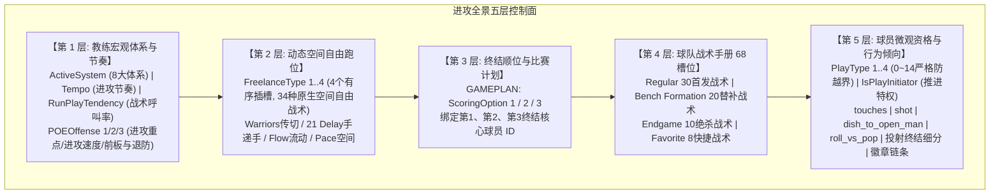
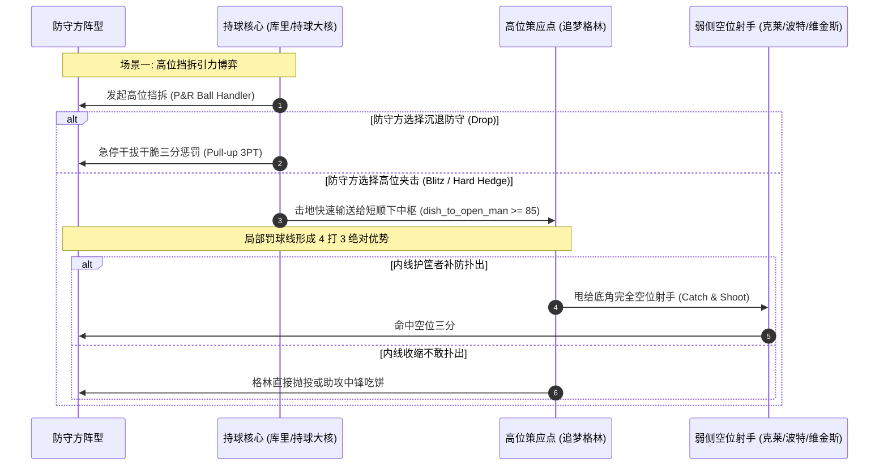

# 📋 NBA 2K22 全维度战术体系与攻防博弈标定标准规范 (V1.0)
# (Full-Dimensional Tactical System & Game-Theoretic Tuning Standard Directive)

> **文档标识**: `STANDARD-NBA2K22-TACTICAL-AND-GAME-THEORY-V1`  
> **生效时间**: 2026-11-23  
> **目标工程**: `Cybernetic_City_State_OS_v2 - nba2k22` / `Antigravity_GM_Engine`  
> **约束等级**: **强制性核心技术标准 (Mandatory Pre-Load Baseline)**  
> **适用对象**: **所有参与 NBA 2K22 球队与球员战术研究、能力重构、倾向平衡、教练预案及对位设置的智能体角色（任务规划、任务开发、独立审核等）**  

---

> [!IMPORTANT]
> **智能体前置必读与加载守则 (Agent Pre-Load Directive)**  
> 任何智能体在针对 30 支 NBA 球队及其阵容（1~5 首发五虎、6~10 第二阵容替补、教练组）展开战术、能力、徽章、倾向及防守对位方案的研究、讨论或生成可执行规格书之前，**必须预先加载并严格遵循本文档所定义的全部可设置项全景、博弈论攻防模型以及四大原生安全铁律**。未经本文档规范推导的任意数值设置均视为无效提议。

---

## 目录 (Table of Contents)
1. [引言与战术博弈核心理念](#一-引言与战术博弈核心理念)
2. [进攻面原生底层可设置项全景](#二-进攻面原生底层可设置项全景)
   - 2.1 [主教练宏观战术体系与风格 (COACHDATA)](#21-主教练宏观战术体系与风格-coachdata-352字节)
   - 2.2 [动态空间自由跑位体系 (Freelance Sets 1..4)](#22-动态空间自由跑位体系-freelance-sets-14)
   - 2.3 [终结顺位与比赛计划 (GAMEPLAN Scoring Options)](#23-终结顺位与比赛计划-gameplan-scoring-options)
   - 2.4 [战术手册 68 槽位分布 (PLAYBOOKDATA)](#24-战术手册-68-槽位分布-playbookdata)
   - 2.5 [球员战术资格与微观决策倾向 (PLAYERDATA)](#25-球员战术资格与微观决策倾向-playerdata)
3. [防守面原生底层可设置项全景](#三-防守面原生底层可设置项全景)
   - 3.1 [球队教练级防守哲学 (COACHDATA & GAMEPLAN)](#31-球队教练级防守哲学-coachdata--gameplan)
   - 3.2 [球员专属与个人对位防守矩阵 (18 维微观策略)](#32-球员专属与个人对位防守矩阵-18-维微观策略)
   - 3.3 [球员个人防守行为倾向与徽章联动](#33-球员个人防守行为倾向与徽章联动)
4. [基于博弈论的攻防体系与阵容搭配方法论](#四-基于博弈论的攻防体系与阵容搭配方法论)
   - 4.1 [引力模型与破局博弈 (Gravity & Counterplay)](#41-引力模型与破局博弈-gravity--counterplay)
   - 4.2 [首发五虎 vs 第 6-10 人第二阵容协同机制](#42-首发五虎-vs-第-6-10-人第二阵容协同机制-化解混编冲突)
   - 4.3 [针对性防守反制策略库](#43-针对性防守反制策略库)
5. [智能体标准作业流程与自检清单 (Agent SOP & Checklist)](#五-智能体标准作业流程与自检清单-agent-sop--checklist)
6. [附录：原生参数字典与速查表](#六-附录原生参数字典与速查表)

---

## 一、 引言与战术博弈核心理念

在传统的篮球游戏数值调整中，往往存在“只调能力值（Attribute）”或“孤立设置单项倾向（Tendency）”的片面做法，这会导致两个严重缺陷：
1. **球场表现脱节**：即使球星能力高达 95+，若缺少对应的战术类型（PlayType）、触球倾向（Touches）或空间自由跑位（Freelance），在 3D 物理引擎和战术模拟中依然会沦为底角看客；
2. **阵容搭配混乱**：替补第六人若与首发核心同样被赋予高触球和高出手倾向，在轮换混编上场时会爆发严重的“球权互抢与停滞”，破坏整体战术流动性。

### 核心博弈理念 (Game-Theoretic Co-Evolution)
现代篮球比赛本质上是**攻防策略的纳什均衡博弈**。
* **进攻端——引力与空位转移**：正如经典的湖人 OK 组合，奥尼尔在低位的绝对统治力（Post Up）会迫使对手采取包夹（Double Team Post），一旦包夹触发，防守阵型必然出现轮转空档；此时如果出球意愿（`dish_to_open_man`）与外线射手的定点投射徽章形成闭环，弱侧将获得空位大优势。同理，勇士库里在高位挡拆（Pick & Roll）所产生的超远射程引力，会逼迫对手采用高位夹击（Blitz）或换防，从而为短顺下的追梦格林创造局部 4 打 3 空间。
* **防守端——针对性锁死与阵型保护**：防守绝非单一的“整体防守”，而是由主教练宏观护筐/外线偏好、全队防守滑块以及 **23 组精准到个人的专属对位策略（Matchup Settings）** 共同构成的立体防御网。
* **动态轮换——先发与替补功能正交**：首发追求极致战术执行与主客引力互补，第二阵容（第 6~10 人）则需承担主控突分、空间拉开、防守大锁与暴力冲击的特定角色。通过**战术资格分离（PlayTypes 分流）**与**进攻倾向梯次化**，彻底根除混编时的球权踩踏。

---

## 二、 进攻面原生底层可设置项全景

REA 逆向工程已完全证实，NBA 2K22 原生进程具备结构清晰的自上而下五级进攻控制面：



### 2.1 主教练宏观战术体系与风格 (`COACHDATA` 352字节)
`COACHDATA` 结构体位于教练专属内存块，大小为 `0x160` 字节（352 字节），控制全队底层运行逻辑：
* **8 大战术体系 (`ActiveSystem` / `PreferredSystem`)**：
  * 偏移：`offset 264` (`0x108`), `start_bit: 28` (Active) / `start_bit: 16` (Preferred), `width: 4`。
  * 合法枚举：
    * `0`: **BALANCED** (攻守均衡体系)
    * `1`: **GRIT_AND_GRIND** (铁血慢节奏阵地战，如灰熊传统)
    * `2`: **PACE_AND_SPACE** (节奏与空间，现代魔球/快攻三分体系)
    * `3`: **PERIMETER** (外线挡拆投射主导)
    * `4`: **POST** (内线低位攻坚主导，如传统双塔/约基奇)
    * `5`: **TRIANGLE** (三角进攻站位与轴心策应)
    * `6`: **SEVEN_SECONDS** (跑轰七秒进攻，极致快速反击)
    * `7`: **DEFENSE** (防守反击主导)
* **执行战术频率 (`RunPlayTendency`)**：
  * 偏移：`offset 224` (`0xE0`), 1 字节, 范围 `0..100`。
  * 含义：决定球队在半场进攻时，强制呼叫 Playbook 具体战术的概率。数值越高，越倾向跑死战术；数值适中（如勇士 60~70），能在跑固定战术与进入 Freelance 自由流动之间取得完美平衡。
* **进攻节奏推进滑块 (`Tempo`)**：
  * 偏移：`offset 328` (`0x148`), `start_bit: 9`, `width: 8`, 范围 `0..100`。
  * 含义：实机观测值如汤姆·锡伯杜 55、尼克·纳斯 40（极度磨阵地），而史蒂夫·科尔高达 95（极致推早攻与转换节奏）。
* **进攻重点三维位域 (`POEOffense 1/2/3`)**：
  * 偏移：共用 `offset 316` (`0x13C`) 4 字节块。
  * **POEOffense (进攻重心)**: `start_bit: 15`, `width: 5`
    * `0`: NO_PREFERENCE, `1`: GET_TO_BASKET (冲击篮筐), `2`: GET_SHOOTERS_OPEN (为射手创造空位), `3`: FEED_THE_POST (喂球低位), `4`: PICK_AND_ROLL_OFFENSE (挡拆起手), `5`: NEUTRAL_OFFENSE_FOCUS (常规), `6`: RUN_OFFENSE_THROUGH_SCORER (围绕头号得分手)。
  * **POEOffense2 (进攻出手机会选择)**: `start_bit: 20`, `width: 5`
    * `0`: NO_PREFERENCE, `7`: PATIENT_OFFENSE (耐心传导), `8`: NEUTRAL_OFFENSE_TEMPO (常规), `9`: SHOOT_AT_WILL (快速拔枪/出手机会即投)。
  * **POEOffense3 (进攻篮板与退防)**: `start_bit: 25`, `width: 5`
    * `0`: NO_PREFERENCE, `10`: CRASH_OFFENSIVE_BOARDS (凶狠冲抢前板), `11`: NEUTRAL_OFFENSE_REBOUND (均衡), `12`: LIMIT_TRANSITION (快速退防/严防反击)。
* **轮换深度与替补使用率**：
  * `BenchDepth` (`offset 222`, 1 字节): 轮换人数限制（8~13 人）。
  * `BenchUtilization` (`offset 312`, 1 字节, 0~100): 替补使用激进程度。

### 2.2 动态空间自由跑位体系 (`Freelance Sets 1..4`)
当半场未呼叫战术、战术受阻断或战术第一段终结时，全队自动切入自由跑位状态。2K22 原生提供 **4 个有序插槽**，支持 34 种经过验证的原生战术：
* **插槽分布**：
  * `FreelanceType` (Slot 1 - 主选): `offset 252`, `start_bit: 25`, `width: 6`
  * `FreelanceType2` (Slot 2 - 次选): `offset 328`, `start_bit: 26`, `width: 6`
  * `FreelanceType3` (Slot 3 - 备选): `offset 348`, `start_bit: 3`, `width: 6`
  * `FreelanceType4` (Slot 4 - 备选): `offset 348`, `start_bit: 9`, `width: 6`
* **常用核心自由战术枚举速查 (部分核心)**：
  * `16`: **WARRIORS** (金州勇士专属无球双掩护、电梯门与空切)
  * `28`: **TWENTY_ONE_DELAY** (21 Delay / Pistol 边线手递手延迟落位)
  * `18`: **FLOW** (流动进攻，强弱侧动态转移球)
  * `21`: **PACE** (现代空间站位，底角拉开)
  * `22`: **POINT_FREELANCE** (组织前锋/高位策应中心)
  * `23`: **PRINCETON_CHIN** (普林斯顿下巴传切体系)
  * `27`: **TRIANGLE** (三角进攻落位)
  * `5`: **FOUR_OUT** (一内四外空间)

### 2.3 终结顺位与比赛计划 (`GAMEPLAN Scoring Options`)
位于 `GAMEPLAN` 结构体（stride 880 字节 / `0x370`）：
* **ScoringOption 1 / 2 / 3** (`offset 0x178`, 2 字节/槽位，共 6 字节)：
  * 分别存储三名球员的唯一 Player ID。
  * **作用机制**：当多名球员同时跑出机会或战术出现多分支时，引擎按照 `Option 1 -> Option 2 -> Option 3` 的严格权重分配传球终结优先级。

### 2.4 战术手册 68 槽位分布 (`PLAYBOOKDATA`)
位于 `PLAYBOOKDATA`（stride 360 字节 / `0x168`），从 `offset 0x58` 开始连续存储 68 个战术 CRC：
* **首发主力战术 (Slots 0~29, 30个)**: 适配首发 5 人的主打战术。
* **替补阵容战术 (Slots 30~49, 20个)**: **为第 6-10 人量身定制的独立战术池**！当替补上场时，AI 会优先从该槽位调配战术，避免强打不适合替补技能包的首发战术。
* **终局绝杀战术 (Slots 50~59, 10个)**: 比赛最后关键时刻的快速三分/单打战术。
* **快捷战术 (Slots 60~67, 8个)**: 手柄十字键一键秒呼战术。

### 2.5 球员战术资格与微观决策倾向 (`PLAYERDATA`)
位于球员对象（stride `0x4F0` 字节）：
* **战术呼叫资格 (`PlayType 1..4`)——【🚨 必须严格执行 0..14 原生范围】**：
  * 偏移：`offset 360` (`0x168`: PT1 bits 0-3, PT2 bits 4-7) 及 `offset 361` (`0x169`: PT3 bits 0-3, PT4 bits 4-7)。
  * **合法枚举定义 (严格禁止写入 >= 15)**：
    * `0`: None (无)
    * `1`: Isolation (单打)
    * `2`: Isolation Point (控卫专属单打)
    * `3`: Isolation Wing (侧翼锋线单打)
    * `4`: P&R Ball Handler (挡拆持球人)
    * `5`: P&R Point (控卫挡拆)
    * `6`: P&R Wing (侧翼挡拆)
    * `7`: P&R Roll Man (挡拆顺下/掩护人)
    * `8`: Post Up Low (低位背打)
    * `9`: Post Up High (高位策应背打)
    * `10`: Guard Post Up (后卫背身单打)
    * `11`: Cutter (无球空切者)
    * `12`: Handoff Receiver (手递手接球人)
    * `13`: Handoff Passer / Mid Range (手递手发牌人 / 中距离挂掩护)
    * `14`: Screen 3PT / 3PT (无球挂掩护三分)
* **组织推进指挥官特权 (`IsPlayInitiator`)**：
  * 偏移：`offset 362` (`0x16A`), `bit 2`。
  * 含义：决定该球员是否有权在后场接球推进过半场并发起战术（如控卫、持球锋线设为 1；无球射手、吃饼中锋严格设为 0）。
* **球权与微观决策核心倾向 (Tendencies, 0~100)**：
  * `TOUCHES_TENDENCY` (`0x499`): 战术呼叫率与持球权重。
  * `SHOT_TENDENCY` (`0x458`): 接球后坚决出手还是继续转移。
  * `DISH_TO_OPEN_MAN_TENDENCY` (`0x498`): **破包夹/破停滞核心**！吸引防守后分球给空位队友的意愿（顶级组织者需 85+）。
  * `ROLL_VS_POP_TENDENCY` (`0x49B`): 挡拆后选择顺下攻筐 (0) 还是外弹跳投 (100)。
  * `DRIVE_TENDENCY` (`0x483`): 突破攻筐侵略性。
  * `PLAY_DISCIPLINE_TENDENCY` (`0x4A1`): 严格按战术路线跑位 (100) vs 自行乱战单打 (0)。
  * 投篮细分倾向：`SPOT_UP_SHOT_THREE` (`0x473`), `OFF_SCREEN_SHOT_THREE` (`0x474`), `TRANSITION_PULL_UP_THREE` (`0x47F`), `STEPBACK_JUMPER_THREE` (`0x47C`) 等。

---

## 三、 防守面原生底层可设置项全景

防守端由教练宏观哲学与球员 18 维专属对位矩阵构成密不可分的防御网。

### 3.1 球队教练级防守哲学 (`COACHDATA` & `GAMEPLAN`)
* **防守重点三维位域 (`POEDefense 1/2/3`)**：
  * 偏移：共用 `offset 316` (`0x13C`) 4 字节块。
  * **POEDefense (防守重心)**: `start_bit: 0`, `width: 5`
    * `0`: NO_PREFERENCE, `13`: PROTECT_PAINT (收缩保护禁区), `14`: NEUTRAL_DEFENSE_FOCUS (常规), `15`: LIMIT_PERIMETER_SHOTS (外扑限制三分)。
  * **POEDefense2 (防守侵略性)**: `start_bit: 5`, `width: 5`
    * `0`: NO_PREFERENCE, `16`: PLAY_CONSERVATIVE (稳妥防守/避免犯规), `17`: NEUTRAL_DEFENSE_TEMPO (常规), `18`: PLAY_PHYSICAL (高强度身体对抗/破坏节奏)。
  * **POEDefense3 (防守篮板与转换)**: `start_bit: 10`, `width: 5`
    * `0`: NO_PREFERENCE, `19`: CRASH_DEFENSIVE_BOARDS (全员卡位保后板), `20`: NEUTRAL_DEFENSE_REBOUND (常规), `21`: RUN_IN_TRANSITION (抓后板快速打反击)。
* **全队防守滑块**：
  * `HelpDefense` (`offset 328`, `start_bit: 17`, `width: 8`, 0~100): 弱侧协防刷卡积极性。
  * `ZoneUsage` (`offset 226`, 1 字节, 0~100): 区域联防使用频率。

### 3.2 球员专属与个人对位防守矩阵 (18 维微观策略)
在 `GAMEPLAN` 的 `offset 0x64..0x178` 连续存储 23 项对位结构，每项 12 字节：
* `+0x00` (2 字节): `matchup_id` (防守目标球员 ID)
* `+0x02` (2 字节): `defender_id` (指派防守人 ID，`65535` 为自动)
* `+0x04` (8 字节): 打包了 **18 项微观防守策略位域**：

| 字段名称 | 位域参数 (start_bit, width) | 合法取值与实战战术含义 |
| :--- | :--- | :--- |
| **PressureOnball** | bit 0, width 3 | `0`: AUTO, `1`: SAG_OFF (放一步), `2`: GAP (大幅放空防投), `3`: MODERATE (适度), `4`: TIGHT (紧逼贴防), `5`: SMOTHER (窒息贴身防接球) |
| **PressureOffball** | bit 3, width 3 | `0`: AUTO, `1`: GAP (收缩放空), `2`: MODERATE (适度), `3`: TIGHT (贴身), `4`: DENY_BALL (阻绝传球线路) |
| **ForceDirection** | bit 6, width 2 | `0`: AUTO, `1`: MIDDLE (逼向中路), `2`: BASELINE (逼向底线/边线), `3`: NO_FORCE |
| **ScreenDefenseOnBall** | bit 8, width 3 | `0`: AUTO, `1`: GO_OVER (从掩护上方挤过绕前), `2`: GO_UNDER (从掩护后方绕后), `3`: SWITCH (遇挡拆直接换防), `4`: ICE (冰封/逼向边线) |
| **ScreenDefenseHedge** | bit 11, width 3 | `0`: AUTO, `1`: DROP (大中锋深沉退守禁区), `2`: SOFT_HEDGE (轻微延误后回位), `3`: HARD_HEDGE (强硬延误阻截), `4`: BLITZ (双人强行夹击持球人), `5`: CATCH_HEDGE (延误并阻断突破走廊), `6`: SWITCH (内线直接换防持球人) |
| **OffballScreenDefense**| bit 14, width 2 | `0`: AUTO, `1`: GO_OVER (挤过无球掩护追防射手), `2`: GO_UNDER (绕后防切入), `3`: SWITCH (无球换防) |
| **PostDefense** | bit 16, width 2 | `0`: AUTO, `1`: BEHIND (背后顶防), `2`: FRONT (正面完全绕前阻绝接球), `3`: THREE_QUARTERS (3/4 绕前对抗) |
| **DoubleTeamPerimeter**| bit 18, width 2 | `0`: AUTO, `1`: NEVER (从不外线包夹), `2`: ON_CATCH (外线接球即包夹), `3`: ON_DRIVE (突破运球时包夹) |
| **DoubleTeamPost** | bit 20, width 2 | `0`: AUTO, `1`: NEVER (从不低位包夹), `2`: ON_CATCH (低位接球即包夹), `3`: ON_DRIBBLE (低位下球背打时包夹) |
| **ScreenDefenseOnBall5**| bit 22, width 3 | 5 号位中锋专属挡拆对位策略（取值同 ScreenDefenseOnBall） |
| **ScreenDefenseHedge5** | bit 25, width 3 | 5 号位中锋专属掩护延误策略（取值同 ScreenDefenseHedge，关键区分沉退 Drop 与硬延误 Hard Hedge） |
| **SwitchRule** | bit 28, width 2 | `0`: AUTO, `1`: NO_SWITCH (不换防), `2`: SWITCH_ALL (1-5号位无差别无限换防), `3`: GUARDS_ONLY (仅1-4号位或后场换防) |
| **OnballHelp** | bit 30, width 2 | `0`: AUTO, `1`: HELP_AND_RECOVER (积极刷卡协防并迅速回位), `2`: NO_HELP (死防自身对位人不协防) |
| **ScreenHelp** | bit 32, width 2 | `0`: AUTO, `1`: HELP_AND_RECOVER (掩护协防并回位), `2`: NO_HELP (不协防) |
| **ExtendPressure** | bit 34, width 2 | `0`: AUTO, `1`: NONE (退回半场), `2`: HALF_COURT (半场紧逼), `3`: THREE_QUARTER (3/4场紧逼), `4`: FULL_COURT (全场死缠领防) |
| **TagOnRoll** | bit 36, width 1 | `0`: NO (不管顺下人), `1`: YES (弱侧防守人刷卡贴防顺下内线，阻断空接/吃饼) |
| **StayAttached** | bit 37, width 1 | `0`: NO (正常协防), `1`: YES (死贴无球神射手，绝不协防放空，封杀弱侧空位三分) |
| **PreRotate** | bit 38, width 1 | `0`: NO (常规轮转), `1`: YES (防守阵型提前预判轮转，先于传球到达落位点) |

### 3.3 球员个人防守行为倾向与徽章联动
* **防守核心倾向 (Tendencies)**:
  * `CONTEST_SHOT_TENDENCY` (`0x4B7`): 扑防与起跳干扰投篮意愿。
  * `BLOCK_SHOT_TENDENCY` (`0x4B8`): 盖帽侵略性。
  * `ON_BALL_STEAL_TENDENCY` (`0x4B6`): 下手抢断持球人。
  * `PASS_INTERCEPTION_TENDENCY` (`0x4B4`): 预判截断传球路线（大闸需 80+）。
  * `TAKE_CHARGE_TENDENCY` (`0x4B5`): 制造进攻犯规造带球撞人。
  * `FOUL_TENDENCY` (`0x4B9`) / `HARD_FOUL_TENDENCY` (`0x4BA`): 控制防守动作洁净度。
* **防守神级徽章联动**:
  * 死亡缠绕 (Clamps): 阻断持球突破与贴身对抗必配。
  * 追帽大师 (Chase Down Artist): 转换追击大帽必备。
  * 拦截者 (Interceptor): 传球路线抢断必备。
  * 禁区威慑 (Intimidator): 干扰禁区终结命中率的核心。

---

## 四、 基于博弈论的攻防体系与阵容搭配方法论

### 4.1 引力模型与破局博弈 (Gravity & Counterplay)



### 4.2 首发五虎 vs 第 6-10 人第二阵容协同机制 (化解混编冲突)

要解决“第六人上场时球权混乱、持球核心互斥”的问题，必须遵循以下 **五大正交设计法则**：

```
┌────────────────────────────────────────────────────────────────────────┐
│               五大首发与替补正交防冲突协同法则                          │
├────────────────────────────────────────────────────────────────────────┤
│ 1. 战术类型正交化 (PlayTypes Orthogonality)                            │
│    - 即使普尔与库里同时在场:                                           │
│      * 普尔绑定: P&R Ball Handler (4), Isolation (1)                   │
│      * 库里绑定: Screen 3PT (14), Handoff Receiver (12)                │
│    - 战术呼叫时两人各司其职，库里无球挂掩护引走防守，普尔打持球挡拆。    │
├────────────────────────────────────────────────────────────────────────┤
│ 2. 球权与出手梯度化 (Usage & Shot Pyramid)                             │
│    - 主控核心 (库里/普尔带二阵): touches 85~90, shot 80~86             │
│    - 二当家/副攻手 (汤普森/维金斯): touches 65~70, shot 75~85          │
│    - 组织策应中枢 (追梦格林): touches 70~75, 但 shot 严格限制 <= 30    │
│    - 终结拼图 (波特/别利察): touches 45~55, shot 55~65                 │
│    - 纯蓝领大闸 (卢尼/小佩顿): touches 30~40, shot 25~35               │
├────────────────────────────────────────────────────────────────────────┤
│ 3. 出球意识底线保证 (Dish to Open Man Floor)                           │
│    - 任何具备高 touches (>=75) 的持球人，dish_to_open_man 必须 >= 75。│
│    - 追梦格林此类发牌轴心，dish_to_open_man 必须达到 90~95。           │
│    - 杜绝一切“持球过半场强顶单打不传空位”的毒瘤代码行为。             │
├────────────────────────────────────────────────────────────────────────┤
│ 4. 战术手册替补槽位专用化 (Bench Playbook Slots 30~49)                 │
│    - 在 Playbook 的 30~49 槽位，专门放入适合第二阵容打法的战术套路。   │
│    - 使得第二阵容单独在场时，AI 不会错误呼叫针对首发体系的旧套路。     │
├────────────────────────────────────────────────────────────────────────┤
│ 5. 内线空间与功能对冲 (Roll vs Pop Duality)                            │
│    - 首发中锋 (卢尼): roll_vs_pop = 10 (纯顺下吃饼，制造攻筐杀伤)      │
│    - 替补中锋 (别利察): roll_vs_pop = 85 (纯外弹三分，为突破拉开空间)   │
│    - 使得第二阵容登场后，整个球场在空间站位上呈现完全不同的博弈维度。  │
└────────────────────────────────────────────────────────────────────────┘
```

### 4.3 针对性防守反制策略库
在 `GAMEPLAN_MATCHUP_DEFENSIVE_SETTINGS` 中，针对不同联盟顶级球星模板建立四类标准预案：

1. **针对外线超远持球大核（如库里、利拉德、特雷杨）**：
   * `PressureOnball`: `SMOTHER` (窒息贴身)
   * `ScreenDefenseOnBall`: `GO_OVER` (必须绕前挤过掩护，严禁绕后)
   * `ScreenDefenseHedge`: `HARD_HEDGE` 或 `BLITZ` (高位延误甚至夹击)
   * `TagOnRoll`: `YES` (弱侧内线刷卡顺下人，弥补外线包夹漏洞)
   * `StayAttached`: `YES` (弱侧无球射手死贴不放)
2. **针对低位攻坚怪兽（如恩比德、约基奇）**：
   * `PostDefense`: `THREE_QUARTERS` (3/4 绕前对抗)
   * `DoubleTeamPost`: `ON_DRIBBLE` (一旦运球立刻包夹，限制自主起步)
   * `PressureOffball`: `DENY_BALL` (阻绝进入深位的吊球)
3. **针对突破重型坦克（如字母哥、莫兰特、西蒙斯）**：
   * `PressureOnball`: `GAP` 或 `SAG_OFF` (后撤一步放空远投，构筑禁区人墙)
   * `ScreenDefenseOnBall`: `GO_UNDER` (掩护绕后收缩禁区)
   * `ScreenDefenseHedge`: `DROP` (深沉退护筐)
4. **针对无球顶级神射（如克莱·汤普森、邓肯·罗宾逊）**：
   * `PressureOffball`: `DENY_BALL` (阻绝接球)
   * `OffballScreenDefense`: `GO_OVER` (无球掩护死命挤过)
   * `StayAttached`: `YES` (严禁协防，寸步不离)

---

## 五、 智能体标准作业流程与自检清单 (Agent SOP & Checklist)

任何负责标定球队与球员的智能体，必须按以下 8 个阶段逐步推进：


### 智能体开工前自检表 (Mandatory Preflight Gate)
- [ ] **门禁 1 (PlayType 安全)**: 所有球员的 `PlayType 1..4` 严格落在 `0..14` 范围内，绝对未出现 `>= 15`。
- [ ] **门禁 2 (位域隔离写入)**: `IsPlayInitiator` (byte 362 bit 2) 及教练各位域字段均采用按位读改写（Read-Modify-Write），未直接覆盖同字节临近位。
- [ ] **门禁 3 (结构体边界与大小)**: `COACHDATA` 修改偏移量不超过 352 字节 (`0x160`)，`PLAYERDATA` 严格在 `0x4F0` 步长内。
- [ ] **门禁 4 (球权冲突审计)**: 场上高 touches (>=75) 球员均配备 >=75 的 `dish_to_open_man`；多核心同场时，PlayType 实现了功能解耦。
- [ ] **门禁 5 (防守闭环审计)**: 球队大闸（如格林、维金斯）不仅调整了防守倾向，而且在 `GAMEPLAN` 中绑定了对应的领防与协防对位位域。

---

## 六、 附录：原生参数字典与速查表

### 附录 A: PlayType 完整合法枚举表 (严格 0..14)
| 枚举值 | 英文名称 | 中文含义 | 适用角色 |
| :---: | :--- | :--- | :--- |
| **0** | `None` | 无战术 | 纯拼图/极低球权球员 |
| **1** | `Isolation` | 面框单打 | 顶级锋卫单打核心 (欧文/塔图姆) |
| **2** | `Isolation Point` | 控卫单打 | 顶级控卫专属单打战术 |
| **3** | `Isolation Wing` | 侧翼单打 | 锋线错位单打 (维金斯/德罗赞) |
| **4** | `P&R Ball Handler` | 挡拆持球人 | 挡拆持球大核 (保罗/特雷杨/普尔) |
| **5** | `P&R Point` | 控卫挡拆 | 控卫高位发起挡拆 |
| **6** | `P&R Wing` | 侧翼锋线挡拆 | 前锋持球挡拆发起 |
| **7** | `P&R Roll Man` | 挡拆掩护/顺下人 | 挡拆掩护顺下或外弹中锋/短顺下前锋 (追梦/卢尼/科林斯) |
| **8** | `Post Up Low` | 低位背身单打 | 传统内线/重型低位核心 (恩比德/约基奇) |
| **9** | `Post Up High` | 高位策应背身 | 高位发牌/轴心中锋 (追梦/萨博尼斯) |
| **10** | `Guard Post Up` | 后卫背身单打 | 高大后卫错位单挑矮后卫 (东契奇/利文斯顿) |
| **11** | `Cutter` | 无球空切者 | 强力空切手/无球顺下 (小佩顿/库明加/阿隆·戈登) |
| **12** | `Handoff Receiver` | 手递手接球人 | 手递手外线终结射手 (库里/克莱/邓罗) |
| **13** | `Handoff Passer / Mid Range` | 手递手发牌人 / 中距离 | 掩护发牌大个子或中投挂掩护者 |
| **14** | `Screen 3PT / 3PT` | 无球挂掩护三分 | 顶级无球神射手 (库里/克莱/乔·哈里斯) |

### 附录 B: 八大战术体系枚举表 (`ActiveSystem` / `PreferredSystem`)
* `0`: `BALANCED` (平衡)
* `1`: `GRIT_AND_GRIND` (铁血慢速阵地)
* `2`: `PACE_AND_SPACE` (现代空间与节奏)
* `3`: `PERIMETER` (外线主导)
* `4`: `POST` (低位主导)
* `5`: `TRIANGLE` (三角进攻)
* `6`: `SEVEN_SECONDS` (跑轰七秒)
* `7`: `DEFENSE` (防守至上)

### 附录 C: 球员微观倾向关键内存偏移量表 (Stride: 0x4F0)
* `0x458`: `SHOT_TENDENCY` (投篮出手倾向)
* `0x46A`: `SHOT_MID_RANGE_TENDENCY` (中投倾向)
* `0x472`: `SHOT_THREE_TENDENCY` (三分出手倾向)
* `0x473`: `SPOT_UP_SHOT_THREE` (定点三分倾向)
* `0x474`: `OFF_SCREEN_SHOT_THREE` (挂掩护三分倾向)
* `0x47F`: `TRANSITION_PULL_UP_THREE` (快攻干拔三分倾向)
* `0x483`: `DRIVE_TENDENCY` (突破攻筐倾向)
* `0x498`: `DISH_TO_OPEN_MAN_TENDENCY` (空位分球倾向)
* `0x499`: `TOUCHES_TENDENCY` (触球倾向)
* `0x49A`: `POST_UP_TENDENCY` (低位背打倾向)
* `0x49B`: `ROLL_VS_POP_TENDENCY` (挡拆顺下 0 vs 外弹 100)
* `0x4A1`: `PLAY_DISCIPLINE_TENDENCY` (战术纪律性倾向)
* `0x4B4`: `PASS_INTERCEPTION_TENDENCY` (传球抢断倾向)
* `0x4B6`: `ON_BALL_STEAL_TENDENCY` (持球抢断倾向)
* `0x4B7`: `CONTEST_SHOT_TENDENCY` (干扰投篮倾向)
* `0x4B8`: `BLOCK_SHOT_TENDENCY` (盖帽倾向)
