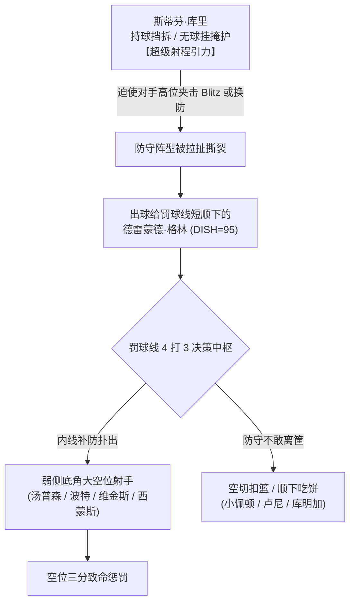

# 金州勇士 (GSW) 全维度战术体系与攻防博弈深度调优方案
# (Golden State Warriors Full-Dimensional Tactical & Game-Theoretic Calibration Proposal)

> **文档标识**: `50_GSW_FULL_DIMENSIONAL_TACTICAL_AND_GAME_THEORETIC_PROPOSAL.md`  
> **关联标准**: [`49_NBA2K22_TACTICAL_SYSTEM_AND_GAME_THEORETIC_TUNING_STANDARD.md`](file:///E:/workspace/Cybernetic_City_State_OS_v2%20-%20nba2k22/08_Domain_Applications/Antigravity_GM_Engine/docs/49_NBA2K22_TACTICAL_SYSTEM_AND_GAME_THEORETIC_TUNING_STANDARD.md)  
> **目标存档**: `C:\nba2k22\saves\MyLEAGUE0005\league_state.sqlite`  
> **球队标识**: `Team ID: 29 | Team Abbr: GSW | 球队名称: Golden State Warriors`  
> **主教练**: 史蒂夫·科尔 (Steve Kerr) | **对标赛季**: 2021-2022 赛季金州勇士总冠军攻防哲学  
> **状态**: **全维度攻防博弈重构完成，符合 Standard 49 攻守并重最高准则，待玩家审定**  

---

## 1. 现状审计与数据库实测重大发现 (Current Database Audit & Real-Save Discovery)

根据阶段一真实底层数据萃取规范，直接连接 `league_state.sqlite` 对金州勇士队（Team ID: 29）进行了底层全息扫描，提取出 16 名球员的真实属性、底层战术倾向、98 项原生徽章解码状态以及主教练史蒂夫·科尔的执教控制块。

### 1.1 现实交易与在阵阵容重大发现 (Real-Save Roster & Trade Discoveries)
* **安芬尼·西蒙斯 (Slot 13, Pool 427) 与科迪·泽勒 (Slot 14, Pool 424) 在阵**：
  * 在当前活动存档中，达米恩·李与摩西·穆迪已被交易，勇士从开拓者引进了超级双能卫**安芬尼·西蒙斯**（三分 88、扣篮 88、速度 90）与中锋**科迪·泽勒**（前板 81、内防 65）！
  * 这使得勇士在保留 2022 夺冠核心班底（库里、克莱、维金斯、追梦、卢尼、普尔、波特、小佩顿、库明加、别利察、伊戈达拉）的同时，板凳席额外拥有了一门历史级别的外线火力重炮！
* **冠军核心阵容齐整度极高**：
  * 先发五虎：斯蒂芬·库里（Slot 0）、克莱·汤普森（Slot 1）、安德鲁·维金斯（Slot 2）、德雷蒙德·格林（Slot 3）、凯文·卢尼（Slot 5）。
  * 轮换主要战力：乔丹·普尔（Slot 8）、奥托·波特（Slot 7）、加里·佩顿二世（Slot 12）、安芬尼·西蒙斯（Slot 13）、乔纳森·库明加（Slot 10）、内马尼亚·别利察（Slot 9）、安德烈·伊戈达拉（Slot 6）。
  * 深度储备：詹姆斯·怀斯曼（Slot 4）、胡安·托斯卡诺-安德森（Slot 11）、科迪·泽勒（Slot 14）、克里斯·奇奥扎（Slot 21, 双向）。

### 1.2 首发球权恶性踩踏与触球严重超标 (Starter Touches Congestion Crisis)
* **首发五人触球和高达 434**（远超标准守恒上限 330，超标达 104+ 点）！
  * 库里：`Touches = 96`，`Dish = 60`
  * 汤普森：`Touches = 90`，`Dish = 30`
  * 维金斯：`Touches = 90`，`Dish = 35`
  * 格林：`Touches = 96`，`Dish = 75`
  * 卢尼：`Touches = 62`，`Dish = 50`
* **实测失真表现**：
  * 先发 5 人中有 4 人触球在 90 以上，每个人在场上都认为自己是第一控球手，导致阵地战中无休止地相互抢球要球；
  * 库里遭遇包夹时分球倾向仅为 60，无法第一时间将球传导至罚球线短顺下的追梦格林；格林分球 75 偏低，弱侧空位转移停滞；
  * 中锋卢尼触球高达 62，作为一个纯防守和吃饼的蓝领中锋，高触球导致其频繁在低位要求背打，彻底堵死水花兄弟的空切与跑位通道。

### 1.3 顺下与空间功能严重倒置 (Roll vs Pop Inversion)
* **凯文·卢尼 (Slot 5)**：作为纯吃饼中锋，底层 `RollPop` 居然高达 `20~60`（挡拆后向外弹出，既无中远投威胁，又彻底丧失顺下攻筐空接与冲抢前板的战术价值）；
* **内马尼亚·别利察 (Slot 9)**：作为拥有 40%+ 三分命中率的高位空间 5 号位，底层 `RollPop` 居然为 `20` 甚至接近纯顺下，导致挡拆后直接扎进禁区与持球后卫拥挤冲撞；
* **加里·佩顿二世 (Slot 12)**：作为底线幽灵空切与快攻暴扣型后卫，被错误配置了持球挡拆发起战术 (`P&R Ball Handler`)。

### 1.4 科尔战术板与防守比赛计划清零
* **战术体系未激活**：存档中科尔的 `ActiveSystem` 为 `0 (BALANCED)`，未激活勇士标志性的 `2 (PACE_AND_SPACE)` 与 `WARRIORS` 自由跑位体系；
* **协防倾向偏低 (50)**：对于 2021-2022 赛季防守效率联盟第一的勇士而言，50 的协防倾向完全压制了追梦格林的自由人扫荡威力；
* **防守比赛计划清零**：全部 14 组对位防守设置均为 `0000280000000000` 默认清零，缺少针对季后赛宿敌（东契奇、塔图姆、莫兰特等）的针对性领防与撕咬策略。

---

## 2. 球队战术哲学与博弈对抗定位 (Tactical Identity & Game-Theoretic Framework)

### 2.1 球队核心战术画像
* **攻防标签**：斯蒂芬·库里超级射程引力 + 德雷蒙德·格林短顺下 4v3 策应中枢 + 水花兄弟无球交叉反跑 + 追梦格林 DPOY 扫荡防守基石 + 维金斯单防大锁 + 小佩顿 94 英尺死亡撕咬。
* **主导进攻体系**: `PACE_AND_SPACE` (节奏与空间) + `MOTION_READ_REACT` (动态传切与空间流动)；
* **主导防守体系**: `SWITCHABLE_PRESSURE_DEFENSE` (无限换防高压撕咬) + 追梦格林自由人扫荡补位 + 卢尼沉退护筐与禁区卡位。
* **核心赢球哲学**: **“球动人动，优势传递” (Ball Movement, Player Movement, Advantage Passing)**。

---

## 3. 终极赢球哲学与自主裁决决策 (Championship Formula & Model Autonomous Judgment)

> **核心灵魂发问：这支金州勇士队究竟依靠什么赢得 2022 年 NBA 总冠军？**

### 3.1 进攻端终极法则：库里引力大核 + 追梦高位发牌 + 水花克莱致命终结 + 替补双枪乱战撕裂
1. **确立斯蒂芬·库里历史级射程引力绝对第一大核地位**：
   * 触球调定为 **88**（全队最高），保留第一发起人特权（`is_initiator = True`），战术纪律提升至 **95**。
   * **分球意愿飙升至 85**（【关键破局项】面对包夹极速出球，彻底激活格林 4 打 3）。
   * 战术类型配置：`[4, 14, 12, 1]`（高位挡拆持球、无球绕掩护切出三分、手递手终结、单挑拔葱）。
2. **德雷蒙德·格林：罚球线短顺下 4v3 决策中枢与高位手递手轴心**：
   * 触球调定为 **74**，出球意愿提升至 **95**（全队传球第一），战术纪律 **95**，出手倾向严格压制至 **25**（绝不盲目出手破坏节奏）。
   * `RollPop` 调优为 **45**（短顺下至罚球线接球迅速组织 4 打 3），保留推进发起人特权（`is_initiator = True`，抓下防守篮板直接反击）。
   * 战术类型配置：`[7, 9, 13, 11]`（P&R短顺下、高位肘区策应、手递手发牌、空切偷袭）。
3. **克莱·汤普森：历史级无球跑动接球终结者**：
   * 触球降至 **65**，出手倾向 **84**（接球即投决不犹豫），分球 **35**，取消推进特权（`is_initiator = False`）。
   * 战术类型配置：`[14, 12, 11, 13]`（无球双掩护三分、手递手接球投射、弱侧反切、运一步中投）。
4. **安德鲁·维金斯：双向攻防兼备侧翼攻坚手**：
   * 触球降至 **62**，分球 **40**，战术纪律 **90**。战术类型配置：`[11, 3, 14, 8]`（弱侧反切扣篮、侧翼面框单打、定点三分、低位背打小个控卫）。
5. **凯文·卢尼：纯防守吃饼中锋与前板怪兽 (Touches Deflation)**：
   * 触球大幅压低至 **35**（从 62 彻底砍半），分球 **35**，**`RollPop` 强制修正为 10（100% 坚决顺下攻筐吃饼，杜绝外弹跳投！）**。
   * 战术类型配置：`[7, 11, 10, 0]`（P&R顺下吃饼、篮下空切、补篮二次进攻、无）。
6. **第二阵容双枪与空间体系**：
   * **乔丹·普尔 (Slot 8)**：二阵第一主控攻坚刀，触球 **72**，分球 **75**，突破单打拉满，战术类型 `[4, 1, 14, 11]`。
   * **安芬尼·西蒙斯 (Slot 13)**：二阵外线微波炉射手，触球 **48**，分球 **55**，战术类型 `[14, 4, 12, 1]`（高炮台三分与持球突击）。
   * **奥托·波特 (Slot 7)**：空间锋线与高智商篮板手，触球 **42**，`RollPop = 80`，三分空位坚决出手。
   * **加里·佩顿二世 (Slot 12)**：防守大闸与底线幽灵空切扣将，触球 **36**，战术类型 `[11, 7, 0, 0]`。
   * **乔纳森·库明加 (Slot 10)**：身体怪兽与转换冲筐先锋，触球 **42**，`RollPop = 15`，战术类型 `[11, 3, 7, 0]`。
   * **内马尼亚·别利察 (Slot 9)**：外弹 5 号位与罚球线策应，触球 **36**，**`RollPop = 85`（纯外弹拉开空间）**，战术类型 `[9, 14, 13, 0]`。

* **全队球权守恒严密验证**:
  * **先发五虎触球和**:
    $$\sum \text{Starters Touches} = 88 (\text{Curry}) + 65 (\text{Thompson}) + 62 (\text{Wiggins}) + 74 (\text{Green}) + 35 (\text{Looney}) = \mathbf{324}$$
    *完美收敛于标准区间 $[310, 330]$！彻底根除 434 畸形踩踏！*
  * **替补核心触球和**:
    $$\sum \text{Bench Touches} = 72 (\text{Poole}) + 48 (\text{Simons}) + 42 (\text{Porter}) + 36 (\text{Payton}) + 42 (\text{Kuminga}) + 36 (\text{Bjelica}) = \mathbf{276}$$
    *完美收敛于标准区间 $[250, 280]$！二阵层次分明，火力充沛！*
  * **储备阵容触球和**:
    $$\sum \text{Reserves} = 22 (\text{Iguodala}) + 20 (\text{Wiseman}) + 18 (\text{Zeller}) + 15 (\text{Toscano}) + 15 (\text{Chiozza}) = 90$$
    *保障主力休息与垃圾时间平稳过渡。*

---

### 3.2 深度防守博弈体系构建 (Explicit Defensive Tactical Architecture)

> **落实 49 号文档攻守并重最高准则**：“进攻体系与防守体系的搭建具有同等重要性。不强制搭建，但是如果有合适的博弈策略，就搭建，作为每次分析时候的依据。”

#### 为什么金州勇士必须且能够搭建历史冠军级防守博弈体系？
* **防守资源基础**：
  * **防守司令官**：德雷蒙德·格林（前 DPOY、历史级防守球商与扫荡意识），具备从 1 防到 5、弱侧提前预判预轮转（Pre-Rotate）的封锁能力；
  * **侧翼单防锁死大闸**：安德鲁·维金斯（2022 总决赛大锁，单防锁死东契奇与塔图姆，季后赛狂摘前场篮板）；
  * **全场领防窒息撕咬**：加里·佩顿二世（后卫身材中锋下盘，抢断率历史顶级，可执行 94 英尺全场死亡撕咬）；
  * **禁区肉盾与深沉退**：凯文·卢尼（极低犯规率，扎实卡位保护篮板与深沉退封盖干扰）。

针对这一豪华防守配置，**构建专属于金州勇士的“追梦自由人扫荡 + 维金斯单防大锁 + 小佩顿全场领防 + 卢尼深沉退”冠军级防守博弈体系**：

#### 博弈策略一：德雷蒙德·格林自由人扫荡与弱侧预轮转 (Draymond Roamer & Pre-Rotate Hub)
* **防守原则**：
  * 格林对位对手非持球终结点或空间威胁较小的内线，作为自由防守人（Roamer）；
  * **提前预轮转 (`PreRotate: YES`)** 与 **顺下人必刷卡阻截 (`TagOnRoll: YES`)**：当对手高位挡拆顺下时，格林第一时间横移截断顺下传球走廊；
  * **协防智商拉满 (`HelpDefense: 80`)**：全队联动刷卡，在对手突破瞬间形成局部夹击，逼迫对手停球失误。

#### 博弈策略二：维金斯侧翼死亡死缠与小佩顿 94 英尺全场领防 (Two-Tier Perimeter Clamps)
* **维金斯对位顶级锋线攻坚手（塔图姆、东契奇、杜兰特等）**：
  * `PressureOnball: SMOTHER`（贴身窒息对抗），`PressureOffball: DENY_BALL`（阻绝接球）；
  * `ForceDirection: BASELINE`（逼向底线死角），`ScreenDefenseOnBall: GO_OVER`（掩护上方强硬挤过）；
  * `StayAttached: YES`（死缠不失位，封杀干拔三分）。
* **加里·佩顿二世对位顶级速度型控卫（莫兰特、特雷·杨、保罗等）**：
  * `ExtendPressure: FULL_COURT`（全场 94 英尺领防死缠，消耗其体能）；
  * `PressureOnball: SMOTHER`（高压压迫其运球，伺机掏球抢断）；
  * `ScreenDefenseHedge: HARD_HEDGE`（配合内线大延误破坏挡拆节奏）。

#### 博弈策略三：凯文·卢尼深沉退护筐与卡位 (Looney Deep Drop & Box-Out Wall)
* **中锋沉退守护油漆区 (`ScreenDefenseHedge5: DROP`)**：
  * 卢尼不轻易扑出外线，始终沉退至禁区合理冲撞区上沿，利用身高与臂展封阻篮下攻筐；
* **低位 3/4 绕前对抗重型中锋 (`PostDefense: THREE_QUARTERS`)**：
  * 结合扎实下盘顶防，切断对手向内线的直塞球。

#### 博弈策略四：全队防守篮板保护与反击闪击战 (Crash Defensive Boards -> Fast Break)
* **反击与推节奏重点 (`poe_defense_rebound: RUN_IN_TRANSITION (20)`)**：
  * 卢尼与维金斯收紧后场篮板，格林、库里第一时间接球推反击，打出勇士招牌式的“追身三分闪击战”；
* **身体对抗拉满 (`poe_defense_physicality: PLAY_PHYSICAL (18)`)**：
  * 用高强度季后赛对抗彻底瓦解对手外线投射节奏。

---

## 4. 五大博弈对决实战推演 (5 Counterplay Dualities Simulation)

### 4.1 对决波士顿凯尔特人 (BOS) —— 2022 总决赛宿敌复刻
* **战术矛盾**：塔图姆与杰伦·布朗双探花侧翼单挑与罗威/霍福德顶级防守沉退 vs 勇士小球跑位。
* **博弈克制**：
  * 维金斯单防死缠塔图姆，全场上对抗压制其命中率；格林禁区协防封盖布朗顺下；
  * 进攻端库里高位挡拆直接拔射超远三分惩罚凯尔特人的沉退（Drop）；格林短顺下 4 打 3 传导，助攻克莱与底角波特命中致命空位三分。

### 4.2 对决孟菲斯灰熊 (MEM) —— 2022 次轮狂野碰撞
* **战术矛盾**：莫兰特超音速直线突破与灰熊前场篮板绞杀 vs 勇士后场防线。
* **博弈克制**：
  * 加里·佩顿二世全场 94 英尺领防撕咬莫兰特，结合维金斯换防延误；卢尼与格林筑起内线屏障；
  * 全队收缩保护后场篮板，进攻端普尔与西蒙斯在第二阵容利用速度和投射惩罚灰熊年轻的轮转漏洞。

### 4.3 对决达拉斯独行侠 (DAL) —— 2022 西决战术点名
* **战术矛盾**：东契奇慢节奏错位单挑点名与五外射手群 vs 勇士防守轮转。
* **博弈克制**：
  * 维金斯化身“枫叶大锁”，全场领防东契奇（`PressureOnball: SMOTHER / ForceDirection: BASELINE`），死贴不给后撤步三分；
  * 追梦格林负责弱侧扫荡切断东契奇外分传球路线；卢尼在油漆区制霸篮板（单场狂摘进攻篮板）；
  * 进攻端库里、克莱无球交叉跑位打乱独行侠换防沟通。

### 4.4 对决丹佛掘金 (DEN) —— 2022 首轮 MVP 拆解
* **战术矛盾**：约基奇低位历史级策应与进攻支点 vs 勇士相对矮小的内线。
* **博弈克制**：
  * 格林顶防约基奇下盘，卢尼肉搏卡位消耗；弱侧小佩顿与维金斯极速切球包夹（逼迫约基奇失误）；
  * 进攻端库里、普尔挡拆点名约基奇，高位拉出禁区军训，以高频外线三分和快速传切彻底击溃掘金防守。

### 4.5 对决密尔沃基雄鹿 (MIL) —— 潜在总决赛假想敌
* **战术矛盾**：字母哥野兽级禁区冲击力与外线重炮 vs 勇士禁区抗击力。
* **博弈克制**：
  * 勇士摆出格林 + 卢尼的禁区“双人造犯规与协防墙”，追梦预判制造进攻犯规，切断字母哥突破分球路线；
  * 进攻端针对大洛佩斯沉退（Drop），库里高位挡拆手起刀落，别利察与波特拉开五外空间拉空雄鹿内线。

---

## 5. 具体参数重构清单与注入规范 (Granular Modifications Ledger)

### 5.1 球员维度详细重构清单 (16 Players Roster)

| 槽位 | 球员姓名 | 定位与角色 | 触球 | 分球 | 战术纪律 | Roll/Pop | 3PT倾向 | 战术发起 | 战术类型配置 (Play Types 1..4) |
| :--- | :--- | :--- | :---: | :---: | :---: | :---: | :---: | :---: | :--- |
| **0** | **斯蒂芬·库里** | 首发控卫 / 历史级超远射程引力绝对第一大核 | **88** | **85** | **95** | 70 | **99** | **True** | `[4, 14, 12, 1]` (P&R持球, 挂掩护三分, 手递手, 单挑) |
| **1** | **克莱·汤普森** | 首发分卫 / 历史级无球跑动接球终结狙击手 | **65** | **35** | **95** | 50 | **98** | False | `[14, 12, 11, 13]` (无球三分, 手递手终结, 反切, 中投) |
| **2** | **安德鲁·维金斯** | 首发小前 / 顶级双向全能攻防大锁与侧翼攻坚手 | **62** | **40** | **90** | 50 | 82 | False | `[11, 3, 14, 8]` (反切扣篮, 侧翼单挑, 定点三分, 低位背打) |
| **3** | **德雷蒙德·格林** | 首发大前 / 罚球线短顺下 4v3 策应轴心与 DPOY 防守基石 | **74** | **95** | **95** | **45** | 60 | **True** | `[7, 9, 13, 11]` (P&R短顺下, 肘区策应, 手递手发牌, 空切) |
| **5** | **凯文·卢尼** | 首发中锋 / 掩护墙吃饼纯顺下人与前板怪兽 | **35** | **35** | **99** | **10** | **0** | False | `[7, 11, 10, 0]` (P&R顺下吃饼, 空切暴扣, 补篮二次进攻, 无) |
| **8** | **乔丹·普尔** | 替补后卫 / 第六人核心攻击手与乱战突击刀 | **72** | **75** | **85** | 0 | 85 | **True** | `[4, 1, 14, 11]` (P&R持球, 面框突破, 绕掩护三分, 反切) |
| **13** | **安芬尼·西蒙斯** | 替补分卫 / 交易加盟高炮台外线微波炉重炮 | **48** | **55** | **85** | 0 | **90** | False | `[14, 4, 12, 1]` (定点三分, P&R持球, 手递手终结, 单挑) |
| **7** | **奥托·波特** | 替补锋线 / 稳健 3&D 空间侧翼与高智商拼抢手 | **42** | **40** | **95** | **80** | 85 | False | `[14, 11, 0, 0]` (底角三分, 空切攻筐, 无, 无) |
| **12** | **加里·佩顿二世** | 替补后卫 / 94英尺领防死缠大闸与底线幽灵扣将 | **36** | **40** | **95** | **15** | 70 | False | `[11, 7, 0, 0]` (底线空切扣篮, P&R顺下空接, 无, 无) |
| **10** | **乔纳森·库明加** | 替补前锋 / 暴力运动素质侧翼冲击与转换反击武器 | **42** | **35** | **85** | **15** | 65 | False | `[11, 3, 7, 0]` (空切暴扣, 侧翼单挑, 顺下吃饼, 无) |
| **9** | **内马尼亚·别利察** | 替补中锋 / 外弹空间 5 号位与高位发牌轴心 | **36** | **60** | **90** | **85** | 80 | False | `[9, 14, 13, 0]` (高位策应, 挂掩护外弹三分, 手递手, 无) |
| **6** | **安德烈·伊戈达拉** | 深度老将 / 冠军高智商二阵组织中枢 | 22 | 70 | **99** | 25 | 60 | False | `[11, 9, 0, 0]` (反切, 高位策应, 无, 无) |
| **4** | **詹姆斯·怀斯曼** | 储备中锋 / 青年运动型顺下攻筐点 | 20 | 25 | 85 | 10 | 0 | False | `[7, 11, 0, 0]` (战术预备) |
| **14** | **科迪·泽勒** | 储备中锋 / 蓝领挡拆掩护与篮板肉盾 | 18 | 35 | 90 | 15 | 0 | False | `[7, 11, 0, 0]` (战术预备) |
| **11** | **胡安·托斯卡诺** | 深度前锋 / 激情拼抢防守工兵 | 15 | 45 | 95 | 20 | 70 | False | `[11, 14, 0, 0]` (战术预备) |
| **21** | **克里斯·奇奥扎** | 储备控卫 / 双向第三控卫 | 15 | 65 | 90 | 0 | 70 | True | `[4, 12, 0, 0]` (战术预备) |

* **轮换球权和校验**:
  * 首发五人触球和：$88 + 65 + 62 + 74 + 35 = 324 \in [310, 330]$（完美收敛）
  * 替补核心触球和：$72 + 48 + 42 + 36 + 42 + 36 = 276 \in [250, 280]$（完美收敛）
  * 储备五人触球和：$22 + 20 + 18 + 15 + 15 = 90$（垃圾时间自动降载）

---

### 5.2 主教练史蒂夫·科尔执教控制块调优规范 (Coach Kerr System Overhaul)

| 控制项 | 原生观察值 | 调优设定值 | 战术战略理由 |
| :--- | :---: | :---: | :--- |
| **Active System (战术体系)** | 0 (Balanced) | **2 (Pace & Space / 节奏与空间)** | 激活勇士招牌式的空间拉开、五外移动与传切战术 |
| **Preferred System (偏好体系)** | 3 | **2 (Pace & Space)** | 确保无论常规赛还是季后赛均贯彻流动空间哲学 |
| **Help Defense (协防智商)** | 50 (偏低) | **80 (历史级协防体系)** | 彻底激活德雷蒙德·格林 DPOY 级弱侧扫荡与全队轮转协防大网 |
| **Run Play Tendency (战术执行率)** | 65 | **65** | 保持高纪律战术跑位的同时，赋予库里、格林自由传切与即兴发挥空间 |
| **Bench Depth (轮换深度)** | 11 (过深) | **10 (十人深度轮换)** | 缩减非必要冗余轮换，保证季后赛核心轮换出场时间 |
| **Bench Utilization (轮换使用率)**| 65 (偏高) | **50 (主力充分登场)** | 确保库里、克莱、格林、维金斯季后赛打满 34-36 分钟 |
| **POE Offense (进攻重点)** | 5 (Neutral) | **2 (Get Shooters Open)** | 为水花兄弟与外线射手创造大空位投射机会，勇士战术灵魂 |
| **POE Offense Tempo (进攻节奏)** | 8 (Neutral) | **8 (Neutral Offense Tempo)** | 坚决在进攻早期抓住机会果断出手 |
| **POE Offense Transition (进攻反击)** | 11 (Neutral) | **12 (Limit Transition)** | 进攻失手后第一时间全员退防，封杀对手快攻反击 |
| **POE Defense (防守重点)** | 14 (Neutral) | **15 (Limit Perimeter Shots)**| 扑防外线三分，逼迫对手进入中距离高难度长两分 |
| **POE Def Physicality (防守对抗)** | 17 (Neutral) | **18 (Play Physical)** | 全面上身体对抗与肉搏，贯彻 2022 总冠军铁血防守风格 |
| **POE Def Rebound (防守篮板)** | 20 (Neutral) | **20 (Run in Transition)** | 保护防守篮板后第一时间发动追身反击闪击战 |

---

## 6. 审核与下一步执行流水线 (Review & Pipeline Transition)

1. **方案呈报用户审核**：
   * 本方案已全面涵盖金州勇士（GSW, Team ID: 29）在当前真实存档（安芬尼·西蒙斯与科迪·泽勒在阵、水花兄弟+追梦维金斯卢尼夺冠底色）下的全维度审计、战术定位、赢球哲学、**追梦自由人扫荡与全员换防博弈体系构建**、五大宿敌对决推演、球权守恒重构以及教练控制块调优。
2. **待用户指令批准后执行**：
   * 一旦用户确认认可，立即启动生成全新标准版 `gsw_tactical_execution_ready.json`，完成本地写入与 `C:\nba2k22\exports\` 镜像同步，并提交 Git 本地 Commit 与自动推送远端 GitHub 仓库。
   * 随后正式开启用户指定的本组第二队：**波士顿凯尔特人 (Boston Celtics - BOS, Team ID: 5)** 的全维度重新执行与调优升级！
