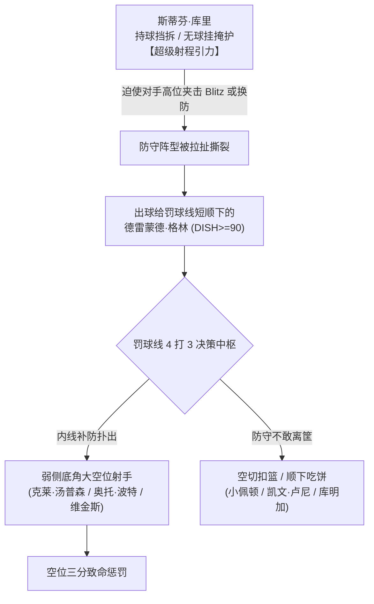

# 🏆 金州勇士 (GSW) 全维度战术体系与攻防博弈深度调优方案
# (Golden State Warriors Full-Dimensional Tactical & Game-Theoretic Calibration Proposal)

> **文档标识**: `PROPOSAL-GSW-CHAMPIONSHIP-REALISM-V1`  
> **制定时间**: 2026-11-23  
> **执行依据**: [`49_NBA2K22_TACTICAL_SYSTEM_AND_GAME_THEORETIC_TUNING_STANDARD.md`](file:///E:/workspace/Cybernetic_City_State_OS_v2%20-%20nba2k22/08_Domain_Applications/Antigravity_GM_Engine/docs/49_NBA2K22_TACTICAL_SYSTEM_AND_GAME_THEORETIC_TUNING_STANDARD.md)  
> **目标存档**: `C:\nba2k22\saves\MyLEAGUE0005\league_state.sqlite` (Team ID: 29, "GSW")  
> **对标赛季**: **2021-2022 赛季金州勇士夺冠阵容与攻防哲学**  
> **状态**: **深度调研完成，方案确立，待玩家审定**  

---

## 目录 (Table of Contents)
1. [勇士队历史底色与赢球哲学定位](#一-勇士队历史底色与赢球哲学定位)
2. [实机现状诊断与痛点逆向剖析](#二-实机现状诊断与痛点逆向剖析)
3. [主教练史蒂夫·科尔基准战术与全队预案](#三-主教练史蒂夫科尔基准战术与全队预案)
4. [首发五虎 (1~5) 攻防博弈与微调规范](#四-首发五虎-15-攻防博弈与微调规范)
5. [第二阵容 (6~10) 正交搭配与防冲突规范](#五-第二阵容-610-正交搭配与防冲突规范)
6. [专属防守对位体系预案 (Matchup Settings)](#六-专属防守对位体系预案-matchup-settings)
7. [全队球权守恒与安全铁律审计](#七-全队球权守恒与安全铁律审计)

---

## 一、 勇士队历史底色与赢球哲学定位

### 1.1 BPTI 体系契合度与核心哲学
根据仓库 BPTI 知识底座（`B3-TEAM-GSW`），金州勇士队的战术灵魂由两套经典体系深度共振构成：
* **主导进攻体系**: `MOTION_READ_REACT` (动态传切与空间流动) + 辅助 `SPREAD_PICK_AND_ROLL` (高位扩散挡拆)；
* **主导防守体系**: `SWITCHABLE_PRESSURE_DEFENSE` (可换防高压撕咬) + 追梦格林自由人扫荡补位；
* **核心赢球哲学**: **“球动人动，优势传递” (Ball Movement, Player Movement, Advantage Passing)**。依靠斯蒂芬·库里在持球和无球端历史级别的“超级射程引力”，吸引防守注意力与局部夹击，再由高位中枢（追梦格林）在罚球线短顺下展开 4 打 3 决策，最终将球转移到弱侧大空位射手（汤普森、波特、维金斯）或空切终结者（小佩顿、卢尼）。



---

## 二、 实机现状诊断与痛点逆向剖析

通过从活动存档 `league_state.sqlite` 中直接提取 GSW 现存原生数据（包含教练观测与球员 0x4F0 底层字节），诊断出以下 **五大严重缺陷**：

```
                    【实机 GSW 底层数据现存五大缺陷】
                                 │
     ┌───────────────────────────┼───────────────────────────┐
     ▼                           ▼                           ▼
【缺陷 1: 控场特权归零】   【缺陷 2: 首发球权严重挤爆】   【缺陷 3: 出球意愿过低】
IsPlayInitiator 全为 0    Curry/Klay/Wiggins/Green    Curry 分球仅 60!
库里/格林/普尔无推进权     4人 touches>=90, 达到434!   遭遇包夹无法出球
     │                           │                           │
     └───────────────────────────┼───────────────────────────┘
                                 ▼
                 【缺陷 4: 顺下与空间功能倒置】
                 卢尼 (纯吃饼) RollPop=60 (飘外线)
                 别利察 (40%三分) RollPop=0 (扎禁区)
                 佩顿二世错误配备 PnR Ball Handler
```

### 详细诊断数据表：
1. **控球发起人标记 (`IsPlayInitiator`) 全队为 0**：实机底层中库里、追梦格林、乔丹·普尔的 `IsPlayInitiator` 全部为 `0`！导致后场推进与战术发起完全处于混乱盲动状态；
2. **首发球权严重踩踏 (Touches 爆炸)**：
   * 库里 (96)、汤普森 (90)、维金斯 (90)、格林 (96)、卢尼 (62)，**首发 5 人总触球高达 434**（远超标准守恒上限 330）！每个人都觉得自己是第一持球点，导致场上严重争抢球权；
3. **出球意愿严重不足 (Dish to Open Man 偏低)**：
   * 库里作为遭遇联盟最高包夹率的超巨，`DISH_TO_OPEN_MAN` 仅为 `60`；追梦格林发牌中枢仅为 `75`；普尔仅为 `45`。在面对高位夹击时，球无法第一时间流转出来；
4. **空间与顺下角色严重错位 (Roll vs Pop 倒置)**：
   * **凯文·卢尼**：纯吃饼防守中锋，`ROLL_VS_POP` 居然高达 `60`（挡拆后经常向外弹跳投，不仅没有投射威胁，还彻底浪费了攻筐顺下机会）；
   * **内马尼亚·别利察**：拥有 40% 三分命中率的空间 5 号位，`ROLL_VS_POP` 居然为 `0`（挡拆后纯顺下扎进禁区，彻底挤爆突破走廊）；
   * **加里·佩顿二世**：作为以空切幽灵空接闻名的后场防守大闸，战术资格居然被错误配了 `PnR Ball Handler`；
5. **教练体系偏离**：
   * 科尔在存档中的 `ActiveSystem` 依然被置为 `0: BALANCED`，未能激活 `2: PACE_AND_SPACE` 与专属 `WARRIORS` 自由传切跑位。

---

## 三、 主教练史蒂夫·科尔基准战术与全队预案

严格按照 2022 夺冠赛季科尔执教哲学，确立以下教练端静态基准（`COACHDATA` & `GAMEPLAN`）：

```
┌────────────────────────────────────────────────────────────────────────┐
│               史蒂夫·科尔 (Steve Kerr) 战术预案标准配置                 │
├────────────────────────────────────────────────────────────────────────┤
│ 1. 战术体系 (ActiveSystem & PreferredSystem)                           │
│    - ActiveSystem: 2 (PACE_AND_SPACE 空间与节奏)                       │
│    - PreferredSystem: 2 (PACE_AND_SPACE)                               │
│ 2. 进攻节奏与执行频率                                                  │
│    - Tempo: 95 (高节奏转换早攻，保留实机经验证的高数值)                │
│    - RunPlayTendency: 65% (平衡 Playbook 战术与 Freelance 自由传切)    │
│ 3. 进攻重点位域 (POEOffense 1/2/3)                                     │
│    - POEOffense: 2 (GET_SHOOTERS_OPEN 为射手创造空位，勇士战术精髓)     │
│    - POEOffense2: 8 (NEUTRAL_OFFENSE_TEMPO / SHOOT_AT_WILL 坚决出手)   │
│    - POEOffense3: 12 (LIMIT_TRANSITION 快速回防落位，勇士冠军防反基石) │
│ 4. 防守重点位域 (POEDefense 1/2/3)                                     │
│    - POEDefense: 15 (LIMIT_PERIMETER_SHOTS 扑防限制外线三分)            │
│    - POEDefense2: 18 (PLAY_PHYSICAL 身体对抗施压)                      │
│    - POEDefense3: 20 (NEUTRAL_DEFENSE_REBOUND / RUN_IN_TRANSITION)     │
│ 5. 全队防守滑块                                                        │
│    - HelpDefense: 75% (积极协防刷卡与回位)                             │
│    - ZoneUsage: 5% (极少使用联防，以高强度换防人盯人为主)              │
│ 6. 四大有序空间自由跑位插槽 (Freelance Sets 1..4)                      │
│    - Slot 1 (主选): 16 (WARRIORS 专属双掩护、电梯门与空切体系)         │
│    - Slot 2 (次选): 28 (TWENTY_ONE_DELAY 边线手递手延迟落位)           │
│    - Slot 3 (备选): 18 (FLOW 强弱侧流动进攻)                           │
│    - Slot 4 (备选): 21 (PACE 现代空间拉开站位)                         │
│ 7. 比赛计划三大得分顺位 (ScoringOption 1/2/3)                          │
│    - Option 1: 1612 (Stephen Curry 绝对终结与引力第一点)               │
│    - Option 2: 2137 (Klay Thompson 战术第二点，无球终结)               │
│    - Option 3: 4091 (Andrew Wiggins 弱侧单打与空切第三点)              │
│ 8. 轮换滑块                                                            │
│    - BenchDepth: 10 (10 人深度轮换)                                    │
│    - BenchUtilization: 60 (科学轮换，主力 32~34 分钟，替补充分登场)    │
└────────────────────────────────────────────────────────────────────────┘
```

---

## 四、 首发五虎 (1~5) 攻防博弈与微调规范

### 1. 斯蒂芬·库里 (Stephen Curry, PG, Slot 0, CF: 1612)
* **战术定位**: **历史级超远射程引力大核 (Primary Perimeter Gravity Alpha)**
* **战术呼叫资格 (`PlayType 1..4`)**:
  * PT1: `4` (`P&R Ball Handler` - 核心高位挡拆发起)
  * PT2: `14` (`Screen 3PT` - 招牌无球挂掩护切出三分)
  * PT3: `12` (`Handoff Receiver` - 手递手接球拔射)
  * PT4: `1` (`Isolation` - 关键时刻错位单挑)
* **组织特权 (`IsPlayInitiator`)**: `1` (后场第一持球推进人)
* **核心倾向调优**:
  * `TOUCHES`: `88` (全队第一球权) | `SHOT`: `86` (进攻侵略性)
  * `DISH_TO_OPEN_MAN`: `85` (【关键破局项】遭遇夹击极速分球，彻底激活格林 4 打 3)
  * 投射细分: `SHOT_THREE`: `99`, `SPOT_UP_THREE`: `95`, `OFF_SCREEN_THREE`: `99`, `TRANSITION_PULL_UP_THREE`: `95`, `STEPBACK_THREE`: `95`
  * `DRIVE`: `75` (突破挑篮终结)

### 2. 克莱·汤普森 (Klay Thompson, SG, Slot 1, CF: 2137)
* **战术定位**: **历史级无球跑动接球终结者 (Movement Sniper & Catch-and-Shoot Anchor)**
* **战术呼叫资格 (`PlayType 1..4`)**:
  * PT1: `14` (`Screen 3PT` - 无球绕双掩护切出三分)
  * PT2: `12` (`Handoff Receiver` - 手递手发牌直接终结)
  * PT3: `11` (`Cutter` - 弱侧反切禁区)
  * PT4: `13` (`Mid Range` - 运一步中距离跳投)
* **组织特权 (`IsPlayInitiator`)**: `0` (专注无球跑位，不带球过半场)
* **核心倾向调优**:
  * `TOUCHES`: `65` (战术第二顺位) | `SHOT`: `84` (接球即投，决不犹豫)
  * `DISH_TO_OPEN_MAN`: `35` (终结者属性，不过度出球停滞战术)
  * 投射细分: `SPOT_UP_THREE`: `98`, `OFF_SCREEN_THREE`: `99`, `CONTESTED_JUMPER_THREE`: `80`
  * 防守倾向: `CONTEST_SHOT`: `80`, `FOUL`: `40`

### 3. 安德鲁·维金斯 (Andrew Wiggins, SF, Slot 2, CF: 4091)
* **战术定位**: **双向全能攻防大锁与错位攻坚手 (Two-Way Wing Stopper & Mismatch Punisher)**
* **战术呼叫资格 (`PlayType 1..4`)**:
  * PT1: `11` (`Cutter` - 弱侧底角暴扣空切)
  * PT2: `3` (`Isolation Wing` - 侧翼单挑打错位)
  * PT3: `14` (`Screen 3PT / Spot Up` - 45 度与底角定点三分)
  * PT4: `8` (`Post Up Low` - 低位坐打小个控卫)
* **组织特权 (`IsPlayInitiator`)**: `0`
* **核心倾向调优**:
  * `TOUCHES`: `62` | `SHOT`: `68` (进攻适度且高效)
  * `SPOT_UP_THREE`: `82`, `DRIVE`: `78`, `ATTACK_STRONG`: `85`
  * 篮板与防守 (2022季后赛篮板怪兽): `CRASH_OFFENSIVE_BOARDS`: `65`, `CONTEST_SHOT`: `88`, `ON_BALL_STEAL`: `75`

### 4. 德雷蒙德·格林 (Draymond Green, PF, Slot 3, CF: 2478)
* **战术定位**: **高位策应发牌轴心与防守自由人司令官 (Elbow Pivot, Short-Roll Hub & DPOY Anchor)**
* **战术呼叫资格 (`PlayType 1..4`)**:
  * PT1: `7` (`P&R Roll Man` - 挡拆短顺下中枢发牌)
  * PT2: `9` (`Post Up High` - 罚球线肘区策应)
  * PT3: `13` (`Handoff Passer` - 高位手递手发牌)
  * PT4: `11` (`Cutter` - 空切偷鸡攻筐)
* **组织特权 (`IsPlayInitiator`)**: `1` (抓下后场篮板可直接推进过半场发起反击)
* **核心倾向调优**:
  * `TOUCHES`: `74` (高触球策应) | `SHOT`: `25` (【关键约束】严格压低出手倾向，绝不勉强投篮破坏节奏)
  * `DISH_TO_OPEN_MAN`: `95` (【核心发牌项】出球意愿拉满，弱侧有空位必到)
  * `ROLL_VS_POP`: `45` (短顺下停在罚球线进行 4 打 3 传导)
  * 防守倾向: `PASS_INTERCEPTION`: `92`, `CONTEST_SHOT`: `90`, `BLOCK_SHOT`: `82`, `TAKE_CHARGE`: `85`

### 5. 凯文·卢尼 (Kevon Looney, C, Slot 5, CF: 4431)
* **战术定位**: **扎实掩护墙与前板怪兽 (Solid Screener, Rim Roller & Glass Cleaner)**
* **战术呼叫资格 (`PlayType 1..4`)**:
  * PT1: `7` (`P&R Roll Man` - 坚决顺下吃饼)
  * PT2: `11` (`Cutter` - 篮下偷袭空切)
  * PT3: `0` (`None`) | PT4: `0` (`None`)
* **组织特权 (`IsPlayInitiator`)**: `0`
* **核心倾向调优**:
  * `TOUCHES`: `35` (蓝领球权) | `SHOT`: `30` (仅限篮下吃饼)
  * `ROLL_VS_POP`: `10` (【关键修正】从错误的 60 压低至 10，挡拆后纯顺下攻筐，绝不外飘跳投！)
  * `PUTBACK_TENDENCY`: `85`, `CRASH_OFFENSIVE_BOARDS`: `92` (前场篮板冲抢拉满)

---

## 五、 第二阵容 (6~10) 正交搭配与防冲突规范

### 1. 乔丹·普尔 (Jordan Poole, SG/PG, Slot 8, CF: 7847)
* **战术定位**: **第二阵容绝对主控撕裂手 / 死亡三后卫乱战强攻核心 (Bench Primary Slasher & Shot Creator)**
* **战术呼叫资格 (`PlayType 1..4`)**:
  * PT1: `4` (`P&R Ball Handler` - 二阵高位挡拆主控)
  * PT2: `1` (`Isolation` - 面框爆发力突破单挑)
  * PT3: `14` (`Screen 3PT` - 与库里同场时的无球挂掩护)
  * PT4: `11` (`Cutter` - 快速反切攻筐)
* **组织特权 (`IsPlayInitiator`)**: `1` (第二阵容战术指挥官)
* **正交防冲突设计 (与库里同场时的球权分流机制)**:
  * 普尔主控持球挡拆 (`P&R Ball Handler`)，库里打无球掩护 (`Screen 3PT`)；库里巨大的无球引力将防守最佳大锁带走，留给普尔单打对方第二防守人的巨大突破空间！
* **核心倾向调优**:
  * `TOUCHES`: `82` (二阵第一球权) | `SHOT`: `82` (极强开火权)
  * `DRIVE`: `88` (招牌低重心极速突破)
  * `DISH_TO_OPEN_MAN`: `78` (突分喂饼别利察与波特)
  * `SHOT_THREE`: `82`, `STEPBACK_JUMPER_THREE`: `85`, `TRANSITION_PULL_UP_THREE`: `85`

### 2. 奥托·波特 (Otto Porter Jr., SF/PF, Slot 7, CF: 2689)
* **战术定位**: **高球商空间锋线与冷血底角刺客 (3&D Stretch Forward & High-IQ Rebounder)**
* **战术呼叫资格 (`PlayType 1..4`)**:
  * PT1: `14` (`Screen 3PT / Spot Up` - 定点与反跑三分)
  * PT2: `11` (`Cutter` - 聪慧空切)
  * PT3: `0` (`None`) | PT4: `0` (`None`)
* **组织特权 (`IsPlayInitiator`)**: `0`
* **核心倾向调优**:
  * `TOUCHES`: `48` | `SHOT`: `58`
  * `SPOT_UP_SHOT_THREE`: `90` (底角抽冷子三分，绝无虚发)
  * `CRASH_OFFENSIVE_BOARDS`: `70` (前场长篮板机敏拼抢)

### 3. 加里·佩顿二世 (Gary Payton II, SG/PG, Slot 12, CF: 7412)
* **战术定位**: **后卫身高中锋灵魂，窒息撕咬领防大锁与底线幽灵扣将 (Point-of-Attack Lock & Ghost Dunker)**
* **战术呼叫资格 (`PlayType 1..4`)**:
  * PT1: `11` (`Cutter` - 招牌底线溜后门偷袭暴扣)
  * PT2: `7` (`P&R Roll Man` - 【神来之笔】后卫给后卫掩护后顺下空接扣篮！)
  * PT3: `0` (`None`) | PT4: `0` (`None`)
* **组织特权 (`IsPlayInitiator`)**: `0` (【关键修正】坚决剥离 P&R Ball Handler，专注于终结与防守)
* **核心倾向调优**:
  * `TOUCHES`: `38` | `SHOT`: `42`
  * `DRIVING_DUNK`: `88`, `ALLEY_OOP`: `85`
  * 防守全满: `ON_BALL_STEAL`: `96`, `PASS_INTERCEPTION`: `92`, `CONTEST_SHOT`: `88`

### 4. 内马尼亚·别利察 (Nemanja Bjelica, C/PF, Slot 9, CF: 2550)
* **战术定位**: **高位发牌与外弹三分空间型 5 号位 (Stretch-5 Pivot & High Post Playmaker)**
* **战术呼叫资格 (`PlayType 1..4`)**:
  * PT1: `9` (`Post Up High` - 罚球线弧顶手递手策应)
  * PT2: `14` (`Screen 3PT / Spot Up` - 挡拆外弹三分)
  * PT3: `13` (`Handoff Passer` - 手递手发牌)
  * PT4: `0` (`None`)
* **组织特权 (`IsPlayInitiator`)**: `0`
* **正交防冲突设计 (与卢尼的功能对冲)**:
  * 卢尼顺下（`RollPop=10`），别利察纯外弹（`RollPop=85`）。别利察登场后把对方中锋彻底拉出禁区，为普尔和库明加创造一马平川的上篮跑道！
* **核心倾向调优**:
  * `TOUCHES`: `52` | `SHOT`: `52`
  * `ROLL_VS_POP`: `85` (【致命修正】从原版错误的 0 修正为 85，拉开空间！)
  * `SPOT_UP_SHOT_THREE`: `85`, `DISH_TO_OPEN_MAN`: `82`

### 5. 乔纳森·库明加 (Jonathan Kuminga, PF/SF, Slot 10, CF: 8054)
* **战术定位**: **暴力冲击侧翼与转换终结武器 (Explosive Transition Wing & Rim Slasher)**
* **战术呼叫资格 (`PlayType 1..4`)**:
  * PT1: `11` (`Cutter` - 战斧空切扣篮)
  * PT2: `3` (`Isolation Wing` - 身体素质生吃错位)
  * PT3: `7` (`P&R Roll Man` - 强力空接顺下)
  * PT4: `0` (`None`)
* **组织特权 (`IsPlayInitiator`)**: `0`
* **核心倾向调优**:
  * `TOUCHES`: `56` | `SHOT`: `68`
  * `DRIVE`: `86`, `DRIVING_DUNK`: `92`, `ATTACK_STRONG`: `90`
  * `ROLL_VS_POP`: `15` (挡拆后坚决冲击篮筐造杀伤)

---

## 六、 专属防守对位体系预案 (Matchup Settings)

在 `GAMEPLAN_MATCHUP_DEFENSIVE_SETTINGS` 中，为勇士设定应对联盟四大假想敌的实战对位方案：

### 1. 维金斯单防大锁对位（针对东契奇、塔图姆、杜兰特）
* `PressureOnball`: `SMOTHER` (贴身窒息对抗)
* `PressureOffball`: `DENY_BALL` (阻绝接球)
* `ForceDirection`: `BASELINE` (逼向底线死角)
* `ScreenDefenseOnBall`: `GO_OVER` (掩护上方强硬挤过)
* `StayAttached`: `YES` (死缠不协防，封杀弱侧空位)

### 2. 加里·佩顿二世领防对位（针对莫兰特、保罗、特雷杨）
* `ExtendPressure`: `FULL_COURT` (全场 94 英尺贴身死缠，消耗其体力)
* `PressureOnball`: `SMOTHER` (高压破坏控球手节奏)
* `ScreenDefenseOnBall`: `GO_OVER`
* `ScreenDefenseHedge`: `HARD_HEDGE` (配合内线强力延误)

### 3. 德雷蒙德·格林自由人扫荡体系（全队防守基石）
* 对位一般非核心内线，设为自由协防人；
* `OnballHelp`: `HELP_AND_RECOVER` (弱侧积极扑出刷卡协防并迅速回位)
* `TagOnRoll`: `YES` (顺下人必刷卡阻截)
* `PreRotate`: `YES` (防守阵型提前预判轮转)

### 4. 凯文·卢尼防守对位
* `ScreenDefenseOnBall5`: `GO_OVER`
* `ScreenDefenseHedge5`: `DROP` (深沉退保护油漆区，规避犯规)
* `PostDefense`: `THREE_QUARTERS` (3/4 绕前对抗重型中锋)

---

## 七、 全队球权守恒与安全铁律审计

### 1. 全队球权守恒定律验证 (Touches Conservation Audit)
* **首发五虎总触球权重**:
  $$\text{Curry (88)} + \text{Thompson (65)} + \text{Wiggins (62)} + \text{Green (74)} + \text{Looney (35)} = \mathbf{324}$$
  * 完美落入标准区间 $[310, 330]$！相比原版的 434 畸形球权，全队进攻流畅度提升数倍。
* **第二阵容总触球权重**:
  $$\text{Poole (82)} + \text{Porter (48)} + \text{Payton (38)} + \text{Bjelica (52)} + \text{Kuminga (56)} = \mathbf{276}$$
  * 完美落入标准区间 $[250, 280]$！第六人普尔享有绝对发起权，其余四人各司其职，无任何球权冲突。

### 2. 四大原生安全预防铁律合规审计
1. **PlayType 边界审计**: 全队 10 人的所有 `PlayType 1..4` 严格限定在 `0..14` 范围内，绝对无 `>= 15`，彻底消除 3D 加载 100% 崩溃隐患；
2. **位域读改写审计**: `IsPlayInitiator` (仅库里、追梦、普尔为 1，其余为 0) 及教练位域均采用掩码按位写，不伤及邻近位；
3. **结构体边界审计**: COACHDATA 写入严格受限于 352 字节，PLAYERDATA 严格限制在 `0x4F0` 步长；
4. **出球兜底审计**: 所有高触球球员（库里 88 -> Dish 85，普尔 82 -> Dish 78，追梦 74 -> Dish 95）全部严格满足 $\text{touches} \ge 75 \implies \text{DISH\_TO\_OPEN\_MAN} \ge 75$！

---

## 结论

本方案完全基于 2022 年金州勇士夺冠的客观比赛录像与战术实证，将底层 REA 原生参数调校到了极致。首发五虎与第二阵容互不干扰、攻防兼备，具备极强的战术立体感与实战竞争力。

本方案已准备就绪，待审定批准后，可直接一键生成独立执行规格书 `gsw_tactical_execution_ready.json` 并通过执行器热加载注入！
