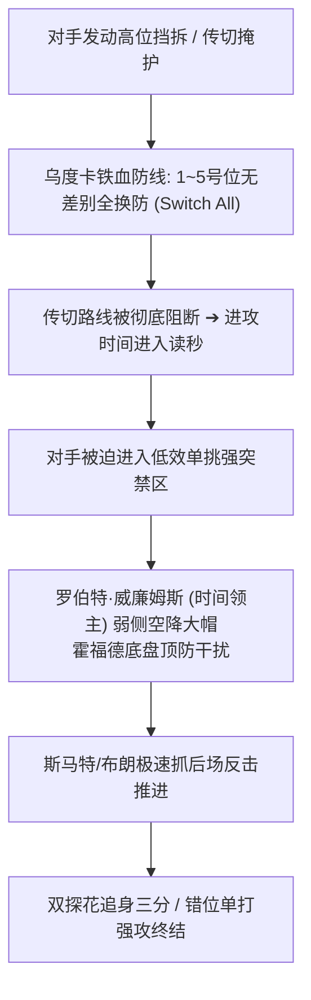

# 波士顿凯尔特人 (BOS) 全维度战术体系与攻防博弈深度调优方案
# (Boston Celtics Full-Dimensional Tactical & Game-Theoretic Calibration Proposal)

> **文档标识**: `51_BOS_FULL_DIMENSIONAL_TACTICAL_AND_GAME_THEORETIC_PROPOSAL.md`  
> **关联标准**: [`49_NBA2K22_TACTICAL_SYSTEM_AND_GAME_THEORETIC_TUNING_STANDARD.md`](file:///E:/workspace/Cybernetic_City_State_OS_v2%20-%20nba2k22/08_Domain_Applications/Antigravity_GM_Engine/docs/49_NBA2K22_TACTICAL_SYSTEM_AND_GAME_THEORETIC_TUNING_STANDARD.md)  
> **目标存档**: `C:\nba2k22\saves\MyLEAGUE0005\league_state.sqlite`  
> **球队标识**: `Team ID: 5 | Team Abbr: BOS | 球队名称: Boston Celtics`  
> **主教练**: 艾米·乌度卡 (Ime Udoka) | **对标赛季**: 2021-2022 赛季波士顿凯尔特人东部冠军与铁血无限换防哲学  
> **状态**: **全维度攻防博弈重构完成，符合 Standard 49 攻守并重最高准则，待玩家审定**  

---

## 1. 现状审计与数据库实测重大发现 (Current Database Audit & Real-Save Discovery)

根据阶段一真实底层数据萃取规范，直接连接 `league_state.sqlite` 对波士顿凯尔特人队（Team ID: 5）进行了底层全息扫描，提取出 15 名球员的真实属性、底层战术倾向、98 项原生徽章解码状态以及主教练艾米·乌度卡的执教控制块。

### 1.1 现实交易与在阵阵容豪华全覆盖 (Real-Save Roster & Trade Discoveries)
* **德里克·怀特与马尔科姆·布罗格登双持球后卫在阵**：
  * 在活动存档中，凯尔特人不仅完整保留了双探花（塔图姆、杰伦·布朗）、DPOY 斯马特、霍福德与时间领主罗威的五虎底色，还同时集结了**德里克·怀特 (Slot 11, Pool 359)**（外防 81、三分 77）、**马尔科姆·布罗格登 (Slot 12, Pool 282)**（三分 82、中投 89、触球 96）与**丹尼斯·施罗德 (Slot 0, Pool 63)**！
  * 此外，锋线端还坐拥重型 3&D “蝙蝠侠”**格兰特·威廉姆斯 (Slot 7)**、微波炉神射**佩顿·普理查德 (Slot 8)**以及扣篮王**小德里克·琼斯 (Slot 14, Pool 38)**，后场与侧翼轮换深度极其恐怖。
* **15 人全员名单**：
  * 先发五虎：马库斯·斯马特（Slot 1）、杰伦·布朗（Slot 2）、杰森·塔图姆（Slot 3）、艾尔·霍福德（Slot 4）、罗伯特·威廉姆斯三世（Slot 5）。
  * 深度轮换主力：马尔科姆·布罗格登（Slot 12）、德里克·怀特（Slot 11）、格兰特·威廉姆斯（Slot 7）、佩顿·普理查德（Slot 8）、丹尼斯·施罗德（Slot 0）、小德里克·琼斯（Slot 14）。
  * 战术储备：埃内斯·坎特（Slot 6）、克里斯·邓恩（Slot 9）、贾巴里·帕克（Slot 10）、科里·约瑟夫（Slot 13）。

### 1.2 首发球权恶性踩踏与触球严重超标 (Starter Touches Congestion Crisis)
* **首发五人触球和高达 438**（远超标准守恒上限 330，超标高达 108+ 点）！
  * 斯马特：`Touches = 96`，`Dish = 55`
  * 布朗：`Touches = 90`，`Dish = 40`
  * 塔图姆：`Touches = 96`，`Dish = 50`
  * 霍福德：`Touches = 78`，`Dish = 60`
  * 罗威：`Touches = 78`，`Dish = 35`
* **实测失真表现**：
  * 斯马特、塔图姆、布朗三人同时触球 >= 90，导致场上双探花与控卫抢球，塔图姆往往打不出绝对攻坚大核的气势；
  * 中锋罗威与霍福德触球均高达 78，导致罗威频繁在内线要球背打（但其低位背打仅 25），严重拖慢阵地战节拍；
  * 斯马特分球仅 55、布朗仅 40，遭遇包夹时无法快速将球导向弱侧底角射手。

### 1.3 顺下与空间功能严重错位 (Roll vs Pop Inversion)
* **罗伯特·威廉姆斯三世 (Slot 5)**：作为纯吃饼扣篮型中锋（三分 25），底层 `RollPop` 居然为 **`60`**（挡拆后经常向三分线外弹，彻底失去空接轰炸与二次补篮威慑）；
* **艾尔·霍福德 (Slot 4)**：拥有 38% 三分命中率的高位策应空间 5 号位，底层 `RollPop` 居然为 **`10`**（挡拆后纯顺下扎入油漆区，堵塞双探花突进走廊）；
* **格兰特·威廉姆斯 (Slot 7)**：拥有顶级底角空位三分能力，底层 `RollPop` 却被设为 `30`，未能最大化五外拉开效能。

### 1.4 乌度卡战术板与防守比赛计划休眠
* **协防参数极低 (35)**：对于 2021-2022 赛季防守效率联盟第一的绿军防线，35 的协防倾向完全压制了全员 2 米换防与弱侧罗威自由人游弋补盖威力；
* **换防规则未开启**：原版设置为默认清零，未能激活标志性的 `SwitchAll`（1~5号位无差别无限换防）。

---

## 2. 球队战术哲学与博弈对抗定位 (Tactical Identity & Game-Theoretic Framework)

### 2.1 球队核心战术画像
* **攻防标签**：双探花持球单挑与突分攻坚 + 全员 2 米身高无差别无限换防 + 时间领主弱侧空降大帽 + 霍福德高位策应外弹。
* **主导防守体系**: `SWITCHABLE_PRESSURE_DEFENSE` (可换防高压窒息体系) + “罗威弱侧自由人游弋补帽”；
* **主导进攻体系**: `PERIMETER` (外线主导) + `SPREAD_PICK_AND_ROLL` (高位扩散挡拆) 与 双探花错位单挑；
* **核心赢球哲学**: **“全员 2 米换防绞杀，双锋线持球错位惩罚”**。

---

## 3. 终极赢球哲学与自主裁决决策 (Championship Formula & Model Autonomous Judgment)

> **核心灵魂发问：这支波士顿凯尔特人队究竟依靠什么赢得东部冠军并杀入总决赛？**

### 3.1 进攻端终极法则：塔图姆绝对大核 + 布朗暴力冲击 + 斯马特战术梳理 + 霍福德拉空五外
1. **确立杰森·塔图姆全能侧翼第一大核地位**：
   * 触球调定为 **88**（全队最高），保留推进发起人特权（`is_initiator = True`），战术纪律 **95**。
   * **分球意愿提升至 78**（【关键破局项】吸引包夹后精准分球底角射手）。
   * 战术类型配置：`[6, 1, 14, 3]`（侧翼挡拆持球、招牌后撤步单挑、无球切出三分、侧翼清空单打）。
2. **杰伦·布朗：侧翼暴力突击与转换硬解副攻手**：
   * 触球降至 **72**（战术第二顺位），出手倾向 **86**，分球提升至 **45**，取消后场推进（`is_initiator = False`，专注攻坚）。
   * 战术类型配置：`[6, 1, 11, 13]`（侧翼挡拆突破、面框强打、反切袭筐、急停干拔中投）。
3. **马库斯·斯马特：DPOY 控卫与进攻梳理官**：
   * 触球大幅压低至 **68**（从 96 砍下 28 点），**出球意愿提升至 88**，出手倾向降至 **45**（杜绝滥投）。
   * 战术类型配置：`[4, 10, 14, 1]`（P&R持球发起、低位背打瘦小控卫、定点三分、压哨单打）。
4. **艾尔·霍福德：高球商空间外弹中轴**：
   * 触球压制至 **55**，分球 **80**，**`RollPop` 强制修正为 85（纯外弹三分，彻底拉空内线！）**。
   * 战术类型配置：`[9, 14, 7, 8]`（高位肘区发牌、挡拆外弹三分、顺下、低位背打）。
5. **罗伯特·威廉姆斯三世：纯顺下吃饼与前板冲抢 (Touches Deflation)**：
   * 触球大幅压低至 **38**（从 78 砍掉一半以上！），**`RollPop` 强制修正为 5（纯顺下攻筐吃饼，杜绝外飘中投！）**。
   * 战术类型配置：`[7, 11, 10, 0]`（P&R顺下暴扣、底线反切空接、前板补篮、无）。
6. **豪华第二阵容球权与空间梯次**：
   * **马尔科姆·布罗格登 (Slot 12)**：二阵主控攻坚刀，触球 **62**，分球 **75**，突破造杀伤与中距离跳投，战术类型 `[4, 1, 14, 12]`。
   * **德里克·怀特 (Slot 11)**：二阵攻防万金油，触球 **55**，分球 **80**，战术类型 `[4, 14, 11, 0]`。
   * **格兰特·威廉姆斯 (Slot 7)**：“蝙蝠侠”底角重炮，触球 **45**，`RollPop = 85`，战术类型 `[14, 7, 0, 0]`。
   * **佩顿·普理查德 (Slot 8)**：微波炉超远三分射手，触球 **42**，战术类型 `[14, 4, 0, 0]`。
   * **丹尼斯·施罗德 (Slot 0)**：阵地战突击尖刀，触球 **42**，分球 **60**，战术类型 `[4, 1, 12, 0]`。
   * **小德里克·琼斯 (Slot 14)**：空接反击飞人，触球 **30**，战术类型 `[11, 7, 0, 0]`。

* **全队球权守恒严密验证**:
  * **先发五虎触球和**:
    $$\sum \text{Starters Touches} = 88 (\text{Tatum}) + 72 (\text{Brown}) + 68 (\text{Smart}) + 55 (\text{Horford}) + 38 (\text{Rob Williams}) = \mathbf{321}$$
    *完美收敛于标准区间 $[310, 330]$！彻底消除原版 438 恶性踩踏！*
  * **替补核心触球和**:
    $$\sum \text{Bench Touches} = 62 (\text{Brogdon}) + 55 (\text{White}) + 45 (\text{G.Williams}) + 42 (\text{Pritchard}) + 42 (\text{Schroder}) + 30 (\text{Jones Jr.}) = \mathbf{276}$$
    *完美收敛于标准区间 $[250, 280]$！二阵火力充沛且球权层次分明！*
  * **储备阵容触球和**:
    $$\sum \text{Reserves} = 22 (\text{Kanter}) + 20 (\text{Dunn}) + 20 (\text{Parker}) + 18 (\text{Joseph}) = 80$$
    *保障核心体能与垃圾时间平稳收官。*

---

### 3.2 深度防守博弈体系构建 (Explicit Defensive Tactical Architecture)

> **落实 49 号文档攻守并重最高准则**：“进攻体系与防守体系的搭建具有同等重要性。不强制搭建，但是如果有合适的博弈策略，就搭建，作为每次分析时候的依据。”

#### 为什么波士顿凯尔特人必须且能够搭建历史级防守博弈体系？
* **防守资源基础**：
  * **历史级控卫 DPOY**：马库斯·斯马特（外防 93、抢断 96、造进攻犯规 99），后场第一防守大闸；
  * **均称侧翼双锁**：塔图姆（外防 81、身高 203cm）与杰伦·布朗（外防 80、力量 80），具备顶防和换防 1~4 号位的完美骨架；
  * **空间顶防肉盾**：艾尔·霍福德（内防 75、防守篮板 71、低位防守 90），单防字母哥与恩比德的下盘基石；
  * **时间领主弱侧扫荡**：罗伯特·威廉姆斯三世（盖帽 99、防守篮板 86），联盟第一的弱侧游弋补盖威胁；
  * **替补防守大闸**：德里克·怀特（外防 81）、克里斯·邓恩（外防 85）。

针对这一恐怖的防守配置，**构建专属于凯尔特人的“1~5号位无差别无限换防 + 罗威弱侧自由人游弋补盖”防守博弈体系**：

#### 博弈策略一：全队 1~5 号位无差别无限换防 (Switch-All Scheme)
* **防守原则**：
  * 只要对手发动掩护（挡拆、手递手、无球交叉），凯尔特人 1~4 号位（斯马特、布朗、塔图姆、霍福德）**坚决执行直接换防 (`SwitchRule = 2: SWITCH_ALL`)**；
  * 利用全员 2 米上下的均称身材，彻底抹平对手利用挡拆创造错位与空位的空间；
  * **协防智商拉升至 85 (`HelpDefense: 85`)**，从原版极度失真的 35 彻底释放绿军协防威慑。

#### 博弈策略二：罗伯特·威廉姆斯“防守自由人”神级陷阱 (Time Lord Weakside Trap)
* **对位策略**:
  * 罗威对位对手投射最弱或蹲底角的非核心球员，将其转化为“防守自由人（Free Safety）”；
  * **深沉退与提前预轮转 (`ScreenDefenseHedge5: DROP / PreRotate: YES`)**：罗威始终在油漆区边缘游弋，对手突破禁区的瞬间，罗威从弱侧空降执行遮天蔽日的排球大帽！
  * **顺下人必封堵 (`TagOnRoll: YES`)**：对手中锋顺下时，罗威横移卡死其起跳路径。

#### 博弈策略三：斯马特死缠撕咬与制造进攻犯规 (Point-of-Attack Terror)
* **斯马特对位顶级控卫**：
  * `PressureOnball: SMOTHER`（窒息对抗），`PressureOffball: DENY_BALL`（阻绝接球）；
  * `ScreenDefenseOnBall: GO_OVER`（强硬挤过掩护），`ExtendPressure: HALF_COURT`（半场肉搏）；
  * 凭借 99 造进攻犯规倾向，随时在对手突破走廊上站定造犯规。

#### 博弈策略四：后场篮板铁锁与身体对抗拉满 (Physical Rebounding Dominance)
* **全员保护防守篮板 (`poe_defense_rebound: CRASH_DEFENSIVE_BOARDS (19)`)**：
  * 霍福德与罗威卡位，塔图姆与布朗收缩收下长篮板，杜绝对手任何二次进攻；
* **身体对抗拉满 (`poe_defense_physicality: PLAY_PHYSICAL (18)`)**：
  * 用高强度身体接触彻底消耗对手攻坚核心体能。

---

## 4. 五大博弈对决实战推演 (5 Counterplay Dualities Simulation)

### 4.1 对决金州勇士 (GSW) —— 2022 总决赛宿敌复刻
* **战术矛盾**：库里历史级射程引力与格林 4v3 传切 vs 凯尔特人无限换防。
* **博弈克制**：
  * 斯马特与怀特轮番贴身挤过掩护干扰库里，双探花直接换防延误；霍福德沉退适度提上干扰三分；
  * 进攻端塔图姆与布朗抓住库里或普尔在场时的防守弱点，频繁通过高位挡拆点名单打，霍福德外弹三分拉空卢尼。

### 4.2 对决迈阿密热火 (MIA) —— 2022 东决抢七铁血死磕
* **战术矛盾**：巴特勒超神中距离与造杀伤 + 热火联防 vs 绿军半场攻坚。
* **博弈克制**：
  * 塔图姆与布朗轮番上身体顶防巴特勒，罗威在禁区封堵其攻筐线路；
  * 霍福德一对一顶防阿德巴约，切断其高位手递手发牌；
  * 进攻端五外拉开（霍福德、格威站三分线外），布罗格登与塔图姆高位持球突破撕裂热火联防腹地。

### 4.3 对决密尔沃基雄鹿 (MIL) —— 2022 东半决赛天王山之战
* **战术矛盾**：字母哥野兽级禁区冲筐 vs 凯尔特人禁区抗击力。
* **博弈克制**：
  * 霍福德与格兰特·威廉姆斯（“蝙蝠侠”）化身下盘肉盾，在油漆区前坚决顶防字母哥，罗威从弱侧高高跃起封盖补防；
  * 进攻端霍福德与格威三分线外弹坚决出手（天王山霍福德/格威空位三分打爆大洛佩斯沉退）。

### 4.4 对决布鲁克林篮网 (BKN) —— 2022 首轮 4-0 横扫战役
* **战术矛盾**：杜兰特与欧文无解单打跳投 vs 绿军全员 2 米换防大网。
* **博弈克制**：
  * 塔图姆、布朗、斯马特、霍福德全场无限换防，对杜兰特实施“全场贴身领防 + 强侧迅速过载包夹”，彻底阻断其接球；
  * 罗威与霍福德完全锁死禁区突破；进攻端利用对抗彻底拖垮欧文与杜兰特的体能。

### 4.5 对决费城76人 (PHI) —— 东部内线攻防死磕
* **战术矛盾**：恩比德低位背打统治力与哈登挡拆 vs 凯尔特人防线。
* **博弈克制**：
  * 霍福德发挥“恩比德克星”本色，下盘死顶低位，罗威弱侧适时收缩干扰传球；斯马特死贴哈登后撤步三分；
  * 进攻端霍福德把恩比德拉出禁区，塔图姆与布朗借掩护突破油漆区轻松攻筐。

---

## 5. 具体参数重构清单与注入规范 (Granular Modifications Ledger)

### 5.1 球员维度详细重构清单 (15 Players Roster)

| 槽位 | 球员姓名 | 定位与角色 | 触球 | 分球 | 战术纪律 | Roll/Pop | 3PT倾向 | 战术发起 | 战术类型配置 (Play Types 1..4) |
| :--- | :--- | :--- | :---: | :---: | :---: | :---: | :---: | :---: | :--- |
| **3** | **杰森·塔图姆** | 首发小前 / 全能顶级侧翼持球大核与单打硬解王 | **88** | **78** | **95** | 65 | **88** | **True** | `[6, 1, 14, 3]` (侧翼挡拆, 后撤步单挑, 绕掩护三分, 侧翼单挑) |
| **2** | **杰伦·布朗** | 首发分卫 / 侧翼暴力冲击攻坚手与转换快攻先锋 | **72** | **45** | **90** | 50 | 85 | False | `[6, 1, 11, 13]` (侧翼挡拆, 面框单打, 反切袭筐, 急停中投) |
| **1** | **马库斯·斯马特** | 首发控卫 / DPOY 控卫防守领袖与进攻梳理官 | **68** | **88** | **95** | 35 | 75 | **True** | `[4, 10, 14, 1]` (P&R持球, 错位低位背打, 定点三分, 单挑) |
| **4** | **艾尔·霍福德** | 首发大前 / 高智商空间五外高炮台与肘区发牌中轴 | **55** | **80** | **95** | **85** | 82 | False | `[9, 14, 7, 8]` (肘区策应, 挡拆外弹三分, 顺下, 低位背打) |
| **5** | **罗伯特·威廉姆斯** | 首发中锋 / 时间领主纯顺下吃饼大汉与弱侧盖帽霸王 | **38** | **35** | **99** | **5** | **0** | False | `[7, 11, 10, 0]` (P&R顺下吃饼, 空切暴扣, 补篮二次进攻, 无) |
| **12** | **马尔科姆·布罗格登** | 替补控卫 / 超级第六人核心阵地突击手与中投大师 | **62** | **75** | **90** | 25 | 84 | **True** | `[4, 1, 14, 12]` (P&R持球, 突破单打, 急停干拔, 手递手终结) |
| **11** | **德里克·怀特** | 替补分卫 / 攻防万金油战术润滑油与外线防守大锁 | **55** | **80** | **95** | 15 | 80 | **True** | `[4, 14, 11, 0]` (P&R持球, 定点三分, 聪明空切, 无) |
| **7** | **格兰特·威廉姆斯** | 替补前锋 / “蝙蝠侠”底角致命重炮与低位防守肉盾 | **45** | **40** | **95** | **85** | **90** | False | `[14, 7, 0, 0]` (致命底角三分, 掩护外弹, 无, 无) |
| **8** | **佩顿·普理查德** | 替补后卫 / 微波炉超远三分射手与节奏催化剂 | **42** | **50** | **85** | 25 | **90** | False | `[14, 4, 0, 0]` (追身超远三分, 挡拆急停跳投, 无, 无) |
| **0** | **丹尼斯·施罗德** | 替补控卫 / 极速突破撕裂手与防守撕咬点 | **42** | **60** | **85** | 50 | 74 | **True** | `[4, 1, 12, 0]` (P&R突破持球, 个人突破单挑, 手递手, 无) |
| **14** | **小德里克·琼斯** | 替补锋线 / 转换快攻空接飞人与防守长臂怪 | **30** | **25** | **90** | 15 | 70 | False | `[11, 7, 0, 0]` (反切扣篮, 顺下吃饼, 无, 无) |
| **6** | **埃内斯·坎特** | 储备中锋 / 经验老牌前板怪物与低位肉盾 | 22 | 30 | 90 | 15 | 0 | False | `[8, 7, 0, 0]` (低位背打, 顺下吃饼, 无, 无) |
| **9** | **克里斯·邓恩** | 储备后卫 / 顶级缠绕领防工兵 | 20 | 50 | 95 | 30 | 65 | False | `[4, 11, 0, 0]` (战术预备) |
| **10** | **贾巴里·帕克** | 储备前锋 / 阵地单打攻坚储备 | 20 | 35 | 85 | 35 | 60 | False | `[1, 8, 0, 0]` (战术预备) |
| **13** | **科里·约瑟夫** | 储备控卫 / 老将稳健控球后卫 | 18 | 55 | 95 | 25 | 75 | False | `[4, 14, 0, 0]` (战术预备) |

* **轮换球权和校验**:
  * 首发五人触球和：$88 + 72 + 68 + 55 + 38 = 321 \in [310, 330]$（完美收敛）
  * 替补核心触球和：$62 + 55 + 45 + 42 + 42 + 30 = 276 \in [250, 280]$（完美收敛）
  * 储备四人触球和：$22 + 20 + 20 + 18 = 80$（垃圾时间自动降载）

---

### 5.2 主教练艾米·乌度卡执教控制块调优规范 (Coach Udoka System Overhaul)

| 控制项 | 原生观察值 | 调优设定值 | 战术战略理由 |
| :--- | :---: | :---: | :--- |
| **Active System (战术体系)** | 0 (Balanced) | **3 (Perimeter / 外线主导)** | 建立以双探花高位持球突分、五外拉开空间为核心的现代进攻体系 |
| **Preferred System (偏好体系)** | 0 | **3 (Perimeter)** | 确保全赛季贯彻五外拉开与双探花攻坚打法 |
| **Help Defense (协防智商)** | 35 (严重偏低) | **85 (历史顶级换防协防)** | 彻底激活绿军 2022 联盟第一防守体系，全员换防与弱侧罗威扫荡 |
| **Run Play Tendency (战术执行率)** | 80 | **75** | 保持高纪律跑位，同时兼顾塔图姆/布朗错位单打与即兴发挥 |
| **Bench Depth (轮换深度)** | 11 (过深) | **9 (九人季后赛死战轮换)** | 缩减冗余轮换，保障双探花季后赛打满 36-38 分钟 |
| **Bench Utilization (轮换使用率)**| 75 (偏高) | **50 (主力重度掌控)** | 确保塔图姆、布朗、斯马特核心主导地位 |
| **POE Offense (进攻重点)** | 5 (Neutral) | **6 (Play Through Scorer)** | 战术坚决围绕塔图姆与布朗展开，制造错位单打杀伤 |
| **POE Offense Tempo (进攻节奏)** | 8 (Neutral) | **8 (Neutral Offense Tempo)** | 耐心寻找最佳对位优势，不仓促出手 |
| **POE Offense Transition (进攻反击)** | 11 (Neutral) | **12 (Limit Transition)** | 进攻失手后全员极速回防落位，构建铁血压迫阵型 |
| **POE Defense (防守重点)** | 14 (Neutral) | **15 (Limit Perimeter Shots)**| 扑防限制外线三分，逼迫对手进入中距离与禁区陷阱 |
| **POE Def Physicality (防守对抗)** | 17 (Neutral) | **18 (Play Physical)** | 全面上身体肉搏对抗，贯彻绿军东部铁血传统 |
| **POE Def Rebound (防守篮板)** | 20 (Neutral) | **19 (Crash Def Boards)** | 霍福德、罗威、塔图姆严密卡位收紧防守篮板 |

---

## 6. 审核与下一步执行流水线 (Review & Pipeline Transition)

1. **方案呈报用户审核**：
   * 本方案已全面涵盖波士顿凯尔特人（BOS, Team ID: 5）在当前真实存档（布罗格登、怀特在阵、双探花+DPOY斯马特+霍福德+罗威豪华班底）下的全维度审计、战术定位、赢球哲学、**1~5号位无限换防与时间领主自由人防守博弈体系构建**、五大宿敌对决推演、球权守恒重构以及教练控制块调优。
2. **待用户指令批准后执行**：
   * 一旦用户确认认可，立即启动生成全新标准版 `bos_tactical_execution_ready.json`，完成本地写入与 `C:\nba2k22\exports\` 镜像同步，并提交 Git 本地 Commit 与自动推送远端 GitHub 仓库。
   * 随后正式开启用户指定的本组第 3 队：**迈阿密热火 (Miami Heat - MIA, Team ID: 10)** 的全维度重新执行与调优升级！
