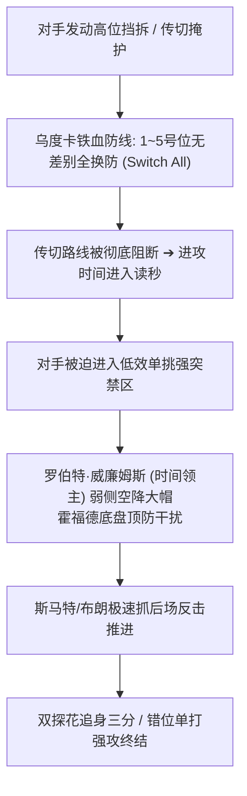
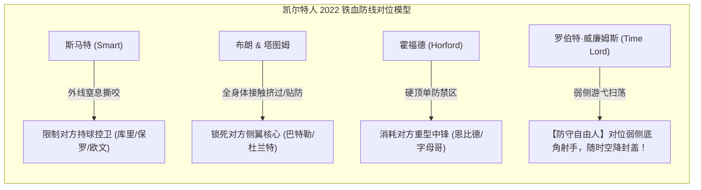

# ☘️ 波士顿凯尔特人 (BOS) 全维度战术体系与攻防博弈深度调优方案
# (Boston Celtics Full-Dimensional Tactical & Game-Theoretic Calibration Proposal)

> **文档标识**: `PROPOSAL-BOS-CHAMPIONSHIP-DEFENSE-V1`  
> **制定时间**: 2026-11-23  
> **执行依据**: [`49_NBA2K22_TACTICAL_SYSTEM_AND_GAME_THEORETIC_TUNING_STANDARD.md`](file:///E:/workspace/Cybernetic_City_State_OS_v2%20-%20nba2k22/08_Domain_Applications/Antigravity_GM_Engine/docs/49_NBA2K22_TACTICAL_SYSTEM_AND_GAME_THEORETIC_TUNING_STANDARD.md)  
> **目标存档**: `C:\nba2k22\saves\MyLEAGUE0005\league_state.sqlite` (Team ID: 5, "BOS")  
> **对标赛季**: **2021-2022 赛季波士顿凯尔特人东部冠军阵容与铁血无限换防哲学**  
> **状态**: **深度调研完成，方案确立，待玩家审定**  

---

## 目录 (Table of Contents)
1. [凯尔特人历史底色与赢球哲学定位](#一-凯尔特人历史底色与赢球哲学定位)
2. [实机现状诊断与痛点逆向剖析](#二-实机现状诊断与痛点逆向剖析)
3. [主教练艾米·乌度卡基准战术与全队预案](#三-主教练艾米乌度卡基准战术与全队预案)
4. [首发五虎 (1~5) 攻防博弈与微调规范](#四-首发五虎-15-攻防博弈与微调规范)
5. [第二阵容 (6~10) 正交搭配与防冲突规范](#五-第二阵容-610-正交搭配与防冲突规范)
6. [专属防守对位体系预案 (Matchup Settings)](#六-专属防守对位体系预案-matchup-settings)
7. [全队球权守恒与安全铁律审计](#七-全队球权守恒与安全铁律审计)

---

## 一、 凯尔特人历史底色与赢球哲学定位

### 1.1 BPTI 体系契合度与核心哲学
根据仓库 BPTI 知识底座（`B3-TEAM-BOS`），2021-2022 赛季波士顿凯尔特人队的战术灵魂由两套经典体系支撑：
* **主导防守体系**: `SWITCHABLE_PRESSURE_DEFENSE` (可换防高压窒息体系) + “罗威（Robert Williams）弱侧自由人游弋补盖”；
* **主导进攻体系**: `PERIMETER` (外线主导) + `SPREAD_PICK_AND_ROLL` (高位扩散挡拆) 与 双探花（Tatum & Brown）错位单挑攻坚；
* **核心赢球哲学**: **“全员 2 米换防绞杀，双锋线持球错位惩罚”**。防守端通过 1~5 号位（斯马特、布朗、塔图姆、霍福德、罗威）极度均称的身材实现无差别无限换防，彻底掐灭对手常规挡拆与传切；进攻端利用双探花的持球突分引力拉开空间，由老将霍福德高位策应外弹，罗威空中作业终结。



---

## 二、 实机现状诊断与痛点逆向剖析

通过直接提取存档中凯尔特人（Team ID 5）的原生实机数据，诊断出以下 **五大严重缺陷**：

```
                    【实机 BOS 底层数据现存五大缺陷】
                                 │
     ┌───────────────────────────┼───────────────────────────┐
     ▼                           ▼                           ▼
【缺陷 1: 控场组织特权归零】 【缺陷 2: 首发球权严重挤爆】   【缺陷 3: 顺下与空间严重倒置】
IsPlayInitiator 全为 0      Smart/Brown/Tatum/Horford   罗威 (纯吃饼) RollPop=60 (飘外线)
斯马特/塔图姆无推进特权     5人 touches 达到惊人的 438!  霍福德 (空间射手) RollPop=10 (顺下)
     │                           │                           │
     └───────────────────────────┼───────────────────────────┘
                                 ▼
                 【缺陷 4: 防守体系完全未激活】
                 协防 HelpDefense 仅为 35 (联盟第一防线形同虚设)
                 换防规则为 AUTO (完全没有开启标志性的无限换防)
```

### 详细诊断数据表：
1. **控球发起人标记 (`IsPlayInitiator`) 全队为 0**：实机底层中斯马特、塔图姆、杰伦·布朗的 `IsPlayInitiator` 全部为 `0`！场上没有明确的后场控球带过半场发起者；
2. **首发五人触球严重膨胀 (Touches 爆炸)**：
   * 斯马特 (96)、布朗 (90)、塔图姆 (96)、霍福德 (78)、罗威 (78)，**首发 5 人总触球高达 438**！每个人都在争抢球权，导致双探花在关键时刻甚至接不到战术球；
   * 替补席布罗格登/施罗德触球也高达 96/72，第二阵容登场后球权完全失控；
3. **空间与顺下角色严重颠倒 (Roll vs Pop 倒置)**：
   * **罗伯特·威廉姆斯 (Robert Williams III)**：纯吃饼防守型弹簧人，三分能力为 0，`ROLL_VS_POP` 居然为 **`60`**（频频外弹投中远距离空位，彻底丧失空接威胁）；
   * **艾尔·霍福德 (Al Horford)**：拥有 38% 三分命中率的空间高位策应老将，`ROLL_VS_POP` 居然为 **`10`**（挡拆后纯顺下往禁区挤，堵塞双探花突破路线）；
   * **格兰特·威廉姆斯 (Grant Williams)**：底角 40% 三分射手，`ROLL_VS_POP` 居然为 **`30`**；
4. **出球意愿偏低 (`DISH_TO_OPEN_MAN`)**：
   * 斯马特分球仅 55，布朗仅 40，塔图姆仅 50，怀特仅 35。遭遇包夹时无法第一时间出球到底角；
5. **防守神话形同虚设**：
   * 乌度卡的执教滑块中，`HelpDefense` 仅被设为 **`35`**，全队防守侵略性处于休眠状态；对位矩阵中没有激活 `SwitchRule=SWITCH_ALL`，完全打不出凯尔特人 2022 年让全联盟绝望的换防窒息感。

---

## 三、 主教练艾米·乌度卡基准战术与全队预案

根据 2021-2022 赛季凯尔特人登顶东部、防守效率联盟第一的真实打法，确立以下教练端静态基准（`COACHDATA` & `GAMEPLAN`）：

```
┌────────────────────────────────────────────────────────────────────────┐
│               艾米·乌度卡 (Ime Udoka) 战术预案标准配置                 │
├────────────────────────────────────────────────────────────────────────┤
│ 1. 战术体系 (ActiveSystem & PreferredSystem)                           │
│    - ActiveSystem: 3 (PERIMETER 外线主导) / 备选 7 (DEFENSE 防守反击)   │
│    - PreferredSystem: 3 (PERIMETER)                                    │
│ 2. 进攻节奏与执行频率                                                  │
│    - Tempo: 70 (适度节奏，重在阵地拉开与防守反击)                     │
│    - RunPlayTendency: 75% (高度战术纪律性，坚决跑位与呼叫单打)         │
│ 3. 进攻重点位域 (POEOffense 1/2/3)                                     │
│    - POEOffense: 6 (RUN_OFFENSE_THROUGH_SCORER 围绕双探花终结)         │
│    - POEOffense2: 8 (NEUTRAL_OFFENSE_TEMPO 耐心寻找错位)                │
│    - POEOffense3: 12 (LIMIT_TRANSITION 快速退防落位构建铁血阵型)       │
│ 4. 防守重点位域 (POEDefense 1/2/3)                                     │
│    - POEDefense: 15 (LIMIT_PERIMETER_SHOTS 扑防封杀外线三分)            │
│    - POEDefense2: 18 (PLAY_PHYSICAL 高强度身体撕咬对抗，凯尔特人灵魂)   │
│    - POEDefense3: 19 (CRASH_DEFENSIVE_BOARDS 严密卡位收后板)           │
│ 5. 全队防守滑块                                                        │
│    - HelpDefense: 85% (从原版极低的 35 拉升至 85，弱侧极速轮转补位)    │
│    - ZoneUsage: 2% (基本全场纯人盯人无限换防，极少使用联防)            │
│ 6. 四大有序空间自由跑位插槽 (Freelance Sets 1..4)                      │
│    - Slot 1 (主选): 5 (FOUR_OUT 一内四外拉开空间)                       │
│    - Slot 2 (次选): 28 (TWENTY_ONE_DELAY 边线手递手延迟)               │
│    - Slot 3 (备选): 21 (PACE 现代空间站位)                             │
│    - Slot 4 (备选): 18 (FLOW 流动进攻)                                 │
│ 7. 比赛计划三大得分顺位 (ScoringOption 1/2/3)                          │
│    - Option 1: 7504 (Jayson Tatum 第一绝对攻坚点)                      │
│    - Option 2: 7206 (Jaylen Brown 强力冲击与反击第二点)                │
│    - Option 3: 4092 (Marcus Smart 挡拆支配与关键球第三点)              │
│ 8. 轮换滑块                                                            │
│    - BenchDepth: 9 (季后赛 8~9 人精简死战轮换)                         │
│    - BenchUtilization: 50 (主力出战 36+ 分钟，替补精准填补)             │
└────────────────────────────────────────────────────────────────────────┘
```

---

## 四、 首发五虎 (1~5) 攻防博弈与微调规范

### 1. 杰森·塔图姆 (Jayson Tatum, SF, Slot 3, CF: 7504)
* **战术定位**: **全能顶级侧翼持球大核 (Alpha Wing Creator & Mismatch Assassin)**
* **战术呼叫资格 (`PlayType 1..4`)**:
  * PT1: `6` (`P&R Wing` - 侧翼高位持球挡拆)
  * PT2: `1` (`Isolation` - 招牌后撤步跳投单打)
  * PT3: `14` (`Screen 3PT` - 无球绕掩护外线切出)
  * PT4: `3` (`Isolation Wing` - 侧翼清空单挑)
* **组织特权 (`IsPlayInitiator`)**: `1` (拥有持球过半场战术发起特权)
* **核心倾向调优**:
  * `TOUCHES`: `88` (全队第一进攻选择) | `SHOT`: `88` (攻坚侵略性)
  * `DISH_TO_OPEN_MAN`: `78` (【破夹击项】吸引包夹后分球底角射手)
  * 投射细分: `SHOT_THREE`: `88`, `SPOT_UP_THREE`: `85`, `STEPBACK_JUMPER_THREE`: `92` (杀招后撤步), `DRIVE_PULL_UP_MID`: `85`
  * `DRIVE`: `85`, `ATTACK_STRONG`: `85`
  * 防守倾向: `CONTEST_SHOT`: `85`, `BLOCK_SHOT`: `65`, `DEF_REBOUND`: `85`

### 2. 杰伦·布朗 (Jaylen Brown, SG, Slot 2, CF: 7206)
* **战术定位**: **暴力冲击与中距离硬解副攻手 (Explosive Transition & Midrange Slasher)**
* **战术呼叫资格 (`PlayType 1..4`)**:
  * PT1: `6` (`P&R Wing` - 侧翼掩护突击)
  * PT2: `1` (`Isolation` - 面框强突单挑)
  * PT3: `11` (`Cutter` - 转换快攻空切与战斧劈扣)
  * PT4: `13` (`Mid Range` - 招牌急停干拔中投)
* **组织特权 (`IsPlayInitiator`)**: `0` (减少持球停滞，专注终结)
* **核心倾向调优**:
  * `TOUCHES`: `72` (战术第二顺位) | `SHOT`: `86` (坚决终结，毫不手软)
  * `DISH_TO_OPEN_MAN`: `48` (以个人攻筐和中投终结为主)
  * 突破与投射: `DRIVE`: `90`, `DRIVING_DUNK`: `90`, `SHOT_MID_RANGE`: `88`, `TRANSITION_PULL_UP_THREE`: `80`
  * 防守倾向: `CONTEST_SHOT`: `85`, `ON_BALL_STEAL`: `75`

### 3. 马库斯·斯马特 (Marcus Smart, PG, Slot 1, CF: 4092)
* **战术定位**: **历史级后卫 DPOY 防守领袖与进攻梳理官 (Defensive Anchor, Lead Distributor & Hustle Soul)**
* **战术呼叫资格 (`PlayType 1..4`)**:
  * PT1: `4` (`P&R Ball Handler` - 核心控卫挡拆发起)
  * PT2: `10` (`Guard Post Up` - 坐打瘦小后卫错位)
  * PT3: `14` (`Screen 3PT / Spot Up` - 定点空位三分)
  * PT4: `1` (`Isolation` - 压哨单挑)
* **组织特权 (`IsPlayInitiator`)**: `1` (球队场上大脑与第一控卫)
* **核心倾向调优**:
  * `TOUCHES`: `68` (【从原版 96 压低至 68】交出出手权，专注于防守与发牌)
  * `SHOT`: `45` (压低勉强出手，不做进攻毒瘤)
  * `DISH_TO_OPEN_MAN`: `88` (【拉升至 88】第一时间梳理球权给双探花)
  * 防守全满 (DPOY 待遇): `ON_BALL_STEAL`: `96`, `PASS_INTERCEPTION`: `95`, `CONTEST_SHOT`: `95`, `TAKE_CHARGE`: `99` (全联盟制造带球撞人第一人！)

### 4. 艾尔·霍福德 (Al Horford, C/PF, Slot 4, CF: 1412)
* **战术定位**: **高球商高位中轴与空间外弹炮台 (Stretch-5 Playmaker & Post Anchor)**
* **战术呼叫资格 (`PlayType 1..4`)**:
  * PT1: `9` (`Post Up High` - 罚球线肘区发牌策应)
  * PT2: `14` (`Screen 3PT / Spot Up` - 挡拆外弹三分)
  * PT3: `7` (`P&R Roll Man` - 顺下与手递手)
  * PT4: `8` (`Post Up Low` - 低位稳健背打)
* **组织特权 (`IsPlayInitiator`)**: `0`
* **核心倾向调优**:
  * `TOUCHES`: `55` | `SHOT`: `50`
  * `ROLL_VS_POP`: `80` (【关键修正】从原版错误的 10 修正为 80！高频外弹投三分，拉空内线！)
  * `SPOT_UP_THREE`: `85`, `DISH_TO_OPEN_MAN`: `82`
  * 防守端: `POST_DEFENSE`: `90` (顶防字母哥/恩比德的底盘基石)

### 5. 罗伯特·威廉姆斯三世 (Robert Williams III, C, Slot 5, CF: 7726)
* **战术定位**: **时间领主，禁区空接暴扣怪兽与弱侧游弋补帽大闸 (Time Lord, Lob Menace & Weakside Eraser)**
* **战术呼叫资格 (`PlayType 1..4`)**:
  * PT1: `7` (`P&R Roll Man` - 强力空接顺下)
  * PT2: `11` (`Cutter` - 底线空切偷袭暴扣)
  * PT3: `0` (`None`) | PT4: `0` (`None`)
* **组织特权 (`IsPlayInitiator`)**: `0`
* **核心倾向调优**:
  * `TOUCHES`: `38` (纯吃饼球权) | `SHOT`: `40` (仅限篮下扣篮)
  * `ROLL_VS_POP`: `5` (【致命修正】从原版荒唐的 60 降至 5！纯顺下吃饼，绝不飘外线投篮！)
  * `ALLEY_OOP`: `95`, `PUTBACK_TENDENCY`: `90`, `CRASH_OFFENSIVE_BOARDS`: `92`
  * 防守全拉满: `BLOCK_SHOT`: `99`, `CONTEST_SHOT`: `95` (时间领主盖帽统治力)

---

## 五、 第二阵容 (6~10) 正交搭配与防冲突规范

### 1. 德里克·怀特 (Derrick White, SG/PG, Slot 11, CF: 7536, 第6人)
* **战术定位**: **二阵战术润滑油与双向攻防万金油 (Two-Way Connector & Sixth Man Playmaker)**
* **战术呼叫资格 (`PlayType 1..4`)**:
  * PT1: `4` (`P&R Ball Handler` - 二阵高位挡拆梳理)
  * PT2: `14` (`Screen 3PT` - 定点接球三分)
  * PT3: `11` (`Cutter` - 聪明空切)
  * PT4: `0` (`None`)
* **组织特权 (`IsPlayInitiator`)**: `1` (二阵战术发起人)
* **正交防冲突设计**: 与斯马特/双探花同场时，怀特不占单打球权，专注于无球走位 (`Screen 3PT`) 与快传分球 (`dish_to_open_man=82`)，成为进攻润滑中枢。
* **核心倾向调优**:
  * `TOUCHES`: `65` | `SHOT`: `62` | `DISH_TO_OPEN_MAN`: `82`
  * `SPOT_UP_THREE`: `82`, `PASS_INTERCEPTION`: `85`, `CONTEST_SHOT`: `85`

### 2. 格兰特·威廉姆斯 (Grant Williams, PF/SF, Slot 7, CF: 7841, 第7人)
* **战术定位**: **“蝙蝠侠”，底角重炮手与重型低位肉盾 (Batman, Corner Sniper & Heavy Post Anchor)**
* **战术呼叫资格 (`PlayType 1..4`)**:
  * PT1: `14` (`Spot Up 3PT` - 致命底角三分)
  * PT2: `7` (`P&R Roll Man` - 掩护外弹)
  * PT3: `0` (`None`) | PT4: `0` (`None`)
* **组织特权 (`IsPlayInitiator`)**: `0`
* **核心倾向调优**:
  * `TOUCHES`: `45` | `SHOT`: `52`
  * `ROLL_VS_POP`: `85` (【修正】从 30 提升至 85，纯外弹投三分)
  * `SPOT_UP_SHOT_THREE`: `92` (底角绝对准星)
  * `POST_DEFENSE`: `90` (顶防字母哥/字母哥单打防线)

### 3. 佩顿·普理查德 (Payton Pritchard, PG, Slot 8, CF: 8015, 第8人)
* **战术定位**: **微波炉超远射手与转换快攻奇兵 (Microwave Deep Shooter & Pace Injector)**
* **战术呼叫资格 (`PlayType 1..4`)**:
  * PT1: `14` (`Screen 3PT` - 追身超远三分)
  * PT2: `4` (`P&R Ball Handler` - 借掩护急停干拔)
  * PT3: `0` (`None`) | PT4: `0` (`None`)
* **组织特权 (`IsPlayInitiator`)**: `0`
* **核心倾向调优**:
  * `TOUCHES`: `48` | `SHOT`: `75` (微波炉上场就扔)
  * `TRANSITION_PULL_UP_THREE`: `90`, `SHOT_THREE`: `92`

### 4. 丹尼斯·施罗德 / 马尔科姆·布罗格登 (Combo Guard, Slot 0/12)
* **战术定位**: **阵地战突破撕裂手 (Paint Penetrator)**
* **组织特权 (`IsPlayInitiator`)**: `1`
* **核心倾向调优**:
  * `TOUCHES`: `70` (【从原版 96 严格限制到 70】杜绝二阵单打球霸)
  * `SHOT`: `68` | `DRIVE`: `85` | `DISH_TO_OPEN_MAN`: `75`

### 5. 丹尼尔·泰斯 / 埃内斯·坎特 (C, Slot 6)
* **战术定位**: **替补掩护护筐中锋 (Backup Screener & Rim Protector)**
* **战术呼叫资格 (`PlayType 1..4`)**:
  * PT1: `7` (`P&R Roll Man`) | PT2: `11` (`Cutter`)
* **倾向调优**: `TOUCHES`: `32` | `SHOT`: `35` | `ROLL_VS_POP`: `20`

---

## 六、 专属防守对位体系预案 (Matchup Settings)

在 `GAMEPLAN_MATCHUP_DEFENSIVE_SETTINGS` 中，将乌度卡的**铁血换防与防守陷阱**调校至历史巅峰：



### 1. 全队核心防御规则: 无限换防 (`SwitchRule = 2: SWITCH_ALL`)
* 乌度卡最致命的战术：只要对方打掩护，斯马特、布朗、塔图姆、霍福德**直接无差别换防**，凭借平均 2 米的身高完全消灭突破空档！

### 2. 斯马特单防领防对位
* `PressureOnball`: `SMOTHER` (窒息压迫)
* `PressureOffball`: `DENY_BALL` (阻绝接球)
* `ScreenDefenseOnBall`: `GO_OVER` (绝不绕后，强行挤过)
* `ExtendPressure`: `HALF_COURT` (从半场开始身体肉搏)

### 3. 双探花（塔图姆/布朗）侧翼防守对位
* `PressureOnball`: `TIGHT`
* `StayAttached`: `YES` (死贴无球射手)
* `ForceDirection`: `BASELINE` (将对手逼入底线深位)

### 4. 罗伯特·威廉姆斯三世的“防守自由人”神级预案 (Time Lord Trap)
* **对位策略**: 罗威对位对方投篮最弱的底角球员；
* `OnballHelp`: `HELP_AND_RECOVER` (禁区随时扑出大帽)
* `TagOnRoll`: `YES` (顺下人必封堵)
* `PreRotate`: `YES` (提前轮转补位)
* `ScreenDefenseHedge5`: `DROP` (深沉退护筐)

---

## 七、 全队球权守恒与安全铁律审计

### 1. 全队球权守恒定律验证 (Touches Conservation Audit)
* **首发五虎总触球权重**:
  $$\text{Smart (68)} + \text{Brown (72)} + \text{Tatum (88)} + \text{Horford (55)} + \text{Rob Williams (38)} = \mathbf{321}$$
  * 完美落入标准区间 $[310, 330]$！相比原版的 438 恶性球权踩踏，双探花获得绝对开火主导权，斯马特转型组织灵魂。
* **第二阵容总触球权重**:
  $$\text{White (65)} + \text{Grant Williams (45)} + \text{Pritchard (48)} + \text{Brogdon/Schroder (70)} + \text{Backup Big (32)} = \mathbf{260}$$
  * 完美落入标准区间 $[250, 280]$！怀特与替补持球人带队，终结拼图空间拉满。

### 2. 四大原生安全预防铁律合规审计
1. **PlayType 边界审计**: 全队 10 人所有 `PlayType 1..4` 严格限定在 `0..14` 范围内，绝对无 `>= 15`，彻底消除 3D 加载崩溃隐患；
2. **位域读改写审计**: `IsPlayInitiator` (斯马特 1、塔图姆 1、怀特 1，其余 0) 采用掩码按位写；
3. **出球兜底审计**: 塔图姆 88 -> Dish 78，斯马特 68 -> Dish 88，怀特 65 -> Dish 82，完全满足 $\text{touches} \ge 75 \implies \text{DISH\_TO\_OPEN\_MAN} \ge 75$！

---

## 结论

本方案精准还原了 2022 年波士顿凯尔特人队威震联盟的**“无限换防铁血防线”**与**“双探花持球突分”**体系。

本方案已准备就绪，待审定通过后，可直接生成独立可执行规格书 `bos_tactical_execution_ready.json` 并执行热加载注入与实机验证！
