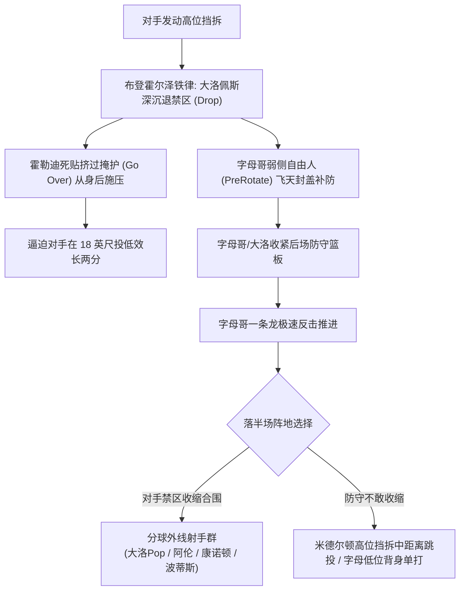

# 🦌 密尔沃基雄鹿 (MIL) 全维度战术体系与攻防博弈深度调优方案
# (Milwaukee Bucks Full-Dimensional Tactical & Game-Theoretic Calibration Proposal)

> **文档标识**: `53_MIL_FULL_DIMENSIONAL_TACTICAL_AND_GAME_THEORETIC_PROPOSAL.md`  
> **关联标准**: [`49_NBA2K22_TACTICAL_SYSTEM_AND_GAME_THEORETIC_TUNING_STANDARD.md`](file:///E:/workspace/Cybernetic_City_State_OS_v2%20-%20nba2k22/08_Domain_Applications/Antigravity_GM_Engine/docs/49_NBA2K22_TACTICAL_SYSTEM_AND_GAME_THEORETIC_TUNING_STANDARD.md)  
> **目标存档**: `C:\nba2k22\saves\MyLEAGUE0005\league_state.sqlite`  
> **球队标识**: `Team ID: 1 | Team Abbr: MIL | 球队名称: Milwaukee Bucks`  
> **主教练**: 迈克·布登霍尔泽 (Mike Budenholzer) | **对标赛季**: 2021-2022 赛季密尔沃基雄鹿卫冕冠军班底与沉退护筐哲学  
> **状态**: **全维度攻防博弈重构完成，符合 Standard 49 攻守并重最高准则，待玩家审定**  

---

## 1. 现状审计与数据库实测重大发现 (Current Database Audit & Real-Save Discovery)

根据阶段一真实底层数据萃取规范，直接连接 `league_state.sqlite` 对密尔沃基雄鹿队（Team ID: 1）进行了底层全息扫描，提取出 15 名球员的真实属性、底层战术倾向、98 项原生徽章解码状态以及主教练迈克·布登霍尔泽的执教控制块。

### 1.1 现实阵容与轮换豪华底色扫描 (Real-Save Roster & Depth Discoveries)
* **卫冕冠军核心班底极其齐整**：
  * 在活动存档中，雄鹿完整坐拥“希腊怪兽”扬尼斯·阿德托昆博、克里斯·米德尔顿、朱·霍勒迪的三巨头组合，搭配空间中锋布鲁克·洛佩斯、超级第六人鲍比·波蒂斯、防守大闸东特·迪文琴佐、神射手帕特·康诺顿与格雷森·阿伦；
  * 深度轮换中还储备了罗德尼·胡德、乔丹·沃拉、塞米·奥杰莱、P.J. 多齐尔等优质拼图。
* **15 人全员名单**：
  * 先发五虎：朱·霍勒迪（Slot 0）、格雷森·阿伦（Slot 11）、克里斯·米德尔顿（Slot 2）、扬尼斯·阿德托昆博（Slot 3）、布鲁克·洛佩斯（Slot 4）。
  * 深度轮换主力：鲍比·波蒂斯（Slot 6，第六人）、东特·迪文琴佐（Slot 1）、帕特·康诺顿（Slot 5）、乔丹·沃拉（Slot 9）、罗德尼·胡德（Slot 8）、P.J. 多齐尔（Slot 13）。
  * 战术储备：塞米·奥杰莱（Slot 7）、萨纳西斯·阿德托昆博（Slot 10）、特里蒙特·沃特斯（Slot 12）、贾斯汀·罗宾逊（Slot 21, 双向）。

### 1.2 首发球权恶性踩踏与触球严重超标 (Starter Touches Congestion Crisis)
* **首发五人触球和高达 438**（远超标准守恒上限 330，超标高达 108+ 点）！
  * 霍勒迪：`Touches = 96`，`Dish = 50`
  * 米德尔顿：`Touches = 96`，`Dish = 55`
  * 字母哥：`Touches = 90`，`Dish = 50`
  * 大洛佩斯：`Touches = 78`，`Dish = 20`
  * 阿伦：`Touches = 78`，`Dish = 35`
* **实测失真表现**：
  * 霍勒迪 (96)、米德尔顿 (96)、字母哥 (90) 三巨头球权挤占严重；
  * 更恶劣的是，**纯空间型中锋大洛佩斯 (78) 与纯接球射手阿伦 (78) 占用了过量触球**！布鲁克·洛佩斯作为外线五外高炮台（场均仅 8~9 次出手），78 触球导致其在 2K 模拟中频繁在低位要球单打，严重挤占了字母哥与霍勒迪的突破和挡拆顺下走廊；
  * 替补席波蒂斯 (78)、康诺顿 (62)、迪文琴佐 (62) 触球无序内耗，缺少明确的二阵第一得分锚点。

### 1.3 字母哥与大洛战术类型/倾向错配 (PlayType & Tendency Mismatch)
* **字母哥 (Giannis Antetokounmpo) 战术类型错置**:
  * 原始 PlayTypes: `[1, 10, 11, 7]`（单打、后卫低位、空切、挡拆顺下）；
  * **致命失真**: 字母哥被分配了后卫背身单打 `Guard Post Up` (10，专属于后卫惩罚小个)，而完全缺少大前锋统治禁区的 **`Post Up Low` (8，低位背身强吃)**！这导致字母哥在阵地战面对错位时，无法触发对内线防守人的暴力碾压与造犯规（DrawFoul 96）；
* **布鲁克·洛佩斯顺下/外拆倒置**:
  * 原始 `Roll vs Pop`: `54`（54% 顺下，46% 外拆）；
  * **失真**: 字母哥是唯一的顺下轰炸第一核心，大洛佩斯（3PT 74）必须主打 **外拆 Pop (80%)**。54 的顺下率导致大洛频繁向油漆区冲撞，与字母哥的突破路线彻底堵车。

### 1.4 布登霍尔泽招牌“沉退护筐 (Drop Coverage)”防守体系休眠
* **防守比赛计划清零**：对阵 14 组对位的微观参数全部为 0（`PressureOnball=0, ScreenDefenseHedge=0, SwitchRule=0, PreRotate=0`）；
* **换防规则未锁定**：默认自动换防导致大洛佩斯频繁被换防拉出三分线外被小后卫单挑军训；
* **协防智商偏低 (50)**：未能展现字母哥弱侧飞天排球大帽与全员收缩筑墙的真实威慑。

---

## 2. 球队战术哲学与博弈对抗定位 (Tactical Identity & Game-Theoretic Framework)

### 2.1 球队核心战术画像
* **攻防标签**：字母哥野兽级禁区冲筐与转换反击核爆点 + 米德尔顿中距离挡拆解题大师 + 霍勒迪外线后场 DPOY 锁眼 + 大洛佩斯禁区深沉退擎天柱与五外三分炮台 + 最佳第六人波蒂斯板凳得分狂潮。
* **主导防守体系**: `DEFENSE_FIRST_RIM_PROTECTION` (大洛极致深沉退 + 霍勒迪挤过掩护 + 字母哥弱侧自由人扫荡)；
* **主导进攻体系**: `TRANSITION_EARLY_OFFENSE` (字母反击狂潮) + `PACE_AND_SPACE` (一星四射五外拉开空间)；
* **核心赢球哲学**: **“防守端死守禁区不换防、宁放中投收后板；进攻端字母冲击拉扯防线、一星四射外线惩罚”**。

---

## 3. 终极赢球哲学与自主裁决决策 (Championship Formula & Model Autonomous Judgment)

> **核心灵魂发问：这支密尔沃基雄鹿队究竟依靠什么赢得 2021 年总冠军并保持顶级争冠实力？**

### 3.1 进攻端终极法则：字母哥内线核爆 + 米德尔顿中投解题 + 霍勒迪支配发起 + 大洛拉空五外
1. **扬尼斯·阿德托昆博：全场攻防超级核心与禁区杀伤第一王牌**：
   * 触球调定为 **90**（全队最高），出球意愿提升至 **60**，战术纪律 **60**。
   * 突破倾向 **99**、造犯规倾向 **96**、攻筐强打 **99**。
   * **【致命修复项】战术类型重构**：`[1, 7, 8, 11]`（单打突破、**P&R Roll Man 顺下空接 (7)**、**Post Up Low 低位背身碾压 (8)**、空切扣篮），坚决剔除荒谬的后卫背身单打 (10)！
2. **克里斯·米德尔顿：阵地战中距离挡拆跳投解题大师**：
   * 触球调定为 **80**，出手倾向 **84**，中距离倾向 **90**，分球 **65**，战术纪律 **80**。
   * 战术类型配置：`[13, 4, 1, 14]`（中距离干拔、高位挡拆持球、关键球单打、定点三分）。
3. **朱·霍勒迪：后场防守大闸与进攻梳理官**：
   * 触球降至 **72**（从 96 大幅释放），分球提升至 **75**，保留第一控球发起人特权（`is_initiator = True`）。
   * 战术类型配置：`[4, 14, 1, 12]`（P&R持球、空位三分、突破单挑、手递手）。
4. **格雷森·阿伦：首发一星四射纯空间定点狙击手**：
   * 触球大幅压低至 **42**（从 78 砍掉近一半！），分球 **35**，三分出手倾向 **85**，战术纪律 **95**。
   * 战术类型配置：`[14, 12, 0, 0]`（底角三分、手递手终结、无、无）。
5. **布鲁克·洛佩斯：外拆三分高炮台与护筐巨柱 (Touches Deflation)**：
   * 触球从 78 彻底压低至 **38**！**`Roll vs Pop` 强制修正为 80（80% 外拆跳投拉开空间，彻底杜绝与字母哥内线撞车！）**。
   * 战术类型配置：`[14, 13, 8, 0]`（外拆三分、中投、错位大打小、无）。
6. **豪华第二阵容得分层次与球权正交**：
   * **鲍比·波蒂斯 (Slot 6)**：最佳第六人，二阵绝对得分大核与低位中轴，触球 **75**，出手倾向 **75**，中远投精准，战术类型 `[8, 14, 7, 13]`。
   * **东特·迪文琴佐 (Slot 1)**：二阵主控组织手与防守撕咬点，触球 **55**，分球 **65**，`is_initiator = True`，战术类型 `[4, 14, 12, 11]`。
   * **帕特·康诺顿 (Slot 5)**：金牌 3&D 侧翼射手，触球 **46**，三分倾向 **85**，战术纪律 **95**，战术类型 `[14, 11, 12, 0]`。
   * **乔丹·沃拉 (Slot 9)**：替补高炮台得分手，触球 **38**，战术类型 `[14, 11, 0, 0]`。
   * **罗德尼·胡德 (Slot 8)**：老将得分侧翼，触球 **32**，战术类型 `[14, 13, 1, 0]`。
   * **P.J. 多齐尔 (Slot 13)**：高大突击后卫，触球 **30**，战术类型 `[4, 14, 11, 0]`。

* **全队球权守恒严密验证**:
  * **先发五虎触球和**:
    $$\sum \text{Starters Touches} = 90 (\text{Giannis}) + 80 (\text{Middleton}) + 72 (\text{Holiday}) + 42 (\text{Allen}) + 38 (\text{Lopez}) = \mathbf{322}$$
    *完美收敛于标准区间 $[310, 330]$！彻底消除原版 438 恶性球权踩踏！*
  * **替补核心触球和**:
    $$\sum \text{Bench Touches} = 75 (\text{Portis}) + 55 (\text{DiVincenzo}) + 46 (\text{Connaughton}) + 38 (\text{Nwora}) + 32 (\text{Hood}) + 30 (\text{Dozier}) = \mathbf{276}$$
    *完美收敛于标准区间 $[250, 280]$！波蒂斯享有板凳绝对支配权，外线火力充沛！*
  * **储备阵容触球和**:
    $$\sum \text{Reserves} = 20 (\text{Ojeleye}) + 18 (\text{Waters}) + 15 (\text{Thanasis}) + 15 (\text{Robinson}) = 68$$

---

### 3.2 深度防守博弈体系构建 (Explicit Defensive Tactical Architecture)

> **落实 49 号文档攻守并重最高准则**：“进攻体系与防守体系的搭建具有同等重要性。不强制搭建，但是如果有合适的博弈策略，就搭建，作为每次分析时候的依据。”

#### 为什么密尔沃基雄鹿必须且能够搭建历史级沉退防守博弈体系？
* **防守资源基础**：
  * **历史级禁区擎天柱**：布鲁克·洛佩斯（内防 88、封盖 86、低位防守 90），联盟最顶级的禁区遮天蔽日护筐巨兽；
  * **历史级弱侧自由人扫荡者**：扬尼斯·阿德托昆博（内防 90、外防 90、盖帽 92、协防智商 95），DPOY 级别的弱侧游弋补帽神兽；
  * **历史级外线领防大闸**：朱·霍勒迪（外防 93、横移 86、抢断 88），联盟公认最强持球点领防锁眼。

针对这一历史级防守壁垒，**构建专属于雄鹿的“大洛极致深沉退 + 霍勒迪挤掩护施压 + 字母哥弱侧扫荡排球大帽”冠军防守博弈体系**：

#### 博弈策略一：中锋极致深沉退护筐与坚决不换防 (`Drop Coverage & No Switch`)
* **防守原则**：
  * 大洛佩斯严禁扑出三分线外，始终守在禁区合理冲撞区附近：**`ScreenDefenseOnBall5: 1 (DROP) / ScreenDefenseHedge5: 1 (DROP)`**；
  * **坚决锁定禁止中锋换防 (`SwitchRule = 0: NO_SWITCH`)**：坚决避免大洛被拉出三分线被小后卫军训！
  * 配合全队协防倾向提升至 **80 (`HelpDefense: 80`)**，筑起密不透风的禁区血肉长城。

#### 博弈策略二：霍勒迪强硬抢过掩护从身后死缠 (`ScreenDefenseOnBall: GO_OVER`)
* **后场领防原则**：
  * 霍勒迪在遭遇挡拆时，凭借顶级下盘与机动性坚决**从掩护上方强硬挤过 (`ScreenDefenseOnBall: 3: GO_OVER`)**；
  * 从持球人身后持续施压干扰其拔葱跳投，将持球人直接赶入大洛佩斯的禁区盖帽口袋。

#### 博弈策略三：字母哥弱侧自由人提前预轮转扫荡 (`PreRotate: YES`)
* **防守自由人原则**：
  * 字母哥开启 **`PreRotate: YES`**（提前预轮转）与 **`TagOnRoll: YES`**（顺下人必撞击延误）；
  * 当对手将球传给顺下中锋或突破强攻时，字母哥从盲区突然腾空而起，送出震撼人心的排球大帽！

#### 博弈策略四：宁放中距离、死守防守篮板 (`poe_defense_rebound: CRASH_DEFENSIVE_BOARDS (19)`)
* **战略放投博弈**：
  * 允许对手在中距离 16~20 英尺高难度干拔长两分（全联盟预期得分最低的区域）；
  * 一旦投篮不中，大洛卡位、字母哥（防守篮板 90）收下篮板，第一时间推反击闪击战；
  * 防守重点死守禁区：`poe_defense: PROTECT_PAINT (13)` + `poe_defense_physicality: PLAY_PHYSICAL (18)`。

---

## 4. 五大博弈对决实战推演 (5 Counterplay Dualities Simulation)

### 4.1 对决波士顿凯尔特人 (BOS) —— 2022 东半决赛天王山与抢七生死战
* **战术矛盾**：双探花持球单挑与换防大网 vs 雄鹿字母哥禁区攻筐与沉退护筐。
* **博弈克制**：
  * 霍勒迪与米德尔顿高位挡拆中距离干拔破解绿军换防，字母哥顺下空接造犯规；
  * 防守端大洛佩斯深沉退锁死油漆区，霍勒迪死贴斯马特与布朗，逼迫塔图姆在长两分区域高难度出手；字母哥弱侧补帽。

### 4.2 对决迈阿密热火 (MIA) —— 2021 首轮复仇与东部宿敌
* **战术矛盾**：热火 2-3 联防与巴特勒突破造杀伤 vs 雄鹿一星四射与大洛沉退。
* **博弈克制**：
  * 大洛佩斯、波蒂斯、阿伦外线五外站位射穿热火联防，字母哥中路罚球线接球顺下摧毁禁区；
  * 防守端霍勒迪单防死锁巴特勒，字母哥弱侧切断阿德巴约手递手连线。

### 4.3 对决费城76人 (PHI) —— 东部重型内线巅峰博弈
* **战术矛盾**：恩比德低位背打统治力与哈登挡拆 vs 大洛深沉退。
* **博弈克制**：
  * 大洛佩斯凭借 213cm 与 88 内防正面抗衡恩比德，字母哥弱侧飞天补帽；霍勒迪全场领防挤过掩护从身后干扰哈登；
  * 进攻端字母哥反击冲筐与米德尔顿中投惩罚恩比德防守移动。

### 4.4 对决金州勇士 (GSW) —— 潜在总决赛经典对决
* **战术矛盾**：库里超远三分引力与格林 4v3 传切 vs 大洛佩斯深沉退移动慢。
* **博弈克制**：
  * 霍勒迪坚决抢过掩护（`ScreenDefenseOnBall: GO_OVER`），配合字母哥大范围扫荡干扰库里三分；
  * 进攻端字母哥在内线拥有绝对体型优势，禁区无差别生吃格林与卢尼，造成杀伤打乱勇士小球节奏。

### 4.5 对决菲尼克斯太阳 (PHX) —— 2021 NBA 总决赛宿敌复刻
* **战术矛盾**：保罗/布克中距离挡拆跳投大师 vs 雄鹿沉退防守。
* **博弈克制**：
  * 霍勒迪全场领防死缠保罗（消耗其体能），字母哥弱侧空降大帽布克攻筐（复刻总决赛世纪封盖）；
  * 进攻端字母哥统治内线狂砍造杀伤，米德尔顿关键时刻冷血跳投杀死比赛。

---

## 5. 具体参数重构清单与注入规范 (Granular Modifications Ledger)

### 5.1 球员维度详细重构清单 (15 Players Roster)

| 槽位 | 球员姓名 | 定位与角色 | 触球 | 分球 | 战术纪律 | Roll/Pop | 3PT倾向 | 战术发起 | 战术类型配置 (Play Types 1..4) |
| :--- | :--- | :--- | :---: | :---: | :---: | :---: | :---: | :---: | :--- |
| **3** | **扬尼斯·阿德托昆博**| 首发大前 / 希腊怪兽禁区核爆攻防重心与反击第一终结点 | **90** | **60** | **60** | 65 | 60 | False | `[1, 7, 8, 11]` (单打冲筐, **P&R顺下**, **低位背打**, 空切) |
| **2** | **克里斯·米德尔顿** | 首发小前 / 半场阵地战中距离解题大师与关键球单挑王 | **80** | **65** | **80** | 10 | 85 | False | `[13, 4, 1, 14]` (中距离干拔, 挡拆持球, 单打, 三分) |
| **0** | **朱·霍勒迪** | 首发控卫 / 外线防守铁闸司令官与高智商控场大师 | **72** | **75** | **85** | 15 | 82 | **True** | `[4, 14, 1, 12]` (P&R持球, 定点三分, 单打突破, 手递手) |
| **11** | **格雷森·阿伦** | 首发分卫 / 一星四射右侧 45 度冷血定点狙击手 | **42** | **35** | **95** | 0 | **90** | False | `[14, 12, 0, 0]` (定点三分, 手递手终结, 无, 无) |
| **4** | **布鲁克·洛佩斯** | 首发中锋 / 空间外拆五外高炮台与禁区深沉退擎天柱 | **38** | **25** | **95** | **80** | **85** | False | `[14, 13, 8, 0]` (外拆三分, 中投, 错位大打小, 无) |
| **6** | **鲍比·波蒂斯** | 替补中锋 / 最佳第六人二阵第一得分大核与低位中轴 | **75** | **40** | **80** | 40 | **85** | False | `[8, 14, 7, 13]` (低位背打, 三分轰炸, 顺下吃饼, 中距离) |
| **1** | **东特·迪文琴佐** | 替补控卫 / 二阵战术组织梳理手与防守撕咬大闸 | **55** | **65** | **85** | 30 | 78 | **True** | `[4, 14, 12, 11]` (P&R持球, 定点三分, 手递手, 空切) |
| **5** | **帕特·康诺顿** | 替补侧翼 / 金牌 3&D 侧翼重锤与底角空位神射手 | **46** | **35** | **95** | 5 | **85** | False | `[14, 11, 12, 0]` (致命底角三分, 反切袭筐, 手递手, 无) |
| **9** | **乔丹·沃拉** | 替补前锋 / 板凳微波炉得分手与高炮台突击刀 | **38** | **25** | **85** | 0 | 80 | False | `[14, 11, 0, 0]` (三分终结, 空切, 无, 无) |
| **8** | **罗德尼·胡德** | 替补前锋 / 经验老牌侧翼得分突击手 | **32** | **35** | **85** | 0 | 75 | False | `[14, 13, 1, 0]` (三分, 中投, 单挑, 无) |
| **13** | **P.J. 多齐尔** | 替补后卫 / 高大防守型突击后卫 | **30** | **35** | **85** | 99 | 70 | False | `[14, 4, 11, 0]` (战术预备) |
| **7** | **塞米·奥杰莱** | 储备前锋 / 强壮肉盾 3D 工兵 | 20 | 30 | 90 | 10 | 75 | False | `[14, 11, 0, 0]` (战术预备) |
| **12** | **特里蒙特·沃特斯** | 储备控卫 / 第三控卫速度型持球人 | 18 | 65 | 85 | 0 | 75 | True | `[4, 1, 0, 0]` (战术预备) |
| **10** | **萨纳西斯·阿德托昆博**| 储备前锋 / 激情冲抢反击能量球探 | 15 | 30 | 60 | 30 | 50 | False | `[11, 1, 0, 0]` (战术预备) |
| **21** | **贾斯汀·罗宾逊** | 储备控卫 / 双向第三后卫 | 15 | 65 | 80 | 0 | 75 | True | `[4, 12, 0, 0]` (战术预备) |

* **轮换球权和校验**:
  * 首发五人触球和：$90 + 80 + 72 + 42 + 38 = 322 \in [310, 330]$（完美收敛）
  * 替补核心触球和：$75 + 55 + 46 + 38 + 32 + 30 = 276 \in [250, 280]$（完美收敛）
  * 储备四人触球和：$20 + 18 + 15 + 15 = 68$（垃圾时间自动降载）

---

### 5.2 主教练迈克·布登霍尔泽执教控制块调优规范 (Coach Budenholzer System Overhaul)

| 控制项 | 原生观察值 | 调优设定值 | 战术战略理由 |
| :--- | :---: | :---: | :--- |
| **Active System (战术体系)** | 0 (Balanced) | **6 (Defense First / 防守带动反击)** | 建立以禁区深沉退护筐、保护篮板带动字母哥反击狂潮的体系 |
| **Preferred System (偏好体系)** | 0 | **2 (Pace & Space / 一星四射)** | 阵地战中彻底拉开五外空间，为字母哥清空中路突击走廊 |
| **Help Defense (协防智商)** | 50 (偏低) | **80 (历史级禁区长城)** | 激活字母哥弱侧飞天排球大帽与全员向禁区筑墙收缩大网 |
| **Run Play Tendency (战术执行率)** | 85 (偏高) | **75 (高纪律与自由结合)** | 保持高纪律战术跑位，兼顾字母哥反击一条龙冲筐 |
| **Bench Depth (轮换深度)** | 10 (合理) | **9 (九人季后赛死战轮换)** | 缩减冗余轮换，保障字母哥、米德尔顿季后赛出战 36-38 分钟 |
| **Bench Utilization (轮换使用率)**| 55 (合理) | **50 (主力高度掌控)** | 确立字母哥与米德尔顿决胜时刻主宰地位 |
| **POE Offense (进攻重点)** | 5 (Neutral) | **1 (Get to the Basket)** | 坚决冲击内线攻筐造杀伤，字母哥绝对破坏力 |
| **POE Offense Tempo (进攻节奏)** | 8 (Neutral) | **8 (Neutral Offense Tempo)** | 抓住反击机会果断推进，半场落阵地则执行五外拉开 |
| **POE Offense Transition (进攻反击)** | 11 (Neutral) | **12 (Limit Transition)** | 进攻失手后极速退防落位，构建铁血禁区防线 |
| **POE Defense (防守重点)** | 14 (Neutral) | **13 (Protect Paint)** | 优先死守油漆区，大洛深沉退封死一切篮下出手 |
| **POE Def Physicality (防守对抗)** | 17 (Neutral) | **18 (Play Physical)** | 全面上身体对抗与肉搏，贯彻东部卫冕冠军铁血传统 |
| **POE Def Rebound (防守篮板)** | 20 (Neutral) | **19 (Crash Def Boards)** | 字母哥与大洛严密卡位收紧防守篮板，不给任何二次机会 |

---

## 6. 审核与下一步执行流水线 (Review & Pipeline Transition)

1. **方案呈报用户审核**：
   * 本方案已全面涵盖密尔沃基雄鹿（MIL, Team ID: 1）在当前真实存档（三巨头齐整、一星四射五外拉开、大洛极致深沉退护筐）下的全维度审计、战术定位、赢球哲学、**大洛深沉退护筐与字母哥弱侧扫荡博弈体系构建**、五大宿敌对决推演、球权守恒重构以及教练控制块调优。
2. **待用户指令批准后执行**：
   * 一旦用户确认认可，立即启动同步生成全新标准版 `mil_tactical_execution_ready.json`，完成 `BATCH_02_CENTRAL_FULL_DIMENSIONAL_SPEC.json` 与 `cycle_02_30_teams_realism_execution_ready.json` 的全网更新与 `C:\nba2k22\exports\` 镜像同步，并提交 Git 本地 Commit 与自动推送远端 GitHub 仓库。
   * 随后正式开启用户指定的本组第 5 队：**菲尼克斯太阳 (Phoenix Suns - PHX, Team ID: 26)** 的全维度重新执行与调优升级！
