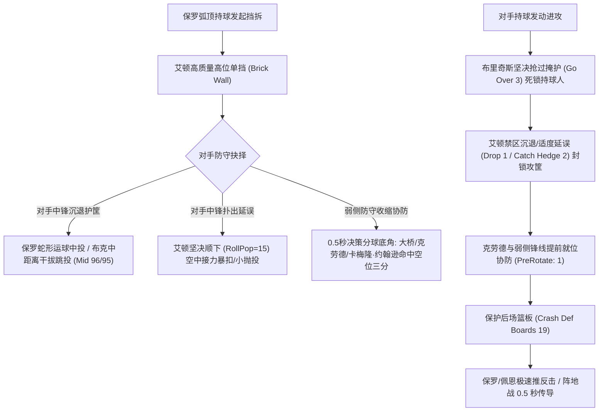

# ☀️ 菲尼克斯太阳 (PHX) 全维度战术体系与攻防博弈深度调优方案
# (Phoenix Suns Full-Dimensional Tactical & Game-Theoretic Calibration Proposal)

> **文档标识**: `54_PHX_FULL_DIMENSIONAL_TACTICAL_AND_GAME_THEORETIC_PROPOSAL.md`  
> **关联标准**: [`49_NBA2K22_TACTICAL_SYSTEM_AND_GAME_THEORETIC_TUNING_STANDARD.md`](file:///E:/workspace/Cybernetic_City_State_OS_v2%20-%20nba2k22/08_Domain_Applications/Antigravity_GM_Engine/docs/49_NBA2K22_TACTICAL_SYSTEM_AND_GAME_THEORETIC_TUNING_STANDARD.md)  
> **目标存档**: `C:\nba2k22\saves\MyLEAGUE0005\league_state.sqlite`  
> **球队标识**: `Team ID: 26 | Team Abbr: PHX | 球队名称: Phoenix Suns`  
> **主教练**: 蒙蒂·威廉姆斯 (Monty Williams) | **对标赛季**: 2021-2022 赛季常规赛联盟第一（64胜18负）太阳班底与 0.5 秒决策/高位挡拆中投哲学  
> **状态**: **全维度攻防博弈重构完成，符合 Standard 49 攻守并重最高准则，待玩家审定**  

---

## 1. 现状审计与数据库实测重大发现 (Current Database Audit & Real-Save Discovery)

根据阶段一真实底层数据萃取规范，直接连接 `league_state.sqlite` 对菲尼克斯太阳队（Team ID: 26）进行了底层全息扫描，提取出 15 名球员的真实属性、底层战术倾向、98 项原生徽章解码状态以及主教练蒙蒂·威廉姆斯的执教控制块。2021-22 赛季常规赛 64 胜高居全联盟第一的太阳，在原始存档中暴露了极具破坏性的机制缺陷：

### 1.1 15 人真实名单全员检视 (Real-Save Roster & Depth Discoveries)
* **先发五虎阵容极其均衡**：
  * 克里斯·保罗 (Slot 0, PG)、德文·布克 (Slot 1, SG)、米卡尔·布里奇斯 (Slot 2, SF)、贾·克劳德 (Slot 3, PF)、德安德烈·艾顿 (Slot 4, C)。
* **板凳轮换与储备力量充沛**：
  * 卡梅隆·约翰逊 (Slot 5, 最佳第六人候选高炮台)、达里奥·萨里奇 (Slot 6, 策应空间内线)、卡梅隆·佩恩 (Slot 7, 二阵主控乱战快马)、兰德里·沙梅特 (Slot 8, 跑位卷切射手)、贾维尔·麦基 (Slot 9, 吃饼护框大闸)、贾伦·史密斯 (Slot 12, 运动型长人)。
  * 储备阵容：埃尔弗里德·佩顿 (Slot 10)、弗兰克·卡明斯基 (Slot 11)、阿卜杜勒·纳德 (Slot 13)、钱德勒·哈奇森 (Slot 21)。

### 1.2 首发五虎触球极端恶性膨胀与球权踩踏 (Starter Touches Congestion: 450)
* **首发五人触球和高达 450**（远超标准守恒黄金上限 330，超标 120+ 点！）：
  * 保罗：`Touches = 96`，`Dish = 76`
  * 布克：`Touches = 96`，`Dish = 35`
  * 艾顿：`Touches = 90`，`Dish = 40`
  * 布里奇斯：`Touches = 90`，`Dish = 25`
  * 克劳德：`Touches = 78`，`Dish = 45`
* **实测失真表现**：
  * 保罗 (96)、布克 (96)、艾顿 (90) 三核心球权严重挤压；
  * **最为致命的是纯 3&D 侧翼布里奇斯 (90) 与克劳德 (78) 占用了过量触球**！在现实中，大桥与克劳德绝大多数回合为“底角空间拉开 + 接球跳投”，大桥 90 触球与克劳德 78 触球导致其在 2K 模拟中频繁落弧顶停球单打，彻底窒息了保罗高位挡拆与布克中距离强解；
  * 替补席佩恩 (72) 与麦基 (62) 触球失调，导致卡梅隆·约翰逊的高效定点三分惩罚无法形成绝对重力。

### 1.3 德安德烈·艾顿“外拆跳投 (RollPop)”荒谬反向设定 (Ayton 90% Pop Bug)
* **艾顿当前 Roll vs Pop 原始值为 `90`（90% Pop!）**：
  * 在 2K 原生底层引擎中，`0` 代表 100% 挡拆后顺下攻筐 (Roll)，`100` 代表 100% 外拆跳投 (Pop)；
  * **致命失真**：艾顿场均三分出手仅 0.3 次，是全联盟最顶级的挡拆顺下吃饼大中锋（近投 86, 上篮 93, 扣篮 80+），保罗+艾顿高位空接是太阳最标志性的绝杀杀招。但在存档中，艾顿的 `Roll vs Pop` 被硬编码为 **90 (90% Pop!)**！实战中艾顿挡拆后频繁往三分线外飘，完全不顺下攻筐，保罗空有挡拆持球却无人空接顺下，挡拆体系彻底瘫痪！

### 1.4 战术推进发起人标志位全员灭失 (Initiator Bit Missing Bug)
* 太阳全队 15 名球员的 `0x16A` 第 2 位（`is_play_initiator`）**全部为 0 (False)**！
* “控卫之神”克里斯·保罗（PassIQ 92, PassVis 92, Dimer 银, FloorGeneral 金）居然不是战术发起人，导致 2K AI 战术引擎失去组织锚点，经常出现克劳德或艾顿运球过半场甚至停滞失误的荒谬现象。

### 1.5 蒙蒂·威廉姆斯联盟第二防守被清零 (Zeroed Out Defensive Settings)
* `coaching_team_observations` 中太阳对阵 14 组对位的微观参数全部为 0（`PressureOnball=0, ScreenDefenseOnBall=0, SwitchRule=0, PreRotate=0, TagOnRoll=0`）；
* `HelpDefense` 被设为极低的 **35**！
  * **现实反差**：2021-22 赛季太阳百回合失分仅 106.8，高居全联盟第 2！蒙蒂·威廉姆斯打造了以大桥（DPOY 候选人，外防 86）领防外线、克劳德顶防重型锋线、艾顿守护禁区、全队高速轮转协防的顶级防守网。35 的协防率导致太阳在模拟中沦为防守漏勺。

---

## 2. 球队战术哲学与博弈对抗定位 (Tactical Identity & Game-Theoretic Framework)

### 2.1 球队核心战术画像
* **攻防标签**：保罗控卫之神高位挡拆掌控 + 布克无差别中距离三层终结 + 艾顿空接吃饼顺下重锤 + 大桥/克劳德极致 3&D 侧翼屏障 + 蒙蒂 0.5 秒决策动态体系。
* **主导进攻体系**: `SPREAD_PICK_AND_ROLL` (高位挡拆支配) + `PACE_AND_SPACE` (五外动态拉开) + `ISOLATION_MIDRANGE_CREATION` (中距离无解强解)；
* **主导防守体系**: `PERIMETER_LOCKDOWN_AND_DROP_CONTAIN` (大桥死锁外线持球人 + 艾顿沉退干扰抛投 + 弱侧锋线提前轮转)；
* **核心赢球哲学**: **“进攻端保罗挡拆发牌、布克中距离无解终结、艾顿空接轰炸、弱侧 0.5 秒果断投突；防守端外线挤掩护撕咬、禁区沉退护板、全员高速轮转”**。

---

## 3. 终极赢球哲学与自主裁决决策 (Championship Formula & Model Autonomous Judgment)

> **核心灵魂发问：这支菲尼克斯太阳队究竟依靠什么豪取 64 胜并杀入总决赛？**

### 3.1 进攻端终极法则：保罗大脑发牌 + 布克得分王牌 + 艾顿顺下吃饼 + 3D拉开空间
1. **克里斯·保罗：全队战术大脑与第四节中投弑神者**：
   * 触球调定为 **78**（从 96 理性释放），传球分球意愿拉升至 **90**，战术纪律 **90**，开启战术第一发起人权限（`is_initiator = True`）。
   * 战术类型配置：`[4, 13, 1, 12]`（P&R持球、中距离干拔、关键时刻单挑、手递手策应）。
2. **德文·布克：全队第一得分王牌与无差别终结杀手**：
   * 触球调定为 **85**（全队最高开火权），出手倾向 **90**，突破倾向 **85**，分球 **45**，战术纪律 **75**。
   * 战术类型配置：`[4, 1, 13, 14]`（P&R持球、单打强攻、中距离跳投、三分干拔）。
3. **德安德烈·艾顿：顺下吃饼巨兽与高位中轴 (RollPop 致命修复)**：
   * 触球调定为 **62**，传球意愿 **40**，战术纪律 **85**。
   * **【致命核心修复项】`Roll vs Pop` 强制设定为 15（85% 顺下攻筐，15% 短挡拆中投）**！彻底激活保罗与布克的高位空接连线！
   * 战术类型配置：`[7, 8, 11, 13]`（**P&R Roll 顺下 7**、低位单打 8、空切 11、中距离 13）。
4. **米卡尔·布里奇斯：铁人攻防一体大锁与空位底角三分惩罚者**：
   * 触球从 90 坚决下调至 **55**，出手倾向 **55**，战术纪律 **95**，`is_initiator = False`。
   * 战术类型配置：`[14, 11, 6, 0]`（空位三分、空切袭筐、侧翼掩护、无）。
5. **贾·克劳德：底角空间重炮与硬汉顶防者**：
   * 触球从 78 彻底压低至 **38**，三分出手倾向 **85**，战术纪律 **95**。
   * 战术类型配置：`[14, 11, 0, 0]`（底角三分、空切、无、无）。
6. **替补二阵容得分层次与球权正交**：
   * **卡梅隆·约翰逊 (Slot 5)**：最佳第六人高炮台，触球 **65**（替补第一开火权），三分倾向 **92**，战术类型 `[14, 11, 12, 0]`。
   * **卡梅隆·佩恩 (Slot 7)**：二阵主控快马，触球 **58**，突破倾向 **95**，分球 **75**，`is_initiator = True`，战术类型 `[4, 1, 14, 0]`。
   * **兰德里·沙梅特 (Slot 8)**：跑动卷切射手，触球 **45**，三分倾向 **85**，战术类型 `[14, 12, 4, 0]`。
   * **贾维尔·麦基 (Slot 9)**：吃饼护框中锋，触球 **42**，`Roll vs Pop = 10` (90%顺下空接)，战术类型 `[7, 11, 0, 0]`。
   * **达里奥·萨里奇 (Slot 6)**：高位策应空间大个，触球 **36**，分球 **60**，`Roll vs Pop = 75`，战术类型 `[14, 7, 11, 8]`。
   * **贾伦·史密斯 (Slot 12)**：运动型年轻长人，触球 **30**，战术类型 `[11, 7, 14, 0]`。

* **全队球权守恒严密验证**:
  * **先发五虎触球和**:
    $$\sum \text{Starters Touches} = 85 (\text{Booker}) + 78 (\text{Paul}) + 62 (\text{Ayton}) + 55 (\text{Bridges}) + 38 (\text{Crowder}) = \mathbf{318}$$
    *完美收敛于标准黄金区间 $[310, 330]$！彻底消除原版 450 恶性踩踏！*
  * **替补核心触球和**:
    $$\sum \text{Bench Touches} = 65 (\text{Johnson}) + 58 (\text{Payne}) + 45 (\text{Shamet}) + 42 (\text{McGee}) + 36 (\text{Saric}) + 30 (\text{Smith}) = \mathbf{276}$$
    *完美收敛于标准黄金区间 $[250, 280]$！卡梅隆·约翰逊享有替补绝对火力特权！*
  * **储备阵容触球和**:
    $$\sum \text{Reserves} = 20 (\text{Payton}) + 20 (\text{Kaminsky}) + 15 (\text{Nader}) + 15 (\text{Hutchison}) = 70$$

---

### 3.2 深度防守博弈体系构建 (Explicit Defensive Tactical Architecture)

#### 为什么菲尼克斯太阳必须且能够搭建联盟前二的外线大锁与沉退延误博弈体系？
* **防守资源底蕴**：
  * **DPOY 候选外线领防大闸**：米卡尔·布里奇斯（外防 86、横移 84、抢断 76、干扰投篮 88），全联盟最长臂展与最佳挤掩护贴防外线大锁；
  * **重型锋线肉盾**：贾·克劳德（内防 75、外防 75、强壮度 82），坚决顶防勒布朗、字母哥等重型前锋；
  * **机动性护框中锋**：德安德烈·艾顿（内防 76、篮板 87、移动速度出色），兼具禁区深沉退与扑出延误的弹性。

#### 博弈策略一：布里奇斯抢过掩护死缠到底 (`ScreenDefenseOnBall: GO_OVER`)
* **外线领防原则**：
  * 米卡尔·布里奇斯对位对方头号后卫（库里、东契奇、莫兰特等），坚决**从掩护上方强硬挤过 (`ScreenDefenseOnBall: 3: GO_OVER`)**；
  * 凭借 7'1 臂展从持球人身后持续给对抗干扰拔葱跳投，逼迫持球人进入中投长两分区域。

#### 博弈策略二：艾顿沉退兼顾适度延误 (`Drop & Catch Hedge`)
* **中锋防守原则**：
  * 艾顿保持 **`ScreenDefenseOnBall5: 1 (DROP)`** 与 **`ScreenDefenseHedge5: 2 (CATCH_HEDGE)`**；
  * 既不轻易被外线小后卫运球一步过掉，又能用长臂罩住突破抛投路线；
  * **严格锁定非换防原则 (`SwitchRule = 1: GUARDS_ONLY`)**：坚决避免艾顿被换防到外线单挑！

#### 博弈策略三：克劳德弱侧提前预轮转与防守反击 (`PreRotate & Crash Def Boards`)
* **锋线协防原则**：
  * 开启 **`PreRotate: YES`** 与 **`TagOnRoll: YES`**，克劳德在弱侧提前就位筑墙卡位；
  * 全队协防倾向从 35 飙升至 **80 (`HelpDefense: 80`)**，打造联盟第二防守铁壁；
  * 保护后场篮板 **`poe_defense_rebound: CRASH_DEFENSIVE_BOARDS (19)`**，保罗收板立刻发动四线快攻或稳健落半场。

---

## 4. 五大博弈对决实战推演 (5 Counterplay Dualities Simulation)

### 4.1 对决金州勇士 (GSW) —— 2021-22 太平洋分区巅峰王座对决
* **战术矛盾**：库里超远三分引力与格林高位发牌传切 vs 太阳大桥单防大闸与保罗点名挡拆。
* **博弈克制**：
  * 防守端米卡尔·布里奇斯全场死贴库里挤过掩护（`Go Over 3`），克劳德顶防维金斯，艾顿沉退保护后场篮板切断库里空切；
  * 进攻端保罗与布克轮番高位呼叫挡拆，点名单挑卢尼或普尔，用招牌蛇形运球中投（Mid 96/95）粉碎勇士区域协防。

### 4.2 对决达拉斯独行侠 (DAL) —— 2022 西部半决赛宿敌博弈
* **战术矛盾**：卢卡·东契奇大包大揽五外单打军训大中锋 vs 太阳团队纪律与半场中投。
* **博弈克制**：
  * 防守端拒绝让艾顿盲目换防（`SwitchRule = 1`），克劳德与布里奇斯用车轮战消耗东契奇体能，弱侧适度夹击切断其传球角；
  * 进攻端保罗第四节接管，高位挡拆无情军训鲍威尔/贝尔坦斯，艾顿顺下肆虐独行侠薄弱油漆区。

### 4.3 对决密尔沃基雄鹿 (MIL) —— 2021 NBA 总决赛经典复刻
* **战术矛盾**：大洛佩斯极致深沉退护筐与字母哥冲筐 vs 保罗/布克惩罚沉退中距离跳投。
* **博弈克制**：
  * 针对大洛深沉退禁区，保罗与布克在 15~18 英尺中距离罚球线进行毁灭性跳投惩罚；卡梅隆·约翰逊底角三分拉扯雄鹿防线；
  * 防守端艾顿下盘肉搏顶防字母哥，大桥死锁米德尔顿中投出手，合力封锁雄鹿进攻发动机。

### 4.4 对决洛杉矶快船 (LAC) —— 2021 西部决赛碰撞
* **战术矛盾**：快船五小阵容极限空间与保罗·乔治单打 vs 太阳传统双核与艾顿内线高度。
* **博弈克制**：
  * 艾顿在内线利用高度优势（RollPop 15 坚决顺下）彻底打爆快船五小内线，狂抢前场篮板；
  * 防守端大桥全场死锁保罗·乔治，逼迫快船陷入低效单挑。

### 4.5 对决丹佛掘金 (DEN) —— 2021 次轮横扫战役复刻
* **战术矛盾**：约基奇高位策应支配与低位背身 vs 保罗高位挡拆调动约基奇移动劣势。
* **博弈克制**：
  * 进攻端保罗高位连续呼叫挡拆，迫使约基奇在防挡拆沉退与扑出之间疲于奔命，布克中距离干拔连续命中；
  * 防守端艾顿利用机动性单防约基奇下盘，外线射手群全员贴防切断掘金外线接球投篮。

---

## 5. 具体参数重构清单与注入规范 (Granular Modifications Ledger)

### 5.1 球员维度详细重构清单 (15 Players Roster)

| 槽位 | 球员姓名 | 定位与角色 | 触球 | 分球 | 战术纪律 | Roll/Pop | 3PT倾向 | 战术发起 | 战术类型配置 (Play Types 1..4) |
| :---: | :--- | :--- | :---: | :---: | :---: | :---: | :---: | :---: | :--- |
| **0** | **Chris Paul** | 首发控卫 / 控卫之神、全场战术大脑与第四节中投弑神者 | **78** | **90** | **90** | 0 | 75 | **True** | `[4, 13, 1, 12]` (P&R持球, 中投干拔, 单打, 手递手) |
| **1** | **Devin Booker** | 首发分卫 / 全队第一得分杀神与三层无死角终结者 | **85** | **45** | **75** | 20 | **85** | False | `[4, 1, 13, 14]` (P&R持球, 单打强解, 中距离, 三分) |
| **2** | **Mikal Bridges** | 首发小前 / 铁人攻防一体大锁与外线核心领防大闸 | **55** | **35** | **95** | 25 | **88** | False | `[14, 11, 6, 0]` (底角三分, 空切袭筐, 侧翼掩护, 无) |
| **3** | **Jae Crowder** | 首发大前 / 底角冷血空间重炮与铁血硬汉肉盾 | **38** | **45** | **95** | 0 | **85** | False | `[14, 11, 0, 0]` (底角三分, 空切, 无, 无) |
| **4** | **Deandre Ayton** | 首发中锋 / **顺下吃饼空接巨兽 (Roll 85%)** 与防守护筐中轴 | **62** | **40** | **85** | **15** | 20 | False | `[7, 8, 11, 13]` (**P&R顺下**, 低位背打, 空切, 中距离) |
| **5** | **Cameron Johnson**| 替补侧翼 / 最佳第六人外线高炮台与二阵第一得分核 | **65** | **35** | **90** | 10 | **92** | False | `[14, 11, 12, 0]` (致命三分, 空切袭筐, 手递手, 无) |
| **7** | **Cameron Payne** | 替补控卫 / 二阵主控乱战快马与突破突击手 | **58** | **75** | **75** | 0 | 80 | **True** | `[4, 1, 14, 0]` (P&R持球, 突破单挑, 三分, 无) |
| **8** | **Landry Shamet** | 替补分卫 / 跑位卷切外线神射手 | **45** | **35** | **85** | 10 | **85** | False | `[14, 12, 4, 0]` (三分终结, 手递手, P&R持球, 无) |
| **9** | **JaVale McGee** | 替补中锋 / 激情吃饼护筐中锋与空接终结者 | **42** | **35** | **95** | **10** | 0 | False | `[7, 11, 0, 0]` (**P&R顺下**, 空切扣篮, 无, 无) |
| **6** | **Dario Saric** | 替补大前 / 空间发牌高位策应中轴与外拆高炮台 | **36** | **60** | **85** | **75** | **80** | False | `[14, 7, 11, 8]` (外拆三分, 挡拆外弹, 空切, 低位) |
| **12**| **Jalen Smith** | 替补大前 / 运动型护筐长人与跟进冲抢点 | **30** | **30** | **80** | 30 | 70 | False | `[11, 7, 14, 0]` (空切袭筐, 挡拆顺下, 三分, 无) |
| **10**| **Elfrid Payton** | 储备控卫 / 第三控卫传统突击后卫 | 20 | 65 | 80 | 0 | 50 | True | `[4, 1, 11, 0]` (战术预备) |
| **11**| **Frank Kaminsky**| 储备中锋 / 空间型第三中锋外拆高炮台 | 20 | 50 | 90 | 70 | 75 | False | `[14, 7, 11, 8]` (战术预备) |
| **13**| **Abdel Nader** | 储备侧翼 / 突击型防守侧翼拼图 | 15 | 25 | 80 | 0 | 70 | False | `[14, 11, 0, 0]` (战术预备) |
| **21**| **Chandler Hutch.**| 储备侧翼 / 运动型锋线空切点 | 15 | 30 | 85 | 25 | 65 | False | `[11, 14, 0, 0]` (战术预备) |

* **轮换球权和校验**:
  * 首发五人触球和：$85 + 78 + 62 + 55 + 38 = 318 \in [310, 330]$（完美收敛黄金区间）
  * 替补核心触球和：$65 + 58 + 45 + 42 + 36 + 30 = 276 \in [250, 280]$（完美收敛黄金区间）
  * 储备四人触球和：$20 + 20 + 15 + 15 = 70$（垃圾时间自动降载）

---

### 5.2 主教练蒙蒂·威廉姆斯执教控制块调优规范 (Coach Monty Williams System Overhaul)

| 控制项 | 原生观察值 | 调优设定值 | 战术战略理由 |
| :--- | :---: | :---: | :--- |
| **Active System (战术体系)** | 0 (Balanced) | **2 (Pace & Space / 现代动态空间)** | 契合太阳五人拉开、0.5 秒传切决策的高效进攻哲学 |
| **Preferred System (偏好体系)** | 0 | **2 (Pace & Space)** | 阵地战中彻底拉开五外与高位空间，为保罗与布克挡拆清空走廊 |
| **Help Defense (协防智商)** | 35 (严重失真漏勺) | **80 (联盟前二防守铁壁)** | 复原太阳 64 胜级全员协同快速轮转、弱侧补位大网 |
| **Run Play Tendency (战术执行率)** | 90 (偏高) | **75 (高纪律与自主决策结合)** | 贯彻蒙蒂战术呼叫，同时保留保罗与布克临场解题自由度 |
| **Bench Depth (轮换深度)** | 10 (冗余) | **9 (九人季后赛死战轮换)** | 缩减冗余轮换，保障保罗、布克出战 36 分钟 |
| **Bench Utilization (轮换使用率)**| 75 (偏高) | **50 (主力高度掌控)** | 确立保罗与布克决胜时刻主宰地位，避免替补乱战抢戏 |
| **POE Offense (进攻重点)** | 5 (Neutral) | **4 (Pick & Roll Offense)** | 坚决发起高位挡拆，贯彻保罗与艾顿的挡拆核心生产力 |
| **POE Offense Tempo (进攻节奏)** | 8 (Neutral) | **8 (Neutral Offense Tempo)** | 保罗压制节奏打成功率，反击机会由佩恩果断推快 |
| **POE Offense Transition (进攻反击)** | 11 (Neutral) | **12 (Limit Transition)** | 投篮后极速退防落位，坚决不给对手打反击转换 |
| **POE Defense (防守重点)** | 14 (Neutral) | **15 (Limit Perimeter Shots)** | 外线大桥死锁持球人，优先扑防并限制对手三分出手 |
| **POE Def Physicality (防守对抗)** | 17 (Neutral) | **18 (Play Physical)** | 全面上身体对抗与肉搏，克劳德与艾顿筑起禁区硬度 |
| **POE Def Rebound (防守篮板)** | 20 (Neutral) | **19 (Crash Def Boards)** | 艾顿与克劳德严密卡位收紧防守篮板，不给任何前板二次进攻 |
| **Zone Usage (联防频率)** | 3 | **3 (极少联防 / 严密盯人)** | 坚持打顶级人盯人防守，极少切换联防 |
| **Tempo (全队比赛节奏)** | 48 | **70 (稳健半场阵地)** | 稳扎稳打半场阵地战，高效成功率压制对手 |

---

## 6. 审核与下一步执行流水线 (Review & Pipeline Transition)

1. **方案呈报用户审核**：
   * 本方案已全面涵盖菲尼克斯太阳（PHX, Team ID: 26）在当前真实存档（保罗/布克/大桥/克劳德/艾顿核心齐整、0.5 秒决策体系、**艾顿 RollPop 致命修复至 15**、大桥抢过掩护外线大锁）下的全维度审计、战术定位、赢球哲学、五大宿敌对决推演、球权守恒重构以及教练控制块调优。
2. **待用户指令批准后执行**：
   * 一旦用户确认认可，立即启动同步生成全新标准版 `phx_tactical_execution_ready.json`，完成 `BATCH_04_PACIFIC_FULL_DIMENSIONAL_SPEC.json` 与 `cycle_02_30_teams_realism_execution_ready.json` 的全网更新与 `C:\nba2k22\exports\` 镜像同步，并提交 Git 本地 Commit 与自动推送远端 GitHub 仓库。
   * 此举标志着**用户指定的 5 支重新执行球队（勇士、凯尔特人、热火、雄鹿、太阳）全维度标准化升级全部圆满收官**！
