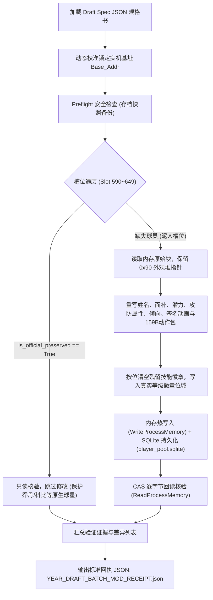

# NBA 2K22 历史选秀名单 REA Native 批量注入标准接口协议 (v1.0)
# (Draft Class REA Native Batch Modification Interface Protocol Specification)

> **协议标识 (Protocol ID)**: `SPEC-DRAFT-CLASS-NATIVE-MOD-V1`  
> **适用版本**: NBA 2K22 (Steam PC x64) | 引擎底层: `NBA2K22.exe`  
> **适用业务**: 任意历史年份选秀名单（1984、1992、1996、2003 等）的全量 60 槽位工业化重构与 Native 批量热注入  
> **对接角色**:  
> - **输入方 (数据提供)**: `role-planner` / `decision_architecture` (选秀数值建模与原型采样模型)  
> - **执行方 (批量注入)**: `role-developer` / `batch_executor` (REA Native / 内存直写执行模型)  

---

## 一、 协议核心设计原则与两大铁律 (Constitutional Principles)

为确保全量 60 名新秀在实机运行内存与底层存档数据库中 100% 稳定生效，且杜绝任何闪退、身材畸形与原生球星损坏，所有年份选秀数据包必须无条件遵循以下原则：

### 1. 原生官方球星绝对保护铁律 (Official Star Preservation)
- 2K 官方已经在该年份选秀名单中内置的真实球星（例如 1984 届的乔丹、奥拉朱旺、斯托克顿；1996 届的科比、艾弗森、纳什、雷·阿伦等），**必须标记为 `OFFICIAL_PRESERVED` 并完全禁止篡改其身份、骨骼与原生签名动作**。
- 禁止按选秀真实顺位强行重排球员槽位！选秀顺位由游戏休赛期选秀大会各队 AI 依据需求自主抽取。

### 2. 泥人体型契合映射与 0x90 外观指针绝不篡改 (Preserve 0x90 Appearance Pointer)
- 缺失球员（如巴克利、雷吉·米勒、拉希德·华莱士等）只能替换官方内置的随机“泥人槽位”；
- 映射时必须依据该泥人槽位原生的**位置（Position）、身高（Height）、体重（Weight）**就近对齐；
- 写入 1,264 字节结构体时，**绝对保留偏移 `0x90` 处的 64 位独立外观数据块指针 (`APPEARANCEDATA`)**，从根源杜绝骨骼拉伸、面部塌陷与游戏崩溃。

### 3. 泥人残留技能等级徽章按位纯净化 (Residual Level Badge Purging)
- 泥人槽位底层往往随机生成大量无意义技能徽章。执行端在写入目标新秀徽章前，必须先将 `0x4BB ~ 0x4E2` 范围内的 80 个技能等级徽章（`kind: LEVEL`，每徽章占 3 位）**全部按位清零**，再写入目标配置，杜绝垃圾数据干扰。

### 4. 双端一致性原子落盘 (Dual-End Atomic Persistence)
- 数据包必须同时提交至：
  1. **实时运行内存 (`NBA2K22.exe` RAM)**：即时在游戏球探页面呈现真实姓名、面补与能力。
  2. **存档数据库 (`player_pool.sqlite`)**：更新 `raw_struct` 二进制块及关系列，确保存档重新加载后永久保留。

---

## 二、 标准数据包 JSON 格式规范 (Machine-Ready JSON Schema)

上游模型需按照以下结构生成单一、纯净、机器可读的 JSON 规格书（命名规范：`<YEAR>_draft_enhancement_spec.json`）：

```json
{
  "protocol_version": "v1.0_draft_native_batch_mod",
  "draft_year": 1996,
  "target_career": "MyLEAGUE0005",
  "total_slots": 60,
  "slot_range": [590, 649],
  "official_preserved_slots": [590, 591, 592, 593, 594, 595],
  "prospects": [
    {
      "slot_id": 591,
      "full_name": "Allen Iverson",
      "first_name": "Allen",
      "last_name": "Iverson",
      "position": 0,
      "position_name": "PG",
      "face_id": 165,
      "face_class": "CLASS_A_OFFICIAL",
      "is_official_preserved": true,
      "note": "官方已内置真实新秀，执行模型跳过结构体重写，仅做只读核验"
    },
    {
      "slot_id": 623,
      "full_name": "Missing Star Name",
      "first_name": "First",
      "last_name": "Last",
      "position": 3,
      "position_name": "PF",
      "face_id": 2001,
      "face_class": "CLASS_B_RETRO_GENERIC",
      "is_official_preserved": false,
      "height_cm": 203,
      "weight_lbs": 240,
      "ovr": 82,
      "potential": 97,
      "potential_raw": 216,
      
      "attributes": {
        "shot_close": 90, "mid_range": 72, "three_point": 45, "free_throw": 75,
        "driving_layup": 86, "standing_dunk": 82, "driving_dunk": 88,
        "post_hook": 78, "post_fadeaway": 80, "post_moves": 86,
        "off_rebound": 94, "def_rebound": 95, "interior_def": 82, "perimeter_def": 74,
        "block": 74, "steal": 76, "lateral_quick": 76, "speed": 82, "speed_with_ball": 78,
        "acceleration": 84, "strength": 96, "vertical": 88, "stamina": 92, "hustle": 95,
        "shot_iq": 82, "pass_perception": 75, "ball_control": 78, "pass_accuracy": 76,
        "pass_iq": 80, "pass_vision": 75, "hands": 88, "draw_foul": 88
      },

      "tendencies": {
        "shot": 85, "driving_layup": 85, "standing_dunk": 80, "driving_dunk": 88,
        "flashy_dunk": 75, "alley_oop": 70, "putback": 92, "crash": 95,
        "shot_under_basket": 90, "shot_close": 88, "shot_mid_range": 68, "shot_three": 20,
        "drive": 86, "attack_strong_on_drive": 92, "dish_to_open_man": 72, "touches": 88,
        "post_up": 84, "roll_vs_pop": 20, "play_discipline": 65, "pass_interception": 75,
        "on_ball_steal": 76, "contest_shot": 84, "block_shot": 72, "foul": 78, "hard_foul": 85
      },

      "badges": {
        "ReboundChaser": 3,
        "Box": 3,
        "BackdownPunisher": 3,
        "FearlessFinisher": 2,
        "AlphaDog": 1,
        "Enforcer": 1,
        "Expressive": 1
      },

      "signature_id": 31882795,
      "prototype_reference": "Zion Williamson (0x01E67E2B)",
      "animation_block_hex": "01000300... (共 159 字节完整动作结构十六进制字符串)",
      "personality_hex": "02612c4c6402880c0610"
    }
  ]
}
```

---

## 三、 球员底层结构体（1,264 字节，步长 `0x4F0`）全量二进制偏移字典

以下为 2K22 原生球员池每个槽位内部的严格物理偏移地址，执行端注入与校验均以此为准：

| 模块名称 | 偏移地址 (十六进制) | 偏移 (十进制) | 字段大小与数据类型 | 编码与换算规则 |
| :--- | :---: | :---: | :---: | :--- |
| **Last Name (姓氏)** | `0x000` | 0 | 40 字节 (UTF-16LE) | 定长 40 字节，`\x00` 填充截断 |
| **First Name (名字)** | `0x028` | 40 | 40 字节 (UTF-16LE) | 定长 40 字节，`\x00` 填充截断 |
| **Cyberface ID (面补)** | `0x06C` | 108 | `uint16` (2 字节小端) | 官方或外挂真实面补 ID |
| **Appearance Pointer (体型)** | `0x090` | 144 | `uint64` (8 字节指针) | **【严禁触碰】保留原槽位堆指针** |
| **Signature ID (专属动画)** | `0x0E8` | 232 | `uint32` (4 字节小端) | 赛场球星被动动画原型包 ID |
| **Potential (潜在能力)** | `0x0EB` | 235 | `uint8` (1 字节) | 人类评分 `[25, 99]` |
| **Position (场上位置)** | `0x0F9` | 249 | 低 3 位 (`& 0x07`) | `0`=PG, `1`=SG, `2`=SF, `3`=PF, `4`=C |
| **Draft Year (选秀年份)** | `0x0FA` | 250 | `uint8` (1 字节) | 实际年份 - 1900（如 1984 存 `84`） |
| **Animation Block (动作包)** | `0x380 ~ 0x41E` | 896 ~ 1054 | **159 字节连续结构** | 真实采样的跳投、上篮、扣篮、运球包 |
| **Attributes Block (攻防属性)** | `0x41F ~ 0x455` | 1055 ~ 1109 | 单字节 (`uint8`) | **换算公式**: $\text{Raw} = \lfloor(\text{Rating}-25)\times 3\rfloor$ |
| **Potential Raw (潜力底层)** | `0x441` | 1089 | `uint8` (1 字节) | 潜力的单字节换算值：$(POT-25)\times 3$ |
| **Tendencies Block (战术倾向)** | `0x458 ~ 0x4BA` | 1112 ~ 1210 | 单字节 (`uint8`) | 直写整数 `0 ~ 100` |
| **Personality Bits (性格位域)** | `0x4BB ~ 0x4C4` | 1211 ~ 1220 | 10 字节位域 | 领头羊、极具表现力、好胜心、硬汉 |
| **Badge Bitfields (技能徽章)** | `0x4C5 ~ 0x4E2` | 1221 ~ 1250 | 30 字节位域 | 每 3 位存放一个徽章等级 (`0`=无, `1`=铜, `2`=银, `3`=金, `4`=紫) |

---

## 四、 29 项核心属性与 29 项核心倾向精确偏移映射表

### 1. 属性偏移对照 (`0x41F ~ 0x455`)
- `driving_layup`: `0x41F` (1055)
- `post_fadeaway`: `0x420` (1056)
- `post_hook`: `0x421` (1057)
- `post_moves`: `0x422` (1058)
- `draw_foul`: `0x423` (1059)
- `shot_close`: `0x424` (1060)
- `mid_range`: `0x425` (1061)
- `three_point`: `0x426` (1062)
- `free_throw`: `0x427` (1063)
- `ball_control`: `0x428` (1064)
- `pass_iq`: `0x429` (1065)
- `pass_accuracy`: `0x42A` (1066)
- `off_rebound`: `0x42B` (1067)
- `def_rebound`: `0x42C` (1068)
- `interior_def`: `0x42D` (1069)
- `perimeter_def`: `0x42E` (1070)
- `lateral_quick`: `0x42F` (1071)
- `pass_perception`: `0x430` (1072)
- `block`: `0x431` (1073)
- `steal`: `0x432` (1074)
- `standing_dunk`: `0x435` (1077)
- `driving_dunk`: `0x436` (1078)
- `speed`: `0x437` (1079)
- `speed_with_ball`: `0x438` (1080)
- `acceleration`: `0x439` (1081)
- `vertical`: `0x43A` (1082)
- `strength`: `0x43B` (1083)
- `stamina`: `0x43C` (1084)
- `hustle`: `0x43D` (1085)
- `shot_iq`: `0x43E` (1086)
- `intangibles`: `0x440` (1088)
- `potential_raw`: `0x441` (1089)
- `pass_vision`: `0x453` (1107)
- `hands`: `0x455` (1109)

### 2. 倾向偏移对照 (`0x458 ~ 0x4BA`)
- `shot`: `0x458` (1112)
- `driving_layup`: `0x459` (1113)
- `standing_dunk`: `0x45A` (1114)
- `driving_dunk`: `0x45B` (1115)
- `flashy_dunk`: `0x45C` (1116)
- `alley_oop`: `0x45D` (1117)
- `putback`: `0x45E` (1118)
- `crash`: `0x45F` (1119)
- `shot_under_basket`: `0x465` (1125)
- `shot_close`: `0x466` (1126)
- `shot_mid_range`: `0x46A` (1130)
- `shot_three`: `0x472` (1138)
- `drive`: `0x483` (1155)
- `attack_strong_on_drive`: `0x497` (1175)
- `dish_to_open_man`: `0x498` (1176)
- `touches`: `0x499` (1177)
- `post_up`: `0x49A` (1178)
- `roll_vs_pop`: `0x49B` (1179)
- `play_discipline`: `0x4A1` (1185)
- `pass_interception`: `0x4B4` (1204)
- `on_ball_steal`: `0x4B6` (1206)
- `contest_shot`: `0x4B7` (1207)
- `block_shot`: `0x4B8` (1208)
- `foul`: `0x4B9` (1209)
- `hard_foul`: `0x4BA` (1210)

---

## 五、 执行模型自动化操作流水线与验收标准 (Definition of Done)

执行模型拿到满足本协议的 JSON 规格书后，执行标准的 4 步无缝流水线：



### 验收交付回执格式 (`<YEAR>_DRAFT_BATCH_MOD_RECEIPT.json`)
执行模型在执行完毕后，自动在 `C:\nba2k22\exports\` 生成包含以下证据字段的闭环回执：
1. `mode`: `"LIVE_INJECTION_COMMITTED"`
2. `total_prospects`: 60
3. `preserved_official_stars`: 包含姓名与槽位
4. `modified_prospects_count`: 缺失球员实际重构数
5. `mismatches_count`: `0`（100% 成功）
6. `cas_verification`: 关键球星回读核验数据块（首发/核心的姓名、面补、年份、属性、徽章）
