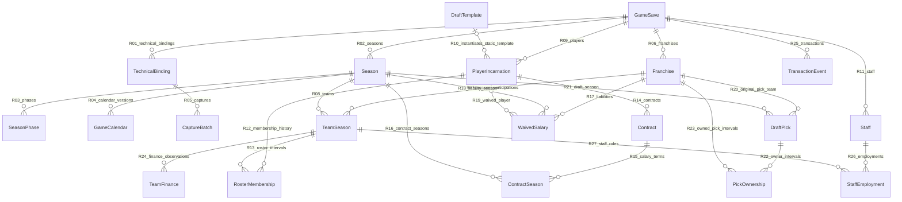
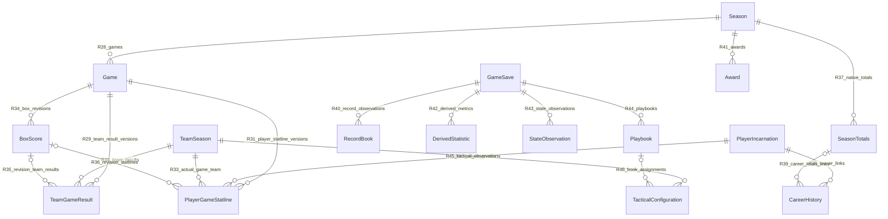
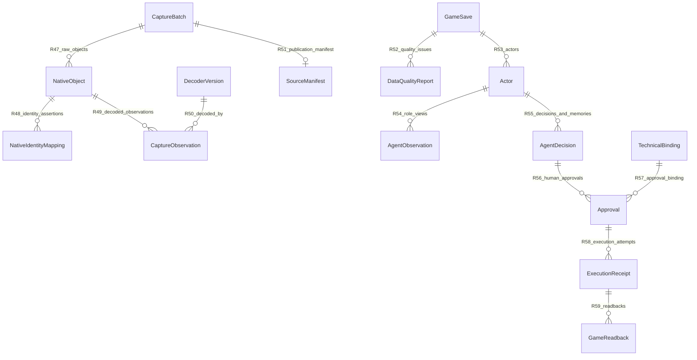

# WORLD-DATA-ARCH-01 世界领域数据模型 V1

状态：CANDIDATE_PENDING_INDEPENDENT_REVIEW。2026-10-22，基准 `407e2134bd2f595477099b2c6e3484c818059fd9`。本轮为概念设计；没有生产 DDL、游戏操作或原生验收。

Human 审核更新（2026-10-22）：本轮明确结论为“这次算审核通过”。详情及后续实际验证结果以 OS run 的 completion_pointer.json / human_review.md 为准；独立模型审核尚未进行，候选未合入 master。

## 设计起点与规范分工

以独立存档的连续篮球世界为建模边界。游戏产生比赛与自然成长，外挂记录事实和有证据的历史，再为角色提供权限受限的视图。[身份与时间 ADR](WORLD_DATA_IDENTITY_AND_TIME_ADR_V1.md)定义身份、跨赛季和技术重置；[质量契约](WORLD_DATA_SOURCE_AND_QUALITY_CONTRACT_V1.md)定义证据与订正；[实体字典](WORLD_DATA_ENTITY_CATALOG_V1.json)是本模型对象名、属性与关系基数的机器表达；[旧系统交接](WORLD_DATA_LEGACY_IMPACT_AND_SCHEMA_HANDOFF_V1.md)给出工程映射。

实体采用业务身份、关系及生命周期划分。44 个概念对象不等于 44 张物理表。StateObservation 统一动态状态的观察信封，字段仍按能力/倾向/徽章/伤病/疲劳/士气/训练/教练设置的类型字典严格校验，不采用任意 JSON 就视为有效的宽松语义。BoxScore、GameCalendar 和部分 CareerHistory 可以是受约束聚合或视图。Salary 属于 ContractSeason；Coach 属于 Staff 岗位；Player 就是 PlayerIncarnation，不另造跨存档人物主表。

稳定的角色记忆为同一世界下的 AI 记录；本模型仅定义其归属、输入来源和访问边界，不设计人格、谈判或自动调度算法。静态 DraftTemplate 和 DecoderVersion 可复用，其任何消费者仍须经过世界和角色权限检查。

## A. Save and time

| 实体 | 定义与选择理由 | 业务键 | 生命周期 |
|---|---|---|---|
| GameSave | 一个独立 NBA2K22 游戏存档所代表的连续篮球世界；不是存档文件路径或备份文件。 | `world_id` | registered -> active -> retired; retirement retains history |
| TechnicalBinding | 世界与一次 DEV14 物理工作区实例/技术代际的绑定；是安全边界而非世界分支。 | `binding_id` | prepared -> active -> sealed/blocked; append new binding on reset |
| Season | 一个世界内的赛季周期；年份标签仅为属性。 | `season_uid` | scheduled -> active -> completed -> archived |
| SeasonPhase | 赛季中有来源的阶段及有效区间。 | `phase_uid` | observed intervals; corrections versioned |
| GameCalendar | 某赛季已观察到的赛程视图及版本，不将缺少日期的比赛补造为日历事件。 | `calendar_uid` | versioned season calendar projection; not event creator |
| CaptureBatch | 一次被明确绑定到存档和技术代际的采集执行及其完整性边界。 | `batch_id` | staged -> validated -> published or rejected; immutable publication manifest |

## B. Identity

| 实体 | 定义与选择理由 | 业务键 | 生命周期 |
|---|---|---|---|
| Franchise | 世界内长期球队组织身份，可跨赛季更名或迁址；原生槽位不等于此身份。 | `team_uid` | registered through rename/relocation; retired identity retained |
| TeamSeason | 长期球队在一个赛季/竞赛中的参与身份与状态容器。 | `team_season_uid` | one franchise participation per season and competition; observed state versions |
| PlayerIncarnation | 某个存档内实际存在的一名球员及其连续生涯；球员姓名和历史模板都不是身份。 | `player_uid` | registered -> active -> retired; stable across season and trade |
| DraftTemplate | 可跨存档复用的版本化静态选秀素材；不含游戏实例的历史、记忆或成长。 | `template_id` | versioned reusable static resource; no world facts/memories |
| Staff | 世界内工作人员身份；Coach 是岗位，换队不自动产生新人。 | `staff_uid` | registered -> employed/unemployed -> retired |

## C. Operations and assets

| 实体 | 定义与选择理由 | 业务键 | 生命周期 |
|---|---|---|---|
| RosterMembership | 球员在球队赛季中某种名单角色的有时效归属；合同球队可能与出场球队不同。 | `membership_uid` | effective intervals; end on trade/waive, never rewrite prior membership |
| Contract | 球员与组织之间的一份有来源的合同及修订历史。 | `contract_uid` | observed -> active -> amended/terminated/expired; amendments retain versions |
| ContractSeason | 合同在具体游戏赛季的薪资义务、保障及选项观察。 | `contract_season_uid` | per-contract season obligations and versioned observations |
| WaivedSalary | 球队在某赛季的裁员残留薪资义务，不等同球员现行合同。 | `obligation_uid` | observed liability -> settled/expired; prior balances retained |
| DraftPick | 以本世界未来选秀赛季、轮次和原始球队定义语义的资产；归属变化不改变资产身份。 | `pick_uid` | created -> transferred -> exercised/expired; stable asset |
| PickOwnership | 选秀权的有时效归属与附带条件；不臆造保护或互换权。 | `ownership_uid` | effective owner intervals; condition versions retained |
| TeamFinance | 球队赛季财务在指定时点的观察；原生金额和公式估算分字段标记。 | `finance_observation_uid` | append observations, retain source version and effective time |
| TransactionEvent | 已发生的交易、签约或选秀事件的有证据断言；提案不能成为此事件。 | `transaction_uid` | candidate observation -> identity/source resolved -> recorded; corrections versioned |
| StaffEmployment | 工作人员在球队赛季中担任岗位的有效区间及条款。 | `employment_uid` | effective team-role interval with observed terms |

## D. Games and statistics

| 实体 | 定义与选择理由 | 业务键 | 生命周期 |
|---|---|---|---|
| Game | 世界内赛季与竞赛中的一次比赛身份；赛程、进行中和终局是状态而非三个事件。 | `game_uid` | scheduled -> in_progress -> final; cancel/postpone/unknown retained as versioned observations |
| TeamGameResult | 某队在某场比赛的一份结果版本，包括主客方、比分和结果状态。 | `result_uid` | one per game/team/result revision; only resolved final games yield wins |
| PlayerGameStatline | 球员为比赛当时球队出场的统计断言，保留未出场和未观察的差别。 | `statline_uid` | game/player/team observation versions; never follow player's current team |
| BoxScore | 同一比赛修订版本下的双方结果和球员统计聚合，完整性必须显式声明。 | `box_revision_uid` | immutable game revision aggregate; may be partial |
| SeasonTotals | 原生赛季累计观察；包括主体、赛季、竞赛、球队口径和截至时间。 | `totals_observation_uid` | append native cumulative observations per subject/season/competition/stint |
| CareerHistory | 球员与已有原生历史赛季记录的有证据关联；不是全部职业生涯完整性的承诺。 | `career_link_uid` | links native history observations to resolved player/season; retains missing history |
| RecordBook | 原生纪录簿的一条观察，区分内置真实 NBA 历史与该存档产生的纪录。 | `record_observation_uid` | versioned native record observations; world history distinguished from built-in real history |
| Award | 指定世界赛季中的有证据奖项事件及获奖主体。 | `award_uid` | observed season award event; correction retains prior winner assertion |
| DerivedStatistic | 在明确输入集合和公式版本上计算的结果，保留覆盖率及敏感性继承。 | `derivation_uid` | immutable formula execution on explicit source set; recompute new version |

## E. Dynamic state

| 实体 | 定义与选择理由 | 业务键 | 生命周期 |
|---|---|---|---|
| StateObservation | 某主体在某时点的能力、倾向、徽章、健康、训练或教练配置等类型化观察。 | `state_observation_uid` | append typed observations; valid interval only where evidenced |
| Playbook | 世界内已观察到的原生战术本内容版本；不以篮球研究知识替代原生指令。 | `playbook_observation_uid` | versioned observed native book content; assignment distinct from static tactics research |
| TacticalConfiguration | 球队赛季及可选对手范围内的战术配置观察；配置不证明比赛效果。 | `tactics_observation_uid` | team/opponent scoped observation versions; effect unknown without evidence |

## F. Native evidence

| 实体 | 定义与选择理由 | 业务键 | 生命周期 |
|---|---|---|---|
| NativeObject | 一次采集内的有界原生对象字节或安全摘要，具有布局版本和批次局部定位。 | `native_observation_uid` | immutable bounded capture-local bytes/summary; restricted raw access |
| NativeIdentityMapping | 在明确原生命名空间和有效范围内，将原生标识映射到业务对象的证据断言。 | `mapping_uid` | candidate -> verified/ambiguous/rejected/expired; scope and evidence retained |
| CaptureObservation | 使用指定 Decoder 对某原生对象生成的一次字段断言；身份未解时不进入事实层。 | `observation_uid` | immutable decoded assertion; corrected by another assertion |
| DecoderVersion | 版本化解码代码、布局与字段语义说明；可共享的静态程序资源。 | `decoder_id` | immutable code/layout hash release; version not auto-acceptance |
| SourceManifest | 封存批次的来源、产物哈希、覆盖度、脱敏与发布一致性证明清单。 | `manifest_uid` | sealed per publication cohort; cross-file hashes and masking evidence |
| DataQualityReport | 对来源、身份、关系、统计或权限问题的可追溯质量记录。 | `quality_uid` | append issues/findings and scoped disposition; original mismatch retained |

## G. Actors and approved action

| 实体 | 定义与选择理由 | 业务键 | 生命周期 |
|---|---|---|---|
| Actor | 世界内 GM、Coach 或 Player 的角色及主体绑定，不规定人格算法。 | `actor_uid` | role binding within one save; memory retained in that save only |
| AgentObservation | 按角色、世界、时间和策略裁剪后的事实视图快照。 | `agent_observation_uid` | immutable role-safe view snapshot; explicit as-of and source set |
| AgentDecision | 角色基于其观察作出的分析、意愿、提案或记忆；始终为 AI 来源。 | `decision_uid` | draft -> proposed -> accepted/rejected/withdrawn; all AI provenance |
| Approval | 真人对明确意向、批次、技术绑定和摘要的具体批准。 | `approval_uid` | explicit Human grant -> used/revoked/expired; stale binding rejected |
| ExecutionReceipt | 一次获批执行尝试及其前像、状态、故障与恢复凭据。 | `execution_uid` | prepared -> applying -> complete/partial/unrecovered; durable preimages |
| GameReadback | 对执行后实际游戏状态的观察；内存回读和 Save/Reload 证明独立记录。 | `readback_uid` | one or more post-attempt observations; persistence separate |

## 关系基数与聚合约束

字典的 `from_cardinality` 指每个 to 对象可关联的 from 数量，`to_cardinality` 指每个 from 可关联的 to 数量。全部业务关系要求两端 world_id 相同。只有 DraftTemplate→PlayerIncarnation、DecoderVersion→CaptureObservation 是共享静态资源引用；它们不传递动态事实或记忆。

### ER 1

### ER 2

### ER 3

Mermaid 的 crow-foot 不表达上限 2，R35 在图中显示零到多，字典精确值为 **0..2**。已认证 FINAL 的完整 Box 修订必须恰有两个不同球队结果（home、away 各一）；部分 Box 可为 0、1、2。跨修订结果可以多条，但一个结果只属于零或一个 Box 修订；未组装观察允许暂时无 Box。每个 PlayerGameStatline 在同一修订中以 game/player/实际 team 去重；不按玩家当前球队回填旧比赛。

以下是图以外的必要不变量：
- TeamSeason 在同 world、season、competition、team 组合唯一；Franchise 改名不改 team_uid，无法验证迁址/扩张关联时保留未解映射。
- RosterMembership 的 valid 区间为左闭右开。对同 player、竞赛、assignment_kind 的排他 active 名单区间不得重叠；合同归属、双向或发展联盟 assignment 采用显式不同 kind，不假设所有归属互斥。边界不明则保留观察区间，不制造精确交易时点。
- 一名球员可以有多份历史合同和多段球队归属；ContractSeason 的合同、赛季、条款版本形成确定口径。合同薪资、WaivedSalary 与 TeamFinance 不互相覆盖。
- DraftPick 的资产身份与 PickOwnership 分离；原始球队和选秀赛季不能因转手变化。复杂保护/互换未解不补简单所有权结论。
- TransactionEvent 的参与者为有类型、同 world 的 1..* 业务引用；转会必须明确具体球员/球队/资产及来源。AgentDecision 或 APPROVED 状态不能替代已发生事件证明。
- SeasonTotals.subject 为 PlayerIncarnation 或 TeamSeason 恰一；Actor.subject 为 PlayerIncarnation、Staff 或 Franchise 恰一。Award.recipient 同理按获奖类别绑定；类型与岗位不匹配时拒绝。
- CaptureObservation 和 NativeIdentityMapping 的目标允许未解（0..1），但已发表的规范事实不得带无法解析的必需引用。每个已解析目标同 world；完整类型列表见字典 polymorphic_relations。
- 每个规范事实必须链接非空来源集合。原生事实沿 CaptureObservation→NativeObject→CaptureBatch→TechnicalBinding 回溯，DecoderVersion 固定代码和布局。执行事件可链接 ExecutionReceipt 和独立 GameReadback；AI 只能引用安全 AgentObservation。
- SourceManifest 对一个批次为 0..1，发布前必须有 1；新发布不是复写旧 manifest。查询固定发布批次和断言版本。数据质量问题可对一组同 world 对象/来源形成报告。
- Actor、其观察、决定/记忆、Approval、Receipt 和 Readback 同 world 且技术绑定可验证。离开岗位不抹掉历史决定，角色数据访问随岗位/时间收回。

## 生命周期与能力的区别

Game scheduled/in_progress/final 表达篮球对象状态；CaptureBatch staged/validated/published 表达资料处理状态；NativeIdentityMapping verified 表达特定映射证据；OS run 的生命周期另由 OS enum 管理。任何一个都不是整个项目 DONE。球员退役和球队停用不删除历史外键，技术 reset 不产生世界分支。

逻辑键和引用应可被关系数据库强制约束；物理实现可采用同世界复合键或等价的隔离数据库约束。不能只依赖 UI 筛选 world_id。SQLite 外键及 NULL 处理等能力须在 SCHEMA-01 实测，当前仅采用其关系完整性原则。[SQLite 官方外键文档](https://www.sqlite.org/foreignkeys.html)

## 可验收的纵向切片

一个已绑定存档中的 Season→Game→两队 TeamGameResult→PlayerGameStatline→SeasonTotals 对账，连通原始来源和角色视图。它覆盖实体、双时间、去重、订正和权限，不要求先建所有表。未采到的 CareerHistory、Awards、伤病等返回明确缺失状态，不能为了覆盖界面而伪造数据。

六个具体反例与验收结果规范见 ADR 第 6 节；实际离线检查保存在本任务 OS run。此模型的结构与反例自检通过也只形成待独立审核候选。
