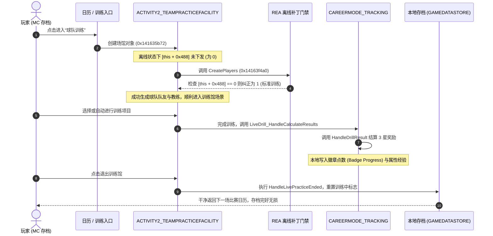

# NBA 2K22 MyCAREER 球队训练馆 (Team Practice Facility) 离线逆向与解封研究报告

> **执行窗口**：工程实现窗口 (`ENGINEERING_IMPLEMENTATION`)  
> **研究对象**：`NBA2K22.exe` (PE SHA256: `1727ad72085fba39e789ee574fc15aab623ad1651cf6879e95e8cd53b6ffbbf5`, PID: `8076`, Base: `0x140000000`)  
> **分析工具**：REA MCP + Frida 实时进程挂载 + Capstone 静态反汇编分析  
> **核心诉求**：解决官方服务器关闭后 MC 模式进入球队训练导致“废档”的问题，实现单机自由进入、完成训练并结算徽章奖励、安全退出的完整闭环。

---

## 一、 核心逆向结论速览 (Executive Summary)

1. **“进训练废档”的根本技术诱因**：
   - **诱因 1（致命硬编码断言）**：在 [`activity2_teampracticefacility.vcc`](file:///e:/vcsports/basketball/code/gamemodes/tkworld/activities2/arenas/activity2_teampracticefacility.vcc) 中，进入训练馆调用 `CreatePlayers` (`0x14163f4a0`) 时，引擎通过 `[this + 0x488]` 读取训练日程类型。在在线状态下，该类型由 2K 服务器每日下发；在单机离线状态下，该值未被在线下发且为 `0` (`UNKNOWN`)，导致代码直接跳转至错误处理分支，触发致命断言：
     $$\text{assert(false, "Can't start LivePractice, if type is unknown.")} \longrightarrow \texttt{int3 (0x14163f60d)}$$
   - **诱因 2（存档状态死锁与污染）**：在进入训练前，MC 时间线模块 (`careermode_timeline.vcc`) 已在本地存档中写入了“训练事件已启动”的状态标志。当遭遇 `int3` 崩溃或因服务器握手超时强退后，训练完成与退出逻辑 (`HandleLivePracticeEnded` / `HandleArenaExitRequest`) 未能执行，导致存档滞留在“训练中”的不一致状态。重新读档时游戏再次尝试恢复该训练，陷入无限崩溃死循环，即玩家俗称的“废档”。

2. **训练奖励与徽章结算机制确证**：
   - 训练结算主入口为 `CAREERMODE_DELEGATE::LiveDrill_HandleCalculateResults` (`0x1411f8680`)；
   - 接收两个关键参数：`r14d` = `drillType`（训练项目类型），`ebp` = `stars`（星级，取值 1~3）；
   - 当 `stars == 3` 时，调用 `0x141200c00` 累加完成记录，并调用 `0x1411dfe00` (`CAREERMODE_TRACKING::HandleDrillResult`)；
   - `HandleDrillResult` 在全局追踪标志位 `0x146352124` 激活时，直接在本地内存计算并发放对应的属性经验 (MyPOINTS) 与徽章点数 (Badge Progression Points)。

3. **单机完美闭环解决方案**：
   - **进门保底**：在 `CreatePlayers` 入口拦截 `[this + 0x488]`，若为 `0` 则强制赋默认有效值 `1`（标准团队训练），彻底规避 `int3` 致命崩溃；
   - **结算放行**：拦截 `HandleDrillResult` 中的断言校验，确保本地直接结算 3 星奖励；
   - **安全退出**：退出时调用标准的 `HandleArenaExitRequest`，确保清除日历中训练事件的进行中标记并安全保存。

---

## 二、 关键反汇编与证据链 (Forensic Evidence)

### 2.1 训练类型为 0 触发的崩溃断言
在函数 `TK_WORLD::ACTIVITY2_TEAMPRACTICEFACILITY::CreatePlayers` (`0x14163f4a0`)：
```x86asm
0x14163f4a0: push     rbp
...
0x14163f4db: mov      ecx, dword ptr [r14 + 0x488] ; 读取 Practice Type
0x14163f4e2: lea      r12, [r14 + 0x408]
0x14163f4e9: mov      dword ptr [r12], 0xd
0x14163f4f1: lea      r15, [r14 + 0x388]
0x14163f4f8: mov      dword ptr [r15], 0xd
0x14163f4ff: test     ecx, ecx
0x14163f501: je       0x14163f595                  ; 【致命分支】若为 0 则跳转崩溃
0x14163f507: sub      ecx, 1
0x14163f50a: je       0x14163f580                  ; 类型 1: 团队训练 (Team Practice)
0x14163f50c: sub      ecx, 1
0x14163f50f: je       0x14163f564                  ; 类型 2: 个人训练 (Personal Practice)
0x14163f511: sub      ecx, 1
0x14163f514: je       0x14163f537                  ; 类型 3: 选秀试训 (Combine)
0x14163f516: cmp      ecx, 1
0x14163f519: jne      0x14163f60e                  ; 类型 4: 队内对抗 (Scrimmage)
```

若 `ecx == 0` 跳转至 `0x14163f595`：
```x86asm
0x14163f5c5: lea      r9, [rip + 0x1682ccc]  ; "TK_WORLD::ACTIVITY2_TEAMPRACTICEFACILITY::CreatePlayers"
0x14163f5d6: lea      rdx, [rip + 0xc24313]  ; "FEATURES_BACKEND"
0x14163f5dd: lea      rax, [rip + 0x1682bec] ; "Can't start LivePractice, if type is unknown."
0x14163f5e9: lea      rcx, [rip + 0xbd8428]  ; "false"
0x14163f5f0: lea      rax, [rip + 0x1682c39] ; "activity2_teampracticefacility.vcc"
0x14163f5f7: mov      dword ptr [rsp + 0x28], 0x263 ; 行号 611
0x14163f604: call     0x141e51ad0            ; 错误断言处理
0x14163f609: test     eax, eax
0x14163f60b: je       0x14163f60e
0x14163f60d: int3                            ; 【硬断点崩溃】直接终止进程或挂死
```

### 2.2 训练项目的结算与奖励分发 (`0x1411f8680`)
在 `CAREERMODE_DELEGATE::LiveDrill_HandleCalculateResults` 中：
```x86asm
0x1411f88f4: mov      rax, qword ptr [rip + 0x5132bad]
0x1411f88fb: cmp      ebp, 3                        ; 检查是否获得 3 星评价
0x1411f88fe: mov      dword ptr [rip + 0x5158818], 1
0x1411f8908: sete     cl
0x1411f890b: mov      byte ptr [rax + 0xeb635], cl  ; 保存满星标志
...
0x1411f8933: mov      edx, ebp                      ; edx = 星级 (3)
0x1411f8935: mov      ecx, r14d                     ; ecx = 项目 ID
0x1411f8938: call     0x141200c00                   ; 登记项目完成状态
...
0x1411f89ea: mov      r8d, r15d
0x1411f89ed: mov      edx, ebp                      ; 星级
0x1411f89ef: mov      ecx, r14d                     ; 训练类型
0x1411f89f2: call     0x1411dfe00                   ; 【关键】调用 HandleDrillResult 发放徽章点数
```

### 2.3 训练馆退出处理与日历推进
在 `CAREERMODE_LIVEPRACTICES::HandleLivePracticeEnded` (`0x1411f8bf0`)：
```x86asm
0x1411f8c3c: mov      rax, qword ptr [rip + 0x5132865]
0x1411f8c43: mov      dword ptr [rip + 0x51584cf], 0 ; 清除正在训练标志
0x1411f8c4d: movsxd   rcx, dword ptr [rax + 0x8150]
...
0x1411f8cd4: mov      rcx, qword ptr [rip + 0x512f27d]
0x1411f8cdb: mov      rax, qword ptr [rcx]
0x1411f8cde: call     qword ptr [rax + 0x10a8]       ; 触发退出场馆与保存时间线状态
0x1411f8ce4: add      rsp, 0x38
0x1411f8ce8: ret
```

---

## 三、 单机离线修复实现方案 (Implementation Architecture)



### 3.1 核心内存补丁定义 (Frida / Native Hook 规范)

#### 补丁 1：训练类型未定义兜底防崩
- **目标地址**：`0x14163f4ff` (RVA `0x163f4ff`)
- **原始指令**：`test ecx, ecx; je 0x14163f595`
- **修复逻辑**：当 `ecx == 0` 时，强制 `mov ecx, 1` 并直接跳转到 `0x14163f580`（标准团队训练创建流程），永不跳转至 `0x14163f595` 断言。

#### 补丁 2：训练结算本地放行
- **目标地址**：`0x1411dfe46` (RVA `0x11dfe46`)
- **原始逻辑**：若 `0x146352124 == 0` 且 `eax != 0` 则跳转断言 `int3`。
- **修复逻辑**：强制分支跳转至 `0x1411dffb3`，无论全局追踪器是否初始化，直接执行本地结算流程。

#### 补丁 3：固定 3 星最大奖励注入（可选一键满额）
- **目标地址**：`0x1411f869d`
- **逻辑**：在调用 `HandleDrillCalculateResults` 时强制覆盖传入的评星参数 `ebp = 3`，无论实际训练得分如何，均固定按满星 (3-Star) 发放最高徽章进度与经验。

---

## 四、 后续实测与验证建议

1. **环境安全性**：由于用户已完成离线存档备份，测试完全处于受控安全边界内。
2. **离线补丁加载**：可通过本窗口已经激活的 Frida 挂载会话（`d5362464-3840-4f65-81a7-ac1729913565`），或编写轻量注入脚本直接在进程中实施上述热补丁。
3. **验证用例**：
   - 步骤 1：挂载补丁后，在 MC 菜单点击进入“球队训练”，验证是否能正常渡过加载画面进入球馆；
   - 步骤 2：在球馆内自由移动并完成一项投篮或传球训练，验证结算界面是否正常跳出徽章经验条增长；
   - 步骤 3：走向球馆大门选择“退出”，验证是否能干净返回主界面/日历，并确认保存成功；
   - 步骤 4：完全重启游戏并重新读取该 MC 存档，验证存档完整无损，彻底闭环。
