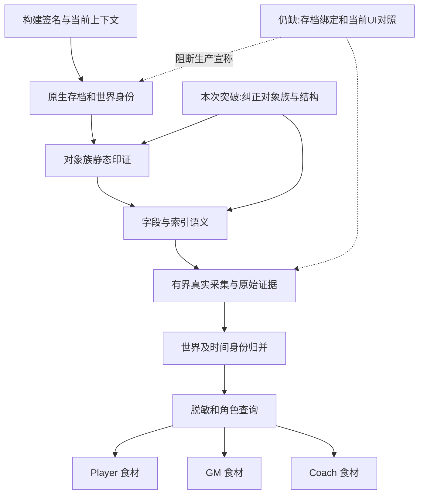

# NATIVE-ATLAS-CODEX-TRIAGE-01 — Issue #1 交付入口

2026-10-23。性质：独立于 Gemini R00-WIDE-01 交付的 **Codex 静态证据裁决与结构攻坚**；本交付自身的最终独立审核仍待另一会话。不是新实机采集、生产 Decoder、食材全量验收或 master 集成。

## 结论与直接成果

| 对象 | 原交付解释 | 本次原始证据支持的结论 | 精确证据入口 |
|---|---|---|---|
| Slot39 | PLAYER_CAREER_LOGS，开头 player_id/season_year | `ROSTERDATA::GetRecordDataByIndex`；52B 纪录簿记录，历史 500 条 fixture 支持两段姓名及 float。不能作为逐年生涯统计 | REVERSE_ENGINEERING.md §1；static_evidence.json；adjudication_75.json |
| Slot35 | 4020B 球队财务总账 | `GetCustomUniformDataByIndex`；消费者测试 `+0x4C & 0x400`。财务解释被反证 | §2，Getter 0xF3C6A0，消费者 0x920E40 |
| Slot22 | 360B 48分钟轮换时间线 | `GetPlaybookDataByIndex`；68 个 uint32 位于 +0x58..+0x167；原生 68 路 switch 逐项验证，lookup 为 +0x54 低7位 | §3，Getter 0xF3ED60，accessor 0xF1D740 |
| Slot42 | 32B 带保护选秀权完整语义 | `GetDraftDataByIndex`；真实队伍指针、分组/轮次/序号位域和 linked-pick 身份路径。保护、交换、当前存档及完整年份语义未获新实机认证 | §4，0x92A3A0、0x929C62、0x947330 |
| Slot9 | arena/court/uniform，stride60.01 | `GetCollegeDataByIndex`；机器码 stride60，583条=34980B。非整数来自继承 fixture，不是原生步长 | §5，0xF3C4F0 / 0xF3C525 |
| Slot61 | 死钱 | `GetDeadCapDataByIndex`；136B 步长获静态复核。金额/年度/UI/Stretch 位域仍须分项证据 | §6 |
| Slot1/24 | 全字段已认证核心/赛季数据 | 静态验证 1264B PLAYER 寻址与48B PlayerStat Getter；不能扩大到全部字段、当前 Save 或食材生产可用 | §6 |

本地磁盘 PE SHA256：`1727ad72085fba39e789ee574fc15aab623ad1651cf6879e95e8cd53b6ffbbf5`。只读取磁盘文件，没有打开/读取游戏进程，没有运行任何历史 live reader。PE 与历史游戏进程缺少绑定，因此本次静态结果为 **该哈希构建的证据**，不倒推 R00-WIDE-01 当时 exe/save 身份。

在 `0xF3A000..0xF45000` 的有界 Getter 区域，发现 64 个槽位具有唯一槽位关联的原生函数名，72 个命名 Getter 路径。另验证 Slot1 PLAYER 寻址。这是 **64 个对象族名称的静态印证**，不是64种已完整解码、采集或供角色使用的能力。`adjudication_75.json` 对全部75槽位逐项保存标签、固定出处、解释来源、置信与未证边界；35项具体解释被反证或因缺少支撑而拒绝，未逐项列出的其他业务关系仍保留为假说。

## 输入和证据链

- 当前正式 base：`407e2134bd2f595477099b2c6e3484c818059fd9`；不把未合并研究分支当主线。
- Issue #1 全文快照：领域 run 的 `issue_snapshot.json`。
- R00-WIDE-01 最终输入：`b779ad8d677b0f7bb53fdb99e9f8acf12d3d7482`。
- 首 Managed 候选：`7139d7662b50d85be27d1b60ef822abaf45d979f`。与最终 HEAD 的差异仅涉及来源任务 run/completion pointer；不是本次验证候选。
- LIVE01：`7d84614710d9855d3ffd683da1cdb6fc896ebcf1`；其前置 R00-01 固定为 `1d980be8f32642e8c177a6ad8e9b429beaa48647`，由源 task packet 保留。
- AG01B/C/D 研究、旧 Decoder、纪录簿500条原始 fixture、历史目录与 `GAME_NATIVE_OBJECT_HINTS_V0.json`：从固定研究树按文件保留，45个来源的路径/commit/Git blob/SHA256见 `source_manifest.json`。历史来源仅供复核，旧脚本从不被执行。
- `sources/**` 为逐字节历史证据镜像，含来源自带的尾空格；局部attributes禁止换行转换并排除镜像的空白修复，避免改写证据。新编写的代码/报告仍受diff whitespace检查，全部镜像另由原始SHA256验证。
- 当前会话按 Human 指定 Core `446ca66ad48831f5fcdb1af18f37d07619e048c4` 的选择性证据反馈及范围内方法自由工作；不修改领域内 core-owned 副本。

## 新鲜度、权限和旧验证的裁决

75/75 count/pData **数值**与 AG01C 历史目录完全相同（NULL 与0x0归一后）。这与同一活动会话再观测或沿用观察都相容，既不能用新时间戳证明新构建/新存档，也不能据此判定伪造。新 Atlas 没有 exe hash、原生 save ID/world binding。描述符标签的含义为“固定来源报告与历史 fixture 可追溯”，不是本次新 live 观察。

源脚本显式日志共135条：根8B、目录1200B，以及67次4B头探针、66次1B尾探针；对象缓冲区样本合计334B，总显式字节1542B。源任务 execution_basis 主要批准75描述符 metadata；对象缓冲区不因“只读”或日志 PASS 自动获追认。没有完整底层调用追踪，故本次不作每一次实际 RPM 或最终违规归责判决。新一轮必须先列出并批准完整读取封套，再执行。

旧 `verify_r00_wide.py` 的 ATLAS/MATRIX/PACKET/AUDIT/SCOPE 检查依据 JSON、固定字段与文件、日志断言；源回执和 Managed Run/Inspect 声明至多证明这些检查被报告运行通过。它们不证明对象名称、字段、当前存档或底层读取完整性。本次不重跑旧 live verifier冒充新语义验收。

## Player / GM / Coach 缺口及下一轮

机器矩阵：`ingredient_gaps.json`；可直接交给 Gemini 的研究步骤、证据、正负对照、授权建议及停止标准：`GEMINI_NEXT_ROUND.md` 与 `next_round_plan.json`。顺序是绑定 → Player 真实生涯/投篮 → Draft 关系 → Coach Playbook → DeadCap/TPE → RecordBook 尾部。Slot35 财务攻坚停止，定性为 CustomUniform 后降级；不在错误对象里继续找税额。

对象存在、字段解码、当前身份、采集器执行、发布、角色查询、UI效果、Save/Reload 是独立轴。Atlas里未出现的字段不能被永久归为 NON_EXISTENT；SEASON 和对象关联也不被75槽位目录穷尽。

## 验证和复现

`test_adjudication.py` 用历史原始 fixture 和反例验证39/22/9及32B Draft结构；`verify_delivery.py STATIC_EVIDENCE_REPLAY` 从显式环境变量 `NBA2K22_TRIAGE_STATIC_IMAGE` 指定的磁盘 PE **重新提取**函数机器码、RIP字符串和68个分派目标，与持久结果逐项比较。不会只检查手写结论。

三个 OS 必需检查：`ADJUDICATION_AND_REGRESSIONS`、`STATIC_EVIDENCE_REPLAY`、`DELIVERY_AND_SCOPE`。真实命令、原始日志、精确候选与 run/inspect 证据由领域 run / `verification_receipt.json` 记录。候选工程验证与本交付最终独立审核分别判定；后者未在本会话冒领。

领域 run：`01_os/07_content/_runs/run-20261023-native-atlas-codex-triage-01/`。工作分支：`task/native-atlas-codex-triage-01`。精确代码候选、验证和最终发布 SHA 通过完成指针及远端读回衔接；不要求文件包含自身提交哈希。
