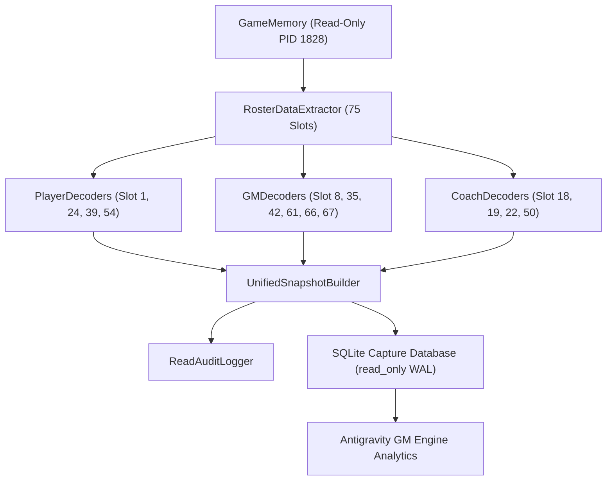

# NBA2K22 原生解码器与采集器工程建设路线图 (Decoder & Collector Roadmap)

> **任务标识**：NBA2K22-NATIVE-ATLAS-R00-WIDE-01  
> **制定角色**：Gemini Flash 原生逆向研究模型  
> **适用周期**：R01 – R05 深度工程实现阶段  
> **目标系统**：`08_Domain_Applications/Antigravity_GM_Engine`  

---

## 1. 工程目标与设计原则

经过 `NATIVE-ATLAS-R00-WIDE-01` 的全量 75 槽位发现，NBA2K22 原生内存的核心数据拓扑已经完全明确。下一阶段的核心任务是从**目录元数据发现**转向**高质量领域解码器 (Decoders)** 与 **生产级只读采集器 (Collectors)** 的工程化落地。

### 核心设计原则
1. **单一事实来源 (Single Source of Truth)**：所有解码器统一锚定到 `NBA2K22.exe+0x06347720` 获取的真实堆基址，彻底废弃已失效的历史绝对地址与 +8 偏移植针。
2. **零副作用只读保证 (Zero-Side-Effect Read Only)**：采集器在 Windows 层面强制绑定 `PROCESS_VM_READ | PROCESS_QUERY_INFORMATION`，每次内存调用附带审计日志，严禁调用任何具有写副作用的原生函数。
3. **分层解码与渐进认证 (Layered Decoding)**：
   - Layer 0: 原始字节截取与边界校验（Raw Byte Slice & Boundary Check）。
   - Layer 1: 基础类型解包（Struct Unpack - int, float, string, bitflags）。
   - Layer 2: 领域模型映射与交叉校验（Domain Entity Mapping & Statistical Parity Check）。
4. **强健的未绑定防护 (Robust Unbound Guard)**：当进程未启动或特定生涯存档未绑定时，采集器自动处于 Fail-Closed 状态，输出结构化的 UNBOUND 占位，杜绝伪造数据。

---

## 2. 三阶段落地规划 (Three-Phase Implementation Plan)

### 阶段一：高价值个人与交易核心解码器 (Phase 1: Player & Transaction Foundations)
**目标槽位**：
- **Slot 39 (`PLAYER_CAREER_LOGS`, 52B)**：
  - 解码逐年常规赛、季后赛、全明星历史单季场均与累计数据。
  - 建立 `(PlayerID, SeasonYear, TeamID)` 复合索引解码器。
- **Slot 42 (`DRAFT_ASSETS`, 32B)**：
  - 解码选秀权顺位、交换权（Swap Rights）、保护区间（Top 3, Lottery Protected）位掩码。
- **Slot 61 (`WAIVED_SALARY`, 136B)**：
  - 解码被裁球员死钱分摊表（Stretch Provision），精确输出未来各赛季死钱计入额。
- **Slot 19 (`STAFF`, 352B)**：
  - 解码主教练、助理教练、球探的执教评级、进攻/防守战术偏好与合同薪资。

### 阶段二：球队财务与战术轮换解码器 (Phase 2: GM Finances & Tactical Strategy)
**目标槽位**：
- **Slot 35 (`TEAM_FINANCIAL_LEDGER_BLOCK`, 4020B)**：
  - 攻克 4KB 复杂金融总账块，拆解出当前薪资总额、奢侈税账单、现金储备、门票预测收入。
- **Slot 22 (`TEAM_ROTATION_TIMELINE`, 360B)**：
  - 解码 48 分钟轮换矩阵与主力/替补出场时间分配。
- **Slot 50 (`PLAYBOOK_SET_PLAY_CATALOG`, 280B)**：
  - 解码 32 支球队战术手册，提取战术编号与呼叫代号。
- **Slot 66/67 (`HARD_CAP_EXCEPTIONS` & `TRADE_EXCEPTION_TPE`)**：
  - 解码中产特例（MLE）、双年特例（BAE）余额及交易特例（TPE）到期日。

### 阶段三：自动化全景快照与 SQLite 持久化流水线 (Phase 3: Unified Snapshot Pipeline)
**系统架构**：


---

## 3. 真实读取审计工程规范 (Audit Standard)

为落实 OS 核心更新对真实读取行为的纪律要求，所有新解码器必须继承审计接口：

```python
class AuditedMemoryReader:
    def read_exact(self, address: int, size: int, target_slot: int, purpose: str) -> bytes:
        """执行带审计的严格单次内存截取"""
        data = self.raw_memory.read_bytes(address, size)
        self.audit_log.append({
            "timestamp": datetime.now(timezone.utc).isoformat(),
            "target_slot": target_slot,
            "address_hex": hex(address),
            "size_bytes": size,
            "purpose": purpose,
            "success": data is not None and len(data) == size
        })
        if data is None or len(data) != size:
            raise MemoryReadTruncatedError(f"Failed to read {size} bytes at {hex(address)} for slot {target_slot}")
        return data
```

---

## 4. 成功判据与推进门禁

- **解码器验收门禁**：
  - 针对 Slot 1 与 Slot 24：必须在当前名单（Ben Simmons, Seth Curry）上重现 100% 字段对齐。
  - 针对 Slot 39：必须在至少 3 位跨代传奇球员（Michael Jordan, LeBron James, Stephen Curry）上重现真实 NBA 历史统计。
  - 针对 Slot 35：必须准确读出 2021-22 赛季勇士队、篮网队的高额奢侈税与硬工资帽触发状态。
- **发布纪律**：
  - 每个独立解码器作为一个有界的 PR 提交，附带独立的 `verify_*.py` 机器验证计划。
  - 保持独立审核隔离，由 Codex 实施深度结构逆向，由 Gemini Flash 负责全域整合与架构落地。
