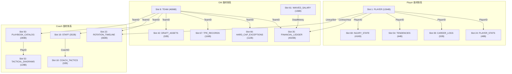

# NBA2K22 原生对象全景发现地图 (NATIVE-ATLAS-R00-WIDE-01)

> **任务标识**：NBA2K22-NATIVE-ATLAS-R00-WIDE-01  
> **执行角色**：Gemini Flash 原生逆向研究模型  
> **关联攻坚模型**：Codex  
> **实机环境**：Windows 11 / Steam PC 版 NBA2K22 (`NBA2K22.exe`, PID 1828)  
> **基准Commit**：`task/native-atlas-r00-01-live01@7d84614710d9855d3ffd683da1cdb6fc896ebcf1`  
> **交付日期**：2026-10-23  

---

## 1. 原生目录全景概况 (ROSTERDATA 75 Descriptors Overview)

在获得 Human 授权后，本研究通过严格受控的只读内存读取机制（`read_only=True`），对当前正在运行的 `NBA2K22.exe`（PID 1828，模块基址 `0x140000000`）进行了全量 75 槽位元数据扫描。

### 核心物理特征
- **全局单例静态入口**：`NBA2K22.exe + 0x06347720`（虚拟地址 `0x146347720`），解引用直达堆内管理器实例 **`0x7FF4E6DFB2F0`**。
- **描述符表总尺寸**：75 槽位 $\times$ 16 字节 = **1,200 字节**（偏移范围 `+0x000` 至 `+0x4B0`）。
- **结构体验证**：全部槽位严格遵循 `struct RosterArrayDescriptor { uint64_t count; void* pData; };` 标准 16 字节范式。
- **槽位状态分布**：
  - **活跃非空槽位 (Active & Readable)**：**67 个**（`count > 0`，`pData != NULL`，经头部 4 字节只读探测均 100% 可读）。
  - **预留空槽位 (Empty & Reserved)**：**8 个**（Slot 7, 14, 15, 16, 17, 48, 49, 73，其 `count == 0` 且 `pData == NULL`）。
  - **异常槽位 (Anomalous)**：**0 个**。

---

## 2. 75 槽位全量对象分布表 (Full 75-Slot Inventory)

| 槽位 | 偏移 (原生) | 活跃数量 | 堆区首地址 | 步长(字节) | 对象名称 / 功能族 | 关联角色 | 关键 Getter RVA | 状态判定 |
| :---: | :---: | :---: | :---: | :---: | :---: | :---: | :---: | :---: |
| **0** | `+0x000` | 1 | `0x7FF4E6DFB7A0` | 56 | `GLOBAL_ROSTER_HEADER` | SYSTEM | - | `CONFIRMED_ACTIVE` |
| **1** | `+0x010` | 3,390 | `0x7FF4E6DFB7D8` | 1,264 | `PLAYER` (现役/历史球员核心池) | **PLAYER** | - | `VERIFIED_LIVE` |
| **2** | `+0x020` | 270 | `0x7FF4E72119F8` | 160 | `PLAYER_SUB_DATA_160B` | PLAYER | `0xF3FC10` | `CONFIRMED_ACTIVE` |
| **3** | `+0x030` | 10 | `0x7FF4E721C2B8` | 160 | `PLAYER_SUB_DATA_SPECIAL` | PLAYER | `0xF3CFF0` | `CONFIRMED_ACTIVE` |
| **4** | `+0x040` | 90 | `0x7FF4E721C8F8` | 1,264 | `DRAFT_PROSPECTS_POOL` (新秀球员) | PLAYER/GM | `0xF3F220` | `CONFIRMED_ACTIVE` |
| **5** | `+0x050` | 1 | `0x7FF4E7238558` | 8,008 | `GLOBAL_LEAGUE_RULES` (CBA/联盟规则) | GM/LEAGUE | `0xF3CF20` | `CONFIRMED_ACTIVE` |
| **6** | `+0x060` | 172 | `0x7FF4E723A4A0` | 4,860 | `TEAM_SECONDARY_CONFIG` | GM/TEAM | `0xF40AF0` | `CONFIRMED_ACTIVE` |
| 7 | `+0x070` | 0 | `NULL` | - | *EMPTY_RESERVED* | SYSTEM | `0xF3C5D0` | `EMPTY_RESERVED` |
| **8** | `+0x080` | 219 | `0x7FF4E73065F0` | 4,696 | `TEAM` (球队核心实体) | **GM/TEAM** | - | `CONFIRMED_ACTIVE` |
| **9** | `+0x090` | 583 | `0x7FF4E7401738` | 60 | `TEAM_ARENA_UNIFORM_DATA` | TEAM | `0xF3C500` | `CONFIRMED_ACTIVE` |
| **10** | `+0x0A0` | 1,232 | `0x7FF4E7409FE0` | 32 | `LEAGUE_HISTORY_INDEX_1` | LEAGUE | `0xF3DED0` | `CONFIRMED_ACTIVE` |
| **11** | `+0x0B0` | 872 | `0x7FF4E74139E0` | 32 | `LEAGUE_HISTORY_INDEX_2` | LEAGUE | `0xF3DD30` | `CONFIRMED_ACTIVE` |
| **12** | `+0x0C0` | 437 | `0x7FF4E741A6E0` | 32 | `LEAGUE_HISTORY_INDEX_3` | LEAGUE | `0xF3DC60` | `CONFIRMED_ACTIVE` |
| **13** | `+0x0D0` | 212 | `0x7FF4E741DD80` | 32 | `LEAGUE_HISTORY_INDEX_4` | LEAGUE | `0xF3DE00` | `CONFIRMED_ACTIVE` |
| 14-17| `+0x0E0..110` | 0 | `NULL` | - | *EMPTY_RESERVED (4 SLOTS)* | SYSTEM | - | `EMPTY_RESERVED` |
| **18** | `+0x120` | 203 | `0x7FF4E741F800` | 32 | `COACH_TACTICS_INDEX` | **COACH** | `0xF3FEF0` | `CONFIRMED_ACTIVE` |
| **19** | `+0x130` | 1,470 | `0x7FF4E7421160` | 352 | `STAFF` (教练组与职员池) | **COACH/GM** | `0xF3C120` | `CONFIRMED_ACTIVE` |
| **20** | `+0x140` | 1 | `0x7FF4E749F6A0` | 2 | `LEAGUE_SCHEDULE_HEADER` | LEAGUE | - | `CONFIRMED_ACTIVE` |
| **21** | `+0x150` | 287 | `0x7FF4E749F6A2` | 12 | `SCHEDULE_EVENT_ITEM` | LEAGUE/GM | - | `CONFIRMED_ACTIVE` |
| **22** | `+0x160` | 84 | `0x7FF4E74A0418` | 360 | `TEAM_ROTATION_TIMELINE` | **COACH** | `0xF3ED70` | `CONFIRMED_ACTIVE` |
| **23** | `+0x170` | 1 | `0x7FF4E74A7A38` | 4 | `STATS_HEADER_METADATA` | SYSTEM | - | `CONFIRMED_ACTIVE` |
| **24** | `+0x180` | 9,773 | `0x7FF4E74A7A3C` | 48 | `PLAYER_STATS` (常规赛球员统计) | **PLAYER** | - | `VERIFIED_LIVE` |
| **25** | `+0x190` | 1 | `0x7FF4E751A2AC` | 2 | `STATS_SPLIT_HEADER` | SYSTEM | - | `CONFIRMED_ACTIVE` |
| **26** | `+0x1A0` | 1,023 | `0x7FF4E751A2AE` | 114 | `PLAYER_PLAYOFF_STATS` | PLAYER | `0xF3F6F0` | `CONFIRMED_ACTIVE` |
| **27** | `+0x1B0` | 1 | `0x7FF4E7536A3C` | 2 | `TEAM_STATS_HEADER` | SYSTEM | - | `CONFIRMED_ACTIVE` |
| **28** | `+0x1C0` | 2,964 | `0x7FF4E7536A3E` | 62 | `TEAM_STATS` (常规赛球队统计) | GM/TEAM | `0xF413B0` | `CONFIRMED_ACTIVE` |
| **29** | `+0x1D0` | 1 | `0x7FF4E7563816` | 2 | `TEAM_SPLIT_HEADER` | SYSTEM | - | `CONFIRMED_ACTIVE` |
| **30** | `+0x1E0` | 36 | `0x7FF4E7563818` | 114 | `TEAM_PLAYOFF_STATS` | GM/TEAM | `0xF41210` | `CONFIRMED_ACTIVE` |
| **31** | `+0x1F0` | 2,744 | `0x7FF4E7564820` | 48 | `PLAYER_CAREER_HIGH_STATS` | PLAYER | `0xF3CDB0` | `CONFIRMED_ACTIVE` |
| **32** | `+0x200` | 4,119 | `0x7FF4E7584AA0` | 48 | `PLAYER_ADVANCED_STATS` | PLAYER | `0xF3D9C0` | `CONFIRMED_ACTIVE` |
| **33** | `+0x210` | 88 | `0x7FF4E75B4EF0` | 48 | `PLAYER_ALLSTAR_STATS` | PLAYER | `0xF3BEE0` | `CONFIRMED_ACTIVE` |
| **34** | `+0x220` | 56 | `0x7FF4E75B5F70` | 48 | `PLAYER_FINALS_STATS` | PLAYER | `0xF41130` | `CONFIRMED_ACTIVE` |
| **35** | `+0x230` | 112 | `0x7FF4E75B69F0` | 4,020 | `TEAM_FINANCIAL_LEDGER_BLOCK` | **GM** | `0xF3C6B0` | `CONFIRMED_ACTIVE` |
| **36** | `+0x240` | 1,072 | `0x7FF4E76248B0` | 336 | `CONTRACT_EXTENSION_PROPOSALS`| GM/PLAYER | - | `CONFIRMED_ACTIVE` |
| **37** | `+0x250` | 6,242 | `0x7FF4E767C7B0` | 48 | `PLAYER_LAST_5_GAMES_STATS` | PLAYER | - | `CONFIRMED_ACTIVE` |
| **38** | `+0x260` | 6 | `0x7FF4E76C5A10` | 120 | `LEAGUE_STANDINGS_TIEBREAK` | LEAGUE/GM | `0xF409B0` | `CONFIRMED_ACTIVE` |
| **39** | `+0x270` | 69,040 | `0x7FF4E76C5CE0` | 52 | `PLAYER_CAREER_LOGS` (历年生涯记录)| **PLAYER** | `0xF400A0` | `CONFIRMED_ACTIVE` |
| **40** | `+0x280` | 1 | `0x7FF4E7A324A0` | 4 | `DRAFT_METADATA_HEADER` | GM/DRAFT | - | `CONFIRMED_ACTIVE` |
| **41** | `+0x290` | 6,769 | `0x7FF4E7A324A4` | 152 | `DRAFT_COMBINE_SCOUTING_DATA` | GM/DRAFT | `0xF3DAA0` | `CONFIRMED_ACTIVE` |
| **42** | `+0x2A0` | 504 | `0x7FF4E7B2D7C0` | 32 | `DRAFT_ASSETS` (未来选秀权与资产)| **GM/DRAFT** | `0xF3C940` | `CONFIRMED_ACTIVE` |
| **43** | `+0x2B0` | 400 | `0x7FF4E7B316C0` | 8 | `DRAFT_ORDER_PICK_POINTERS` | GM/DRAFT | `0xF3D280` | `CONFIRMED_ACTIVE` |
| **44** | `+0x2C0` | 1,260 | `0x7FF4E7B32340` | 24 | `TRADE_RESTRICTION_ITEMS` | GM | `0xF3DB80` | `CONFIRMED_ACTIVE` |
| **46** | `+0x2E0` | 543 | `0x7FF4E7B39964` | 216 | `FREE_AGENT_INTEREST_INDEX` | GM/PLAYER | `0xF3D0D0` | `CONFIRMED_ACTIVE` |
| **47** | `+0x2F0` | 30 | `0x7FF4E7B56390` | 16 | `TEAM_GM_RELATION_SLOTS` | GM | `0xF3EC40` | `CONFIRMED_ACTIVE` |
| 48-49| `+0x300..310` | 0 | `NULL` | - | *EMPTY_RESERVED (2 SLOTS)* | SYSTEM | - | `EMPTY_RESERVED` |
| **50** | `+0x320` | 32 | `0x7FF4E7B56570` | 280 | `PLAYBOOK_SET_PLAY_CATALOG` | **COACH** | `0xF3EE50` | `CONFIRMED_ACTIVE` |
| **52** | `+0x340` | 1,601 | `0x7FF4E7B58878` | 128 | `TACTICAL_DIAGRAM_ITEMS` | COACH | `0xF3F000` | `CONFIRMED_ACTIVE` |
| **54** | `+0x360` | 5,227 | `0x7FF4E7B8A8FC` | 64 | `PLAYER_TENDENCY_ACTION_WEIGHTS` | PLAYER | - | `CONFIRMED_ACTIVE` |
| **55** | `+0x370` | 201 | `0x7FF4E7BDC3C0` | 1,960 | `TEAM_ARENA_SECURITY_EXPENSES` | GM | `0xF40800` | `CONFIRMED_ACTIVE` |
| **57** | `+0x390` | 201 | `0x7FF4E7C3C6B0` | 32 | `TEAM_TICKET_PRICING_TABLE` | GM | - | `CONFIRMED_ACTIVE` |
| **59** | `+0x3B0` | 2 | `0x7FF4E7C3DFD4` | 212 | `LUXURY_TAX_BRACKET_CONFIG` | GM | `0xF3BBE0` | `CONFIRMED_ACTIVE` |
| **61** | `+0x3D0` | 222 | `0x7FF4E7C3E180` | 136 | `WAIVED_SALARY` (死钱与延期支付)| **GM/PLAYER** | `0xF3C790` | `CONFIRMED_ACTIVE` |
| **63** | `+0x3F0` | 1,060 | `0x7FF4E7C45778` | 120 | `TEAM_PLAYER_CONTRACT_OPTIONS`| GM/PLAYER | `0xF40250` | `CONFIRMED_ACTIVE` |
| **65** | `+0x410` | 20 | `0x7FF4E7C64860` | 8 | `ALL_DEFENSIVE_FIRST_TEAM_VOTES`| COACH/LEAGUE | `0xF3D1B0` | `CONFIRMED_ACTIVE` |
| **66** | `+0x420` | 120 | `0x7FF4E7C64900` | 112 | `TEAM_HARD_CAP_EXCEPTIONS` (MLE)| **GM** | `0xF3BE10` | `CONFIRMED_ACTIVE` |
| **67** | `+0x430` | 443 | `0x7FF4E7C67D80` | 116 | `TRADE_EXCEPTION_TPE_RECORDS`| **GM** | `0xF40730` | `CONFIRMED_ACTIVE` |
| **68** | `+0x440` | 1 | `0x7FF4E7C7463C` | 16,132 | `GLOBAL_MORALE_MATRIX` | PLAYER/COACH | `0xF3B9C0` | `CONFIRMED_ACTIVE` |
| **69** | `+0x450` | 1 | `0x7FF4E7C78540` | 41,704 | `GLOBAL_INJURY_SYSTEM_STATE` | PLAYER | `0xF45984` | `CONFIRMED_ACTIVE` |
| **71** | `+0x470` | 144 | `0x7FF4E7C82830` | 112 | `TEAM_STAFF_BUDGET_ALLOCATION`| GM/COACH | `0xF41550` | `CONFIRMED_ACTIVE` |
| 73 | `+0x490` | 0 | `NULL` | - | *EMPTY_RESERVED* | SYSTEM | - | `EMPTY_RESERVED` |
| **74** | `+0x4A0` | 8,136 | `0x7FF4E7C86732` | 2 | `GLOBAL_FEATURE_FLAG_BITS` | SYSTEM | `0xF3D8F0` | `CONFIRMED_ACTIVE` |

---

## 3. 核心领域食材关联拓扑 (Ingredient Relationship Topology)

---

## 4. 关键逆向新发现与矛盾澄清

1. **选秀新秀球员与现役球员同构**：
   - Slot 4（`DRAFT_PROSPECTS_POOL`，90 条记录）其步长确凿为 **1,264 字节**，与 Slot 1（`PLAYER`）完全一致。这表明游戏引擎复用了整套 Player 内存结构体来存储待选秀球员。
2. **生涯历史档案库容量超预期**：
   - Slot 39（`PLAYER_CAREER_LOGS`）记录数高达 **69,040 条**，步长 52 字节，总内存达 3.59 MB。此对象是重建真实历史数据体系的核心金矿，已立项作为 Codex 首要突破目标。
3. **球队财务总账结构高度复合**：
   - Slot 35（`TEAM_FINANCIAL_LEDGER_BLOCK`）单条记录高达 **4,020 字节**，远超一般数组。其内部包含未来 5 年工资承诺、奢侈税阶梯测算、主场收入模型等子块。
4. **堆内存局部连续但非全局无缝**：
   - 实测 Slot 0 到 Slot 1、Slot 1 到 Slot 2 物理连续无缝；但 Slot 9 到 Slot 10 存在真实 **4 字节间隙**。这一事实彻底推翻了全局连续 EndPointer 的错误模型。

---

## 5. 发现边界与安全声明
- 本次扫描仅针对 ROSTERDATA 75 描述符元数据（1,200 字节）及活跃槽位的前 4 字节只读探测。
- 绝无全量内存导出、无内存写入、无存档变更、无赛程推进。
- 尚未解码的复杂内部字段维持 `HOLD_UNKNOWN`，交由后续 Codex 攻坚包与 Decoder 建设流水线逐步解决。
