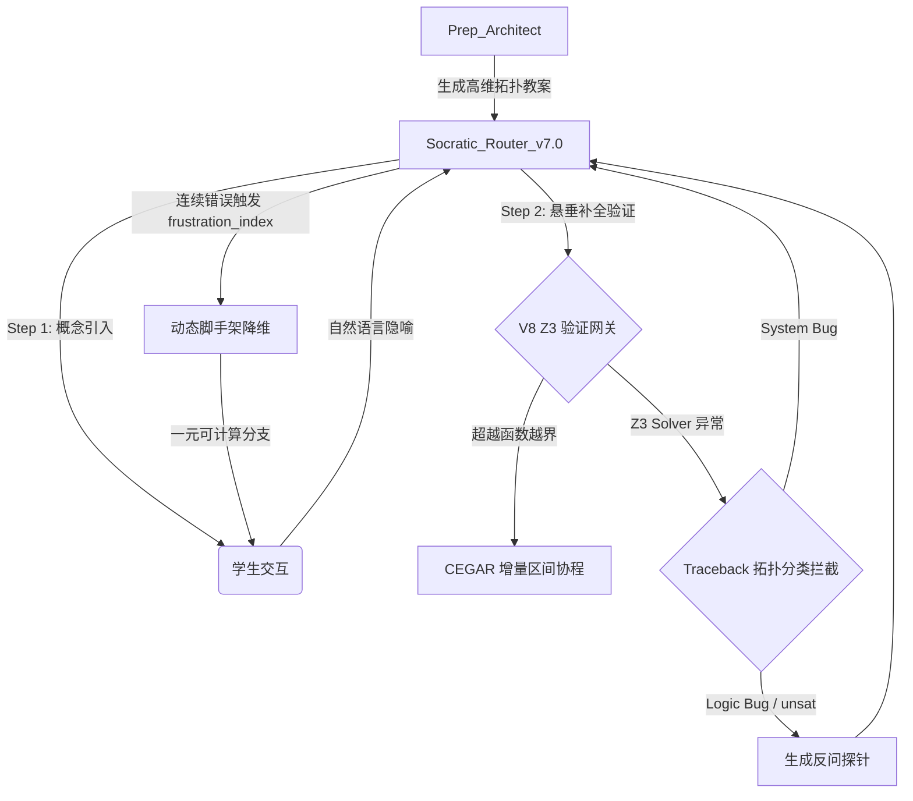

# 🚀 V8 神经符号引擎：底层实装蓝图 (The Neuro-Symbolic Blueprint)

> **【城邦架构核心机密】**
> 本蓝图由赛博城邦最高议长与外部高阶专家模型联合裁定，并在 V7.0“备课/教学分离”架构之上演进。本蓝图彻底解决了大模型（LLM）与形式化验证器（SMT）在工程缝合时遭遇的物理级死锁，标志着 V8 引擎正式具备了落地条件。

## 🗺️ 神经符号引擎集成架构图 (Integration Architecture)

V8 引擎的核心组件将精确挂载至当前 V7.0 `学习期prompt` 目录下的各个核心微服务节点中：

- **Traceback 拓扑分类**：挂载至 `Socratic_Router_v7.0` 后台的验证回调处理层。
- **动态脚手架 (Scaffolding)**：挂载至 `Socratic_Router_v7.0` 的状态记忆层（追踪错误计数）。
- **Z3 + CEGAR 协程**：挂载在后台物理沙盒层，作为对 `Prep_Architect` 核心设计的前置/后置验证。

---

## 🛠️ 核心工程落地路线图 (Phased Implementation Roadmap)

基于系统稳健性与工作量评估，按以下优先级推进 V8 引擎实装：

### [P0] 隔离“泄漏态 Traceback” 
**预估工作量：半天**
- **挂载点**：`Socratic_Router_v7.0` 验证回调处的 `try-except` 分支。
- **机制**：
  - **系统级崩溃 (`TypeError`, `AttributeError`)**：判定为底层断层，静默重试或回退至 L0 概率模式。**绝对禁止将其作为数学错误归咎于学生**，实施最优先的物理保护。
  - **逻辑级塌陷 (`kd.kernel.LemmaError` / `unsat`)**：代表数学逻辑悖论，允许转化为苏格拉底诘问。

### [P1] 动态脚手架与早期停止降维
**预估工作量：半天**
- **挂载点**：`Socratic_Router_v7.0` 的会话状态追踪。
- **机制**：引入 `frustration_index` 计数器。
  - **1-2 轮拦截**：维持纯粹的苏格拉底压迫。
  - **第 3 轮越界（Scaffolding Breakout）**：强制大模型停止高维隐喻，直接降维至一元可计算分支（如：“我们先令 x=0，你能算出这个值吗？”），切断无限诘问死循环。

### [P2] 跨越超越函数死锁：Z3 + CEGAR 协程
**预估工作量：1-2 天**
- **挂载点**：底层验证引擎 `sym2z` 桥接模块。
- **机制**：利用 Python 生成器与区间算术库（如 `mpmath`，已安装）。当 Z3 陷入超越函数（$\sin(x), e^x$）时，利用惰性评估将泰勒展开的不等式逐步注入求解器。

### [DEFERRED] 延期项
- **dReal 旁路路由**：原生支持 $\delta$-完备决策的 SMT 引擎。由于目前缺乏 Windows 原生支持（需 WSL2/Docker 环境搭建），故标记为 `[DEFERRED]`，首期仅实装 Z3。
- **EAGLE 投机解码与前端可视化**：由于涉及 vLLM、GPU 集群以及全新的前端 UI，已从 V8 教学引擎核心中剥离，建立独立 Issue 跟进。
