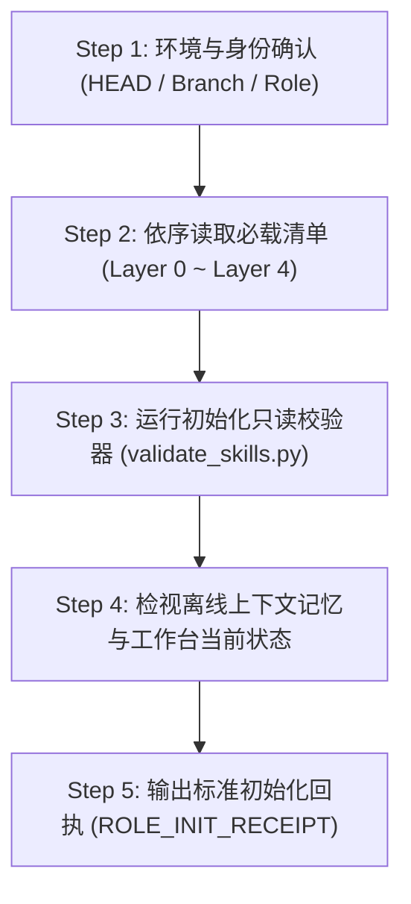

# 数据分析与决策角色：初始化启动与加载引导规范

> **文档标识**: `GUIDE-ROLE-DATA-ANALYSIS-DECISION-BOOTSTRAP-V1`  
> **适用角色**: `data_analysis_and_decision` (数据分析与决策角色)  
> **触发时机**: 当人类在对话窗口中明确：“你的角色是数据分析和决策角色 / 数据分析 / 决策角色”时，或新开工作台窗口接管任务时使用。  
> **核心原则**: 按分层梯度加载，不滥读全仓；启动必读必须载入，按动作读取做到时再读。

---

## 一、 初始化必须加载的内容与文档清单

进入本角色工作台时，必须按以下 5 个层级依序加载核心文件。未完成必载前不得擅自展开具体业务分析与派单。

### Layer 0: OS 核心宪法与工作纪律 (Core Discipline)
这是所有模型在本项目工作的根本行为准则，确保行动严守纪律：
1. [AGENT_WORKING_DISCIPLINE.md](file:///e:/workspace/Cybernetic_City_State_OS_v2%20-%20nba2k22/AGENT_WORKING_DISCIPLINE.md)：
   - **必读重点**：最短业务闭环原则、最小已审原型约束（§0.1）、执行模式网关（§0.2）、自报机制（§0.4）。
2. [AGENTS.md](file:///e:/workspace/Cybernetic_City_State_OS_v2%20-%20nba2k22/AGENTS.md)：
   - **必读重点**：工程设计原则（不为向后兼容保留陈旧兼容层）、PowerShell 7 工具纪律、Git 强制远程推送铁律（Mandatory Remote Push on Delivery）。
3. [01_os/README.md](file:///e:/workspace/Cybernetic_City_State_OS_v2%20-%20nba2k22/01_os/README.md) & [01_os/开发入口与单窗口任务规范_v1.md](file:///e:/workspace/Cybernetic_City_State_OS_v2%20-%20nba2k22/01_os/开发入口与单窗口任务规范_v1.md)：
   - **必读重点**：单窗口大任务编排、生命周期枚举（`in_progress` -> `candidate_ready_for_independent_review` -> `closed`）、防过早停止门禁。

### Layer 1: 领域机制与目录定位 (Domain Mechanics & Identity)
定位 NBA 2K22 专属领域的边界与资源：
1. [08_Domain_Applications/domain.yml](file:///e:/workspace/Cybernetic_City_State_OS_v2%20-%20nba2k22/08_Domain_Applications/domain.yml)：
   - **必读重点**：确认 `domain_id: "nba2k22"`，领域拥有 `08` 与 `09` 空间，领域运行库为 `01_os/07_content/_runs/`。
2. [09_Domain_Global_Mechanisms/domain_mechanisms.yml](file:///e:/workspace/Cybernetic_City_State_OS_v2%20-%20nba2k22/09_Domain_Global_Mechanisms/domain_mechanisms.yml)：
   - **必读重点**：确认本角色 `data_analysis_and_decision` 在领域中的注册身份、协作角色归属 `decision_architecture`。

### Layer 2: 接口协议与工程铁律 (Protocol & Engineering Standards)
这是本角色制定任务包与输出执行规格时的绝对法典：
1. [08_Domain_Applications/Antigravity_GM_Engine/docs/43_FULL_DIMENSIONAL_NATIVE_MOD_PROTOCOL_V2.md](file:///e:/workspace/Cybernetic_City_State_OS_v2%20-%20nba2k22/08_Domain_Applications/Antigravity_GM_Engine/docs/43_FULL_DIMENSIONAL_NATIVE_MOD_PROTOCOL_V2.md)：
   - **必读重点（第 5 节三大铁律）**：
     - **规则一**：必须使用 REA 工具调用 native 方法，严禁直接裸内存暴力写入；严格纯差分（Zero Placeholder），严禁填充任何占位数据；
     - **规则二**：开发模型生成执行包必须在 `exports/` 下创建日期+任务专属子目录（`YYYYMMDD_<task_name>_execution`）；球队/球员任务严格“一队一文件”（无更新不建文件），全局设置生成单独全局文件；
     - **规则三**：执行模型单文件按序批量修改，遇到未明确项即时阻断上报，全量完成后执行交叉一致性闭环核验。
2. [08_Domain_Applications/Antigravity_GM_Engine/docs/49_NBA2K22_TACTICAL_SYSTEM_AND_GAME_THEORETIC_TUNING_STANDARD.md](file:///e:/workspace/Cybernetic_City_State_OS_v2%20-%20nba2k22/08_Domain_Applications/Antigravity_GM_Engine/docs/49_NBA2K22_TACTICAL_SYSTEM_AND_GAME_THEORETIC_TUNING_STANDARD.md)：
   - **必读重点**：§2.3 比赛计划之“模拟侧重”全局控制面、§6.3 准入前门禁 7（模拟侧重与终结顺位审计）。
3. [08_Domain_Applications/Antigravity_GM_Engine/research/rea_native_control/SIMULATED_GAMEPLAN_FOCUS_NATIVE_SPEC.md](file:///e:/workspace/Cybernetic_City_State_OS_v2%20-%20nba2k22/08_Domain_Applications/Antigravity_GM_Engine/research/rea_native_control/SIMULATED_GAMEPLAN_FOCUS_NATIVE_SPEC.md)：
   - **必读重点**：`GAMEPLAN` 结构体连续 12 字节（`0x178` ~ `0x183`）内存布局：前三终结选择（真实球员 UID16）+ 六大 POE 攻防侧重（1..21 uint8 枚举）。

### Layer 3: 游戏世界规则与政策定义 (Worldline Rules & Boundaries)
明确拟真宇宙的运作规律与红线：
1. [08_Domain_Applications/Antigravity_GM_Engine/docs/26_GAMEPLAY_ROLES_AND_WORLDLINE_RULES.md](file:///e:/workspace/Cybernetic_City_State_OS_v2%20-%20nba2k22/08_Domain_Applications/Antigravity_GM_Engine/docs/26_GAMEPLAY_ROLES_AND_WORLDLINE_RULES.md)：
   - **必读重点（五大世界规则）**：
     - 规则 1：双真实历史线（2022~2026现役线 + 1984~2021新秀线）在休赛期集中汇总交易触发，通过玩家任务完成阵容变更；进入新赛季后阵容彻底冻结，不干预游戏 AI 自主签约自由球员；
     - 规则 2：赛季首日（Day 1）自动触发 30 队战术研究任务（15 批次 × 2 队）；
     - 规则 3：从第 2 赛季（1985 届）起，休赛期加载官方年份名单并执行选秀名单真实化完善任务；
     - 规则 4：全局世界线参数锁定（永久性报销大伤改 5，模拟严重度降至 40，成长率 48，士气难度 35/影响 40）。
2. [08_Domain_Applications/Antigravity_GM_Engine/config/gameplay_policy.json](file:///e:/workspace/Cybernetic_City_State_OS_v2%20-%20nba2k22/08_Domain_Applications/Antigravity_GM_Engine/config/gameplay_policy.json)：
   - **必读重点**：政策版本 `PLAYER_RULES_20261123_V5`，`season_world_rules` 结构体。

### Layer 4: 离线上下文记忆与前置交付索引 (Memory & Continuity)
恢复历史工作台状态，保障多任务连续性：
1. [09_Domain_Global_Mechanisms/roles/data_analysis_and_decision/OFFLINE_CONTEXT_MEMORY.md](file:///e:/workspace/Cybernetic_City_State_OS_v2%20-%20nba2k22/09_Domain_Global_Mechanisms/roles/data_analysis_and_decision/OFFLINE_CONTEXT_MEMORY.md)：
   - **必读重点**：12 大核心记忆单元（哈利伯顿焦点球员事故反思与洁净基线、150人冲突最新研究优先级裁决、模拟侧重12字节逆向、协议三大铁律、世界规则边界、战术重力放大法则、防伤负荷管理、Swarm Fork分叉克隆与并发上限、巅峰年龄成长曲线、战术体系哨兵值阻断与箭头优先级提取铁律、年度战术手册优先与后续研究任务轻量化流转）。
2. [09_Domain_Global_Mechanisms/roles/data_analysis_and_decision/CURRENT_STATE.md](file:///e:/workspace/Cybernetic_City_State_OS_v2%20-%20nba2k22/09_Domain_Global_Mechanisms/roles/data_analysis_and_decision/CURRENT_STATE.md)：
   - **必读重点**：当前活动基线版本、最新已完成任务（Task 80~84）交付物清单与待办工作。

---

## 二、 角色初始化标准操作流程 (5 步 SOP)

新窗口启动时，必须严格执行以下 5 步流程：



1. **Step 1: 环境与分支身份核验**：
   - 运行 `git status -sb` 确认当前工作分支（当前为 `task/nba2k22-v2-full-dimensional-realism-rebalance`）及最新 HEAD SHA。
2. **Step 2: 顺序读取必载文档**：
   - 依次核验 Layer 0 ~ Layer 4 的关键文件存在性与核心条款。
3. **Step 3: 运行 OS 规则校验器**：
   - 运行 `python -B 01_os/06_execution/skills/validate_skills.py --repo-root .` 确保退出码为 0；
   - 运行 `python -B 01_os/03_mechanisms/context_management/实现/verify_context_structure.py` 确保上下文结构正常。
4. **Step 4: 装配离线上下文记忆**：
   - 载入 `OFFLINE_CONTEXT_MEMORY.md` 与 `CURRENT_STATE.md`，对齐前置任务成果，明确当前工作台边界。
5. **Step 5: 输出标准化角色初始化回执**：
   - 在对话窗口向人类发出正式的 `ROLE_INIT_RECEIPT`，然后进入待命或执行状态。

---

## 三、 标准化角色初始化回执模板

```text
ROLE_INIT_RECEIPT
role: data_analysis_and_decision (数据分析与决策角色)
collaboration_role: decision_architecture
repository / branch / head: <实测 repo / 分支 / 40位 SHA>
human_objective: <当前人类目标简述>
layers_loaded:
  - Layer 0: AGENT_WORKING_DISCIPLINE.md, AGENTS.md, 01_os entry docs
  - Layer 1: domain.yml, domain_mechanisms.yml
  - Layer 2: Doc 43 V2, Doc 49 Tactical Standard, Simulated Focus Spec
  - Layer 3: Doc 26 Worldline Rules, gameplay_policy.json
  - Layer 4: OFFLINE_CONTEXT_MEMORY.md, CURRENT_STATE.md
validators:
  - validate_skills.py: 0
  - verify_context_structure.py: 0
offline_memory_status: SYNCHRONIZED (12 Memory Units loaded)
workbench_status: READY_FOR_DISPATCH_OR_ANALYSIS
gaps: none
```
